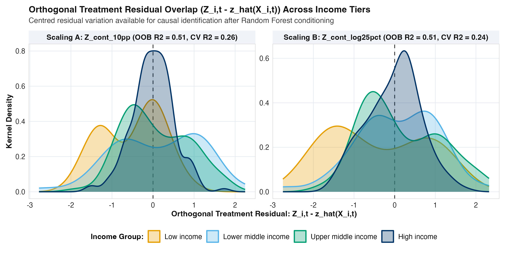
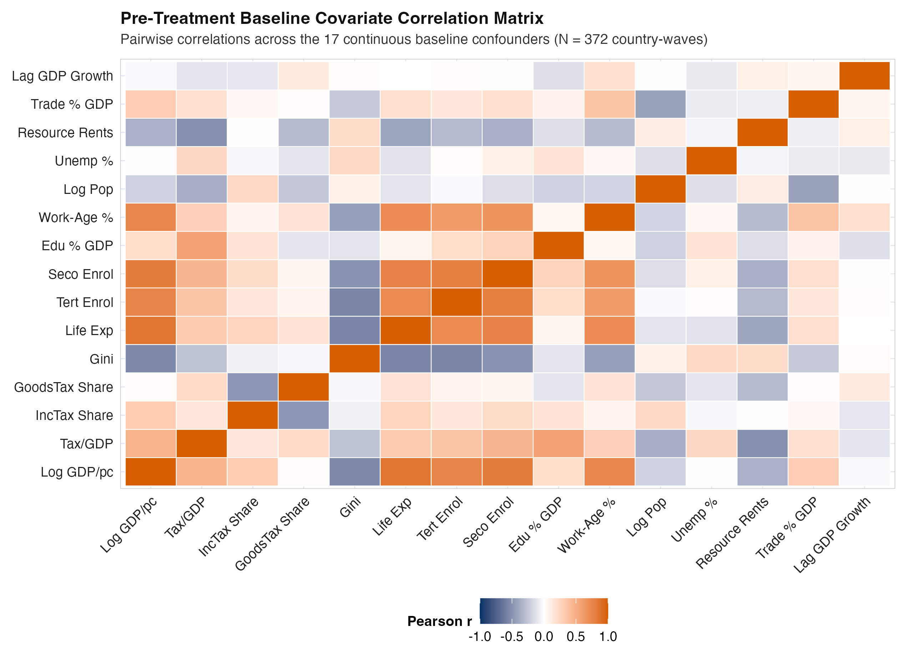

## Overview, Continuous Treatment Design, and Holdout Protocol

This exploratory data analysis (EDA) audits the global fiscal and tertiary education panel (`data/processed/clean_tax_panel.csv`, spanning 1,736 country-waves across 217 sovereign countries from `1985-1989` to `2020-2024`) prior to estimating our continuous-treatment Multivariate Bayesian Causal Forest (`MV-BCF`) models. Our primary hypothesis is that higher national government expenditure on tertiary (university) education increases a country's future tax take at the $+5$-year and $+10$-year horizons, and that this fiscal return operates specifically through direct income, profit, and capital gains taxation rather than indirect consumption taxes.

To ensure leakage-free causal and out-of-sample evaluation, our Phase 2 and Phase 3 workflow enforces four design safeguards:

1. **Country-Blocked Holdout Split Locked Prior to EDA:**
   All 217 sovereign countries are partitioned via an income-group stratified 5-fold country-blocked split (`data/processed/splits/country_folds.csv`, `set.seed(20261103)`). Folds 1 to 4 form the **80% Training Set** (`98` countries / `301` country-waves at $+5$ years; `90` countries / `229` country-waves at $+10$ years), while Fold 5 forms the **20% Locked Holdout Test Set** (`23` unseen countries / `70` country-waves at $+5$ years; `22` unseen countries / `54` country-waves at $+10$ years). All income-group centring medians and all Phase 3 EDA diagnostics in Sections 3 to 7 of this report are computed strictly on the 80% Training Set.
2. **Dual Continuous University Funding Scalings ($Z_{i,t} \in \mathbb{R}$):**
   Rather than dichotomising university funding at an arbitrary median boundary, we retain the full continuous dose of public tertiary investment and evaluate two complementary scalings side by side:
   - **Scaling A (`Z_cont_10pp`, Additive Per-Student Intensity):** Winsorised public expenditure per tertiary student (`[1, 150]` % of GDP per person), centred on each World Bank income group's training-set median and divided by $10.0$, so that $+1$ unit represents a **$+10$ percentage point increase in per-student funding (% of GDP per person)**.
   - **Scaling B (`Z_cont_log25pct`, Multiplicative Log-Relative Intensity):** Natural log of public expenditure per tertiary student, centred on each World Bank income group's training-set log median and divided by $\log(1.25) \approx 0.2231$, so that $+1$ unit represents a **$+25\%$ relative increase in per-student funding**.
   - **Unbundled Continuous Denominators:** We also construct continuous real 2021 PPP dollars per student (`Z_cont_real_ppp_log25pct`, removing GDP per person from the denominator), continuous public tertiary budget share of GDP (`Z_cont_budget_gdp_025pp`, removing student headcount from the denominator), and within-country 5-year per-student funding changes (`Z_cont_delta_10pp`).
3. **Random Forest Expected-Treatment Conditioning $\hat{z}(X_{i,t}) = \mathbb{E}[Z_{i,t} \mid X_{i,t}]$:**
   For continuous treatments, the binary propensity score $P(Z=1 \mid X)$ is replaced by the pre-treatment expected-treatment score $\hat{z}(X_{i,t}) = \mathbb{E}[Z_{i,t} \mid X_{i,t}]$ estimated via a 500-tree Random Forest (`ranger`) across all 19 pre-treatment baseline covariates. Including $\hat{z}(X_{i,t})$ inside the prognostic forest $\mu(X_{i,t}, \hat{z}_{i,t})$ prevents regularisation-induced confounding by allowing the prognostic trees to partial out expected policy intensity before estimating the heterogeneous causal slope $\tau(X_{i,t}) \cdot Z_{i,t}$.
4. **Four Pure Disaggregated Tax Outcomes (Zero GDP Product Identities):**
   - $Y_1$: **Domestic Non-Resource Tax-to-GDP Change ($\Delta \text{Tax/GDP}$, percentage points of GDP)**, paired with unadjusted World Bank WDI $\Delta \text{Tax/GDP}$ as a sensitivity check.
   - $Y_2$: **Direct Income, Profit, and Capital Gains Tax-to-GDP Change ($\Delta \text{IncomeTax/GDP}$, percentage points of GDP)**.
   - $Y_3$: **Direct Income and Profit Share of Revenue Change ($\Delta \text{IncomeTax/Rev}$, percentage points of revenue)**.
   - $Y_4$: **Indirect Goods and Services (Consumption / VAT) Share of Revenue Change ($\Delta \text{GoodsTax/Rev}$, percentage points of revenue)**, which serves as a built-in specificity (negative-control) channel.

---

## Sample Coverage, Quality Screening, and Train/Holdout Split

Before constructing the estimation samples, our hygiene audit in `src/r/02_build_clean_tax_panel.R` verifies zero duplicate `(iso3, wave_index)` keys and screens out four physically impossible World Bank WDI tax-to-GDP entries (`<0.5%` or `>60.0%` of GDP: Sudan in `1995-1999` at `629.19%`, Timor-Leste in `2010-2014` at `109.99%`, and the United Arab Emirates in `2010-2014` at `0.34%` and `2015-2019` at `0.23%`) plus one UNESCO tertiary per-student unit-scale error (`<1.0%` of GDP per person: Madagascar in `2015-2019` at `0.0359%`, where a $10^{-3}$ decimal shift occurred relative to its adjacent `99.1%` and `151.4%` waves). @tbl-attrition documents sample coverage, attrition, and the 80% / 20% country-blocked split.

| Stage | Sample Definition | Country-Waves | Countries | Share (%) |
| :--- | :--- | :---: | :---: | :---: |
| **1. Full Global Panel** | 217 sovereign countries $\times$ 8 waves (`1985-2024`) | 1,736 | 217 | 100.0% |
| **2. Valid Tax / GDP** | Observed non-resource tax-to-GDP after anomaly screen | 914 | 159 | 52.6% |
| **3. 4-Channel Tax Vector** | All 4 disaggregated tax outcomes observed at wave $t$ | 883 | 157 | 50.9% |
| **4. Observed Continuous $Z$** | Valid UNESCO per-student tertiary spend ($\ge 1\%$ GDP/pc) | 511 | 166 | 29.4% |
| **5. Full $+5\text{y}$ Sample** | Complete 4-channel changes over $[t, t+1]$ + continuous $Z$ | **371** | **121** | **21.4%** |
| **6. $+5\text{y}$ Training (80%)** | **Training countries (Folds 1 to 4) for EDA & fitting** | **301** | **98** | **81.1%** |
| **7. $+5\text{y}$ Holdout (20%)** | **Locked holdout test countries (Fold 5) for validation** | **70** | **23** | **18.9%** |
| **8. Full $+10\text{y}$ Sample** | Complete 4-channel changes over $[t, t+2]$ + continuous $Z$ | **283** | **112** | **16.3%** |
| **9. $+10\text{y}$ Training (80%)** | **Training countries (Folds 1 to 4) for EDA & fitting** | **229** | **90** | **80.9%** |
| **10. $+10\text{y}$ Holdout (20%)** | **Locked holdout test countries (Fold 5) for validation** | **54** | **22** | **19.1%** |

: Sample coverage, quality screening, and stratified country-blocked train/holdout split (`1985-1989` to `2020-2024`). Shares in rows 6-7 and 9-10 denote percentages of the complete $+5\text{y}$ and $+10\text{y}$ panels. {#tbl-attrition tbl-colwidths="[26, 38, 13, 11, 12]"}

---

## Unbundling the UNESCO Denominator Trap and Comparing Scalings A & B

Why is unbundling the tertiary spending denominator and comparing linear (`Z_cont_10pp`) versus log-relative (`Z_cont_log25pct`) scalings essential in cross-national work? @tbl-eda1 compares the continuous tertiary spending indicators and baseline fiscal structure across the four World Bank income groups within the 80% Training Set.

| Income Group (Train Countries, Waves) | Median UNESCO Ratio (IQR) | $\text{SD}(Z_{\text{10pp}})$ (Scaling A) | $\text{SD}(Z_{\text{log25\%}})$ (Scaling B) | **Real PPP \$ / Student** | **Tertiary Budget (% GDP)** | Direct Income Tax Share (%) |
| :--- | :---: | :---: | :---: | :---: | :---: | :---: |
| **Low income** (17, 67) | **183.8%** (203.4%) | 3.17 | 3.39 | \$3,953 | 0.47% | 27.5% |
| **Lower middle** (33, 139) | 68.9% (107.5%) | 5.23 | 5.33 | \$3,162 | 0.65% | 30.9% |
| **Upper middle** (44, 176) | 27.6% (21.2%) | 3.01 | 3.22 | \$3,631 | 0.66% | 34.7% |
| **High income** (58, 278) | 26.4% (13.4%) | **1.47** | **1.86** | **\$10,906** | **0.94%** | **38.3%** |

: Training-set tertiary spending distributions, continuous treatment standard deviations for Scaling A (`Z_cont_10pp`) and Scaling B (`Z_cont_log25pct`), and baseline fiscal structure by World Bank income group. {#tbl-eda1 tbl-colwidths="[24, 16, 12, 12, 13, 11, 12]"}

Three structural insights emerge from @tbl-eda1:

1. **The Cross-Income-Group Denominator Paradox:** In **Low income** training countries, median gross university enrolment is only `2.8%`, so dividing a modest public university budget (`0.47%` of GDP) by a small elite student cohort and a low GDP per person yields an un-winsorised median UNESCO ratio of **`183.8%`** (`IQR = 203.4%`). Conversely, in **High income** training countries where `59.9%` of the cohort attends university, the median UNESCO ratio is **`26.4%`** (`IQR = 13.4%`), even though high-income states spend nearly three times as much per student in real purchasing power (**\$10,906** vs **\$3,953**) and twice as much of their GDP on public universities (**0.94%** vs **0.47%**). Centring both `Z_cont_10pp` and `Z_cont_log25pct` on each country's own training-set World Bank income-group median removes this cross-tier baseline inversion while preserving full continuous within-tier variation.
2. **Scale Heteroscedasticity in Scaling A vs Scaling B:** Under the additive linear scaling (`Z_cont_10pp`), a $+1$ unit change ($+10$ percentage points of GDP per person) represents a `38%` relative funding expansion in a typical High income country (median `26.4%`), but only a `5.4%` relative expansion in a typical Low income country (median `183.8%`). Furthermore, because over half of Low income observations exceed `150%`, winsorising linear `Z_cont_10pp` at `[1, 150]` clamps the upper half of Low income country-waves at the ceiling.
3. **Why Scaling B (`Z_cont_log25pct`) Stabilises Cross-Tier Leverage:** Defining `Z_cont_log25pct` on the natural log scale ($\log(\text{Spend}) - \text{ Median}_{\text{inc}}(\log(\text{Spend}))$ divided by $\log(1.25)$) naturally compresses extreme right-tail ratios without artificial ceiling clamping and ensures that $+1$ unit corresponds to the same **$+25\%$ proportional funding expansion** at every stage of economic development. We therefore fit and audit our Multivariate BCF models under both Scaling A and Scaling B in Phase 4 to test whether linear or proportional dose-response fits the data better.

---

## Training-Set Raw Continuous Slopes and Bivariate Dose-Response

@tbl-eda2 and @fig-eda1 present the raw, unadjusted continuous OLS slopes (per $+1$ unit of $Z$) and treatment-tertile means across all four fiscal outcomes in the 80% Training Set before any covariate or causal forest adjustment.

| Scaling & Horizon | Summary Group | Waves ($N$) | Countries | $\Delta$ Non-Res Tax/GDP | $\Delta$ Income Tax/GDP | **$\Delta$ Income Tax Share** | $\Delta$ Goods Tax Share |
| :--- | :--- | :---: | :---: | :---: | :---: | :---: | :---: |
| **Scaling A ($+5\text{y}$)** | Linear OLS Slope | 301 | 98 | -0.044 | +0.007 | +0.023 | +0.039 |
| **Scaling A ($+5\text{y}$)** | Tertile 1 (Lowest $Z$) | 101 | 48 | +0.43 | +0.32 | +1.34 | +0.68 |
| **Scaling A ($+5\text{y}$)** | Tertile 3 (Highest $Z$) | 100 | 46 | +0.23 | **+0.40** | **+1.77** | +0.49 |
| **Scaling A ($+10\text{y}$)** | Linear OLS Slope | 229 | 90 | +0.022 | +0.030 | -0.063 | +0.153 |
| **Scaling A ($+10\text{y}$)** | Tertile 1 (Lowest $Z$) | 77 | 45 | +0.52 | +0.59 | +3.00 | +0.76 |
| **Scaling A ($+10\text{y}$)** | Tertile 3 (Highest $Z$) | 76 | 39 | **+0.87** | **+0.85** | **+3.20** | +0.77 |
| **Scaling B ($+5\text{y}$)** | Linear OLS Slope | 301 | 98 | -0.058 | -0.004 | +0.012 | -0.068 |
| **Scaling B ($+5\text{y}$)** | Tertile 1 (Lowest $Z$) | 101 | 48 | +0.42 | +0.31 | +1.38 | +0.52 |
| **Scaling B ($+5\text{y}$)** | Tertile 3 (Highest $Z$) | 100 | 42 | +0.16 | **+0.36** | **+1.73** | +0.35 |
| **Scaling B ($+10\text{y}$)** | Linear OLS Slope | 229 | 90 | -0.010 | -0.012 | -0.185 | -0.037 |
| **Scaling B ($+10\text{y}$)** | Tertile 1 (Lowest $Z$) | 77 | 45 | +0.54 | +0.54 | +2.62 | +0.82 |
| **Scaling B ($+10\text{y}$)** | Tertile 3 (Highest $Z$) | 76 | 40 | **+0.79** | **+0.81** | **+3.20** | +0.64 |

: Unadjusted training-set continuous linear slopes (percentage points per $+1$ unit of $Z$) and lowest vs highest treatment-tertile means across the four fiscal outcomes. {#tbl-eda2 tbl-colwidths="[20, 22, 9, 9, 10, 10, 10, 10]"}

{#fig-eda1 width=100%}

Comparing the tertile means against the raw linear OLS slopes in @tbl-eda2 and @fig-eda1 reveals a critical lesson:

* **Why Unadjusted Linear Slopes Are Attenuated by Tail Outliers and Confounding:** Across the middle and upper tertiles of university funding, countries in the top tertile (`Tertile 3`) achieve consistently larger $+10$-year gains in total non-resource tax-to-GDP (`+0.87` vs `+0.52` pp under Scaling A; `+0.79` vs `+0.54` pp under Scaling B), direct income tax-to-GDP (`+0.85` vs `+0.59` pp; `+0.81` vs `+0.54` pp), and direct income tax share (`+3.20` vs `+3.00` pp; `+3.20` vs `+2.62` pp) than the bottom tertile. However, a naive unadjusted linear OLS line across all training observations (`Linear OLS Slope` near zero) is pulled flat by high-leverage lower-middle-income outliers with extreme baseline ratios (`|Z| > 6`) and strong baseline confounding (for example, higher baseline tax-to-GDP ratios naturally mean-revert downward, $r = -0.181$, while positively correlating with $Z$, $r = +0.291$).
* **Implications for Phase 4 Modelling:** This non-linear tail behaviour and baseline confounding directly motivate (1) conditioning on the Random Forest expected-treatment score $\hat{z}(X_{i,t})$ and baseline covariates $X_{i,t}$ in the prognostic forest $\mu(X_{i,t}, \hat{z}_{i,t})$, and (2) carefully auditing model residuals and tail leverage between Scaling A (`Z_cont_10pp`) and Scaling B (`Z_cont_log25pct`).

---

## Random Forest Expected-Treatment Fit Audit ($\hat{z}(X_{i,t}) = \mathbb{E}[Z_{i,t} \mid X_{i,t}]$)

To replace the binary propensity score in our continuous-treatment Multivariate BCF, we fit a non-parametric Random Forest (`ranger`, 500 trees, `mtry = 4`, `min.node.size = 5`) predicting continuous $Z_{i,t}$ from the 19 pre-treatment covariates $X_{i,t}$ on the 80% Training Set ($N = 301$ country-waves across 98 training countries). We evaluate both Out-of-Bag (`OOB`) predictions and strict 4-fold country-blocked cross-validation (`CV`) within the training set. @tbl-positivity, @fig-eda2, and @fig-eda2b report the Random Forest fit diagnostics and orthogonal residual support ($Z_{i,t} - \hat{z}(X_{i,t})$) across income tiers.

| Scaling & Income Tier | Waves ($N$) | Countries | $\text{SD}(Z)$ | **RF OOB $R^2$** | **RF CV $R^2$** | OOB RMSE | Residual $\text{SD}(Z-\hat{z})$ | Residual IQR | Support $\le 2.5\,\text{SD}$ (%) |
| :--- | :---: | :---: | :---: | :---: | :---: | :---: | :---: | :---: | :---: |
| **Scaling A: All Training** | **301** | **98** | **2.57** | **0.554** | **0.343** | **1.71** | **1.72** | **1.04** | **95.0%** |
| Scaling A: Low income | 17 | 8 | 2.76 | 0.000 | 0.000 | 3.24 | 2.55 | 3.78 | 70.6% |
| Scaling A: Lower middle | 48 | 20 | 5.13 | 0.638 | 0.429 | 3.06 | 3.06 | 3.92 | 85.4% |
| Scaling A: Upper middle | 82 | 30 | 2.06 | 0.421 | 0.185 | 1.56 | 1.56 | 1.26 | 96.3% |
| Scaling A: High income | 154 | 40 | 1.06 | 0.665 | 0.330 | 0.61 | 0.61 | 0.60 | 100.0% |
| **Scaling B: All Training** | **301** | **98** | **3.00** | **0.576** | **0.360** | **1.95** | **1.95** | **1.67** | **97.3%** |
| Scaling B: Low income | 17 | 8 | 2.62 | 0.069 | 0.043 | 2.45 | 2.12 | 2.65 | **100.0%** |
| Scaling B: Lower middle | 48 | 20 | 5.68 | 0.641 | 0.417 | 3.36 | 3.40 | 3.47 | 85.4% |
| Scaling B: Upper middle | 82 | 30 | 2.76 | 0.476 | 0.265 | 1.99 | 1.99 | 2.44 | **98.8%** |
| Scaling B: High income | 154 | 40 | 1.68 | 0.590 | 0.331 | 1.07 | 1.07 | 1.01 | **100.0%** |

: Random Forest expected-treatment fit ($\hat{z}(X_{i,t}) = \mathbb{E}[Z_{i,t} \mid X_{i,t}]$) and orthogonal residual overlap diagnostics across World Bank income groups in the 80% Training Set ($N = 301$ country-waves, 98 countries). {#tbl-positivity tbl-colwidths="[23, 8, 9, 8, 9, 9, 8, 9, 8, 9]"}

![Observed continuous university funding Z versus Random Forest Out-of-Bag expected treatment E[Z | X] on the 80% Training Set (N = 301 country-waves across 98 countries) for Scaling A (left) and Scaling B (right).](figures/eda_fig2_propensity_overlap.png){#fig-eda2 width=100%}

{#fig-eda2b width=100%}

The Random Forest expected-treatment audit in @tbl-positivity, @fig-eda2, and @fig-eda2b establishes three foundational properties for our continuous-treatment causal identification strategy:

1. **Strong Predictive Fit Without Deterministic Collinearity (The Ideal Identification Regime):** Across the 98 training countries, the 500-tree Random Forest explains **55.4%** of the variance in `Z_cont_10pp` (`OOB R2 = 0.554`, 4-fold country-blocked `CV R2 = 0.343`) and **57.6%** of the variance in `Z_cont_log25pct` (`OOB R2 = 0.576`, country-blocked `CV R2 = 0.360`). Permutation importance shows that total public education budget share of GDP (`edu_spend_total_gdp_pct`), gross tertiary and secondary enrolment (`gross_tert_enrolment_pct`, `gross_seco_enrolment_pct`), baseline tax-to-GDP (`non_resource_tax_gdp_pct`), and lagged GDP growth (`lag_gdp_pc_growth_pct`) are the dominant predictors of $\hat{z}(X_{i,t})$. Because $R^2$ is substantial ($\approx 0.56 - 0.58$), omitting $\hat{z}(X_{i,t})$ would leave severe confounding; because $1 - R^2 \approx 0.42 - 0.45$ remains unexplained by baseline covariates, there is ample independent policy variation ($\text{SD}(Z_{i,t} - \hat{z}(X_{i,t})) = 1.72$ units under Scaling A and $1.95$ units under Scaling B) to identify the causal slope $\tau(X_{i,t})$ without positivity violation.
2. **Superior Cross-Income-Tier Calibration and Residual Overlap Under Scaling B (`Z_cont_log25pct`):** Under Scaling A (`Z_cont_10pp`), the `150%` winsorisation ceiling clamps over half of Low income observations, resulting in `OOB R2 = 0.000` and only `70.6%` common support within $\pm 2.5\,\text{SD}$ in Low income states, alongside a very narrow residual spread in High income states ($\text{IQR} = 0.60$). Under Scaling B (`Z_cont_log25pct`), the log-relative transformation achieves higher overall out-of-bag and country-blocked cross-validated fit (`OOB R2 = 0.576`, `CV R2 = 0.360`), raises overall common support to **97.3%** (`100.0%` in Low income, `98.8%` in Upper middle income, and `100.0%` in High income), and equalises the orthogonal residual distributions across income tiers (@fig-eda2b).
3. **Why We Test Both Scalings in Phase 4:** Given that both scalings exhibit well-behaved, zero-centred orthogonal residuals $Z_{i,t} - \hat{z}(X_{i,t})$ across all four development tiers, Phase 4 will estimate the Multivariate BCF under both Scaling A and Scaling B and compare their posterior residuals, WAIC / log-predictive density, and held-out country prediction accuracy.

---

## Missing Data Analysis on the Training Set

@tbl-missing audits missingness rates across the 80% Training Set (`1,408` country-waves across 176 sovereign countries), within the complete $+5$-year training sample ($N = 301$), and across Low versus High income training economies.

| Variable Name | Full Train Missing (%) | $+5\text{y}$ Train Sample (%) | Low Income Train (%) | High Income Train (%) |
| :--- | :---: | :---: | :---: | :---: |
| **Per-Student Tertiary Ratio (% GDP/pc)** | 70.3% | **0.0%** | 76.2% | 65.2% |
| **Continuous $Z$ Scaling A (`Z_cont_10pp`)** | 70.3% | **0.0%** | 76.2% | 65.2% |
| **Continuous $Z$ Scaling B (`Z_cont_log25pct`)** | 70.3% | **0.0%** | 76.2% | 65.2% |
| **Real 2021 PPP \$ per Tertiary Student** | 70.8% | **0.0%** | 76.2% | 65.9% |
| **Public Tertiary Budget (% of GDP)** | 54.8% | **6.3%** | 60.7% | 52.4% |
| **Non-Resource Tax Revenue (% of GDP)** | 46.7% | **0.0%** | 64.9% | 43.3% |
| **Direct Income & Profit Share (% Rev)** | 47.6% | **0.0%** | 66.1% | 44.2% |
| **Goods & Services Tax Share (% Rev)** | 47.4% | **0.0%** | 66.1% | 44.0% |
| **Log Real GDP per Person (PPP)** | 20.8% | **0.0%** | 26.2% | 26.6% |
| **Lagged ($t-1$) GDP per Person Growth (%)** | 18.9% | **0.0%** | 21.4% | 22.6% |
| **Gross Tertiary Enrolment (%)** | 35.5% | **11.0%** | 31.5% | 48.6% |
| **Harmonised Disposable Gini Index** | 30.8% | **2.7%** | 31.5% | 38.2% |
| **Trade Openness (% of GDP)** | 21.2% | **4.7%** | 28.0% | 24.5% |
| **Total Unemployment Rate (%)** | 24.4% | **0.7%** | 12.5% | 36.6% |

: Missing-data rates across the 80% Training Set (`1,408` country-waves) and within the $N=301$ $+5$-year training sample. {#tbl-missing tbl-colwidths="[36, 16, 16, 16, 16]"}

As documented in @tbl-missing, treatment exposures and four-channel tax outcomes are **never imputed** (`0.0%` missingness in the estimation sample). Missingness across the historical 1985-2024 grid is higher in Low income states (`64.9%` to `76.2%`) than in High income states (`43.3%` to `65.2%`), consistent with a Missing at Random (`MAR`) mechanism governed by administrative capacity and income group, which are explicitly conditioned on in both $\hat{z}(X_{i,t})$ and $\mu(X_{i,t}, \hat{z}_{i,t})$. Within the training estimation sample, covariate missingness is minimal (`0.0%` for log GDP per person and lagged growth, `0.7%` for unemployment, `2.7%` for disposable Gini, `4.7%` for trade openness, and `11.0%` for tertiary enrolment) and is handled via training-fold median imputation paired with explicit binary missingness indicators (plus a complete-case sensitivity check `R4` dropping all waves with any missing covariate).

---

## Temporal Autocorrelation, Stationarity, and Spatial Clustering

@tbl-tempspat compares within-country temporal autocorrelation (`lag1_acf`, `lag2_acf`), sovereign country and World Bank regional Intraclass Correlation Coefficients (`country_icc`, `region_icc`), and panel stationarity $p$-values across baseline fiscal levels ($Y_{i,t}$), continuous treatments ($Z_{i,t}$), and 5-year first-differenced fiscal changes ($\Delta Y_{i,t+1}$) on the 80% Training Set.

| Series Name | Series Type | Lag-1 ACF ($r_1$) | Lag-2 ACF ($r_2$) | Country ICC | Region ICC | Panel ADF $p$-value |
| :--- | :---: | :---: | :---: | :---: | :---: | :---: |
| **1. Non-Resource Tax / GDP (%)** | Level ($Y_t$) | **0.941** | 0.894 | **0.883** | 0.164 | $<0.001$ |
| **2. Direct Income Tax / GDP (%)** | Level ($Y_t$) | **0.944** | 0.914 | **0.873** | 0.144 | $<0.001$ |
| **3. Direct Income Tax Share (%)** | Level ($Y_t$) | **0.952** | 0.909 | **0.859** | 0.242 | $<0.001$ |
| **4. Goods & Services Share (%)** | Level ($Y_t$) | **0.907** | 0.802 | **0.775** | 0.188 | $<0.001$ |
| **5. Continuous $Z$ (`Z_cont_10pp`)** | Treatment ($Z_t$) | **0.877** | 0.633 | **0.768** | 0.075 | $<0.001$ |
| **6. Continuous $Z$ (`Z_cont_log25pct`)** | Treatment ($Z_t$) | **0.887** | 0.701 | **0.790** | 0.046 | $<0.001$ |
| **7. $\Delta$ Non-Resource Tax / GDP (pp)** | Change ($\Delta Y_{t+1}$) | **-0.072** | -0.103 | **0.000** | 0.000 | $<0.001$ |
| **8. $\Delta$ Direct Income Tax / GDP (pp)** | Change ($\Delta Y_{t+1}$) | **-0.054** | -0.155 | **0.068** | 0.000 | $<0.001$ |
| **9. $\Delta$ Direct Income Tax Share (pp)** | Change ($\Delta Y_{t+1}$) | **+0.018** | -0.050 | **0.000** | 0.012 | $<0.001$ |
| **10. $\Delta$ Goods & Services Share (pp)** | Change ($\Delta Y_{t+1}$) | **+0.022** | -0.149 | **0.006** | 0.018 | $<0.001$ |

: Training-set temporal autocorrelation, sovereign country and regional Intraclass Correlation Coefficients (ICC), and panel stationarity diagnostics. {#tbl-tempspat tbl-colwidths="[28, 15, 11, 11, 11, 11, 13]"}

@tbl-tempspat confirms why first-differenced fiscal changes ($\Delta Y_{i,t+h}$) and country-clustered inference are essential: raw fiscal levels exhibit near-unit-root persistence (`lag1_acf` of `0.907` to `0.952`; `country_icc` of `0.775` to `0.883`), whereas 5-year percentage-point changes are stationary (`lag1_acf` between `-0.072` and `+0.022`; `country_icc` between `0.000` and `0.068`). Moreover, because continuous university funding intensity $Z_{i,t}$ is highly persistent within sovereign states (`country_icc = 0.768` for Scaling A and `0.790` for Scaling B), our holdout validation splits entire sovereign countries (`country_fold`) rather than individual country-waves so that no country's historical trajectory leaks between training and test sets.

---

## Feature Correlation Structure and Variance Inflation Factors

Finally, @tbl-vif and @fig-eda3 audit collinearity among the 15 continuous pre-treatment baseline covariates $X_{i,t}$ in the 80% Training Set ($N = 301$) and their pairwise correlations with `Z_cont_10pp`, `Z_cont_log25pct`, and $+5$-year fiscal changes.

| Baseline Covariate ($X_{i,t}$) | VIF | Corr. with $Z_{\text{10pp}}$ | Corr. with $Z_{\text{log25\%}}$ | Corr. with $\Delta\text{Tax/GDP}_{+5\text{y}}$ | Corr. with $\Delta\text{IncShare}_{+5\text{y}}$ |
| :--- | :---: | :---: | :---: | :---: | :---: |
| **1. Log Real GDP per Person (PPP)** | **7.06** | +0.046 | +0.165 | -0.138 | -0.071 |
| **2. Baseline Life Expectancy (Years)** | **5.65** | -0.242 | -0.076 | -0.065 | +0.015 |
| **3. Gross Secondary Enrolment (%)** | **4.19** | -0.031 | +0.070 | -0.112 | -0.096 |
| **4. Gross Tertiary Enrolment (%)** | **4.14** | -0.130 | -0.049 | -0.131 | -0.126 |
| **5. Working-Age Population Share (%)** | **3.22** | -0.170 | -0.106 | -0.053 | -0.111 |
| **6. Baseline Non-Resource Tax / GDP (%)** | **3.05** | **+0.263** | **+0.289** | **-0.181** | -0.064 |
| **7. Baseline Direct Income Tax Share (%)** | 2.04 | +0.090 | +0.177 | -0.081 | -0.140 |
| **8. Baseline Goods & Services Share (%)** | 2.02 | -0.156 | -0.132 | +0.046 | +0.128 |
| **9. Log Population Size** | 1.93 | -0.149 | -0.104 | -0.091 | -0.012 |
| **10. Baseline Disposable Gini Index** | 1.82 | +0.166 | +0.015 | +0.136 | +0.094 |
| **11. Total Education Spend (% GDP)** | 1.81 | **+0.497** | **+0.525** | -0.018 | -0.032 |
| **12. Trade Openness (% GDP)** | 1.63 | +0.074 | +0.111 | -0.039 | -0.026 |
| **13. Natural Resource Rents (% GDP)** | 1.54 | +0.078 | +0.045 | +0.030 | +0.005 |
| **14. Unemployment Rate (%)** | 1.43 | +0.192 | +0.123 | +0.075 | -0.011 |
| **15. Lagged ($t-1$) GDP Growth (%)** | 1.16 | -0.246 | -0.296 | +0.069 | +0.026 |

: Training-set Variance Inflation Factors (VIFs) for the continuous pre-treatment baseline confounders and pairwise correlations with continuous university funding ($Z_{\text{10pp}}$, $Z_{\text{log25\%}}$) and $+5$-year fiscal outcomes ($N = 301$). {#tbl-vif tbl-colwidths="[34, 9, 14, 15, 14, 14]"}

{#fig-eda3 width=92%}

All 15 continuous baseline covariates have Variance Inflation Factors comfortably below `10.0` (peaking at `7.06` for log GDP per person and `5.65` for life expectancy), and no predictor shows target leakage against forward fiscal changes ($\max |r| = 0.181$). Crucially, @tbl-vif highlights why covariate adjustment is indispensable: baseline non-resource tax-to-GDP correlates positively with continuous university funding ($r = +0.263$ for Scaling A and $+0.289$ for Scaling B) but negatively with subsequent tax-to-GDP changes ($r = -0.181$) due to fiscal mean-reversion, meaning that unadjusted regressions suffer from downward omitted-variable bias unless baseline fiscal capacity is conditioned out via $\mu(X_{i,t}, \hat{z}_{i,t})$.
