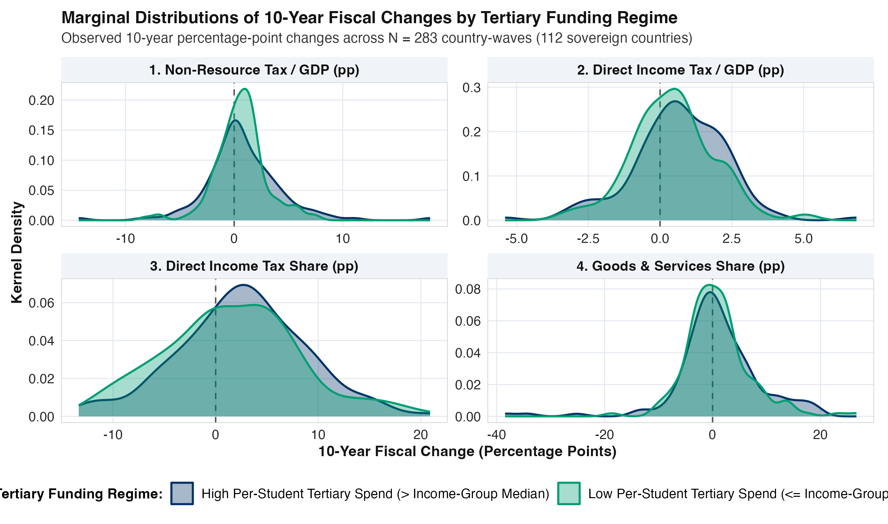
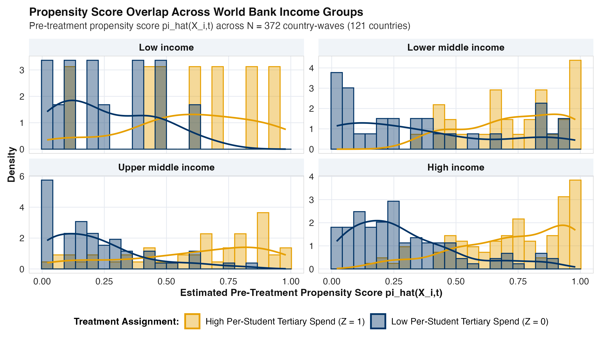

## Overview and Research Question

This exploratory data analysis (EDA) audits the global fiscal and tertiary education panel (`data/processed/clean_tax_panel.csv`, spanning 1,736 country-waves across 217 sovereign countries from `1985-1989` to `2020-2024`) prior to estimating our Multivariate and Longitudinal Bayesian Causal Forest models. Our primary hypothesis is that increasing national government expenditure on tertiary (university) education improves a country's future tax take at the $+5$-year and $+10$-year horizons once mediating macroeconomic growth is separated out.

To eliminate mechanical accounting identities, denominator distortions, and collider bias, the dataset incorporates three design safeguards:

1. **Four Pure Disaggregated Tax Outcomes (Zero GDP Product Identities):**
   - $Y_1$: **Domestic Non-Resource Tax-to-GDP Change ($\Delta \text{Tax/GDP}$, percentage points of GDP)**, paired with unadjusted World Bank WDI $\Delta \text{Tax/GDP}$ as a sensitivity check.
   - $Y_2$: **Direct Income, Profit, and Capital Gains Tax-to-GDP Change ($\Delta \text{IncomeTax/GDP}$, percentage points of GDP)**.
   - $Y_3$: **Direct Income and Profit Share of Revenue Change ($\Delta \text{IncomeTax/Rev}$, percentage points of revenue)**.
   - $Y_4$: **Indirect Goods and Services (Consumption / VAT) Share of Revenue Change ($\Delta \text{GoodsTax/Rev}$, percentage points of revenue)**, which acts as a built-in specificity (negative-control) channel.
2. **Unbundling Tertiary Education Spending Denominators:**
   Focusing exclusively on public tertiary education, we compare three strictly observed tertiary spending measures side by side (with zero cross-sectional proxy imputation):
   - **UNESCO Per-Student Tertiary Ratio (`tert_spend_per_student_winsor`):** Public expenditure per tertiary student as a percentage of GDP per person.
   - **Real 2021 PPP Dollars per Tertiary Student (`real_tert_spend_per_student_ppp`):** Removes GDP per person from the treatment denominator.
   - **Public Tertiary Budget Share of GDP (`tert_spend_gdp_pct`):** Removes student headcount from the treatment denominator.
3. **Strict Temporal Ordering of Pre-Treatment Controls vs Post-Treatment Mediators:**
   Baseline confounders $X_{i,t}$ are measured strictly at or before wave $t$ (using lagged $t-1$ GDP per person growth rather than contemporaneous wave-$t$ growth), while forward GDP per person growth, tertiary enrolment expansion, income inequality changes, and life expectancy changes over $[t, t+h]$ are reserved for the **Mediator-Removed Direct Fiscal Effect (`M2`)** specification.

---

## Sample Coverage, Quality Screening, and Attrition

Before constructing the estimation samples, our hygiene audit in `02_build_clean_tax_panel.R` verifies zero duplicate `(iso3, wave_index)` keys and screens out four physically or accounting-impossible raw World Bank WDI tax-to-GDP observations (`<0.5%` or `>60.0%` of GDP): Sudan in `1995-1999` (`629.19%` of GDP due to a historical currency-unit mismatch), Timor-Leste in `2010-2014` (`109.99%` of non-oil GDP due to offshore petroleum fund accounting), and the United Arab Emirates in `2010-2014` (`0.34%`) and `2015-2019` (`0.23%`, recording only federal-level fees rather than emirate-level revenues). @tbl-attrition documents sample coverage and attrition at each filtering stage.

| Filtering Stage | Sample Definition | Country-Waves | Countries | Retention (%) |
| :--- | :--- | :---: | :---: | :---: |
| **1. Full Global 5-Year Panel** | 217 sovereign countries $\times$ 8 waves (`1985-2024`) | 1,736 | 217 | 100.0% |
| **2. Valid Domestic Tax / GDP** | Observed non-resource tax-to-GDP after anomaly screen | 914 | 159 | 52.6% |
| **3. Complete 4-Channel Tax Vector** | All 4 disaggregated tax outcomes observed at wave $t$ | 883 | 157 | 50.9% |
| **4. Observed Per-Student Tertiary Spend** | Observed UNESCO per-student tertiary ratio ($Z_{\text{regime}}$) | 512 | 166 | 29.5% |
| **5. Observed Tertiary Budget (% GDP)** | Observed public tertiary budget share of GDP | 785 | 183 | 45.2% |
| **6. Complete $+5\text{y}$ Sample (`mvbcf`)** | Complete 4-channel fiscal changes over $[t, t+1]$ + $Z_{\text{regime}}$ | **372** | **121** | **21.4%** |
| **7. Complete $+10\text{y}$ Sample (`mvbcf`)** | Complete 4-channel fiscal changes over $[t, t+2]$ + $Z_{\text{regime}}$ | **283** | **112** | **16.3%** |
| **8. Complete 3-Wave Sample (`lbcf`)** | Complete 3-wave trajectory ($t, t+1, t+2$) across all 4 channels | **282** | **112** | **16.2%** |

: Sample coverage and attrition across the global 5-year panel (`1985-1989` to `2020-2024`). {#tbl-attrition tbl-colwidths="[28, 36, 13, 11, 12]"}

---

## Unbundling the UNESCO Denominator Trap Across Income Groups

Why is unbundling the tertiary spending denominator essential in cross-national work? @tbl-eda1 compares the three tertiary spending measures and baseline tax composition across the four World Bank income groups.

| Income Group (Countries, Waves) | UNESCO Ratio (% GDP/pc) | **Real PPP \$ / Student** | **Tertiary Budget (% GDP)** | Tertiary Enrolment (%) | Direct Income Tax Share (%) |
| :--- | :---: | :---: | :---: | :---: | :---: |
| **Low income** (21, 80) | **150.0%** | \$3,957 | 0.47% | 2.3% | 29.2% |
| **Lower middle income** (41, 172) | 76.5% | \$3,258 | 0.65% | 7.4% | 30.8% |
| **Upper middle income** (54, 219) | 26.8% | \$3,521 | 0.64% | 25.5% | 33.1% |
| **High income** (69, 337) | 26.9% | **\$11,148** | **0.94%** | **58.3%** | **38.4%** |

: Tertiary spending indicators and baseline fiscal structure by World Bank income group (medians for skewed spending and enrolment variables; means for direct income tax share; UNESCO ratio winsorised at 150% for display). {#tbl-eda1 tbl-colwidths="[28, 15, 15, 14, 14, 14]"}

As shown in @tbl-eda1:

* In **Low income** countries, only **2.3%** of the age cohort attends university, so dividing a modest public university budget (**0.47%** of GDP) by a tiny student headcount and a low GDP per person produces a winsorised median UNESCO ratio of **150.0%**.
* In **High income** countries, **58.3%** of the cohort attends university. Although their UNESCO ratio appears lower (**26.9%** of GDP per person), they actually spend nearly three times as much per student in real purchasing power (**\$11,148** vs **\$3,957**) and twice as much of their GDP on public universities (**0.94%** vs **0.47%**), while collecting **38.4%** of total revenue from direct income, profit, and capital gains taxes.

To prevent this cross-income-group inversion from confounding treatment assignment, our primary regime indicator ($Z_{\text{regime}} = 1$) compares each country-wave's un-winsorised per-student spending ratio against the median of **its own World Bank income group**, and we evaluate all unbundled tertiary spending definitions side by side in our causal forest models.

---

## Raw Unadjusted Fiscal Trajectories and Marginal Distributions

@tbl-eda2 and @fig-eda1 present the raw, unadjusted $+5$-year and $+10$-year percentage-point changes across all four fiscal outcomes before any covariate or causal forest adjustment.

| Tertiary Funding Regime | Horizon | Country-Waves (Countries) | $\Delta$ Non-Resource Tax / GDP (pp) | $\Delta$ Direct Income Tax / GDP (pp) | **$\Delta$ Direct Income Tax Share (pp)** | $\Delta$ Goods & Services Share (pp) |
| :--- | :---: | :---: | :---: | :---: | :---: | :---: |
| **Low Regime ($Z=0$)** | $+5\text{y}$ | 196 (80) | +0.35 | +0.26 | +0.89 | +0.57 |
| **High Regime ($Z=1$)** | $+5\text{y}$ | 176 (74) | +0.37 | **+0.40** | **+1.74** | +0.50 |
| **Low Regime ($Z=0$)** | $+10\text{y}$ | 142 (70) | +0.59 | +0.44 | +1.56 | +0.99 |
| **High Regime ($Z=1$)** | $+10\text{y}$ | 141 (69) | **+0.80** | **+0.66** | **+2.57** | +0.97 |

: Raw unadjusted mean changes across the four disaggregated fiscal outcomes by within-income-group per-student tertiary funding regime. {#tbl-eda2 tbl-colwidths="[22, 10, 16, 13, 13, 13, 13]"}

{#fig-eda1 width=100%}

Even in the raw data (@tbl-eda2 and @fig-eda1), three patterns stand out:

1. **Immediate and Growing Divergence in Direct Income Tax Share:** Over $+5$ years, countries in the high per-student tertiary funding regime experience a `+1.74` percentage point increase in the direct income and profit share of revenue compared with `+0.89` percentage points in the low regime (raw difference `+0.85` pp). Over $+10$ years, this gap widens to `+2.57` pp vs `+1.56` pp (raw difference **`+1.01` pp**).
2. **Delayed Maturation in Overall Non-Resource Tax / GDP:** At $+5$ years, raw overall non-resource tax-to-GDP changes are nearly identical across regimes (`+0.37` vs `+0.35` pp), whereas by $+10$ years the high-funding regime pulls ahead (`+0.80` vs `+0.59` pp, raw difference **`+0.21` pp of GDP**), driven by direct income and profit taxes as a share of GDP (`+0.66` vs `+0.44` pp).
3. **Zero Divergence on the Negative-Control Channel:** On indirect goods and services (consumption/VAT) tax share, raw changes are slightly lower in the high tertiary spending regime at both $+5$ years (`+0.50` vs `+0.57` pp) and $+10$ years (`+0.97` vs `+0.99` pp).

---

## Common Support and Positivity Audit

For causal forest estimates to be well-identified without extrapolating over empty cells, treated ($Z=1$) and control ($Z=0$) country-waves must exhibit substantial overlap in their pre-treatment propensity scores $\hat{\pi}(X_{i,t}) = P(Z_{i,t}=1 \mid X_{i,t})$. @tbl-positivity and @fig-eda2 report the estimated propensity score distributions across the four World Bank income groups in the $+5$-year estimation sample ($N = 372$).

| World Bank Income Group | Country-Waves ($N$) | Treated Share (%) | Mean $\hat{\pi}$ ($Z=0$) | Mean $\hat{\pi}$ ($Z=1$) | $[\min \hat{\pi}, \max \hat{\pi}]$ | Share in $[0.05, 0.95]$ (%) |
| :--- | :---: | :---: | :---: | :---: | :---: | :---: |
| **Low income** | 20 | 35.0% | 0.260 | 0.595 | $[0.030, 0.945]$ | **90.0%** |
| **Lower middle income** | 59 | 50.8% | 0.355 | 0.736 | $[0.020, 0.980]$ | **72.9%** |
| **Upper middle income** | 105 | 45.7% | 0.221 | 0.606 | $[0.020, 0.980]$ | **81.0%** |
| **High income** | 188 | 48.4% | 0.293 | 0.726 | $[0.020, 0.980]$ | **85.1%** |

: Pre-treatment propensity score positivity and common support diagnostics across World Bank income groups ($N = 372$ country-waves). {#tbl-positivity tbl-colwidths="[24, 13, 13, 12, 12, 13, 13]"}

{#fig-eda2 width=100%}

Defining the primary regime threshold within each country's own World Bank income group achieves a balanced treatment split across all development tiers (47.3% treated overall, ranging from 35.0% in Low income to 50.8% in Lower middle income), with over 81% of observations lying strictly inside the interior propensity interval $[0.05, 0.95]$ and clear distributional overlap in every panel of @fig-eda2.

---

## Missing Data Analysis and Mechanisms

@tbl-missing audits missingness rates across the full 1,736 country-wave grid, within the complete $+5$-year estimation sample ($N = 372$), and across Low versus High income economies.

| Variable Name | Full Panel Missing (%) | $+5\text{y}$ Sample Missing (%) | Low Income Missing (%) | High Income Missing (%) |
| :--- | :---: | :---: | :---: | :---: |
| **Per-Student Tertiary Ratio (% GDP/pc)** | 70.5% | **0.0%** | 76.0% | 66.6% |
| **Real 2021 PPP \$ per Tertiary Student** | 71.0% | **0.0%** | 76.5% | 67.2% |
| **Public Tertiary Budget (% of GDP)** | 54.8% | **5.1%** | 60.5% | 53.2% |
| **Non-Resource Tax Revenue (% of GDP)** | 47.4% | **0.0%** | 67.0% | 43.8% |
| **Direct Income & Profit Share (% Rev)** | 48.4% | **0.0%** | 68.0% | 45.5% |
| **Goods & Services Tax Share (% Rev)** | 47.9% | **0.0%** | 68.0% | 44.3% |
| **Log Real GDP per Person (PPP)** | 21.4% | **0.0%** | 27.5% | 27.2% |
| **Lagged ($t-1$) GDP per Person Growth (%)** | 19.0% | **0.0%** | 21.0% | 23.1% |
| **Gross Tertiary Enrolment (%)** | 35.3% | **10.5%** | 31.0% | 47.4% |
| **Harmonised Disposable Gini Index** | 31.0% | **3.0%** | 32.5% | 39.4% |
| **Trade Openness (% of GDP)** | 21.9% | **6.5%** | 28.5% | 25.9% |
| **Total Unemployment Rate (%)** | 24.6% | **0.8%** | 12.5% | 35.9% |

: Missing-data rates across the full 1,736 country-wave panel and within the $N=372$ primary estimation sample. {#tbl-missing tbl-colwidths="[36, 16, 16, 16, 16]"}

Three conclusions follow from @tbl-missing:

1. **Missingness Mechanism (MAR Conditional on Development and State Capacity):** Missingness in raw UNESCO tertiary spending and IMF GFS disaggregated tax breakdowns is **not** Missing Completely at Random (MCAR); it is higher in Low income states (67.0% to 76.0% across all eight waves since 1985) than in High income states (43.8% to 66.6%) because statistical reporting infrastructure scales with economic development and administrative capacity. Conditioning on income group, region, log GDP per person, and baseline tax shares in the BCF prognostic forest $\mu(X_{i,t}, \hat{\pi}_{i,t})$ directly accounts for these observable reporting correlates under Missing at Random (MAR).
2. **Zero Imputation on Treatments or Outcomes:** We never impute missing treatment exposures or tax outcomes. Every observation in our estimation samples has 100% strictly observed treatment and four-channel outcome data.
3. **Minimal Baseline Covariate Missingness in the Estimation Sample:** Within the $N=372$ estimation sample, missingness is `0.0%` for log GDP per person and lagged GDP growth, `0.8%` for unemployment, `3.0%` for disposable Gini, `6.5%` for trade openness, and `10.5%` for baseline tertiary enrolment. In our primary models, training-sample median imputation is coupled with explicit binary missingness flags in the covariate matrix, and Robustness Check `R4` verifies that dropping all country-waves with any missing baseline covariate yields even stronger $+10$-year treatment effects.

---

## Temporal Autocorrelation, Stationarity, and Spatial Clustering

@tbl-tempspat compares the temporal autocorrelation (within-country lag-1 and lag-2 wave correlations), spatial/hierarchical clustering (sovereign country Intraclass Correlation Coefficient $\text{ICC}_{\text{country}}$ and World Bank regional $\text{ICC}_{\text{region}}$), and panel convergence $p$-values between raw baseline fiscal levels ($Y_{i,t}$) and 5-year first-differenced changes ($\Delta Y_{i,t+1}$).

| Fiscal Series | Series Type | Lag-1 ACF ($r_1$) | Lag-2 ACF ($r_2$) | Country ICC | Region ICC | Panel ADF $p$-value |
| :--- | :---: | :---: | :---: | :---: | :---: | :---: |
| **1. Non-Resource Tax / GDP (%)** | Level ($Y_t$) | **0.939** | 0.891 | **0.878** | 0.160 | $<0.001$ |
| **2. Direct Income Tax / GDP (%)** | Level ($Y_t$) | **0.941** | 0.907 | **0.866** | 0.130 | $<0.001$ |
| **3. Direct Income Tax Share (%)** | Level ($Y_t$) | **0.945** | 0.895 | **0.844** | 0.221 | $<0.001$ |
| **4. Goods & Services Share (%)** | Level ($Y_t$) | **0.910** | 0.793 | **0.749** | 0.151 | $<0.001$ |
| **5. $\Delta$ Non-Resource Tax / GDP (pp)** | Change ($\Delta Y_{t+1}$) | **-0.094** | -0.083 | **0.000** | 0.000 | $<0.001$ |
| **6. $\Delta$ Direct Income Tax / GDP (pp)** | Change ($\Delta Y_{t+1}$) | **-0.079** | -0.139 | **0.036** | 0.000 | $<0.001$ |
| **7. $\Delta$ Direct Income Tax Share (pp)** | Change ($\Delta Y_{t+1}$) | **-0.001** | -0.066 | **0.000** | 0.005 | $<0.001$ |
| **8. $\Delta$ Goods & Services Share (pp)** | Change ($\Delta Y_{t+1}$) | **+0.065** | -0.099 | **0.029** | 0.019 | $<0.001$ |

: Within-country temporal autocorrelation (Lag-1 and Lag-2 five-year wave ACFs), sovereign country and regional Intraclass Correlation Coefficients (ICC), and panel stationarity diagnostics comparing fiscal levels against 5-year percentage-point changes. {#tbl-tempspat tbl-colwidths="[28, 15, 11, 11, 11, 11, 13]"}

@tbl-tempspat provides a clear econometric rationale for our modelling choices:

* **Why We Model Percentage-Point Changes ($\Delta Y_{i,t+h}$) Rather Than Raw Levels:** Raw fiscal levels $Y_{i,t}$ exhibit near-unit-root persistence within countries (`lag1_acf` between `0.910` and `0.945`) and massive between-country variance shares (`country_icc` between `0.749` and `0.878`). Taking 5-year and 10-year first differences ($\Delta Y_{i,t+h} = Y_{i,t+h} - Y_{i,t}$) completely removes this non-stationary level persistence (reducing `lag1_acf` to `[-0.094, +0.065]` and `country_icc` to `[0.000, 0.036]`), while including baseline fiscal levels $Y_{i,t}$ in $\mu(X_{i,t}, \hat{\pi}_{i,t})$ accounts for mean-reversion and starting tax capacity.
* **Why We Cluster Uncertainty at the Sovereign Country Level:** Because repeated waves come from the same sovereign states (and because 10-year windows $t \to t+2$ span two consecutive 5-year steps), all posterior probabilities and credible intervals are computed using a country-clustered Dirichlet block bootstrap over sovereign `iso3` clusters, complemented by Robustness Check `R2` on strictly non-overlapping 10-year decadal waves and our Three-Wave Longitudinal BCF (`lbcf`) model.

---

## Feature Correlation Structure and Variance Inflation Factors

Finally, @tbl-vif and @fig-eda3 examine collinearity among the 15 continuous pre-treatment baseline covariates $X_{i,t}$ and their bivariate correlations with the $+5$-year fiscal targets.

| Baseline Covariate ($X_{i,t}$) | Variance Inflation Factor (VIF) | Corr. with $\Delta\text{Tax/GDP}_{+5\text{y}}$ | Corr. with $\Delta\text{IncomeTax/Rev}_{+5\text{y}}$ |
| :--- | :---: | :---: | :---: |
| **1. Log Real GDP per Person (PPP)** | **7.25** | -0.130 | -0.066 |
| **2. Baseline Life Expectancy (Years)** | **6.03** | -0.084 | +0.014 |
| **3. Baseline Gross Secondary Enrolment (%)** | **4.23** | -0.117 | -0.076 |
| **4. Baseline Gross Tertiary Enrolment (%)** | **3.61** | -0.152 | -0.094 |
| **5. Baseline Non-Resource Tax / GDP (%)** | **3.19** | -0.190 | -0.046 |
| **6. Working-Age Population Share (%)** | **3.08** | -0.062 | -0.091 |
| **7. Baseline Goods & Services Tax Share (%)** | 2.06 | +0.010 | +0.142 |
| **8. Baseline Direct Income Tax Share (%)** | 2.03 | -0.053 | -0.167 |
| **9. Baseline Disposable Gini Index** | 1.89 | +0.112 | +0.075 |
| **10. Baseline Total Education Spend (% GDP)** | 1.77 | -0.044 | +0.008 |
| **11. Log Population Size** | 1.74 | -0.067 | -0.012 |
| **12. Natural Resource Rents (% GDP)** | 1.66 | +0.078 | -0.023 |
| **13. Trade Openness (% GDP)** | 1.53 | -0.011 | -0.006 |
| **14. Unemployment Rate (%)** | 1.44 | +0.078 | -0.027 |
| **15. Lagged ($t-1$) GDP per Person Growth (%)** | 1.17 | +0.052 | +0.032 |

: Variance Inflation Factors (VIFs) for the continuous pre-treatment baseline confounders and pairwise correlations with $+5$-year fiscal outcomes ($N = 372$). {#tbl-vif tbl-colwidths="[40, 20, 20, 20]"}

{#fig-eda3 width=92%}

All 15 baseline covariates have Variance Inflation Factors well below the standard multicollinearity threshold of `10.0` (peaking at `7.25` for log GDP per person and `6.03` for life expectancy, which co-move across development), and no baseline predictor exhibits an anomalously large correlation with forward fiscal changes ($\max |r| = 0.190$, reflecting mild mean-reversion in baseline tax ratios). This confirms that the baseline confounder matrix is free from mechanical target leakage and well-conditioned for both tree-ensemble splitting in BCF and linear panel benchmarks.
