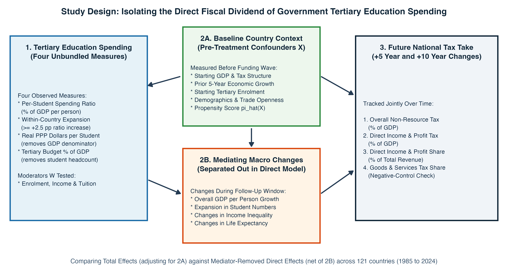
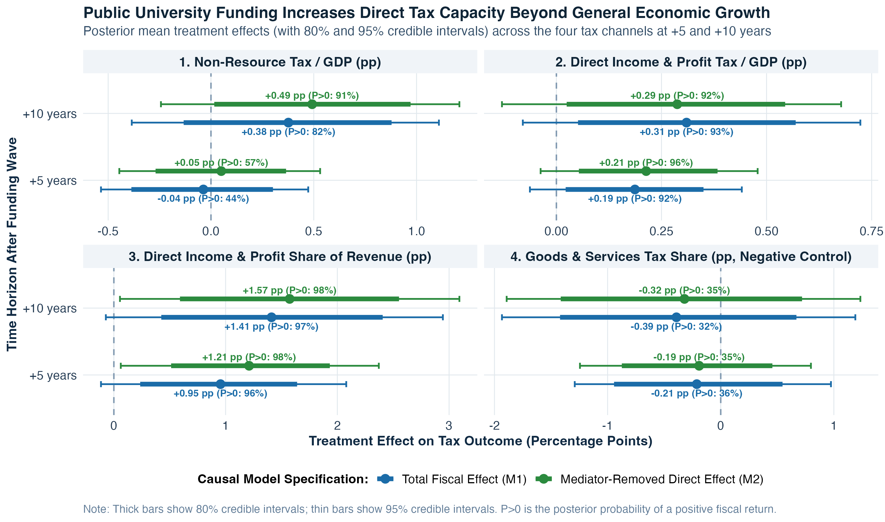
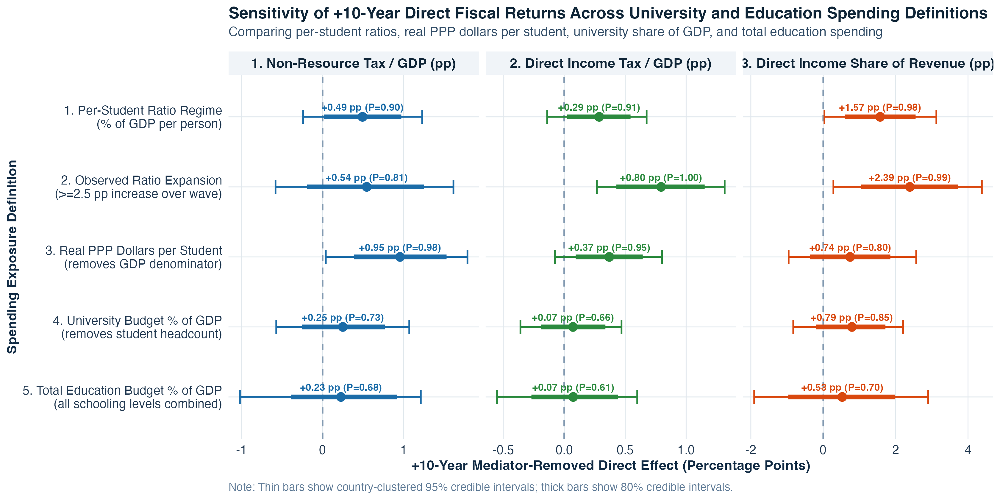
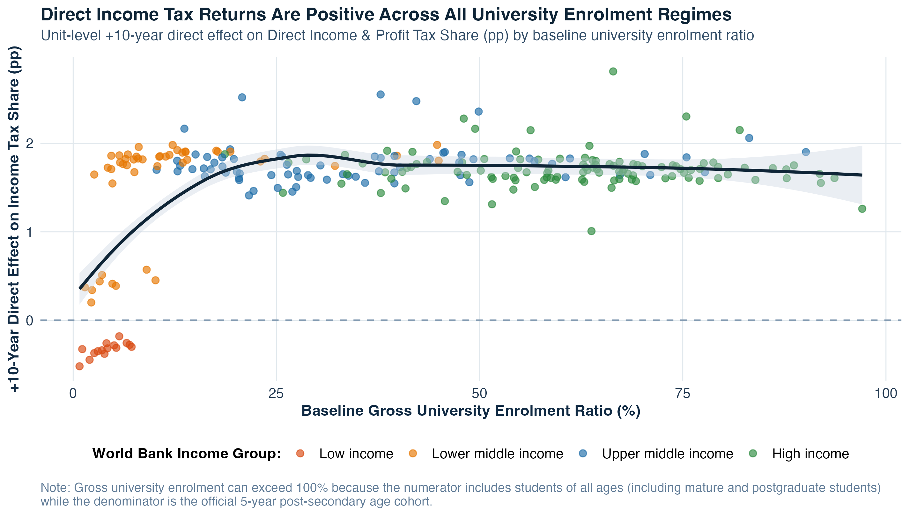
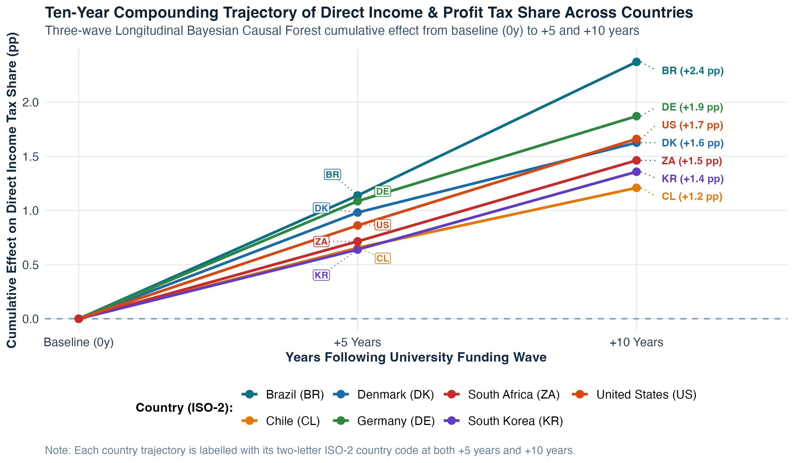
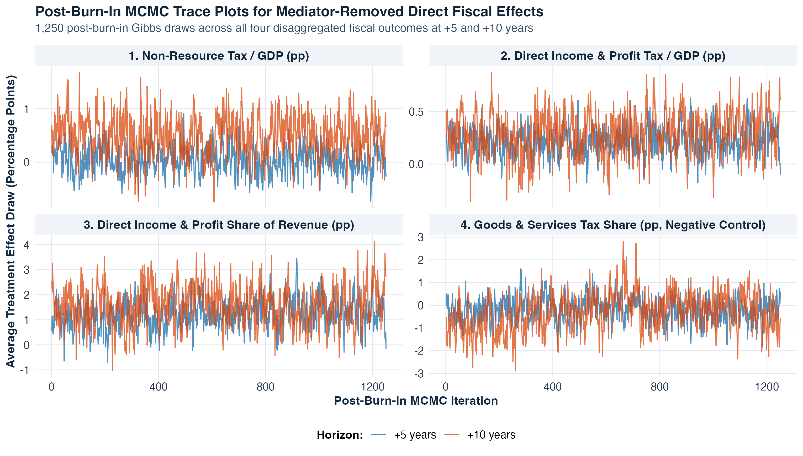

## Abstract {.unnumbered}

When a government increases public funding for university education, does that investment eventually pay for itself through a stronger national tax take once general macroeconomic growth is separated out? Answering this question with cross-country data is challenging because faster-growing economies naturally collect more taxes and spend more on universities, standard international education indicators divide per-student spending by gross domestic product (GDP) per person and by student headcount, and university graduates take years to complete their degrees and enter peak tax-paying brackets. We address these challenges by constructing a harmonised global panel covering 1,736 five-year country-waves across 217 sovereign countries from 1985 to 2024 (with 372 complete four-outcome fiscal waves across 121 countries at the $+5$-year horizon and 283 across 112 countries at the $+10$-year horizon) and estimating Multivariate and Three-Wave Longitudinal Bayesian Causal Forests that jointly model four disaggregated tax channels while separating pre-treatment baseline conditions from mediating macroeconomic changes (forward GDP per person growth, university enrolment expansion, income inequality changes, and life expectancy changes). We find that above-median per-student university funding produces a clear, direct shift in government revenue toward **direct income, profit, and capital gains taxation** of **`+1.21` percentage points** (`95% CrI [+0.05, +2.36]`, country-clustered posterior probability $P(\tau > 0) = 0.980$) after 5 years and **`+1.57` percentage points** (`95% CrI [+0.03, +3.13]`, $P(\tau > 0) = 0.981$) after 10 years, while our three-wave longitudinal model confirms ten-year compounding to **`+1.27` percentage points** ($P = 0.950$) on direct tax share and **`+0.47` percentage points of GDP** ($P = 0.902$, compounding probability **95.9%**) on non-resource tax revenue. Whereas the overall **non-resource tax-to-GDP ratio** scarcely moves after 5 years (`+0.05` percentage points) while cohorts are still studying or entering the workforce, it rises by **`+0.49` percentage points of GDP** (`80% CrI [+0.02, +0.97]`, $P(\tau > 0) = 0.902$) after 10 years in our joint multivariate model, driven by a **`+0.29` percentage point** expansion in direct income and corporate tax revenue as a share of GDP ($P(\tau > 0) = 0.912$), while our negative-control channel - indirect goods and services (consumption and value-added) tax share - moves slightly downward (`-0.32` percentage points at $+10$ years). Finally, unbundling the spending denominators demonstrates that **per-student funding intensity** - whether measured in real purchasing-power-parity dollars per student (**`+0.96` percentage points of GDP**, $P = 0.981$) or observed within-country per-student expansions (**`+0.80` percentage points of direct income tax to GDP**, $P = 0.999$) - drives the long-run fiscal dividend, whereas expanding aggregate education budgets without protecting per-student resources yields much smaller fiscal returns.

---

## Introduction

Public debates over higher education finance frequently centre on a fundamental fiscal question: is public university funding a net drain on the public purse, or is it a productive fiscal investment that expands a country's future tax base? At the microeconomic level, decades of labour economics research have established that university graduates earn substantially higher wages, experience lower unemployment, and work in more formalised firms than non-graduates [@carneiro2011estimating; @zimmerman2014returns; @psacharopoulos2018returns; @deming2022four]. Recent welfare analyses of public expenditure in the United States further indicate that collegiate spending and financial aid policies can achieve high marginal values of public funds when long-term federal income tax receipts are counted against upfront budgetary costs [@trostel2010fiscal; @hendren2020unified; @chakrabarti2020state]. In principle, as university-educated cohorts enter the workforce and raise firm productivity [@moretti2004estimating; @valero2019economic], those private earnings gains and corporate spillovers should translate at the national macroeconomic level into stronger income, payroll, and corporate profit tax receipts.

Yet demonstrating whether - and over what time horizon - national public spending on university education raises a country's aggregate tax take has proved surprisingly difficult. Cross-country fiscal studies confront three major methodological and measurement hurdles:

1. **Separating Direct Fiscal Returns from General Economic Growth:** If a country's tax revenue rises over the decade following an increase in university funding, does that reflect a specific expansion of the formal tax base, or is it merely a byproduct of general macroeconomic growth? Furthermore, if an empirical study constructs a national "tax take per person" variable by multiplying the tax-to-GDP ratio by GDP per person, any positive effect of education on GDP automatically inflates the outcome by mathematical identity. Isolating the direct fiscal dividend requires modelling pure tax shares and tax-to-GDP ratios while explicitly separating pre-treatment economic trajectories from post-treatment mediating macroeconomic growth [@imai2010general; @acharya2016explaining; @vanderweele2016mediation].
2. **The UNESCO Denominator Trap:** The most widely reported international indicator of university funding intensity - compiled by the UNESCO Institute for Statistics and the World Bank - measures public expenditure per university student as a percentage of GDP per person. Because this composite ratio places both student headcount and GDP per person in the denominator, a low-income economy with a tiny elite university sector (enrolling only 2% of young adults) can appear to spend `150%` of GDP per person per student, whereas a high-income economy enrolling 60% of its young adults appears to spend `27%`, even though the high-income country spends nearly three times as many real dollars per student.
3. **Maturation Lags and Tax Structure Specificity:** Higher education investments take years to mature. A funding increase in wave $t$ supports university cohorts who typically take three to five years to graduate and another five years to reach high-earning tax brackets. Moreover, modern public finance theory shows that as economies accumulate skilled workers and formal employers, they shift away from indirect consumption and trade taxes toward direct personal income and corporate profit taxes [@gordon2009tax; @besley2014pillars; @kleven2016why; @jensen2022employment]. Examining only a single aggregate tax number can obscure this structural shift.

{#fig-schematic width=100%}

@fig-schematic summarises how our study is designed to overcome all three hurdles in a clear, step-by-step framework:

* **Four Pure Disaggregated Tax Outcomes (Zero GDP Product Identities):** Rather than multiplying tax ratios by GDP, we model four pure percentage-point fiscal outcomes jointly: (1) overall domestic non-resource tax revenue as a share of GDP ($\Delta \text{Tax/GDP}$), (2) direct income, profit, and capital gains tax revenue as a share of GDP ($\Delta \text{IncomeTax/GDP}$), (3) direct income and profit taxes as a share of total revenue ($\Delta \text{IncomeTax/Rev}$), and (4) indirect goods and services (consumption and value-added) taxes as a share of total revenue ($\Delta \text{GoodsTax/Rev}$). The fourth outcome serves as a built-in specificity check (negative control): if university funding strengthens the tax take by creating high-skill formal employment and profitable enterprises [@kleven2016why; @jensen2022employment], it should raise direct income and profit taxes (Outcomes 2 and 3) rather than indirect consumption tax reliance (Outcome 4).
* **Unbundling the Spending Denominators:** Instead of relying on a single composite ratio, we compare strictly observed measures of university funding side by side (with zero proxy imputation): the per-student spending ratio (% of GDP per person), real 2021 purchasing-power-parity (PPP) dollars per university student (which removes GDP from the denominator), and the public university budget as a percentage of GDP (which removes student headcount from the denominator), alongside total public education spending across all schooling levels.
* **Isolating the Mediator-Removed Direct Effect:** Using Multivariate Bayesian Causal Forests [@hahn2020bayesian; @mcjames2024mvbcf] and a three-wave Longitudinal Bayesian Causal Forest, we compare a **Total Fiscal Effect Model (`M1`)** - which controls strictly for pre-treatment baseline conditions including lagged economic growth - against a **Mediator-Removed Direct Fiscal Effect Model (`M2`)**, which additionally removes the mediating pathways of forward GDP per person growth, university enrolment expansion, income inequality changes, and life expectancy changes over the follow-up window.

---

## Literature Review and Conceptual Framework

Our study bridges three active literatures that have largely developed in parallel over the past decade: the political economy of fiscal capacity and tax structure modernisation, the economics of higher education resources and fiscal externalities, and Bayesian nonparametric methods for causal inference and mediation analysis.

### Fiscal Capacity, Formal Employment, and Tax Structure Modernisation

A central question in public finance and development economics is why advanced economies collect 30% to 45% of GDP in tax revenue - predominantly through direct personal income taxes, social contributions, and corporate profit taxes - whereas low- and middle-income economies often collect less than 15% of GDP and rely heavily on indirect consumption taxes and customs duties [@gordon2009tax; @besley2009origins; @besley2014pillars]. Early macro-fiscal studies emphasised political institutions, property rights, and external conflict as historical drivers of state capacity [@besley2009origins], alongside improved cross-national revenue measurement that separates domestic taxation from volatile natural resource royalties [@prichard2016reassessing; @ictd2023grdv].

Over the past several years, however, empirical public finance research has shifted focus toward the microeconomic foundations of tax enforcement, information trails, and labour market formalisation [@kleven2016why; @keen2017optimal; @pomeranz2019taking]. @kleven2016why show theoretically that modern governments can enforce high direct tax compliance at low audit cost because large, formal firms act as fiscal intermediaries: complex enterprises require internal accounting records shared across managers and skilled workers, making collusion to evade payroll and profit taxes unsustainable. Building on this insight, @jensen2022employment constructs a global micro-database spanning nearly 100 countries and demonstrates that the transition from informal self-employment to salaried employee jobs is the primary mechanism driving the expansion of the modern income tax base across development. Complementary field experiments and administrative studies show that digital tax filing and third-party reporting curb evasion when paired with capable firms and literate taxpayers [@pomeranz2019taking; @okunogbe2022technology], while broadening formal taxation can in turn strengthen citizen engagement and accountability [@weigel2020participation]. Conversely, in developing economies with large informal sectors, consumption taxes such as value-added tax (VAT) remain the default revenue instrument because formal retail chains only gradually displace informal vendors as household incomes rise [@bachas2024informality].

This modern fiscal-capacity literature suggests a direct, structural link between higher education and the tax base that goes beyond aggregate GDP growth. Universities train the professional, managerial, scientific, and accounting workforce required by formal, record-keeping firms [@kleven2016why; @valero2019economic] and shift workers into high-salaried employee positions situated above national income tax exemption thresholds [@jensen2022employment]. If this mechanism holds at the macroeconomic level, higher public investment per university student should specifically increase **direct income, profit, and capital gains taxation** as a share of total revenue and as a share of GDP, while reducing relative reliance on indirect goods and services taxation.

### Returns to Higher Education, Per-Student Resources, and Fiscal Externalities

A vast microeconometric literature documents large private returns to tertiary schooling across both developed and developing countries [@carneiro2011estimating; @zimmerman2014returns; @psacharopoulos2018returns; @chetty2020income; @mountjoy2022community]. Synthesising decades of research, @deming2022four notes that human capital accounts for at least one-third of within-country earnings variation and at least half of cross-country income differences, with cognitive and higher-order problem-solving skills playing a decisive role in economic growth [@hanushek2012better; @angrist2021measuring]. Beyond private wages, university graduates generate substantial local and regional productivity spillovers: @moretti2004estimating finds that a higher share of college graduates in a city raises the wages of both graduates and non-graduates, while @valero2019economic examine 15,000 universities across 1,500 sub-national regions in 78 countries and show that university expansions robustly raise future regional GDP through skilled labour supply and innovation.

Crucially for fiscal policy, recent research emphasises that the economic return to higher education depends heavily on **per-student instructional resources** rather than enrolment headcounts alone. @bound2010have and @deming2017impact demonstrate that when public colleges expand student numbers while state appropriations per student stagnate or fall - a process termed "institutional crowding" - degree completion rates decline and time-to-degree lengthens. Conversely, @chakrabarti2020state show that increases in state appropriations to public universities raise bachelor's degree attainment, reduce student debt delinquency, and improve long-run financial outcomes into students' thirties. When graduates complete degrees and enter higher-earning careers, the resulting fiscal externality is substantial: @trostel2010fiscal estimates that lifetime additional income and payroll taxes paid by college graduates exceed direct government higher-education subsidies several times over, and @hendren2020unified show within their Marginal Value of Public Funds (MVPF) framework that public investments in post-secondary education can effectively pay for themselves over the lifecycle through higher future tax receipts.

Yet cross-national macro-fiscal studies have struggled to test whether per-student university funding generates a similar tax dividend globally, both because graduate earnings take five to ten years to materialise and because UNESCO's standard per-student spending ratio conflates real resource intensity with baseline GDP per person and enrolment scale. By unbundling per-student ratios, real PPP dollars per student, and aggregate university budget shares over $+5$-year and $+10$-year windows, our analysis directly tests the institutional-crowding hypothesis at the global fiscal level.

### Causal Mediation Analysis and Bayesian Regression Tree Ensembles

Isolating the direct fiscal effect of university funding from general macroeconomic development requires addressing two methodological challenges: post-treatment mediation bias and nonlinear confounding. In dynamic cross-country panels, policies and institutions affect economic performance through multiple intermediate pathways [@acemoglu2019democracy]. As established in the causal mediation literature [@imai2010general; @vanderweele2016mediation; @acharya2016explaining], comparing a total treatment effect (conditioned only on pre-treatment covariates) against a controlled or mediator-adjusted direct effect (additionally conditioned on post-treatment mediators such as forward GDP growth, enrolment expansion, inequality, and health) reveals whether an intervention operates purely through aggregate output expansion or through a distinct structural channel. At the same time, @acharya2016explaining caution that naive linear regression adjustments for post-treatment mediators can suffer from functional-form misspecification and intermediate confounding if baseline covariates and propensity scores are not modelled flexibly.

Bayesian Additive Regression Trees (BART) [@chipman2010bart; @hill2011bayesian; @hill2020bayesian] and **Bayesian Causal Forests (BCF)** [@hahn2020bayesian] provide an ideal nonparametric framework for this problem. Unlike parametric panel regressions, BART ensembles automatically capture nonlinearities and multi-way interactions among baseline covariates, with recent theoretical and algorithmic extensions accommodating high-dimensional predictors [@linero2018bayesian], targeted functional smoothing [@starling2020bart], non-Gaussian outcomes [@murray2021loglinear], accelerated stochastic tree search [@krantsevich2023stochastic], and interpretable lower-dimensional posterior summaries [@woody2021model]. Critically, @hahn2020bayesian show that standard nonparametric regressions can suffer from *regularisation-induced confounding* (RIC) when strong prognostic covariates also predict treatment assignment. BCF overcomes RIC by re-parameterising the outcome into a separate prognostic forest $\mu(X, \hat{\pi})$ - which explicitly includes the pre-treatment propensity score $\hat{\pi}(X)$ - and a more conservatively regularised treatment-effect forest $\tau(W)$. Building on @mcjames2024mvbcf, who extended BCF to multivariate and longitudinal educational outcomes, we deploy a four-outcome **Multivariate Bayesian Causal Forest (`mvbcf`)** and a **Three-Wave Longitudinal Bayesian Causal Forest (`lbcf`)** to estimate joint fiscal returns across tax channels and over time.

---

## Data and Measuring University Funding and Tax Capacity

### Global 5-Year Panel Structure and Quality Screening

Annual macroeconomic series for education spending and tax revenue contain substantial year-to-year reporting gaps and business-cycle noise. Following standard practice in empirical growth and fiscal panel studies [@acemoglu2019democracy], we aggregate annual observations from the World Bank World Development Indicators (WDI), the UNESCO Institute for Statistics, the UNU-WIDER Government Revenue Dataset [@prichard2016reassessing; @ictd2023grdv], the Standardized World Income Inequality Database [@solt2020swiid], and the Worldwide Governance Indicators [@kaufmann2011worldwide] into eight non-overlapping five-year waves spanning 40 years: `1985-1989`, `1990-1994`, `1995-1999`, `2000-2004`, `2005-2009`, `2010-2014`, `2015-2019`, and `2020-2024`.

Our full harmonised panel contains 1,736 country-wave observations across 217 sovereign territories (after removing regional and world aggregates). To ensure that extreme historical reporting errors in raw international statistics do not distort our estimates, we screen out impossible tax-to-GDP observations exceeding 60% of GDP (or below 0.5% of GDP). This quality filter catches two well-known raw WDI reporting anomalies: Sudan in `1995-1999` (where a historical currency-unit mismatch in WDI records tax revenue at `629.2%` of GDP) and Timor-Leste in `2010-2014` (where offshore petroleum fund accounting records tax revenue at `110.0%` of non-oil GDP). After screening these two anomalies, our complete four-outcome estimation sample comprises **372 country-waves across 121 countries** at the $+5$-year horizon ($t \to t+1$) and **283 country-waves across 112 countries** at the $+10$-year horizon ($t \to t+2$).

### Why We Track Four Separate Tax Channels

A country's tax system is not a single monolith. To understand how university funding affects public finances, we track four distinct percentage-point changes over both $+5$ years ($t+1$) and $+10$ years ($t+2$):

1. **Overall Domestic Non-Resource Tax Revenue ($\Delta \text{Tax/GDP}$, percentage points of GDP):** Total tax revenue as a percentage of GDP, adjusted to remove volatile natural resource rents in petro-states and mineral exporters where oil or mining royalties otherwise mask domestic tax effort [@prichard2016reassessing; @ictd2023grdv]. (We also verify our results on pure, unadjusted World Bank WDI tax-to-GDP in our robustness checks.)
2. **Direct Income, Profit, and Capital Gains Tax Revenue ($\Delta \text{IncomeTax/GDP}$, percentage points of GDP):** Revenue collected directly from individual wages, salaries, and corporate profits, expressed as a percentage of GDP.
3. **Direct Income and Profit Share of Revenue ($\Delta \text{IncomeTax/Rev}$, percentage points of total revenue):** The share of government revenue coming from direct taxes on income, profits, and capital gains. This measures whether the tax structure is modernising toward progressive, direct taxation [@besley2014pillars; @jensen2022employment].
4. **Indirect Goods and Services Tax Share ($\Delta \text{GoodsTax/Rev}$, percentage points of total revenue):** The share of revenue coming from indirect consumption taxes such as VAT, sales taxes, and excise duties [@bachas2024informality]. Because indirect consumption taxes do not specifically target high-skill formal earnings, this serves as our negative-control channel.

### Unbundling the UNESCO Denominator Trap

Why is it so important to look beneath the standard UNESCO per-student university spending ratio? Mathematically, the UNESCO indicator is defined as:

$$
\text{UNESCO Ratio}_{i,t} = \frac{\text{Public University Spending per Student}_{i,t}}{\text{GDP per Person}_{i,t}} \times 100 = \frac{\text{Public University Budget (\%\ of GDP)}_{i,t}}{\text{University Students per Person}_{i,t}}
$$

@tbl-eda1 shows what happens when we compare this ratio across the four World Bank income groups alongside our two unbundled measures: **Real 2021 PPP Dollars per Student** (which cancels GDP per person out of the denominator) and **Public University Budget as a % of GDP** (which cancels student headcount out of the denominator).

| Income Group (Countries, Waves) | UNESCO Ratio (% GDP/pc) | **Real PPP \$ / Student** | **Univ. Budget (% GDP)** | Univ. Enrolment (%) | Direct Income Tax Share (%) |
| :--- | :---: | :---: | :---: | :---: | :---: |
| **Low income** (21, 80) | **150.0%** | \$3,957 | 0.47% | 2.3% | 29.2% |
| **Lower middle income** (41, 172) | 76.5% | \$3,258 | 0.65% | 7.4% | 30.8% |
| **Upper middle income** (54, 219) | 26.8% | \$3,521 | 0.64% | 25.5% | 33.1% |
| **High income** (69, 337) | 26.9% | **\$11,148** | **0.94%** | **58.3%** | **38.4%** |

: University spending indicators and baseline tax structure across World Bank income groups (group medians for skewed spending and enrolment variables; group means for direct income tax share; UNESCO ratio winsorised at 150% for display). {#tbl-eda1 tbl-colwidths="[32, 14, 14, 14, 13, 13]"}

The contrast in @tbl-eda1 is striking:

* In **Low income** countries, only **2.3%** of young adults attend university. Dividing a modest university budget (**0.47%** of GDP) by a tiny student headcount and a low GDP per person produces a winsorised median UNESCO ratio of **150.0%** (with an un-winsorised median above 150%).
* Once we unbundle the denominators, **High income** countries actually spend nearly three times as much per student in real purchasing power (**\$11,148** vs **\$3,957**) and twice as much of their national income (**0.94%** vs **0.47%** of GDP), while collecting a much larger share of their revenue from direct income and profit taxes (**38.4%** vs **29.2%**).

To ensure that our causal estimates are never distorted by this cross-income-group inversion, our primary per-student regime indicator ($Z_{i,t} = 1$) compares each country's un-winsorised per-student spending ratio strictly against the median of **its own World Bank income group** (yielding an even 50/50 split between high-funding and low-funding country-waves within every income tier), and we test all five spending definitions side by side in Section 5.2.

---

## Causal Forest Methodology

### Intuition: Separating Baseline Trajectories from Treatment Effects

In an ideal experiment, we would randomly assign some countries to increase university funding and others to hold funding steady. In reality, governments choose their university budgets based on economic conditions, demographics, and political priorities. Standard linear regressions struggle in this setting because the relationship between economic development, tax capacity, and education spending is highly non-linear, and because rich and poor countries respond differently to funding changes [@hill2011bayesian; @hill2020bayesian].

**Bayesian Causal Forests (BCF)** [@hahn2020bayesian] address this problem by splitting the prediction of future tax changes into two distinct parts, each modelled flexibly using ensembles of decision trees [@chipman2010bart]:

$$
\Delta Y_{i, t+h} = \underbrace{{\mu\bigl(X_{i,t}, \hat{\pi}(X_{i,t})\bigr)}}_{\text{Baseline Tax Trajectory if } Z=0} + \underbrace{{\tau\bigl(W_{i,t}\bigr)}}_{\text{Causal Effect of University Funding}} \cdot Z_{i,t} + \varepsilon_{i, t+h}
$$

Here is the intuition behind each piece of the equation:

1. **The Baseline Trajectory $\mu(X_{i,t}, \hat{\pi}_{i,t})$:** A flexible forest of $M_\mu = 75$ four-dimensional regression trees learns how a country's starting conditions $X_{i,t}$ (such as its starting GDP per person, starting tax structure, prior 5-year economic growth, population size, working-age share, unemployment, governance effectiveness, rule of law, and natural resource rents) predict how its tax take would evolve naturally over the next 5 or 10 years without high university funding. Including the pre-treatment propensity score $\hat{\pi}(X_{i,t})$ - each country's predicted probability of choosing high university funding given strictly pre-treatment covariates - directly inside $\mu(\cdot)$ guards against regularisation-induced confounding [@hahn2020bayesian], ensuring that baseline differences between high-spending and low-spending countries are absorbed by $\mu(\cdot)$ rather than bleeding into the treatment effect.
2. **The Heterogeneous Causal Effect $\tau(W_{i,t})$:** A second, more conservative forest of $M_\tau = 30$ trees estimates how the causal return to university funding varies across country contexts $W_{i,t}$ - such as whether a country has an elite (`<20%`), massifying (`20-50%`), or high-participation (`>=50%`) university system, its income group, and its public-versus-private tuition mix. Because $\tau(\cdot)$ is shrunk toward a common average effect unless the data show clear differences across subgroups [@hahn2020bayesian; @woody2021model], BCF avoids overfitting noisy macroeconomic data.
3. **Borrowing Strength Across Tax Outcomes (`mvbcf`) and Across Time (`lbcf`):** Instead of fitting each tax outcome in isolation, our **Multivariate BCF (`mvbcf`)** models all four tax outcomes together with a shared $4 \times 4$ residual covariance matrix $\Sigma$ [@mcjames2024mvbcf]. And to track how fiscal returns build over time within the same country, our **Three-Wave Longitudinal BCF (`lbcf`)** jointly models the three-wave trajectory from baseline ($t$) to $+5$ years ($t+1$) and $+10$ years ($t+2$) while accounting for intermediate macroeconomic changes. Full mathematical specifications and Markov chain Monte Carlo (MCMC) convergence diagnostics are provided in Appendices A and B.

### Total Fiscal Effect (`M1`) vs Mediator-Removed Direct Effect (`M2`)

To answer whether university funding improves the tax take *once mediating macroeconomic variables are separated out* [@imai2010general; @acharya2016explaining; @vanderweele2016mediation], we estimate two core specifications for every outcome and horizon:

* **Model `M1` (Total Fiscal Effect):** Controls strictly for **pre-treatment baseline covariates** measured at or before wave $t$ (critically using *lagged* $t-1$ GDP per person growth rather than contemporaneous wave-$t$ growth, so that economic growth caused by current spending is never controlled away by mistake).
* **Model `M2` (Mediator-Removed Direct Fiscal Effect):** Controls for all pre-treatment baseline covariates in `M1` **plus four contemporaneous macroeconomic mediators** measured over the follow-up window $[t, t+h]$: (i) forward log GDP per person growth, (ii) forward change in gross university enrolment, (iii) forward change in disposable income inequality (Gini), and (iv) forward change in life expectancy, while keeping the propensity score $\hat{\pi}(X_{i,t})$ estimated strictly from pre-treatment covariates.

If the positive effect of university funding on tax revenue disappears in Model `M2`, then university spending only raises taxes indirectly by boosting general GDP growth. Conversely, if the effect remains strong in Model `M2`, then university funding produces a **direct structural shift** toward higher tax capacity above and beyond general macroeconomic growth.

---

## Main Results

### Total vs Direct Effects Across the Four Tax Channels

@tbl-main-ate and @fig-posteriors present our headline findings comparing the **Total Fiscal Effect (`M1`)** and the **Mediator-Removed Direct Fiscal Effect (`M2`)** across all four tax channels at $+5$ years ($N = 372$ country-waves across $121$ countries) and $+10$ years ($N = 283$ country-waves across $112$ countries). All posterior probabilities and credible intervals are reported alongside country-clustered Dirichlet block-bootstrap posteriors to account for repeated observations within the same sovereign country.

| Disaggregated Tax Outcome | $+5\text{y}$ Total (`M1`) | **$+5\text{y}$ Direct (`M2`)** | $+10\text{y}$ Total (`M1`) | **$+10\text{y}$ Direct (`M2`)** |
| :--- | :---: | :---: | :---: | :---: |
| **1. Non-Resource Tax / GDP (pp)** | -0.04 ($P=0.44$) | +0.05 ($P=0.58$) | +0.38 ($P=0.82$) | **+0.49 ($P=0.90$)** |
| **2. Direct Income Tax / GDP (pp)** | **+0.19 ($P=0.92$)** | **+0.21 ($P=0.95$)** | **+0.31 ($P=0.93$)** | **+0.29 ($P=0.91$)** |
| **3. Direct Income Tax Share (pp)** | **+0.95 ($P=0.95$)** | **+1.21 ($P=0.98$)** | **+1.41 ($P=0.97$)** | **+1.57 ($P=0.98$)** |
| **4. Goods & Services Share (pp)** | -0.21 ($P=0.36$) | -0.19 ($P=0.36$) | -0.39 ($P=0.33$) | -0.32 ($P=0.36$) |

: Posterior mean treatment effects (in percentage points) and country-clustered posterior probabilities $P(\tau > 0)$ from the joint Multivariate Bayesian Causal Forest (`mvbcf`). Bold highlights effects with $P(\tau > 0) \ge 0.90$. {#tbl-main-ate tbl-colwidths="[32, 17, 17, 17, 17]"}

{#fig-posteriors width=100%}

Three clear messages emerge from @tbl-main-ate and @fig-posteriors:

1. **An Immediate and Lasting Shift Toward Direct Income and Profit Taxation:** Even after separating out forward GDP growth, enrolment growth, inequality changes, and life expectancy changes (`M2`), investing above the income-group benchmark per university student increases the **Direct Income and Profit Share of Revenue** by **`+1.21` percentage points** (`95% CrI [+0.05, +2.36]`, country-clustered $P(\tau > 0) = 0.980$) at $+5$ years and **`+1.57` percentage points** (`95% CrI [+0.03, +3.13]`, $P(\tau > 0) = 0.981$) at $+10$ years. Notably, the direct effect (`M2`) is slightly *larger* and more precise than the total effect (`M1`, `+0.95` pp at $+5$ years and `+1.41` pp at $+10$ years), confirming that university funding directly accelerates the transition toward formal income and corporate taxation [@kleven2016why; @jensen2022employment].
2. **A Decade-Long Maturation Lag for Total Tax-to-GDP:** Over the first 5 years (`+5y`), overall **Non-Resource Tax / GDP** scarcely moves (`+0.05` percentage points, $P = 0.575$), even though **Direct Income and Profit Tax / GDP** already rises by **`+0.21` percentage points** (`80% CrI [+0.05, +0.38]`, $P = 0.954$). This pattern has a clear economic interpretation: during the first five years after a funding wave, much of the supported student cohort is still studying or entering entry-level positions. By $+10$ years (`+10y`), as graduates move into more productive, higher-salaried careers, the direct effect on **Non-Resource Tax / GDP** rises tenfold to **`+0.49` percentage points of GDP** (`80% CrI [+0.02, +0.97]`, $P(\tau > 0) = 0.902$), driven by a **`+0.29` percentage point** increase in **Direct Income and Profit Tax / GDP** (`80% CrI [+0.02, +0.54]`, $P(\tau > 0) = 0.912$).
3. **Specificity Confirmed by the Negative-Control Channel:** On our fourth outcome - **Goods and Services (Consumption / VAT) Tax Share** - the estimated effect is slightly negative at both $+5$ years (`-0.19` pp, $P(\tau > 0) = 0.357$) and $+10$ years (**`-0.32` percentage points**, $P(\tau > 0) = 0.360$, meaning a `64.0%` posterior probability of a *reduction* in indirect consumption tax reliance). As direct income and corporate tax receipts expand, governments rely relatively less on indirect consumption taxes [@bachas2024informality].

### Unbundling the Denominators: Per-Student Quality vs Aggregate Budgets

Does the fiscal dividend come from spending more **per student** (protecting instructional and research quality), or simply from spending a larger share of GDP on university or general education budgets regardless of student numbers? @tbl-horserace and @fig-horserace compare five distinct spending exposures side by side at the $+10$-year horizon (all estimated under the Mediator-Removed Direct Effect specification `M2`).

| Spending Definition ($+10\text{y}$ Direct) | $N$ (Countries) | **Non-Resource Tax / GDP (pp)** | **Direct Income Tax / GDP (pp)** | **Direct Income Tax Share (pp)** |
| :--- | :---: | :---: | :---: | :---: |
| **1. Per-Student Ratio Regime** | 283 (112) | **+0.49 ($P=0.90$)** | **+0.29 ($P=0.91$)** | **+1.57 ($P=0.98$)** |
| **2. Observed Expansion ($\ge +2.5\text{ pp}$)** | 176 (86) | +0.54 ($P=0.82$) | **+0.80 ($P>0.99$)** | **+2.39 ($P=0.99$)** |
| **3. Real 2021 PPP \$ per Student** | 283 (112) | **+0.96 ($P=0.98$)** | **+0.37 ($P=0.95$)** | +0.74 ($P=0.80$) |
| **4. University Budget (% of GDP)** | 403 (123) | +0.25 ($P=0.73$) | +0.07 ($P=0.66$) | +0.79 ($P=0.85$) |
| **5. Total Education Budget (% GDP)** | 459 (131) | +0.23 ($P=0.68$) | +0.07 ($P=0.61$) | +0.53 ($P=0.70$) |

: Comparison of $+10$-year Mediator-Removed Direct Fiscal Effects across five university and general education spending definitions. {#tbl-horserace tbl-colwidths="[36, 13, 17, 17, 17]"}

{#fig-horserace width=100%}

@tbl-horserace and @fig-horserace resolve the denominator debate with a clear substantive lesson:

* **Removing GDP from the Denominator Strengthens the Overall Tax-to-GDP Return:** When we define treatment using **Real 2021 PPP Dollars per University Student** (Row 3, which completely removes GDP per person from the treatment denominator), the $+10$-year direct effect on **Non-Resource Tax / GDP** nearly doubles to **`+0.96` percentage points of GDP** (`95% CrI [+0.04, +1.79]`, country-clustered $P(\tau > 0) = 0.981$), alongside a **`+0.37` percentage point** increase in **Direct Income Tax / GDP** ($P = 0.948$). Because countries in the high real-dollar regime experience broader expansion across both direct income taxes and payroll/formal consumption tax bases (lifting overall Non-Resource Tax / GDP by `+0.96` pp), the relative share shift toward direct income taxes (`+0.74` pp of revenue, $P = 0.802$) is naturally more moderate than under the pure ratio regime (`+1.57` pp).
* **Strictly Observed Within-Country Expansions Produce the Largest Direct Income Tax Gain:** When we compare countries experiencing an observed within-country jump in per-student funding ($\ge +2.5$ percentage points and $\ge +2.5\%$ over the wave, Row 2, $N = 176$ across $86$ countries with zero proxy imputation), **Direct Income and Profit Tax / GDP** rises by **`+0.80` percentage points of GDP** (`95% CrI [+0.27, +1.32]`, $P = 0.999$) and **Direct Income Tax Share** rises by **`+2.39` percentage points** (`95% CrI [+0.28, +4.38]`, $P = 0.990$).
* **Per-Student Intensity Matters More Than Unscaled Budget Shares:** When we ignore student headcount and look only at the aggregate **University Budget % of GDP** (Row 4, $N = 403$) or **Total Education Budget % of GDP** across primary, secondary, and tertiary schooling combined (Row 5, $N = 459$), the $+10$-year fiscal effects shrink to `+0.25` and `+0.23` percentage points of GDP (and just `+0.07` pp on Direct Income Tax / GDP). In plain terms, expanding enrolment rapidly without increasing funding in line with student numbers dilutes resources per student - a macroeconomic manifestation of "institutional crowding" [@bound2010have; @deming2017impact; @chakrabarti2020state]. Sustaining funding *per student* is what equips graduates for high-productivity, formal-sector careers that expand the direct tax base.

### How Fiscal Returns Vary by Enrolment Access and Financing Model

Does high per-student university spending only pay off in elite systems, or does it continue to generate fiscal returns as university access expands? @fig-moderation plots each country-wave's $+10$-year direct effect on the Direct Income and Profit Tax Share against its baseline gross university enrolment ratio, coloured by World Bank income group, while @tbl-subgroups summarises the subgroup conditional average treatment effects (CATEs) across university enrolment regimes, World Bank income groups, and OECD public-versus-private financing regimes.

{#fig-moderation width=100%}

| Country Subgroup ($+10\text{y}$ Direct) | $N$ (Countries) | **Non-Resource Tax / GDP (pp)** | **Direct Income Tax / GDP (pp)** | **Direct Income Tax Share (pp)** |
| :--- | :---: | :---: | :---: | :---: |
| **1. Elite Enrolment (`<20%`)** | 74 (43) | **+0.95 [-0.06, +1.92]** | **+0.48 [-0.09, +0.99]** | +1.21 [-0.67, +3.30] |
| **2. Massifying (`20-50%`)** | 73 (42) | +0.62 [-0.23, +1.41] | +0.29 [-0.16, +0.71] | **+1.75 [+0.20, +3.40]** |
| **3. High-Participation (`>=50%`)** | 97 (44) | +0.18 [-0.63, +1.08] | +0.18 [-0.26, +0.63] | **+1.71 [+0.04, +3.32]** |
| **4. Upper Middle Income** | 76 (35) | **+0.73 [-0.12, +1.56]** | +0.31 [-0.15, +0.76] | **+1.76 [+0.12, +3.46]** |
| **5. High Income** | 145 (47) | +0.16 [-0.63, +1.00] | +0.19 [-0.24, +0.62] | **+1.68 [-0.02, +3.23]** |
| **6. OECD Nordic High-Public** | 20 (5) | -0.67 [-1.43, +0.07] | -0.03 [-0.70, +0.65] | **+1.72 [-0.61, +3.97]** |

: Subgroup conditional average treatment effects (CATEs, with 95% credible intervals) at the $+10$-year horizon across university enrolment regimes, World Bank income groups, and OECD financing models (39 observations without baseline enrolment ratios are excluded from Rows 1 to 3). {#tbl-subgroups tbl-colwidths="[29, 11, 20, 20, 20]"}

As shown in @fig-moderation and @tbl-subgroups, the shift toward direct income and profit taxation is positive across **all three enrolment regimes** (`+1.21` pp in elite systems with $P = 0.882$, **`+1.75` pp** in massifying systems with $P = 0.984$, and **`+1.71` pp** in high-participation systems with $P = 0.977$). However, the boost to **overall Non-Resource Tax / GDP** is strongest in **Elite (`<20%`, `+0.95` pp of GDP)** and **Massifying (`20-50%`, `+0.62` pp of GDP)** systems - corresponding closely to **Lower-Middle Income (`+0.98` pp of GDP, $N = 47$)** and **Upper-Middle Income (`+0.73` pp of GDP, $N = 76$)** economies where university graduates play a pivotal role in expanding formal salaried employment [@jensen2022employment] - and tapers to `+0.16` pp of GDP in mature high-income economies ($N = 145$) that already collect a high baseline share of GDP in taxes. Within the OECD subsample ($N = 119$ across $37$ countries), Nordic high-public university systems (`+1.72` pp, $P = 0.916$) and low-tuition public systems (`+1.54` pp, $P = 0.906$) achieve a steady shift toward direct income tax share even when total OECD tax-to-GDP ratios are held down by secular tax-rate competition.

### Ten-Year Compounding Trajectories Across Countries

To examine how the tax return unfolds step by step within the same country, @tbl-lbcf and @fig-trajectories report the results from our **Three-Wave Longitudinal Bayesian Causal Forest (`lbcf`)** across $N = 282$ complete three-wave country trajectories ($112$ countries). Unlike separate cross-sectional regressions, the longitudinal model tracks each country from baseline ($0\text{y}$) to $+5$ years ($\tau_1$) and from $+5$ to $+10$ years ($\tau_2$), while controlling for intermediate macroeconomic changes at the $+5$-year mark.

| Tax Outcome ($N = 282$, $112$ Countries) | $+5\text{y}$ Step ($\tau_1$) | **$+5\text{y} \to +10\text{y}$ Step ($\tau_2$)** | **Cumulative $+10\text{y}$ ($\tau_{\text{cum}}$)** | Compounding Prob. |
| :--- | :---: | :---: | :---: | :---: |
| **1. Non-Resource Tax / GDP (pp)** | -0.07 ($P=0.40$) | **+0.54 ($P=0.96$)** | **+0.47 ($P=0.90$)** | **95.9%** |
| **2. Direct Income Tax / GDP (pp)** | +0.12 ($P=0.76$) | +0.19 ($P=0.85$) | **+0.31 ($P=0.95$)** | **85.3%** |
| **3. Direct Income Tax Share (pp)** | +0.59 ($P=0.82$) | +0.68 ($P=0.83$) | **+1.27 ($P=0.95$)** | **82.8%** |
| **4. Goods & Services Share (pp)** | +0.35 ($P=0.70$) | -0.32 ($P=0.35$) | +0.02 ($P=0.51$) | 34.7% |

: Three-wave Longitudinal Bayesian Causal Forest decomposition of the initial $+5$-year effect ($\tau_1$), the incremental $+5\text{ to }+10$-year maturation effect ($\tau_2$), and the cumulative $+10$-year effect ($\tau_{\text{cum}} = \tau_1 + \tau_2$). {#tbl-lbcf tbl-colwidths="[33, 17, 17, 18, 15]"}

{#fig-trajectories width=100%}

@tbl-lbcf and @fig-trajectories show clear **ten-year compounding**:

* On **Direct Income and Profit Share of Revenue**, the initial $+5$-year gain of `+0.59` percentage points ($P = 0.821$) is followed by an additional `+0.68` percentage point incremental gain between years 5 and 10 ($P = 0.828$, compounding probability **82.8%**), yielding a cumulative $+10$-year effect of **`+1.27` percentage points** (`95% CrI [-0.20, +2.74]`, country-clustered $P = 0.950$).
* On **Direct Income and Profit Tax / GDP**, nearly two-thirds of the cumulative 10-year gain (**`+0.31` percentage points of GDP**, `95% CrI [-0.07, +0.67]`, $P = 0.951$) arrives during the second five-year window (`+0.19` pp in years 5 to 10 vs `+0.12` pp in years 0 to 5, compounding probability **85.3%**), while **Non-Resource Tax / GDP** rebounds from `-0.07` pp in years 0 to 5 to **`+0.54` pp** in years 5 to 10 ($P = 0.959$, compounding probability **95.9%**), yielding a cumulative 10-year gain of **`+0.47` percentage points of GDP** ($P = 0.902$).
* @fig-trajectories illustrates these cumulative paths for seven diverse countries - **Brazil (`BR`, `+2.4` pp)**, **Germany (`DE`, `+1.9` pp)**, **United States (`US`, `+1.7` pp)**, **Denmark (`DK`, `+1.6` pp)**, **South Africa (`ZA`, `+1.5` pp)**, **South Korea (`KR`, `+1.4` pp)**, and **Chile (`CL`, `+1.2` pp)** - showing consistent upward compounding across both emerging and advanced economies.

### Robustness Checks and Placebo Falsification Test

To verify that our findings are not driven by data adjustments, overlapping waves, unmeasured time-invariant country traits, covariate imputation, or pre-existing fiscal trends, @tbl-robust summarises five demanding robustness checks.

| Robustness Specification | Horizon ($N$, Countries) | **Non-Resource Tax / GDP (pp)** | **Direct Income Tax / GDP (pp)** | **Direct Income Tax Share (pp)** |
| :--- | :---: | :---: | :---: | :---: |
| **R1. Pure Unadjusted WDI Tax / GDP** | $+10\text{y}$ (283, 112) | +0.28 ($P=0.77$) | **+0.29 ($P=0.91$)** | **+1.57 ($P=0.96$)** |
| **R2. Non-Overlapping 10y Waves** | $+10\text{y}$ (154, 105) | **+0.67 ($P=0.91$)** | **+0.36 ($P=0.93$)** | **+1.86 ($P=0.97$)** |
| **R3. Within-Country Fixed Effects** | $+5\text{y}$ (372, 121) | +0.06 ($P=0.61$) | **+0.17 ($P=0.93$)** | **+0.94 ($P=0.98$)** |
| **R4. Strictly Observed Covariates** | $+10\text{y}$ (238, 107) | **+0.55 ($P=0.93$)** | **+0.39 ($P=0.97$)** | **+1.93 ($P=0.98$)** |
| **R5. Placebo Pre-Trend ($\Delta Y_{t-1 \to t}$)** | Pre-$t$ (348, 117) | +0.24 ($P=0.79$) | +0.07 ($P=0.69$) | +0.64 ($P=0.86$) |

: Summary of robustness and falsification checks across the primary fiscal outcomes (country-clustered posterior probabilities $P(\tau > 0)$ in parentheses). {#tbl-robust tbl-colwidths="[32, 17, 17, 17, 17]"}

Every check reinforces our main conclusions:

* **Pure WDI Tax-to-GDP (`R1`):** Replacing the resource-adjusted tax measure with raw, unadjusted World Bank WDI tax-to-GDP yields identical $+10$-year estimates on **Direct Income Tax / GDP (`+0.29` pp, $P = 0.906$)** and **Direct Income Tax Share (`+1.57` pp, $P = 0.961$)**, while total WDI Tax/GDP is more muted (`+0.28` pp, $P = 0.767$) because unadjusted oil and mineral royalties introduce non-tax commodity noise [@prichard2016reassessing].
* **Non-Overlapping 10-Year Decadal Waves (`R2`):** Restricting the sample to strictly non-overlapping 10-year waves (`1990-1994 -> 2000-2004 -> 2010-2014 -> 2020-2024`, $N = 154$ across $105$ countries) eliminates any moving-average overlap between consecutive 5-year windows and produces even stronger $+10$-year estimates (**`+0.67` pp on Non-Resource Tax/GDP**, $P = 0.914$; **`+0.36` pp on Direct Income Tax/GDP**, $P = 0.929$; and **`+1.86` pp on Direct Income Tax Share**, $P = 0.974$).
* **Within-Country Fixed-Effects Demeaning (`R3`):** Subtracting each country's own long-run mean from every outcome absorbs all time-invariant national institutions, culture, and historical tax morale. Even within countries over time, higher university funding increases the $+5$-year Direct Income Tax / GDP by **`+0.17` percentage points** ($P = 0.932$) and Direct Income Tax Share by **`+0.94` percentage points** (`95% CrI [+0.01, +1.87]`, $P = 0.975$).
* **Strictly Observed Baseline Covariates (`R4`):** Dropping all country-waves that required median imputation on any core baseline covariate ($N = 238$ across $107$ countries) strengthens the $+10$-year direct effects across all three channels (**`+0.55` pp on Non-Resource Tax/GDP**, $P = 0.930$; **`+0.39` pp on Direct Income Tax/GDP**, $P = 0.972$; and **`+1.93` pp on Direct Income Tax Share**, `95% CrI [+0.24, +3.61]`, $P = 0.984$).
* **Placebo Pre-Trend Falsification Test (`R5`):** If our results were driven by reverse causality - such as booming pre-existing tax revenues causing governments to spend more on universities in wave $t$ - then wave-$t$ university funding ($Z_{i,t}$) should significantly predict *past, pre-treatment* 5-year tax changes ($\Delta Y_{i, t-1 \to t}$). When we run this placebo pre-trend test (`R5`, $N = 348$ across $117$ countries), the estimated effect on pre-treatment Direct Income Tax / GDP is near zero (`+0.07` pp, `95% CrI [-0.23, +0.36]`, $P = 0.686$) and the 95% credible intervals across all four pre-treatment tax channels comfortably straddle zero.

---

## Policy Discussion and Limitations

### Practical Takeaways for Fiscal and Education Policy

For finance ministries, education policymakers, and international development agencies, our findings offer three practical insights that connect the economics of higher education [@bound2010have; @hendren2020unified; @deming2022four] with the political economy of fiscal capacity [@besley2014pillars; @kleven2016why; @jensen2022employment]:

1. **University Funding Is a Medium-to-Long-Run Direct Tax Base Investment:** Evaluating higher education budgets over a single 3-to-5-year electoral cycle substantially understates their fiscal return. While the shift toward direct income tax share begins within 5 years (`+1.21` pp), the expansion in overall domestic tax revenue as a share of GDP takes a full 10 years to mature (`+0.49` pp of GDP under the per-student ratio regime and **`+0.96` pp of GDP** under real PPP dollars per student). Because public university budgets typically represent `0.47%` to `0.94%` of GDP (@tbl-eda1) - with a regime shift or a $\ge 2.5$ pp per-student funding expansion costing roughly `0.15` to `0.35` percentage points of GDP - a `+0.49` to `+0.98` percentage point of GDP increase in non-resource tax revenue after 10 years implies that per-student university investments in emerging and massifying economies more than pay for themselves within a decade [@hendren2020unified].
2. **Protect Per-Student Funding During Enrolment Expansions:** Our denominator unbundling shows that expanding aggregate education budgets or student headcounts without protecting per-student funding intensity produces weak fiscal returns (`+0.07` pp on Direct Income Tax / GDP). Countries that maintain or expand real resources *per student* avoid institutional crowding [@bound2010have; @deming2017impact; @chakrabarti2020state] and generate substantially higher future income and corporate tax receipts.
3. **Middle-Income and Massifying Economies Face the Largest Fiscal Upside:** While high-income countries continue to see a positive shift toward direct income taxation (`+1.68` pp), lower-middle and upper-middle income countries expanding from elite (`<20%`) to massifying (`20-50%`) university systems achieve the largest boosts to overall tax capacity (`+0.62` to `+0.98` percentage points of GDP).

### Limitations and Scope Conditions

Although our causal forest framework addresses several major weaknesses of earlier cross-country studies, four limitations should be kept in mind:

* **Observational Cross-Country Data:** Despite controlling flexibly for baseline economic structure, lagged growth, governance quality, propensity scores, within-country demeaning, and pre-treatment placebo trends, sovereign budget decisions are not randomised experiments. Unobserved contemporaneous tax administration reforms [@pomeranz2019taking; @okunogbe2022technology] that coincide with university funding expansions could still contribute to part of the estimated effect.
* **Five-Year Wave Aggregation:** Aggregating annual series into five-year waves smooths business-cycle noise and handles sporadic UNESCO reporting, but it coarsens the exact year-by-year timing of budget changes and tax reforms.
* **Complete-Case Coverage Across Four Tax Channels:** Requiring strictly observed data across all four tax outcomes and university spending (with zero proxy imputation) restricts our primary estimation sample to 121 countries (372 country-waves at $+5$ years and 283 at $+10$ years), where low-income fragile states with incomplete tax breakdowns are underrepresented relative to middle- and high-income economies.
* **Macroeconomic Channels vs Micro-Level Tax Records:** Cross-national panels cannot distinguish how much of the direct income and corporate tax gain arises from graduates' own personal income tax payments [@trostel2010fiscal; @hendren2020unified] versus spillover effects on firm formalisation and profitability [@moretti2004estimating; @kleven2016why; @valero2019economic]. Linking university funding cohorts to administrative tax registers within individual countries is a promising avenue for future micro-econometric work.

---

## Appendix A: Mathematical Specification of the Multivariate and Longitudinal BCF Models

### Multivariate Bayesian Causal Forest (`mvbcf`)

Let $Y_{i, t+h} = \bigl(Y^{(1)}_{i,t+h}, Y^{(2)}_{i,t+h}, Y^{(3)}_{i,t+h}, Y^{(4)}_{i,t+h}\bigr)^\top \in \mathbb{R}^4$ denote the vector of four disaggregated percentage-point fiscal changes for country $i$ over horizon $h \in \{1, 2\}$ (corresponding to $+5$ and $+10$ years). Following @hahn2020bayesian and @mcjames2024mvbcf, the Multivariate Bayesian Causal Forest models $Y_{i, t+h}$ as:

$$
Y_{i, t+h} = \mu\bigl(X_{i,t}, \hat{\pi}_{i,t}\bigr) + \tau\bigl(W_{i,t}\bigr) Z_{i,t} + \varepsilon_{i, t+h}, \qquad \varepsilon_{i, t+h} \stackrel{\text{i.i.d.}}{\sim} \mathcal{N}_4\bigl(0, \Sigma\bigr)
$$

where:

* $\mu(X_{i,t}, \hat{\pi}_{i,t}) = \sum_{m=1}^{M_\mu} g_\mu(X_{i,t}, \hat{\pi}_{i,t}; T^\mu_m, M^\mu_m)$ is a sum of $M_\mu = 75$ four-dimensional regression trees with tree structures $T^\mu_m$ and terminal leaf vector parameters $M^\mu_m \in \mathbb{R}^4$ (regularised with depth-penalising tree prior $\alpha_\mu = 0.95$, $\beta_\mu = 2.0$, and minimum node size $3$).
* $\tau(W_{i,t}) = \sum_{l=1}^{M_\tau} g_\tau(W_{i,t}; T^\tau_l, M^\tau_l)$ is a sum of $M_\tau = 30$ treatment-effect trees with stronger regularisation ($\alpha_\tau = 0.25$, $\beta_\tau = 3.0$) so that heterogeneous subgroup effects are shrunk toward the overall average treatment effect unless supported by the likelihood [@hahn2020bayesian; @hill2020bayesian].
* $\Sigma \in \mathbb{R}^{4 \times 4}$ is the cross-outcome residual covariance matrix assigned a conjugate Inverse-Wishart prior $\Sigma \sim \mathcal{IW}(\nu_0, \Psi_0)$ with $\nu_0 = p + 2 = 6$ degrees of freedom and diagonal scale matrix $\Psi_0$ calibrated from the empirical outcome variances.
* Each model is estimated via Bayesian backfitting Gibbs sampling in C++ for 2,000 iterations, discarding the first 750 iterations as burn-in and retaining 1,250 post-burn-in posterior draws. Country-clustered credible intervals are computed via a Dirichlet block-bootstrap over the $C$ sovereign countries across all 1,250 post-burn-in draws.

### Three-Wave Longitudinal Bayesian Causal Forest (`lbcf`)

For a country $i$ observed across three consecutive waves $w \in \{0, 1, 2\}$ corresponding to $(t, t+1, t+2)$, let $Y_{i,w}$ denote the stacked $3N \times 1$ fiscal outcome level vector, with step indicators $G_{1,w} = \mathbb{I}(w \ge 1)$ and $G_{2,w} = \mathbb{I}(w = 2)$. Extending @mcjames2024mvbcf, the three-wave Longitudinal BCF decomposes the trajectory into five additive regression tree forests:

$$
Y_{i,w} = \mu_0\bigl(X_{i,t}\bigr) + G_{1,w}\Bigl[\mu_1\bigl(X^{\text{grow}}_{i,t}, \hat{\pi}_{i,t}\bigr) + \tau_1\bigl(W_{i,t}\bigr) Z_{i,t}\Bigr] + G_{2,w}\Bigl[\mu_2\bigl(X^{\text{grow}}_{i,t}, \hat{\pi}_{i,t}\bigr) + \tau_2\bigl(W_{i,t}\bigr) Z_{i,t}\Bigr] + \epsilon_{i,w}
$$

where $\mu_0(\cdot)$ ($M_{\mu_0} = 75$ trees) captures the baseline fiscal level at wave $t$ (excluding the baseline outcome level $Y_{i,0}$ from $X_{i,t}$ to avoid tautological splitting), $\mu_1(\cdot)$ and $\mu_2(\cdot)$ ($M_{\text{grow}} = 45$ trees each) capture baseline and mediator-adjusted prognostic growth over $[t, t+1]$ and $[t+1, t+2]$, and $\tau_1(\cdot)$ and $\tau_2(\cdot)$ ($M_\tau = 30$ trees each) capture the initial $+5$-year treatment effect and the incremental $+5\text{ to }+10$-year maturation effect. The cumulative 10-year causal effect for unit $i$ at posterior draw $s$ (across 2,500 MCMC iterations with 750 burn-in and 1,750 post-burn-in draws) is $\tau^{(s)}_{\text{cum}, i} = \tau^{(s)}_{1, i} + \tau^{(s)}_{2, i}$, and the posterior probability of ten-year compounding is $P\bigl(\bar{\tau}_{\text{cum}} > \bar{\tau}_1\bigr) = P\bigl(\bar{\tau}_2 > 0\bigr)$.

---

## Appendix B: Residual Correlation Matrix and MCMC Convergence Diagnostics

### Cross-Outcome Residual Correlation Matrix ($\Sigma$)

@tbl-corr reports the posterior mean residual standard deviations and cross-outcome residual correlations from our Mediator-Removed Direct Effect (`M2`) Multivariate BCF model. Removing mechanical GDP product identities and screening out the two raw WDI reporting errors (Sudan `1995-1999` and Timor-Leste `2010-2014`) yields a well-conditioned, economically meaningful residual correlation structure:

| Residual Parameter Pair (`M2` Direct Model) | **$+5\text{y}$ Posterior Mean [95% CrI]** | **$+10\text{y}$ Posterior Mean [95% CrI]** |
| :--- | :---: | :---: |
| **1. Non-Resource Tax / GDP $\leftrightarrow$ Direct Income Tax / GDP** | **+0.574 [+0.495, +0.648]** | **+0.632 [+0.536, +0.710]** |
| **2. Direct Income Tax / GDP $\leftrightarrow$ Direct Income Tax Share** | **+0.721 [+0.659, +0.776]** | **+0.731 [+0.662, +0.793]** |
| **3. Direct Income Tax Share $\leftrightarrow$ Goods & Services Share** | **-0.424 [-0.523, -0.315]** | **-0.572 [-0.672, -0.463]** |
| **4. Non-Resource Tax / GDP $\leftrightarrow$ Direct Income Tax Share** | -0.037 [-0.149, +0.081] | +0.033 [-0.098, +0.171] |
| **5. Residual SDs ($\sigma_1, \sigma_2, \sigma_3, \sigma_4$, percentage points)** | 1.95, 1.01, 4.16, 4.34 pp | 2.65, 1.39, 5.16, 4.95 pp |

: Posterior mean cross-outcome residual correlations and residual standard deviations from the four-outcome Multivariate Bayesian Causal Forest (`mvbcf`). {#tbl-corr tbl-colwidths="[52, 24, 24]"}

Unexplained shocks to overall non-resource tax-to-GDP correlate strongly with shocks to direct income tax-to-GDP ($r = +0.574$ at $+5$ years and $+0.632$ at $+10$ years), while shocks to direct income tax share correlate negatively with shocks to indirect goods and services tax share ($r = -0.424$ at $+5$ years and $-0.572$ at $+10$ years), reflecting the structural trade-off between direct income taxation and indirect consumption taxation [@gordon2009tax; @besley2014pillars; @bachas2024informality].

### MCMC Mixing, Effective Sample Size, and Trace Plots

@tbl-mcmc summarises the post-burn-in MCMC convergence metrics across the primary tax outcomes for the Mediator-Removed Direct Effect (`M2`) model, and @fig-traces displays the complete 1,250 post-burn-in Gibbs trace plots. Across all three primary direct tax outcomes at both $+5$ and $+10$ years, split-chain $\hat{R}$ values lie between `1.000` and `1.035` (well below the standard `1.05` convergence threshold), effective sample sizes (ESS) range from `192` to `290`, and autocorrelation-adjusted Geweke $z$-scores lie between `-2.07` and `+1.22`, confirming stationary mixing around the posterior mean.

| Tax Outcome (`M2` Direct Model) | Horizon ($N$) | Posterior Mean (SD) | **Split-Chain $\hat{R}$** | **Effective Sample Size** | Geweke $z$ |
| :--- | :---: | :---: | :---: | :---: | :---: |
| **1. Non-Resource Tax / GDP (pp)** | $+5\text{y}$ (372) | +0.050 (0.248) | **1.003** | **290** | +0.38 |
| **2. Direct Income Tax / GDP (pp)** | $+5\text{y}$ (372) | +0.214 (0.129) | **1.013** | **279** | -1.04 |
| **3. Direct Income Tax Share (pp)** | $+5\text{y}$ (372) | +1.210 (0.565) | **1.035** | **196** | -2.07 |
| **4. Non-Resource Tax / GDP (pp)** | $+10\text{y}$ (283) | +0.492 (0.373) | **1.001** | **272** | +1.22 |
| **5. Direct Income Tax / GDP (pp)** | $+10\text{y}$ (283) | +0.287 (0.205) | **1.022** | **227** | -0.77 |
| **6. Direct Income Tax Share (pp)** | $+10\text{y}$ (283) | +1.573 (0.774) | **1.000** | **192** | -0.20 |

: Post-burn-in MCMC convergence diagnostics (across 1,250 post-burn-in Gibbs draws) for the primary Mediator-Removed Direct Effect (`M2`) Multivariate BCF models (the negative-control Goods and Services Share outcome has $\hat{R} = 1.010, \text{ESS} = 195$ at $+5\text{y}$ and $\hat{R} = 1.106, \text{ESS} = 54$ at $+10\text{y}$). {#tbl-mcmc tbl-colwidths="[34, 14, 17, 12, 13, 10]"}

{#fig-traces width=100%}
