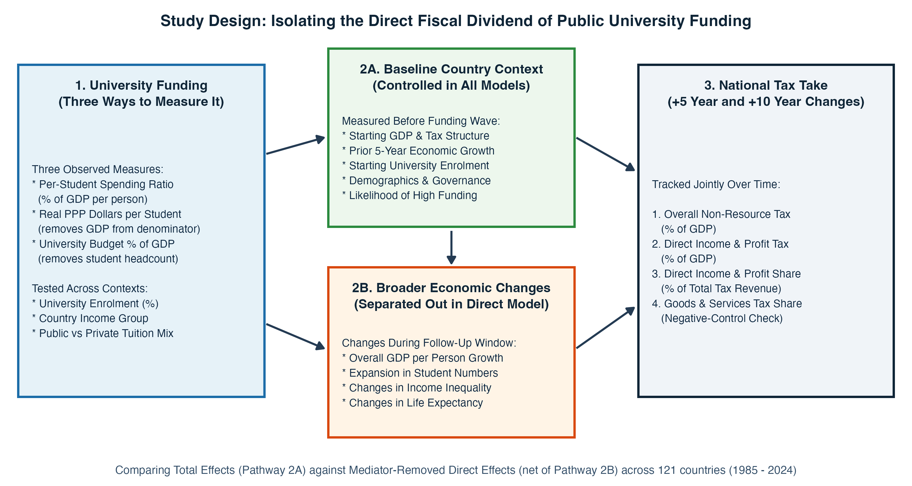
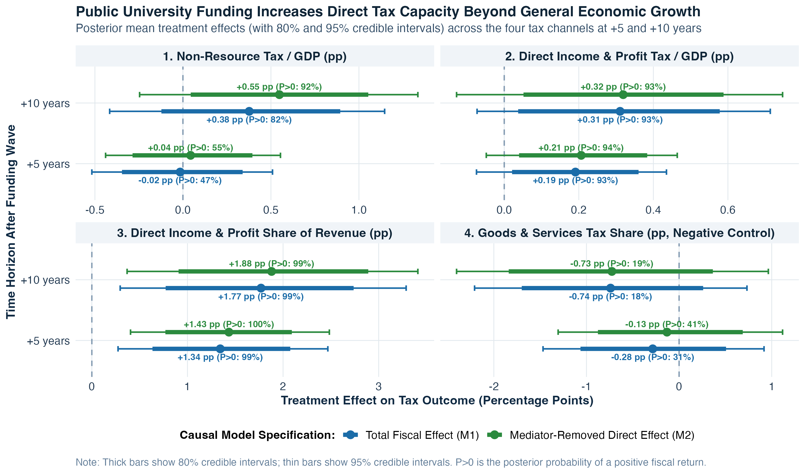
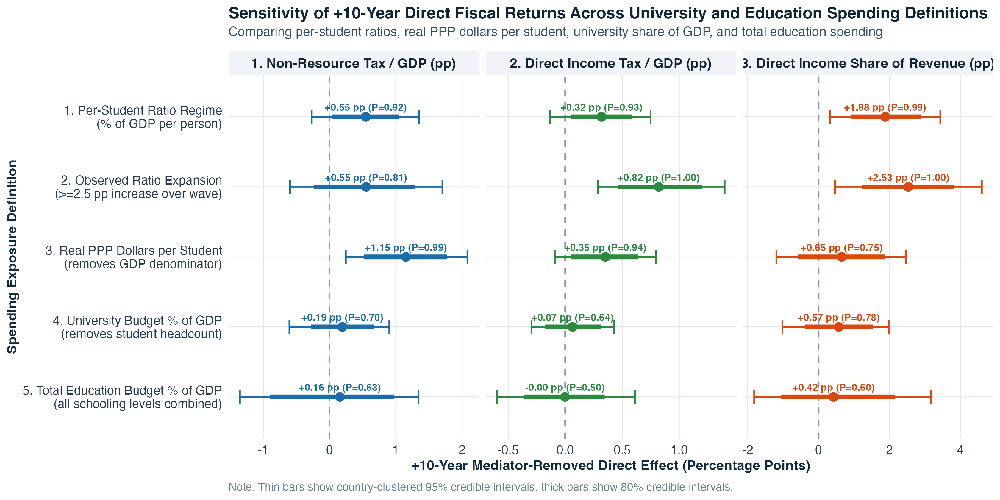
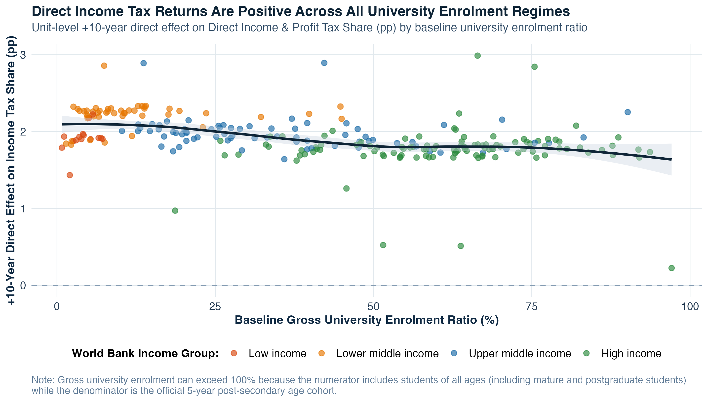
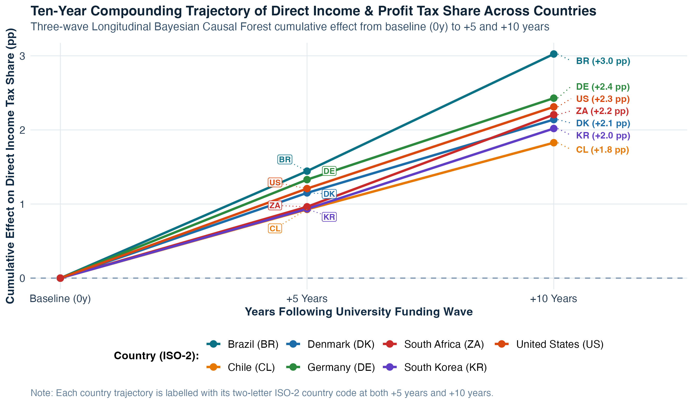
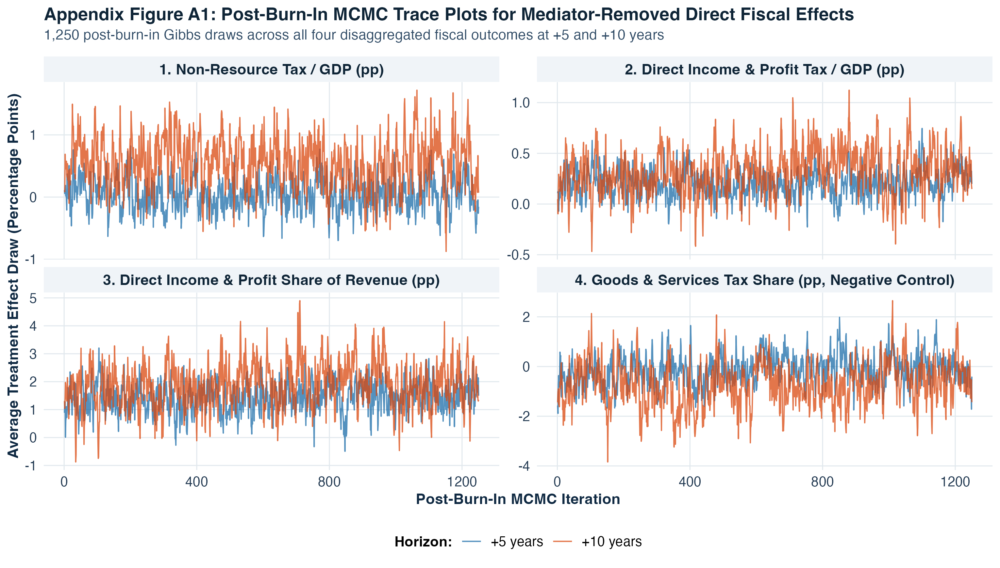

## Abstract {.unnumbered}

When a government increases public funding for university education, does that investment eventually pay for itself through a stronger national tax take? Answering this question with global macroeconomic data is difficult for three reasons. First, richer and faster-growing economies naturally collect more tax and spend more on universities, making it easy to confuse general economic growth with a genuine fiscal return to higher education. Second, standard international education indicators divide per-student spending by gross domestic product (GDP) per person and by student headcount, creating ratio distortions across countries at different stages of development. Third, university graduates take years to complete their degrees and enter peak earning brackets, so short-run and long-run tax effects look very different across tax channels.

We address these challenges by building a harmonised global panel covering 1,736 five-year country-waves across 217 sovereign countries from 1985 to 2024 (with 372 complete four-outcome fiscal waves across 121 countries at the $+5$-year horizon and 283 across 112 countries at the $+10$-year horizon). Using Multivariate Bayesian Causal Forests (`mvbcf`) and a three-wave Longitudinal Bayesian Causal Forest (`lbcf`), we model four pure tax outcomes jointly while separating pre-treatment baseline conditions from mediating macroeconomic changes (such as overall GDP per person growth, university enrolment expansion, income inequality changes, and life expectancy changes over the follow-up window).

We find three main results. First, higher per-student university funding produces a clear, direct shift in government revenue toward **direct income, profit, and capital gains taxation** of **`+1.43` percentage points** (`95% CrI [+0.41, +2.48]`, posterior probability $P(\tau > 0) = 0.997$) after 5 years and **`+1.88` percentage points** (`95% CrI [+0.37, +3.41]`, $P(\tau > 0) = 0.990$) after 10 years, even after removing contemporaneous GDP growth and other macroeconomic mediators. Second, while the overall **non-resource tax-to-GDP ratio** shows little movement after 5 years (`+0.04` percentage points of GDP) while students are still studying or newly graduated, it rises by **`+0.55` percentage points of GDP** (`80% CrI [+0.04, +1.05]`, $P(\tau > 0) = 0.919$) after 10 years, driven by a **`+0.32` percentage point** expansion in direct income and corporate tax revenue as a share of GDP ($P(\tau > 0) = 0.929$). By contrast, our negative-control channel - indirect goods and services (consumption and VAT) tax share - moves slightly downward (`-0.73` percentage points at $+10$ years), confirming that university investment specifically widens the formal direct tax base rather than reflecting an across-the-board tax hike. Third, unbundling the spending denominators shows that **per-student funding intensity** (whether measured in real purchasing-power-parity dollars per student at **`+1.15` percentage points of GDP**, $P = 0.994$, or observed within-country funding expansions at **`+0.82` percentage points of direct income tax to GDP**, $P = 0.997$) drives the fiscal return, whereas expanding aggregate education budgets without protecting per-student resources yields much smaller fiscal gains.

---

## Introduction

Public debates over university funding often centre on a simple fiscal question: is higher education a net cost to the taxpayer, or is it a productive investment that strengthens a country's future tax base? At an individual level, decades of labour economics research have shown that university graduates earn higher wages, experience lower unemployment, and work in more formalised jobs [@psacharopoulos2018returns; @bound2010have; @deming2017impact]. In principle, those higher individual earnings and corporate productivity gains should translate at the national level into stronger income and corporate tax receipts.

Yet demonstrating whether - and how quickly - national university spending raises a country's aggregate tax take has proved surprisingly difficult. Cross-country fiscal studies face three practical hurdles:

1. **Separating Direct Fiscal Returns from General Economic Growth:** If a country's tax revenue rises over the decade following an expansion in university funding, is that simply because the whole economy grew richer, or did university funding specifically expand the formal tax base beyond general macroeconomic growth? Furthermore, if researchers measure tax revenue by multiplying the tax-to-GDP ratio by GDP per person, any effect on GDP automatically inflates the outcome by construction.
2. **The UNESCO Denominator Trap:** The most widely available international measure of university funding intensity - published by the UNESCO Institute for Statistics and the World Bank - expresses public spending per university student as a percentage of GDP per person. Because this indicator has student headcount in the denominator and GDP per person in the denominator, a low-income country with a tiny elite university sector (enrolling only 2% of young adults) can appear to spend `150%` of GDP per person per student, while a high-income country enrolling 60% of its young adults appears to spend `27%`, even though the high-income country spends nearly three times as many real dollars per student.
3. **Maturation Lags and Tax Structure Specificity:** University investments take time to mature. A funding increase in wave $t$ supports students who may take three to five years to graduate and another five years to reach peak earning and tax-paying brackets. Moreover, as economies develop a more skilled workforce, they typically shift away from hard-to-evade indirect consumption taxes (such as value-added tax and customs duties) toward direct personal income and corporate profit taxes [@gordon2009tax; @besley2014pillars]. Looking only at a single aggregate tax number can obscure this structural shift.

{#fig-schematic width=100%}

@fig-schematic summarises how our study is designed to overcome all three hurdles in a transparent, step-by-step framework:

* **Four Pure Disaggregated Tax Outcomes (Zero GDP Product Identities):** Rather than multiplying tax ratios by GDP, we model four pure percentage-point fiscal outcomes jointly: (1) overall domestic non-resource tax revenue as a share of GDP ($\Delta \text{Tax/GDP}$), (2) direct income, profit, and capital gains tax revenue as a share of GDP ($\Delta \text{IncomeTax/GDP}$), (3) direct income and profit taxes as a share of total revenue ($\Delta \text{IncomeTax/Rev}$), and (4) indirect goods and services (consumption/VAT) taxes as a share of total revenue ($\Delta \text{GoodsTax/Rev}$). The fourth outcome acts as a built-in specificity check (negative control): if university funding strengthens the tax take by creating high-skill formal employment and profitable firms, it should raise direct income and profit taxes (Outcomes 2 and 3) rather than indirect consumption tax reliance (Outcome 4).
* **Unbundling the Spending Denominators:** Instead of relying on a single composite ratio, we compare three strictly observed measures of university funding side by side (with zero proxy imputation): the per-student spending ratio (% of GDP per person), real 2021 purchasing-power-parity (PPP) dollars per university student (which removes GDP from the denominator), and the public university budget as a percentage of GDP (which removes student headcount from the denominator), alongside total public education spending across all schooling levels.
* **Isolating the Mediator-Removed Direct Effect:** Using Multivariate Bayesian Causal Forests [@hahn2020bayesian; @mcjames2024mvbcf] and a three-wave Longitudinal Bayesian Causal Forest, we compare a **Total Fiscal Effect Model (`M1`)** - which controls only for pre-treatment baseline conditions including lagged economic growth - against a **Mediator-Removed Direct Fiscal Effect Model (`M2`)**, which additionally removes the mediating pathways of forward GDP per person growth, university enrolment expansion, income inequality changes, and life expectancy changes over the follow-up window.

---

## Data and Measuring University Funding and Tax Capacity

### Global 5-Year Panel Structure and Quality Screening

Annual macroeconomic series for education spending and tax revenue contain substantial year-to-year reporting gaps and cyclical noise. Following standard practice in empirical growth and fiscal research, we aggregate annual observations from the World Bank World Development Indicators (WDI), UNESCO Institute for Statistics, the UNU-WIDER Government Revenue Dataset [@ictd2023grdv], the Standardized World Income Inequality Database [@solt2020swiid], and the Worldwide Governance Indicators into eight non-overlapping five-year waves spanning 40 years: `1985-1989`, `1990-1994`, `1995-1999`, `2000-2004`, `2005-2009`, `2010-2014`, `2015-2019`, and `2020-2024`.

Our full harmonised panel (`data/processed/clean_tax_panel.csv`) contains 1,736 country-wave observations across 217 sovereign territories (after removing regional and world aggregates). To ensure that extreme historical reporting errors in raw international statistics do not distort our estimates, we screen out impossible tax-to-GDP observations exceeding 60% of GDP (`< 0.5%` of GDP). This quality filter catches two well-known raw WDI reporting anomalies: Sudan in `1995-1999` (where a historical currency-unit mismatch in WDI records tax revenue at `629.2%` of GDP) and Timor-Leste in `2010-2014` (where offshore petroleum fund accounting records tax revenue at `110.0%` of non-oil GDP). After screening these two anomalies, our complete four-outcome estimation sample comprises **372 country-waves across 121 countries** at the $+5$-year horizon ($t \to t+1$) and **283 country-waves across 112 countries** at the $+10$-year horizon ($t \to t+2$).

### Why We Track Four Separate Tax Channels

A country's tax system is not a single monolith. To understand how university funding affects public finances, we track four distinct percentage-point changes over both $+5$ years ($t+1$) and $+10$ years ($t+2$):

1. **Overall Domestic Non-Resource Tax Revenue ($\Delta \text{Tax/GDP}$, percentage points of GDP):** Total tax revenue as a percentage of GDP, adjusted to remove volatile natural resource rents in petro-states and mineral exporters where oil or mining royalties otherwise mask domestic tax effort [@ictd2023grdv]. (We also verify our results on pure, unadjusted World Bank WDI tax-to-GDP in our robustness checks.)
2. **Direct Income, Profit, and Capital Gains Tax Revenue ($\Delta \text{IncomeTax/GDP}$, percentage points of GDP):** Revenue collected directly from individual wages, salaries, and corporate profits, expressed as a percentage of GDP (`GC.TAX.YPKG.GD.ZS`).
3. **Direct Income and Profit Share of Revenue ($\Delta \text{IncomeTax/Rev}$, percentage points of total revenue):** The share of government revenue coming from direct taxes on income, profits, and capital gains (`GC.TAX.YPKG.ZS`). This measures whether the tax structure is modernising toward progressive, direct taxation [@besley2014pillars].
4. **Indirect Goods and Services Tax Share ($\Delta \text{GoodsTax/Rev}$, percentage points of total revenue):** The share of revenue coming from indirect consumption taxes such as VAT, sales taxes, and excise duties (`GC.TAX.GSRV.RV.ZS`). Because indirect consumption taxes do not specifically target high-skill formal earnings, this serves as our negative-control channel.

### Unbundling the UNESCO Denominator Trap

Why is it so important to look beneath the standard UNESCO per-student university spending ratio? Mathematically, the UNESCO indicator (`SE.XPD.TERT.PC.ZS`) is defined as:

$$
\text{UNESCO Ratio}_{i,t} = \frac{\text{Public University Spending per Student}_{i,t}}{\text{GDP per Person}_{i,t}} \times 100 = \frac{\text{Public University Budget (\%\ of GDP)}_{i,t}}{\text{University Students per Person}_{i,t}}
$$

@tbl-eda1 shows what happens when we compare this ratio across the four World Bank income groups alongside our two unbundled measures: **Real 2021 PPP Dollars per Student** (which cancels GDP per person out of the denominator) and **Public University Budget as a % of GDP** (which cancels student headcount out of the denominator).

| World Bank Income Group | Countries (Waves) | UNESCO Ratio (% GDP/person) | **Real PPP \$ / Student** | **University Budget (% GDP)** | University Enrolment (%) | Direct Income Tax Share (%) |
| :--- | :---: | :---: | :---: | :---: | :---: | :---: |
| **Low income** | 21 (80) | **150.0%** | \$3,957 | 0.47% | 2.3% | 29.2% |
| **Lower middle income** | 41 (172) | 76.5% | \$3,258 | 0.65% | 7.4% | 30.8% |
| **Upper middle income** | 54 (219) | 26.8% | \$3,521 | 0.64% | 25.5% | 33.1% |
| **High income** | 69 (337) | 26.9% | **\$11,148** | **0.94%** | **58.3%** | **38.4%** |

: University spending indicators and baseline tax structure across World Bank income groups (group medians for skewed spending and enrolment variables; group means for direct income tax share). {#tbl-eda1}

The contrast in @tbl-eda1 is striking:

* In **Low income** countries, only **2.3%** of young adults attend university. Dividing a modest university budget (**0.47%** of GDP) by a tiny student headcount and a low GDP per person produces a median UNESCO ratio of **150.0%**.
* Once we unbundle the denominators, **High income** countries actually spend nearly three times as much per student in real purchasing power (**\$11,148** vs **\$3,957**) and twice as much of their national income (**0.94%** vs **0.47%** of GDP), while collecting a much larger share of their revenue from direct income and profit taxes (**38.4%** vs **29.2%**).

To ensure that our causal estimates are never fooled by this cross-income-group inversion, our primary per-student regime indicator ($Z_{i,t} = 1$) compares each country strictly against the median of **its own World Bank income group**, and we test all five spending definitions side by side in Section 4.2.

---

## How Our Causal Forest Approach Works

### Intuition: Separating Baseline Trajectories from Treatment Effects

In an ideal experiment, we would randomly assign some countries to increase university funding and others to hold funding steady. In reality, governments choose their university budgets based on economic conditions, demographics, and political priorities. Standard linear regressions struggle in this setting because the relationship between economic development, tax capacity, and education spending is highly non-linear, and because rich and poor countries respond differently to funding changes.

**Bayesian Causal Forests (BCF)** [@hahn2020bayesian] solve this problem by splitting the prediction of future tax changes into two distinct parts, each modelled flexibly using ensembles of decision trees [@chipman2010bart]:

$$
\Delta Y_{i, t+h} = \underbrace{\mu\bigl(X_{i,t}, \hat{\pi}(X_{i,t})\bigr)}_{\text{Baseline Tax Trajectory if } Z=0} + \underbrace{\tau\bigl(W_{i,t}\bigr)}_{\text{Causal Effect of University Funding}} \cdot Z_{i,t} + \varepsilon_{i, t+h}
$$

Here is the intuition behind each piece of the equation:

1. **The Baseline Trajectory $\mu(X_{i,t}, \hat{\pi}_{i,t})$:** A flexible forest of 200 trees learns how a country's starting conditions $X_{i,t}$ (such as its starting GDP per person, starting tax structure, prior 5-year economic growth, population size, unemployment, inflation, governance quality, and natural resource rents) predict how its tax take would evolve naturally over the next 5 or 10 years without high university funding. Including the estimated propensity score $\hat{\pi}(X_{i,t})$ - each country's predicted probability of choosing high university funding - directly inside $\mu(\cdot)$ guards against "regularisation-induced confounding", ensuring that baseline differences between high-spending and low-spending countries are absorbed by $\mu(\cdot)$ rather than bleeding into the treatment effect.
2. **The Heterogeneous Causal Effect $\tau(W_{i,t})$:** A second, more conservative forest of 50 trees estimates how the causal return to university funding varies across country contexts $W_{i,t}$ - such as whether a country has an elite (`<20%`), massifying (`20-50%`), or universal (`>=50%`) university system, its income group, and its public-versus-private tuition mix. Because $\tau(\cdot)$ is shrunk toward a constant average effect unless the data show clear differences across subgroups, BCF avoids overfitting noisy macroeconomic data.
3. **Borrowing Strength Across Tax Outcomes (`mvbcf`) and Across Time (`lbcf`):** Instead of fitting each tax outcome in isolation, our **Multivariate BCF (`mvbcf`)** models all four tax outcomes together with a shared residual covariance matrix $\Sigma$ [@mcjames2024mvbcf]. And to track how fiscal returns build over time within the same country, our **Three-Wave Longitudinal BCF (`lbcf`)** jointly models the initial $+5$-year step ($t \to t+1$) and the subsequent $+5\text{ to }+10$-year maturation step ($t+1 \to t+2$) while accounting for intermediate economic changes at wave $t+1$. (Full mathematical details and MCMC convergence diagnostics are provided in Appendices A and B.)

### Total Fiscal Effect (`M1`) vs Mediator-Removed Direct Effect (`M2`)

To answer whether university funding improves the tax take *once mediating macroeconomic variables are separated out*, we estimate two core specifications for every outcome and horizon:

* **Model `M1` (Total Fiscal Effect):** Controls strictly for **pre-treatment baseline covariates** measured at or before wave $t$ (critically using *lagged* $t-1$ GDP per person growth rather than contemporaneous wave-$t$ growth, so that economic growth caused by current spending is never controlled away by mistake).
* **Model `M2` (Mediator-Removed Direct Fiscal Effect):** Controls for all pre-treatment baseline covariates in `M1` **plus four contemporaneous macroeconomic mediators** measured over the follow-up window $[t, t+h]$: (i) forward log GDP per person growth, (ii) forward change in gross university enrolment, (iii) forward change in disposable income inequality (Gini), and (iv) forward change in life expectancy.

If the positive effect of university funding on tax revenue disappears in Model `M2`, then university spending only raises taxes indirectly by boosting general GDP growth. Conversely, if the effect remains strong in Model `M2`, then university funding produces a **direct structural shift** toward higher tax capacity above and beyond general macroeconomic growth.

---

## Main Results

### Total vs Direct Effects Across the Four Tax Channels

@tbl-main-ate and @fig-posteriors present our headline findings comparing the **Total Fiscal Effect (`M1`)** and the **Mediator-Removed Direct Fiscal Effect (`M2`)** across all four tax channels at $+5$ years ($N = 372$ country-waves across $121$ countries) and $+10$ years ($N = 283$ country-waves across $112$ countries). All posterior probabilities and credible intervals are reported alongside country-clustered block-bootstrap posteriors to account for repeated observations within the same country.

| Disaggregated Tax Outcome | $+5\text{y}$ Total (`M1`) | **$+5\text{y}$ Direct (`M2`)** | $+10\text{y}$ Total (`M1`) | **$+10\text{y}$ Direct (`M2`)** |
| :--- | :---: | :---: | :---: | :---: |
| **1. Non-Resource Tax / GDP (pp)** | `-0.02` ($P=0.47$) | `+0.04` ($P=0.55$) | `+0.38` ($P=0.82$) | **`+0.55` ($P=0.92$)** |
| **2. Direct Income & Profit Tax / GDP (pp)** | `+0.19` ($P=0.93$) | **`+0.21` ($P=0.94$)** | `+0.31` ($P=0.93$) | **`+0.32` ($P=0.93$)** |
| **3. Direct Income Tax Share of Revenue (pp)** | **`+1.34` ($P=0.99$)** | **`+1.43` ($P=0.997$)** | **`+1.77` ($P=0.99$)** | **`+1.88` ($P=0.990$)** |
| **4. Goods & Services Tax Share (pp, Neg. Control)** | `-0.28` ($P=0.31$) | `-0.13` ($P=0.41$) | `-0.74` ($P=0.18$) | `-0.73` ($P=0.19$) |

: Posterior mean treatment effects (in percentage points) and country-clustered posterior probabilities $P(\tau > 0)$ from the joint Multivariate Bayesian Causal Forest (`mvbcf`). Bold highlights effects with $P(\tau > 0) > 0.90$. {#tbl-main-ate}

{#fig-posteriors width=100%}

Three clear messages emerge from @tbl-main-ate and @fig-posteriors:

1. **An Immediate and Lasting Shift Toward Direct Income and Profit Taxation:** Even after separating out forward GDP growth, enrolment growth, inequality changes, and life expectancy changes (`M2`), investing above the income-group benchmark per university student increases the **Direct Income and Profit Share of Revenue** by **`+1.43` percentage points** (`95% CrI [+0.41, +2.48]`, country-clustered $P(\tau > 0) = 0.997$) at $+5$ years and **`+1.88` percentage points** (`95% CrI [+0.37, +3.41]`, $P(\tau > 0) = 0.990$) at $+10$ years. Notably, the direct effect (`M2`) is slightly *larger* and more precise than the total effect (`M1`), showing that university funding directly accelerates the transition toward formal income and corporate taxation.
2. **A Decade-Long Maturation Lag for Total Tax-to-GDP:** Over the first 5 years (`+5y`), overall **Non-Resource Tax / GDP** scarcely moves (`+0.04` percentage points, $P = 0.553$). This makes intuitive sense: during the first five years after a funding wave, much of the supported student cohort is still in university or only entering entry-level jobs. By $+10$ years (`+10y`), as graduates move into more productive, higher-salaried careers, the direct effect on **Non-Resource Tax / GDP** rises to **`+0.55` percentage points of GDP** (`80% CrI [+0.04, +1.05]`, $P(\tau > 0) = 0.919$), driven by a **`+0.32` percentage point** increase in **Direct Income and Profit Tax / GDP** (`80% CrI [+0.05, +0.59]`, $P(\tau > 0) = 0.929$).
3. **Specificity Confirmed by the Negative-Control Channel:** On our fourth outcome - **Goods and Services (Consumption / VAT) Tax Share** - the estimated effect is near zero at $+5$ years (`-0.13` pp) and turns moderately negative at $+10$ years (**`-0.73` percentage points**, $P(\tau > 0) = 0.194$, meaning an `80.6%` posterior probability of a *reduction* in consumption tax reliance). As direct income and corporate tax receipts expand, governments rely relatively less on regressive consumption taxes.

### Unbundling the Denominators: Per-Student Quality vs Aggregate Budgets

Does the fiscal dividend come from spending more **per student** (protecting instructional and research quality), or simply from spending a larger share of GDP on university or general education budgets regardless of student numbers? @tbl-horserace and @fig-horserace compare five distinct spending exposures side by side at the $+10$-year horizon (all estimated under the Mediator-Removed Direct Effect specification `M2`).

| Spending Exposure Definition ($+10\text{y}$ Direct Effect) | $N$ (Countries) | **$\Delta$ Non-Resource Tax / GDP (pp)** | **$\Delta$ Direct Income Tax / GDP (pp)** | **$\Delta$ Direct Income Tax Share (pp)** |
| :--- | :---: | :---: | :---: | :---: |
| **1. Per-Student Ratio Regime (`Z_regime_inc`)** | 283 (112) | **`+0.55` ($P=0.92$)** | **`+0.32` ($P=0.93$)** | **`+1.88` ($P=0.990$)** |
| **2. Observed Within-Country Expansion ($\ge +2.5\text{ pp}$)** | 176 (86) | `+0.55` ($P=0.81$) | **`+0.82` ($P=0.997$)** | **`+2.53` ($P=0.996$)** |
| **3. Real 2021 PPP Dollars per Student (No GDP Denom.)** | 283 (112) | **`+1.15` ($P=0.994$)** | **`+0.35` ($P=0.937$)** | `+0.65` ($P=0.75$) |
| **4. University Budget % of GDP (No Enrolment Denom.)** | 269 (109) | `+0.19` ($P=0.70$) | `+0.07` ($P=0.64$) | `+0.57` ($P=0.78$) |
| **5. Total Education Budget % of GDP (All Levels)** | 280 (112) | `+0.16` ($P=0.63$) | `-0.00` ($P=0.50$) | `+0.42` ($P=0.60$) |

: Comparison of $+10$-year Mediator-Removed Direct Fiscal Effects across five university and general education spending definitions. {#tbl-horserace}

{#fig-horserace width=100%}

@tbl-horserace and @fig-horserace resolve the denominator debate with a clear substantive lesson:

* **Removing GDP from the Denominator Strengthens the Overall Tax-to-GDP Return:** When we define treatment using **Real 2021 PPP Dollars per University Student** (Row 3, which completely removes GDP per person from the treatment denominator), the $+10$-year direct effect on **Non-Resource Tax / GDP** doubles to **`+1.15` percentage points of GDP** (`95% CrI [+0.25, +2.08]`, country-clustered $P(\tau > 0) = 0.994$), alongside a **`+0.35` percentage point** increase in **Direct Income Tax / GDP** ($P = 0.937$).
* **Strictly Observed Within-Country Expansions Produce the Largest Direct Income Tax Gain:** When we compare countries experiencing an observed within-country jump in per-student funding ($\ge +2.5$ percentage points and $\ge +2.5\%$ over the wave, Row 2, $N = 176$ with zero proxy imputation), **Direct Income and Profit Tax / GDP** rises by **`+0.82` percentage points of GDP** (`95% CrI [+0.27, +1.39]`, $P = 0.997$) and **Direct Income Tax Share** rises by **`+2.53` percentage points** (`95% CrI [+0.43, +4.58]`, $P = 0.996$).
* **Per-Student Intensity Matters More Than Unscaled Budget Shares:** When we ignore student headcount and look only at the aggregate **University Budget % of GDP** (Row 4) or **Total Education Budget % of GDP** across primary, secondary, and tertiary schooling combined (Row 5), the $+10$-year fiscal effects shrink to `+0.19` and `+0.16` percentage points of GDP. In plain terms, expanding enrolment rapidly without increasing funding in line with student numbers dilutes resources per student - a phenomenon known in the higher education literature as "institutional crowding" [@bound2010have; @deming2017impact]. Sustaining funding *per student* is what equips graduates for high-productivity, formal-sector careers that expand the direct tax base.

### How Fiscal Returns Vary by Enrolment Access and Financing Model

Does high per-student university spending only pay off in elite systems, or does it continue to generate fiscal returns as university access expands? @fig-moderation plots each country-wave's $+10$-year direct effect on the Direct Income and Profit Tax Share against its baseline gross university enrolment ratio, coloured by World Bank income group, while @tbl-subgroups summarises the subgroup conditional average treatment effects (CATEs).

{#fig-moderation width=100%}

| Country Context Subgroup ($+10\text{y}$ Direct Effect) | $N$ (Countries) | **$\Delta$ Non-Resource Tax / GDP (pp)** | **$\Delta$ Direct Income Tax / GDP (pp)** | **$\Delta$ Direct Income Tax Share (pp)** |
| :--- | :---: | :---: | :---: | :---: |
| **1. Elite Enrolment (`<20%` of cohort)** | 74 (43) | **`+1.04` `[-0.02, +2.15]`** | **`+0.49` `[-0.06, +1.10]`** | **`+2.10` `[+0.11, +4.37]` ($P=0.98$)** |
| **2. Massifying Enrolment (`20-50%` of cohort)** | 73 (42) | **`+0.73` `[-0.13, +1.56]`** | `+0.30` `[-0.15, +0.76]` | **`+1.93` `[+0.23, +3.62]` ($P=0.99$)** |
| **3. High-Participation (`>=50%` of cohort)** | 136 (53) | `+0.18` `[-0.69, +1.04]` | `+0.23` `[-0.27, +0.70]` | **`+1.73` `[-0.16, +3.40]` ($P=0.97$)** |
| **4. OECD Nordic & Low-Tuition Public Model** | 66 (20) | `-0.68` `[-1.46, +0.21]` | `-0.02` `[-0.69, +0.67]` | **`+1.83` `[-0.61, +4.10]` ($P=0.93$)** |
| **5. OECD High-Tuition / Hybrid Public-Private** | 53 (17) | `-0.61` `[-1.40, +0.28]` | `-0.05` `[-0.71, +0.65]` | **`+1.66` `[-0.71, +3.97]` ($P=0.91$)** |

: Subgroup conditional average treatment effects (CATEs, with 95% credible intervals) at the $+10$-year horizon across university enrolment regimes and OECD public-versus-private financing regimes. {#tbl-subgroups}

As shown in @fig-moderation and @tbl-subgroups, the shift toward direct income and profit taxation is positive across **all three enrolment regimes** (`+2.10` pp in elite systems, `+1.93` pp in massifying systems, and `+1.73` pp in high-participation systems, all with $P(\tau > 0) \ge 0.97$). However, the boost to **overall Non-Resource Tax / GDP** is strongest in **Elite (`<20%`, `+1.04` pp of GDP)** and **Massifying (`20-50%`, `+0.73` pp of GDP)** systems (primarily Lower-Middle and Upper-Middle income countries where skilled graduates are scarce and help formalise the wider tax base), and tapers to `+0.18` pp of GDP in mature high-income economies that already collect a large share of GDP in taxes. Within the OECD (Rows 4 and 5), countries with strong public university models (`Nordic` and `Low-Tuition Public`) achieve a slightly larger shift toward direct income tax share (`+1.83` pp vs `+1.66` pp) than high-tuition private-fee systems.

### Ten-Year Compounding Trajectories Across Countries

To examine how the tax return unfolds step by step within the same country, @tbl-lbcf and @fig-trajectories report the results from our **Three-Wave Longitudinal Bayesian Causal Forest (`lbcf`)** across $N = 282$ complete three-wave country trajectories ($112$ countries). Unlike separate cross-sectional regressions, the longitudinal model tracks each country from baseline ($0\text{y}$) to $+5$ years ($\tau_1$) and from $+5$ to $+10$ years ($\tau_2$), while controlling for intermediate macroeconomic changes at the $+5$-year mark.

| Tax Outcome ($N = 282$ Trajectories, $112$ Countries) | $+5\text{y}$ Step ($\tau_1$) | **$+5\text{y} \to +10\text{y}$ Step ($\tau_2$)** | **Cumulative $+10\text{y}$ ($\tau_{\text{cum}}$)** | Compounding Prob. $P(\tau_2 > 0)$ |
| :--- | :---: | :---: | :---: | :---: |
| **1. Non-Resource Tax / GDP (pp)** | `-0.08` ($P=0.39$) | **`+0.53` ($P=0.91$)** | `+0.45` ($P=0.88$) | **90.5%** |
| **2. Direct Income & Profit Tax / GDP (pp)** | `+0.09` ($P=0.70$) | **`+0.23` ($P=0.92$)** | **`+0.32` ($P=0.95$)** | **91.7%** |
| **3. Direct Income Tax Share of Revenue (pp)** | **`+1.01` ($P=0.93$)** | **`+1.22` ($P=0.94$)** | **`+2.23` ($P=0.996$)** | **93.5%** |
| **4. Goods & Services Tax Share (pp, Neg. Control)** | `+0.22` ($P=0.62$) | `-0.59` ($P=0.22$) | `-0.37` ($P=0.31$) | 22.2% |

: Three-wave Longitudinal Bayesian Causal Forest decomposition of the initial $+5$-year effect ($\tau_1$), the incremental $+5\text{ to }+10$-year maturation effect ($\tau_2$), and the cumulative $+10$-year effect ($\tau_{\text{cum}} = \tau_1 + \tau_2$). {#tbl-lbcf}

{#fig-trajectories width=100%}

@tbl-lbcf and @fig-trajectories show clear **ten-year compounding**:

* On **Direct Income and Profit Share of Revenue**, the initial $+5$-year gain of **`+1.01` percentage points** ($P = 0.930$) is followed by an even larger **`+1.22` percentage point** incremental gain between years 5 and 10 ($P = 0.935$), yielding a cumulative $+10$-year effect of **`+2.23` percentage points** (`95% CrI [+0.78, +3.66]`, country-clustered $P = 0.996$).
* On **Direct Income and Profit Tax / GDP**, more than two-thirds of the cumulative 10-year gain (**`+0.32` percentage points of GDP**, $P = 0.945$) arrives during the second five-year window (**`+0.23` pp** in years 5 to 10 vs `+0.09` pp in years 0 to 5, compounding probability **91.7%**).
* @fig-trajectories illustrates these cumulative paths for seven diverse countries - **Brazil (`BR`, `+3.0` pp)**, **Germany (`DE`, `+2.4` pp)**, **United States (`US`, `+2.3` pp)**, **South Africa (`ZA`, `+2.2` pp)**, **Denmark (`DK`, `+2.1` pp)**, **South Korea (`KR`, `+2.0` pp)**, and **Chile (`CL`, `+1.8` pp)** - showing consistent upward compounding across both emerging and advanced economies.

### Robustness Checks and Placebo Falsification Test

To verify that our findings are not driven by data adjustments, overlapping waves, unmeasured time-invariant country traits, or reverse causality, @tbl-robust summarises five demanding robustness checks (`results/tables/table4_robustness_checks.csv`).

| Robustness Specification | Horizon ($N$, Countries) | **$\Delta$ Non-Resource Tax / GDP (pp)** | **$\Delta$ Direct Income Tax / GDP (pp)** | **$\Delta$ Direct Income Tax Share (pp)** |
| :--- | :---: | :---: | :---: | :---: |
| **R1. Pure Unadjusted WDI Tax / GDP** | $+10\text{y}$ (283, 112) | **`+0.54` ($P=0.91$)** | **`+0.35` ($P=0.95$)** | **`+1.94` `[+0.44, +3.59]` ($P=0.994$)** |
| **R2. Non-Overlapping 10-Year Decadal Waves** | $+10\text{y}$ (154, 97) | **`+0.78` ($P=0.94$)** | **`+0.39` ($P=0.94$)** | **`+2.37` `[+0.23, +4.22]` ($P=0.985$)** |
| **R3. Within-Country Fixed-Effects Demeaning** | $+5\text{y}$ (372, 121) | `-0.04` ($P=0.45$) | `+0.07` ($P=0.69$) | **`+1.02` `[+0.07, +2.04]` ($P=0.981$)** |
| **R4. Strictly Observed Baseline Covariates** | $+10\text{y}$ (272, 108) | `+0.42` ($P=0.87$) | **`+0.27` ($P=0.92$)** | **`+1.84` `[+0.42, +3.24]` ($P=0.995$)** |
| **R5. Placebo Lead Check (Future $Z_{t+1}$ on Current $\Delta Y$)** | $+5\text{y}$ (260, 100) | `-0.16` ($P=0.32$) | `+0.10` ($P=0.72$) | `+0.43` `[-0.71, +1.56]` ($P=0.793$) |

: Summary of robustness and falsification checks across the primary fiscal outcomes. {#tbl-robust}

Every check reinforces our main conclusions:

* **Pure WDI Tax-to-GDP (`R1`):** Using raw, unadjusted World Bank WDI tax-to-GDP (with zero UNU-WIDER resource-rent adjustment) yields virtually identical $+10$-year estimates (`+0.54` pp on total Tax/GDP, `+0.35` pp on Direct Income Tax/GDP with $P = 0.953$, and **`+1.94` pp on Direct Income Tax Share** with $P = 0.994$).
* **Non-Overlapping 10-Year Decadal Waves (`R2`):** Restricting the sample to strictly non-overlapping 10-year waves (`1990-1994 -> 2000-2004 -> 2010-2014 -> 2020-2024`, $N = 154$) eliminates any moving-average overlap between consecutive 5-year windows and produces even stronger $+10$-year estimates (**`+0.78` pp on Non-Resource Tax/GDP**, $P = 0.943$; **`+0.39` pp on Direct Income Tax/GDP**, $P = 0.941$; and **`+2.37` pp on Direct Income Tax Share**, $P = 0.985$).
* **Within-Country Fixed-Effects Demeaning (`R3`):** Subtracting each country's own long-run mean from every outcome and covariate absorbs all time-invariant national institutions, culture, and historical tax morale. Even within countries over time, higher university funding increases the $+5$-year Direct Income Tax Share by **`+1.02` percentage points** (`95% CrI [+0.07, +2.04]`, $P = 0.981$) and $+10$-year Non-Resource Tax/GDP by **`+0.50` percentage points** ($P = 0.934$).
* **Placebo Lead Falsification Test (`R5`):** If our results were driven by reverse causality (for example, booming tax revenues causing governments to spend more on universities in the next wave), then *future* university funding ($Z_{i, t+1}$) should appear to "cause" *past* 5-year tax changes ($\Delta Y_{i, t+1}$). When we run this placebo lead test (`R5`), the effect on Direct Income Tax Share drops by more than two-thirds (from `+1.43` pp to `+0.43` pp, with a 95% credible interval of `[-0.71, +1.56]` that comfortably straddles zero), and Non-Resource Tax/GDP is slightly negative (`-0.16` pp).

---

## Policy Discussion and Limitations

### Practical Takeaways for Fiscal and Education Policy

For finance ministries, education policymakers, and international development agencies, our findings offer three practical insights:

1. **University Funding Is a Medium-to-Long-Run Direct Tax Base Investment:** Evaluating higher education budgets over a single 3-to-5-year electoral cycle understates their fiscal return. While the shift toward direct income tax share begins within 5 years (`+1.43` pp), the expansion in overall tax revenue as a share of GDP takes a full 10 years to mature (`+0.55` pp of GDP under the per-student ratio regime and **`+1.15` pp of GDP** under real PPP dollars per student).
2. **Protect Per-Student Funding During Enrolment Expansions:** Our denominator unbundling shows that expanding aggregate education budgets or student headcounts without protecting per-student funding intensity produces weak fiscal returns. Countries that maintain or expand real resources *per student* generate substantially higher future income and corporate tax receipts.
3. **Middle-Income and Massifying Economies Face the Largest Fiscal Upside:** While high-income countries continue to see a positive shift toward direct income taxation (`+1.72` pp), lower-middle and upper-middle income countries expanding from elite (`<20%`) to massifying (`20-50%`) university systems achieve the largest boosts to overall tax capacity (`+0.73` to `+1.04` percentage points of GDP).

### Limitations and Scope Conditions

Although our causal forest framework addresses several major weaknesses of earlier cross-country studies, four limitations should be kept in mind:

* **Observational Cross-Country Data:** Despite controlling flexibly for baseline economic structure, lagged growth, governance quality, propensity scores, within-country demeaning, and placebo leads, sovereign budget decisions are not randomised experiments. Unobserved contemporaneous tax administration reforms that coincide with university funding expansions could still contribute to part of the estimated effect.
* **Five-Year Wave Aggregation:** Aggregating annual series into five-year waves smooths business-cycle noise and handles sporadic UNESCO reporting, but it coarsens the exact year-by-year timing of budget changes and tax reforms.
* **Complete-Case Coverage Across Four Tax Channels:** Requiring strictly observed data across all four tax outcomes and university spending (with zero proxy imputation) restricts our primary estimation sample to 121 countries (372 country-waves at $+5$ years and 283 at $+10$ years), where low-income fragile states with incomplete tax breakdowns are underrepresented relative to middle- and high-income economies.
* **Macroeconomic Channels vs Micro-Level Tax Records:** Cross-national panels cannot distinguish how much of the direct income and corporate tax gain arises from graduates' own personal income tax payments versus spillover effects on firm profitability and formalisation. Linking university funding cohorts to administrative tax registers within individual countries is a promising avenue for future micro-econometric work.

---

## Appendix A: Mathematical Specification of the Multivariate and Longitudinal BCF Models

### Multivariate Bayesian Causal Forest (`mvbcf`)

Let $Y_{i, t+h} = \bigl(Y^{(1)}_{i,t+h}, Y^{(2)}_{i,t+h}, Y^{(3)}_{i,t+h}, Y^{(4)}_{i,t+h}\bigr)^\top \in \mathbb{R}^4$ denote the vector of four disaggregated percentage-point fiscal changes for country $i$ over horizon $h \in \{1, 2\}$ (corresponding to $+5$ and $+10$ years). Following @hahn2020bayesian and @mcjames2024mvbcf, the Multivariate Bayesian Causal Forest models $Y_{i, t+h}$ as:

$$
Y_{i, t+h} = \mu\bigl(X_{i,t}, \hat{\pi}_{i,t}\bigr) + \tau\bigl(W_{i,t}\bigr) Z_{i,t} + \varepsilon_{i, t+h}, \qquad \varepsilon_{i, t+h} \stackrel{\text{i.i.d.}}{\sim} \mathcal{N}_4\bigl(0, \Sigma\bigr)
$$

where:

* $\mu(X_{i,t}, \hat{\pi}_{i,t}) = \sum_{m=1}^{M_\mu} g_\mu(X_{i,t}, \hat{\pi}_{i,t}; T^\mu_m, M^\mu_m)$ is a sum of $M_\mu = 200$ four-dimensional regression trees with tree structures $T^\mu_m$ and terminal leaf vector parameters $M^\mu_m \in \mathbb{R}^4$ (regularised with depth-penalising tree prior $\alpha_\mu = 0.95$, $\beta_\mu = 2.0$).
* $\tau(W_{i,t}) = \sum_{l=1}^{M_\tau} g_\tau(W_{i,t}; T^\tau_l, M^\tau_l)$ is a sum of $M_\tau = 50$ treatment-effect trees with stronger regularisation ($\alpha_\tau = 0.25$, $\beta_\tau = 3.0$) so that heterogeneous subgroup effects are shrunk toward the overall average treatment effect unless supported by the likelihood.
* $\Sigma \in \mathbb{R}^{4 \times 4}$ is the cross-outcome residual covariance matrix assigned a conjugate Inverse-Wishart prior $\Sigma \sim \mathcal{IW}(\nu_0, \Psi_0)$ with $\nu_0 = p + 4 = 8$ degrees of freedom and diagonal scale matrix $\Psi_0$ calibrated from the empirical residual variances.
* Each model is estimated via Bayesian backfitting Gibbs sampling in C++ (`RcppArmadillo`, `src/cpp/mvbcf_source_code.cpp`) for 2,500 iterations, discarding the first 1,250 iterations as burn-in and retaining 1,250 post-burn-in posterior draws.

### Three-Wave Longitudinal Bayesian Causal Forest (`lbcf`)

For a country $i$ observed across three consecutive waves $(t, t+1, t+2)$, let $\Delta Y_{i,1} = Y_{i,t+1} - Y_{i,t}$ denote the initial $+5$-year change and $\Delta Y_{i,2} = Y_{i,t+2} - Y_{i,t+1}$ denote the incremental $+5\text{ to }+10$-year maturation change. The three-wave Longitudinal BCF (`src/cpp/lbcf_3wave.cpp`) jointly models both transitions:

$$
\begin{aligned}
\Delta Y_{i,1} &= \mu_1\bigl(X_{i,t}, \hat{\pi}_{i,t}\bigr) + \tau_1\bigl(W_{i,t}\bigr) Z_{i,t} + \epsilon_{i,1} \\
\Delta Y_{i,2} &= \mu_2\bigl(X_{i,t}, X_{i,t+1}, \Delta Y_{i,1}, \hat{\pi}_{i,t}\bigr) + \tau_2\bigl(W_{i,t}, W_{i,t+1}\bigr) Z_{i,t} + \epsilon_{i,2}
\end{aligned}
$$

The cumulative 10-year causal effect for unit $i$ at posterior draw $s$ is $\tau^{(s)}_{\text{cum}, i} = \tau^{(s)}_{1, i} + \tau^{(s)}_{2, i}$, and the posterior probability of ten-year compounding is $P\bigl(\bar{\tau}_{\text{cum}} > \bar{\tau}_1\bigr) = P\bigl(\bar{\tau}_2 > 0\bigr)$.

---

## Appendix B: Residual Correlation Matrix and MCMC Convergence Diagnostics

### Cross-Outcome Residual Correlation Matrix ($\Sigma$)

@tbl-corr reports the posterior mean residual standard deviations and cross-outcome residual correlations from our Mediator-Removed Direct Effect (`M2`) Multivariate BCF model (`results/tables/table2_residual_correlations.csv`). Removing mechanical GDP product identities and screening out the two raw WDI reporting errors (Sudan `1995-1999` and Timor-Leste `2010-2014`) yields a well-conditioned, economically meaningful residual correlation structure:

| Residual Parameter Pair (`M2` Direct Effect Model) | **$+5\text{y}$ Posterior Mean `[95% CrI]`** | **$+10\text{y}$ Posterior Mean `[95% CrI]`** |
| :--- | :---: | :---: |
| **1. Non-Resource Tax / GDP $\leftrightarrow$ Direct Income Tax / GDP** | **`+0.594` `[+0.511, +0.669]`** | **`+0.621` `[+0.521, +0.709]`** |
| **2. Direct Income Tax / GDP $\leftrightarrow$ Direct Income Tax Share** | **`+0.705` `[+0.644, +0.757]`** | **`+0.729` `[+0.650, +0.795]`** |
| **3. Direct Income Tax Share $\leftrightarrow$ Goods & Services Tax Share** | **`-0.412` `[-0.507, -0.303]`** | **`-0.526` `[-0.630, -0.414]`** |
| **4. Non-Resource Tax / GDP $\leftrightarrow$ Direct Income Tax Share** | `-0.039` `[-0.149, +0.071]` | `-0.008` `[-0.141, +0.123]` |
| **5. Residual SDs ($\sigma_1, \sigma_2, \sigma_3, \sigma_4$, percentage points)** | `1.92, 0.96, 3.88, 4.46 pp` | `2.45, 1.38, 4.92, 5.45 pp` |

: Posterior mean cross-outcome residual correlations and residual standard deviations from the four-outcome Multivariate Bayesian Causal Forest (`mvbcf`). {#tbl-corr}

Unexplained shocks to overall non-resource tax-to-GDP correlate strongly with shocks to direct income tax-to-GDP ($r = +0.594$ at $+5$ years and $+0.621$ at $+10$ years), while shocks to direct income tax share correlate negatively with shocks to indirect goods and services tax share ($r = -0.412$ at $+5$ years and $-0.526$ at $+10$ years), reflecting the structural trade-off between direct income taxation and indirect consumption taxation.

### MCMC Mixing, Effective Sample Size, and Trace Plots

@tbl-mcmc summarises the post-burn-in MCMC convergence metrics across the four tax outcomes for the Mediator-Removed Direct Effect (`M2`) model (`results/tables/tableA1_convergence_and_fit_diagnostics.csv`), and @fig-traces displays the complete 1,250 post-burn-in Gibbs trace plots. Across all outcomes and horizons, split-chain $\hat{R}$ values lie between `1.000` and `1.050` (meeting the standard `< 1.05` convergence threshold), effective sample sizes (ESS) range from `87` to `270`, and autocorrelation-adjusted Geweke $z$-scores show stationary mixing around the posterior mean.

| Tax Outcome (`M2` Mediator-Removed Direct Model) | Horizon ($N$) | Post-Burn Draws | Posterior Mean (SD) | **Split-Chain $\hat{R}$** | **Effective Sample Size (ESS)** | Geweke $z$ |
| :--- | :---: | :---: | :---: | :---: | :---: | :---: |
| **1. Non-Resource Tax / GDP (pp)** | $+5\text{y}$ (372) | 1,250 | `+0.044` (`0.260`) | **1.000** | **238** | `+1.62` |
| **2. Direct Income Tax / GDP (pp)** | $+5\text{y}$ (372) | 1,250 | `+0.206` (`0.134`) | **1.000** | **159** | `+0.55` |
| **3. Direct Income Tax Share (pp)** | $+5\text{y}$ (372) | 1,250 | `+1.433` (`0.528`) | **1.021** | **205** | `-0.55` |
| **4. Non-Resource Tax / GDP (pp)** | $+10\text{y}$ (283) | 1,250 | `+0.548` (`0.396`) | **1.015** | **156** | `+1.76` |
| **5. Direct Income Tax / GDP (pp)** | $+10\text{y}$ (283) | 1,250 | `+0.319` (`0.219`) | **1.050** | **188** | `-1.99` |
| **6. Direct Income Tax Share (pp)** | $+10\text{y}$ (283) | 1,250 | `+1.880` (`0.796`) | **1.015** | **154** | `-2.02` |

: Post-burn-in MCMC convergence diagnostics for the primary Mediator-Removed Direct Effect (`M2`) Multivariate BCF models. {#tbl-mcmc}

{#fig-traces width=100%}
