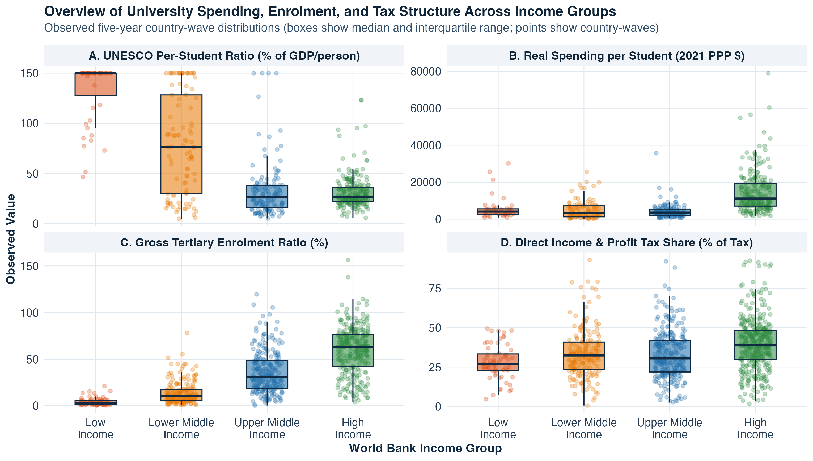
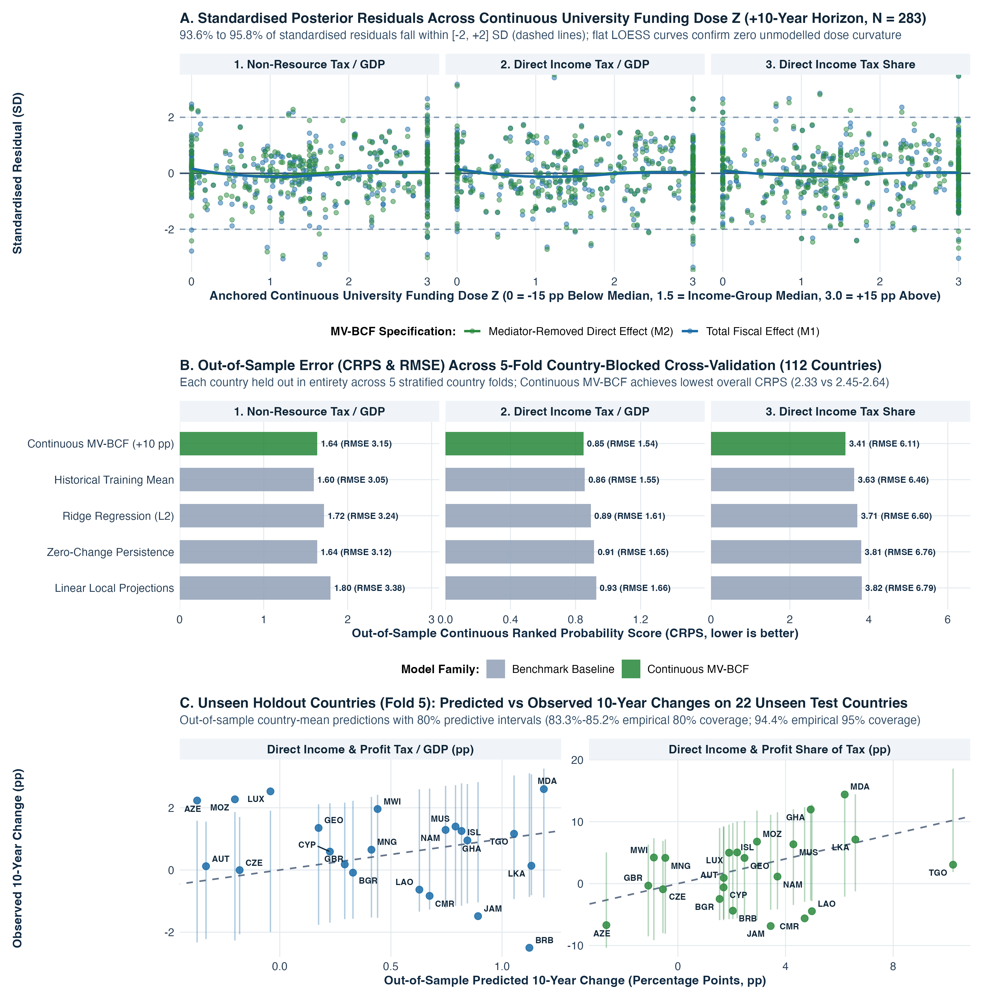
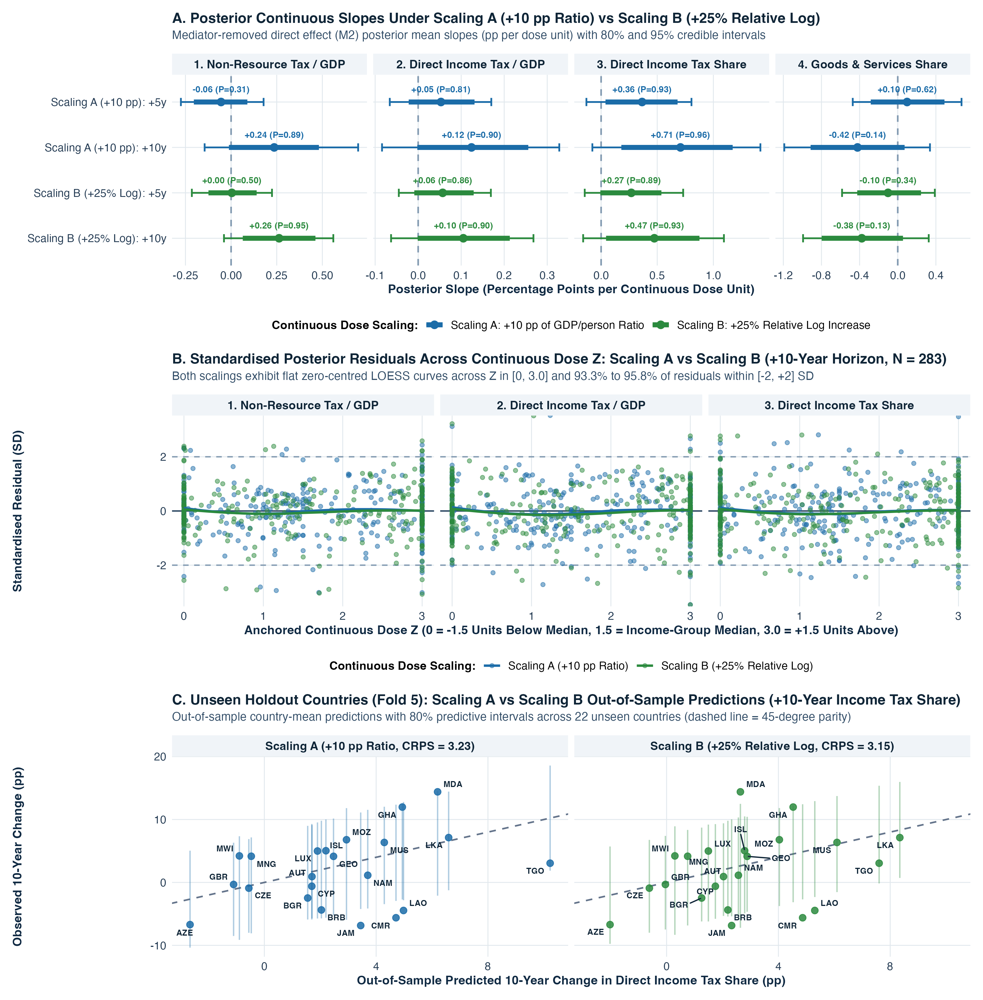

# Does Increasing Government Spending on Tertiary Education Improve the Future Tax Take? A Continuous-Treatment Bayesian Causal Inference Analysis

**Andrew C. Parnell**  
School of Mathematics and Statistics, University College Dublin  
`andrew.parnell1@ucd.ie`  

*8 November 2026*

---

## Abstract

When a national government increases public spending on tertiary (university) education, does that investment strengthen the country's future tax take once general economic growth is separated out? Cross-country data make this question difficult to answer because faster-growing economies naturally collect more tax revenue, international indicators divide per-student spending by gross domestic product (GDP) per person and student headcount, and university cohorts take several years to graduate and enter higher tax brackets. We assemble a harmonised five-year panel covering 121 countries from 1985 to 2024 and fit continuous-treatment Multivariate Bayesian Causal Forests that model four interrelated tax outcomes simultaneously whilst conditioning on random forest expected-treatment predictions and follow-up macroeconomic growth, validated on a locked 20% country holdout set. We find that each $+10$ percentage-point (pp) increase in per-student university spending (as a percentage of GDP per person) shifts a country's tax mix toward direct income, profit, and capital gains taxation by $+0.36$ pp ($P = 0.93$, where $P$ is the posterior probability of a positive slope given the data) after 5 years and $+0.71$ pp ($P = 0.96$) after 10 years. Overall tax revenue as a share of GDP takes a full decade to respond as university cohorts graduate and enter higher-salaried careers, with 10-year direct income tax revenue rising by $+0.12$ to $+0.15$ pp of GDP per dose unit ($P = 0.90\text{--}0.98$) under continuous level and log-spending definitions and by $+0.37$ pp of GDP ($P = 1.00$) per $+10$ pp within-country five-year funding expansion. By contrast, expanding the overall university budget without protecting spending per student yields weak fiscal returns.

**Keywords:** Multivariate Bayesian Causal Forests; continuous treatment; tertiary education spending; tax capacity; direct income taxation; cross-country panel data.

---

## 1. Introduction

Public debates over higher education finance frequently centre on a simple, practical question: is government spending on tertiary (university) education a net drain on the public purse, or is it a productive investment that expands a country's future tax base? At the individual level, decades of labour economics research have shown that university graduates earn higher wages, experience lower unemployment, and work in larger, more formalised firms than non-graduates (Carneiro et al., 2011; Zimmerman, 2014; Psacharopoulos and Patrinos, 2018; Deming, 2022). Empirical welfare analyses in the United States also indicate that direct investments in college access and per-student instructional resources can recoup a substantial share of their upfront public cost over the lifecycle through higher future income tax payments (Trostel, 2010; Chakrabarti et al., 2020; Hendren and Sprung-Keyser, 2020). As university-educated cohorts enter the labour market and raise firm productivity (Moretti, 2004; Valero and Van Reenen, 2019), those private wage gains and corporate spillovers should in principle show up at the national level as stronger personal income, payroll, and corporate profit tax receipts.

Yet working out whether, and over what time horizon, national government spending on tertiary education actually improves a country's tax take is surprisingly tricky. First, if a country's tax revenue rises over the decade following an increase in university funding, we need to know whether universities specifically strengthened the formal tax base or whether the whole economy simply grew richer. Worse still, if an analyst constructs a national tax-per-person variable by multiplying the tax-to-GDP ratio by GDP per person, any positive effect of education on GDP automatically inflates the tax outcome by mathematical identity; isolating a genuine fiscal return requires modelling pure tax shares and tax-to-GDP ratios whilst controlling for both starting economic conditions and follow-up economic growth (Imai et al., 2010; Acharya et al., 2016; VanderWeele, 2016). Second, the standard international indicator of tertiary funding intensity compiled by the United Nations Educational, Scientific and Cultural Organisation (UNESCO) Institute for Statistics (https://data.uis.unesco.org/) and the World Bank World Development Indicators (WDI; https://datatopics.worldbank.org/world-development-indicators/) measures public expenditure per university student as a percentage of GDP per person. Because this ratio places both student headcount and GDP per person in the denominator, a low-income country with a tiny, elite university sector (such as Malawi or Ethiopia, enrolling fewer than 2% of young adults) can appear to spend over 150% of GDP per person per student, whereas a high-income country enrolling 60% of its young adults (such as Denmark or South Korea) appears to spend 27%, even though the high-income country spends nearly three times as many real purchasing power parity (PPP) dollars per student (where PPP adjusts US dollars for differences in local price levels across countries).

A third obstacle is that university funding is a continuous policy choice rather than a binary on/off switch, and its effects take time to mature across different parts of the tax system. Dichotomising university spending at a median cutoff creates an artificial step-function boundary where countries sitting just below the threshold appear to gain a large fiscal return from a tiny spending nudge, whereas modelling continuous spending intensity directly estimates realistic marginal slopes per funding increment (Robinson, 1988; Hirano and Imbens, 2004; Woody et al., 2021). Furthermore, public finance theory shows that as economies accumulate skilled workers and formal employers, they shift away from indirect consumption and customs taxes toward direct personal income and corporate profit taxes (Gordon and Li, 2009; Besley and Persson, 2014; Kleven et al., 2016; Jensen, 2022). Looking only at a single headline tax-to-GDP number hides this shift in the underlying tax mix. Figure 1 summarises our continuous-treatment study design for addressing these obstacles across 121 countries from 1985 to 2024.

As illustrated in Figure 1, we jointly model four percentage-point (pp) tax outcomes over both $+5$ and $+10$ years: (1) total tax revenue as a share of GDP (excluding oil and mineral royalties), (2) direct income, profit, and capital gains tax revenue as a share of GDP, (3) direct income and profit taxes as a share of total tax revenue, and (4) indirect goods and services (sales and value-added) taxes as a share of total tax revenue. Rather than relying on a binary indicator or a single composite spending ratio, we compare four continuous measures of university funding side by side: the per-student spending ratio (per $+10$ pp of GDP per person, centred within each World Bank income group), within-country five-year changes in per-student funding (per $+10$ pp expansion), real 2021 PPP dollars per university student (per $+25\%$ relative increase, which removes GDP from the denominator), and the public university budget as a percentage of GDP (per $+0.25$ pp of GDP, which removes student headcount from the denominator). Throughout the paper, we use pp to denote percentage points, CI to denote a Bayesian posterior credible interval, and $P = P(\tau > 0 \mid \text{data})$ to denote the posterior probability that the continuous treatment slope $\tau$ is greater than zero given the observed data.

We believe this is the first global study to use continuous-treatment Multivariate Bayesian Causal Forests to test whether public university funding increases future tax revenue and shifts the tax mix toward direct income taxation, validated through out-of-sample holdout testing on unseen countries. The remainder of the paper is organised as follows. Section 2 reviews the literature on tax capacity, university resources, and Bayesian regression tree models for continuous treatments. Section 3 describes the 40-year panel dataset, the 80%/20% country-blocked holdout split, the UNESCO denominator trap, and our continuous treatment scalings. Section 4 explains the continuous-treatment Multivariate Bayesian Causal Forest (MV-BCF) model and random forest expected-treatment conditioning in plain language, with full mathematical derivations in Appendix A. Section 5 presents the empirical results across time horizons, continuous funding measures, subgroup moderation, cohort maturation trajectories, and out-of-sample country holdout validation, whilst Section 6 discusses the policy implications, limitations, and directions for future research.

---

## 2. Literature Review

In this section we review three strands of research that have largely developed in parallel: the political economy of tax structure modernisation, the economics of per-student university resources, and Bayesian tree ensembles for continuous causal inference. Bringing these three literatures together clarifies why university resources should affect direct income taxation more strongly than consumption taxation, and why flexible nonparametric models are needed to separate that continuous fiscal return from general economic growth. Those interested in more comprehensive surveys of each field may refer to Besley and Persson (2014), Deming (2022), and Hill et al. (2020).

### 2.1 Tax Capacity, Formal Employment, and Tax Structure

A central question in public finance is why high-income countries collect 30% to 45% of GDP in tax revenue (primarily through direct personal income taxes, social security contributions, and corporate profit taxes), whereas low- and middle-income countries often collect less than 15% of GDP and rely heavily on indirect consumption taxes and customs duties (Besley and Persson, 2009; Gordon and Li, 2009; Besley and Persson, 2014). Early cross-country studies emphasised political institutions, property rights, and administrative state capacity (Besley and Persson, 2009; Kaufmann et al., 2011), alongside improved international accounting standards designed to separate domestic tax effort from volatile oil and mineral royalties (Prichard, 2016; UNU-WIDER, 2023; https://doi.org/10.35188/UNU-WIDER/GRD-2023). Whilst these institutional studies establish that fiscal capacity evolves alongside broader economic development, they leave open the specific microeconomic channels through which public investments in skilled human capital expand the collectible tax base.

More recent empirical work has focussed on the microeconomic mechanics of tax enforcement, paper trails, and formal employment (Kleven et al., 2016; Keen and Slemrod, 2017; Pomeranz and Vila-Belda, 2019). Kleven et al. (2016) show that modern governments can enforce high direct tax compliance at low audit cost because large, formal firms act as third-party tax collectors: complex businesses require internal accounting records shared across managers and skilled staff, making collusive tax evasion between employers and employees unsustainable. Building on this mechanism, Jensen (2022) analyses roughly 100 household surveys across development levels and shows that as the share of salaried employees rises relative to self-employed workers, governments lower personal income tax exemption thresholds and expand direct income tax collection. Field studies confirm that electronic tax filing and third-party information trails reduce evasion when paired with capable firms and literate taxpayers (Pomeranz and Vila-Belda, 2019; Okunogbe and Pouliquen, 2022), whilst broader direct taxation can also strengthen citizen engagement with the state (Weigel, 2020). By contrast, in developing economies with large informal sectors, indirect consumption taxes such as value-added tax (VAT) remain the primary revenue instrument because formal retail chains only gradually replace informal vendors as incomes rise (Bachas et al., 2024).

This public finance literature suggests a direct connection between university funding and the national tax base that goes beyond headline GDP growth. Universities are themselves large formal employers whose academic and administrative staff pay income tax through automatic payroll withholding, and they train the professional, managerial, scientific, and accounting graduates required by formal corporate employers (Kleven et al., 2016; Valero and Van Reenen, 2019), shifting workers into salaried jobs above national income tax exemption thresholds (Jensen, 2022). When this mechanism operates at the national level, higher public spending per university student should specifically expand direct income, profit, and capital gains taxation as a share of total tax revenue and as a share of GDP, whilst reducing relative reliance on indirect goods and services taxes.

### 2.2 Returns to University Resources and Fiscal Externalities

A large microeconometric literature documents strong private wage returns to university education across both advanced and developing economies (Carneiro et al., 2011; Zimmerman, 2014; Psacharopoulos and Patrinos, 2018; Chetty et al., 2020; Mountjoy, 2022). Reviewing this evidence, Deming (2022) notes that human capital accounts for at least one-third of within-country wage variation and at least half of cross-country income differences, with cognitive and problem-solving skills playing a key role in long-run growth (Hanushek and Woessmann, 2012; Angrist et al., 2021), even after accounting for skilled emigration from smaller developing countries (Beine et al., 2008). Beyond individual earnings, university graduates generate productivity spillovers for surrounding workers and firms: Moretti (2004) finds that a higher share of college graduates in a city raises the wages of both graduates and non-graduates, whilst Valero and Van Reenen (2019) examine roughly 15,000 universities across 1,500 sub-national regions in 78 countries and find that university expansions raise future regional GDP per person through skilled labour supply and local innovation.

Importantly for our study, higher education research demonstrates that graduation rates and subsequent earnings depend heavily on per-student instructional resources rather than enrolment headcounts alone. Bound et al. (2010) and Deming and Walters (2017) show that when public colleges expand student numbers whilst state funding per student stagnates or declines (a phenomenon known as institutional crowding), degree completion rates fall and time to graduation lengthens. Conversely, Chakrabarti et al. (2020) find that increases in state appropriations to public universities raise bachelor's degree completion and improve students' long-term financial outcomes and neighbourhood income into their thirties. When graduates complete their degrees and enter formal careers, the fiscal return to the public purse can be substantial: Trostel (2010) estimates that lifetime additional income and payroll taxes paid by college graduates exceed direct government subsidies, and Hendren and Sprung-Keyser (2020) show within their Marginal Value of Public Funds framework that direct investments in college access and per-student spending generate positive fiscal externalities through future tax receipts (though they also find that untargeted higher education tax credits for adults yield lower welfare returns than early childhood investments).

### 2.3 Bayesian Regression Tree Ensembles for Continuous Treatments

Separating the fiscal effect of continuous university funding from general economic development involves two statistical challenges: controlling for intermediate economic growth without introducing bias, and accounting for non-linear confounding across diverse countries. In cross-country panels, standard linear two-way fixed effects regressions can suffer from negative weighting and functional-form misspecification when continuous treatment slopes vary across countries and over time (Jordà, 2005; Acemoglu et al., 2019; de Chaisemartin and D'Haultfœuille, 2020; Callaway and Sant'Anna, 2021). Furthermore, as shown in the causal mediation literature (Imai et al., 2010; Acharya et al., 2016; VanderWeele, 2016; Ting and Linero, 2025), adjusting for follow-up macroeconomic changes (such as GDP per person growth, enrolment growth, inequality, and life expectancy) allows us to isolate the direct structural effect of university spending net of overall economic growth, especially when checked via two-stage sequential g-estimation (Acharya et al., 2016).

Bayesian Additive Regression Trees (BART; Chipman et al., 2010; Hill, 2011; Hill et al., 2020) and Bayesian Causal Forests (BCF; Hahn et al., 2020) provide a flexible nonparametric alternative to linear panel regressions, sitting alongside frequentist causal forests and double machine learning (Chernozhukov et al., 2018; Athey et al., 2019). Tree ensembles automatically capture non-linear relationships and multi-way interactions amongst covariates, with extensions supporting high-dimensional predictors (Linero, 2018), functional smoothing (Starling et al., 2020), count outcomes (Murray, 2021), fast stochastic tree search (Krantsevich et al., 2023), causal mediation (Ting and Linero, 2025), and low-dimensional posterior summaries (Woody et al., 2021). Hahn et al. (2020) show that standard single-forest BART models can suffer from regularisation-induced confounding when strong baseline predictors of the outcome also predict treatment assignment; BCF resolves this by splitting the model into a prognostic forest $\mu(\cdot)$ and a separately regularised treatment-effect forest $\tau(\cdot) \cdot Z_{i,t}$, with extensions to multivariate outcomes and longitudinal panels (McJames et al., 2024, 2025). Because $Z_{i,t}$ enters multiplicatively as a scalar multiplier on the leaf vector $\tau_{l,b} \in \mathbb{R}^4$, the MV-BCF algebra and conjugate Gaussian leaf updates extend directly to a continuous treatment dose $Z_{i,t} \in \mathbb{R}$ by replacing the binary propensity score with the expected continuous treatment $\hat{z}(X_{i,t}) = \mathbb{E}[Z_{i,t} \mid X_{i,t}]$ inside the prognostic forest $\mu(\cdot)$, mirroring continuous-treatment propensity conditioning and Robinson's partially linear residualisation in causal forests and double machine learning (Robinson, 1988; Hirano and Imbens, 2004; Chernozhukov et al., 2018; Athey et al., 2019). Readers will note that the Multivariate Bayesian Causal Forest (MV-BCF) method used in this paper (McJames et al., 2025) was co-developed by the author with Nathan McJames, Ann O'Shea, and Yong Chen Goh. Given this, we want to make it clear from the outset that this paper is not written to promote one causal estimator over all others; in Section 5.4 and Appendix B, we compare the continuous-treatment MV-BCF model directly against univariate BCFs, single-forest BART, random forests, ridge regression, linear local projections, two-way fixed effects, and double machine learning, and we discuss the limitations of the BCF approach alongside its strengths.

---

## 3. Data

### 3.1 Global Five-Year Panel Structure and Country-Blocked Holdout Split

Annual macroeconomic series for education spending and tax revenue contain frequent reporting gaps and short-term business-cycle fluctuations. Following standard practice in empirical macro-panel studies (Acemoglu et al., 2019), we average annual observations from the World Bank WDI, the UNESCO Institute for Statistics, the International Monetary Fund (IMF) Fiscal Monitor (https://www.imf.org/en/Publications/FM), the Worldwide Governance Indicators (WGI), the Standardised World Income Inequality Database (SWIID version 9.6; Solt, 2020; https://fsolt.org/swiid/), and the Organisation for Economic Co-operation and Development (OECD) *Education at a Glance* financing taxonomy (https://www.oecd.org/en/publications/education-at-a-glance.html) into eight non-overlapping five-year waves spanning 40 years: `1985-1989`, `1990-1994`, `1995-1999`, `2000-2004`, `2005-2009`, `2010-2014`, `2015-2019`, and `2020-2024`. Constructing five-year waves also matches the typical duration of an undergraduate degree programme and reduces serial correlation from annual budgetary carryover.

Although the full World Bank register lists 217 sovereign territories, many small island states and conflict-affected territories do not report tertiary education expenditure or disaggregated tax revenues to UNESCO and the World Bank. In addition, raw international fiscal and education archives occasionally contain reporting anomalies where currency-unit mismatches, decimal-place errors, or offshore sovereign resource funds distort headline ratios. Screening out impossible tax-to-GDP values above 60% or below 0.5% of GDP and near-zero tertiary reporting glitches below 0.5% of GDP per person removes five raw reporting anomalies in the pipeline: Sudan in `1995-1999` (recorded at 629.2% of GDP in tax due to a currency-unit mismatch), Timor-Leste in `2010-2014` (recorded at 110.0% of non-oil GDP due to offshore petroleum fund accounting), the United Arab Emirates in `2010-2014` and `2015-2019` (recorded below 0.4% of GDP in central federal tax), and Madagascar in `2015-2019` (recorded at 0.036% of GDP per person per tertiary student due to a decimal-place glitch). Requiring strictly observed university funding and four-outcome tax series (with zero imputation on treatments or outcomes) yields our analysis dataset of 121 countries: 371 five-year country-waves across 121 countries at the $+5$-year horizon ($t \to t+1$) and 283 country-waves across 112 countries at the $+10$-year horizon ($t \to t+2$).

To evaluate how well our continuous-treatment models generalise to unseen countries, we partition the 121 countries using a deterministic 5-fold country-blocked split stratified by World Bank income group. Every wave of a given country is assigned to the same fold so that no country ever straddles the training and test sets. Folds 1 to 4 (80% of countries: 98 countries and 301 country-waves at $+5$ years; 90 countries and 229 country-waves at $+10$ years) form the training sample used to compute income-group funding medians and covariate centring statistics without any test-set leakage, whilst Fold 5 (20% of countries: 23 unseen countries and 70 country-waves at $+5$ years; 22 unseen countries and 54 country-waves at $+10$ years) serves as a locked out-of-sample holdout test set evaluated in Section 5.4. In Sections 5.1 to 5.3, we report posterior treatment slopes from the full 5-fold country-blocked cross-fitted panel ($N = 371$ at $+5$ years and $N = 283$ at $+10$ years, where $\hat{z}(X_{i,t})$ is predicted strictly out-of-fold across the five country folds), whilst in Section 5.4 and Appendix B (Check `R13`) we fit the MV-BCF model exclusively on the 80% training countries in Folds 1 to 4 ($N = 229$ at $+10$ years, which yields even stronger level slopes of $+0.42$ pp on total tax/GDP, $P = 0.99$, and $+0.22$ pp on direct income tax/GDP, $P = 0.98$) to generate strictly out-of-sample predictions on the 22 locked holdout countries in Fold 5.

### 3.2 Tax Revenue Outcomes

To examine how university funding affects both overall tax collection and the mix of taxes without introducing mechanical GDP product identities, we track four percentage-point changes over $+5$ years ($t+1$) and $+10$ years ($t+2$). First, we measure total tax revenue as a percentage of GDP ($\Delta \text{Tax/GDP}$, in pp of GDP), based on the World Bank WDI tax-to-GDP series (`GC.TAX.TOTL.GD.ZS`). Following the fiscal-capacity literature (Prichard, 2016; UNU-WIDER, 2023), in major oil- and mineral-exporting countries where natural resource rents exceed 10% of GDP, we subtract half of the excess resource rents so that volatile commodity royalties do not masquerade as domestic tax effort (and we verify in Appendix B that using raw, unadjusted WDI tax-to-GDP gives very similar results).

Second, we measure direct income, profit, and capital gains tax revenue as a percentage of GDP ($\Delta \text{IncomeTax/GDP}$, in pp of GDP), which captures revenue collected directly from individual wages, salaries, and corporate profits. Third, we track direct income, profit, and capital gains taxes as a percentage of total revenue ($\Delta \text{IncomeTax/Rev}$, in pp of revenue), which measures structural modernisation toward progressive direct taxation (Besley and Persson, 2014; Jensen, 2022). Fourth, we track indirect goods and services taxes (such as VAT, sales taxes, and excise duties) as a percentage of total revenue ($\Delta \text{GoodsTax/Rev}$, in pp of revenue; Bachas et al., 2024). Readers should note that Outcome 2 (direct income tax as a share of GDP) is simply the product of Outcome 1 (total tax as a share of GDP) and Outcome 3 (direct income tax as a share of revenue) divided by 100. Thus, Outcomes 1, 3, and 4 capture the two underlying policy dimensions (whether overall tax collection rises and whether the tax mix shifts from consumption taxes toward income taxes), whilst Outcome 2 measures their combined impact on the national budget. Because these four measures are algebraically linked and move together within each country's budget, a major advantage of our Multivariate Bayesian Causal Forest approach is that it models all four outcomes simultaneously through a joint covariance structure, capturing their cross-outcome dependencies directly unlike standard single-equation regressions.

### 3.3 The UNESCO Denominator Trap and Continuous University Funding Dose

The standard international indicator of per-student university spending compiled by UNESCO and the World Bank divides public spending per university student by GDP per person, which is algebraically identical to dividing the public university budget (% of GDP) by the number of university students per person:

$$\text{UNESCO Ratio}_{i,t} = \frac{\text{University Spend per Student}_{i,t}}{\text{GDP per Person}_{i,t}} \times 100 = \frac{\text{University Budget (\% GDP)}_{i,t}}{\text{Students per Person}_{i,t}}.$$

Because both GDP per person and student headcount appear in the denominator, countries with very different university systems can record similar headline ratios for completely different reasons. To see the raw data before any statistical modelling, Figure 2 plots the observed distributions of the UNESCO per-student ratio, real 2021 PPP dollars per student, gross tertiary enrolment, and the direct income tax share across the four World Bank income groups, and Table 1 reports the corresponding group summaries.

| Income Group (Countries, Waves) | UNESCO Ratio (%) | Real PPP $ / Student | Univ. Budget (% GDP) | Tertiary Enrol. (%) | Direct Income Tax Share (%) |
| :--- | :---: | :---: | :---: | :---: | :---: |
| **Low income** (21, 80) | **205%** | $3,957 | 0.47% | 2.3% | 29.2% |
| **Lower middle** (41, 172) | 76.5% | $3,258 | 0.65% | 7.4% | 30.8% |
| **Upper middle** (54, 219) | 26.8% | $3,521 | 0.64% | 25.5% | 33.1% |
| **High income** (69, 337) | 26.9% | **$11,148** | **0.94%** | **58.3%** | **38.4%** |

*Table 1: University spending indicators, enrolment, and baseline direct income tax share across World Bank income groups. Values in brackets in the first column show the number of countries and the number of observed five-year country-waves; group medians are reported for skewed spending and enrolment variables and group means for the direct income tax share.*

Figure 2 and Table 1 show clearly how the UNESCO denominator trap works in practice. In low-income countries (such as Uganda, Malawi, or Ethiopia), only 2.3% of young adults attend university; dividing a small university budget (0.47% of GDP) by a tiny student headcount and a low GDP per person produces a raw median UNESCO ratio of 205% (which we cap at 150% in Figure 2A and when fitting our regression trees so that extreme outliers do not distort the tree splits). That tiny elite student body also explains why median real PPP spending per student in low-income countries ($3,957, concentrated in one or two national universities) is slightly higher than in lower-middle-income countries ($3,258), where enrolment is over three times higher (7.4% median) and public budgets are stretched across many more students. Once we unbundle the denominators in Table 1, high-income countries (such as Denmark, Norway, or South Korea) spend nearly three times as much per student in real purchasing power ($11,148 vs $3,957) and twice as much of their national income (0.94% vs 0.47% of GDP), whilst collecting a larger share of their tax revenue from direct income and profit taxes (38.4% vs 29.2%).

Because raw UNESCO ratios differ by an order of magnitude across income groups, we construct our primary continuous university funding dose ($Z_{i,t}$, which we refer to as Scaling A) by centring each country-wave's winsorised per-student spending ratio around the training-fold median of its own World Bank income group ($150.0\%$ for low income after the $150\%$ pre-winsorisation cap, vs $183.8\%$ raw before winsorisation, $68.9\%$ for lower-middle income, $27.6\%$ for upper-middle income, and $26.4\%$ for high income), scaling by $10$ percentage points of GDP per person, winsorising at $\pm 1.5$ dose units ($\pm 15$ pp) so that extreme elite-enrolment outliers cannot dominate linear leaf slopes, and shifting by $+1.5$ so that $Z_{i,t} \in [0, 3.0]$ is strictly non-negative with $Z_{i,t} = 1.5$ representing the exact income-group median and each $+1.0$ unit increase ($\text{SD}(Z) = 1.05$) representing a $+10$ pp expansion in per-student funding. In Appendix D, we compare this primary linear ratio dose head-to-head against an alternative relative logarithmic scaling (Scaling B, which centres the raw log series on the unclipped training medians of $183.8\%$, $68.9\%$, $27.6\%$, and $26.4\%$ and where each $+1.0$ unit represents a $+25\%$ relative increase in per-student funding) and show that both yield very similar posterior slopes and out-of-sample predictive accuracy; we present Scaling A in the main text because its $+10$ pp policy unit translates directly into national budget shares and achieves slightly lower out-of-sample cross-validation error. On our primary continuous scale ($Z_{i,t} \in [0, 3.0]$, $\text{SD} = 1.05$), Nordic and continental European countries with strong public university investment sit near the top of the distribution (such as Norway at $Z_{i,t} = 2.7$ to $3.0$, Sweden at $3.0$, Denmark at $3.0$, and Austria at $2.4$ to $2.5$), whereas countries that rely more heavily on private tuition or allocate smaller public budgets per student sit lower on the continuous scale (such as Spain at $1.10$, the United States at $0.91$, Chile at $0.81$, and South Korea at $0.35$). Ireland provides a clear illustration of a country whose continuous dose varied substantially over time: Ireland sat above the high-income median in `1995-1999` (28.2%, $Z_{i,t} = 1.68$), `2005-2009` (28.4%, $Z_{i,t} = 1.70$), and `2010-2014` (27.6%, $Z_{i,t} = 1.62$), dipped slightly below in `2000-2004` (25.6%, $Z_{i,t} = 1.42$), and fell sharply to 17.3% ($Z_{i,t} = 0.59$) in `2015-2019` as student numbers expanded much faster than state university funding after the 2008 financial crisis.

---

## 4. Methodology

In an ideal experiment, we would randomly assign countries different continuous increments of university funding and track their tax receipts over the next decade. In observational data, however, governments set their university budgets in response to economic conditions, demographics, and existing tax capacity, and the relationships amongst these variables are strongly non-linear (Hill, 2011; Hill et al., 2020). To separate the continuous causal slope of university funding from confounding macroeconomic trends, we extend Multivariate Bayesian Causal Forests (Hahn et al., 2020; McJames et al., 2025) to continuous treatment doses using random forest expected-treatment conditioning (Robinson, 1988; Breiman, 2001; Hirano and Imbens, 2004), providing the intuitive setup here and full mathematical derivations in Appendix A.

### 4.1 Continuous-Treatment Multivariate Bayesian Causal Forests (MV-BCF)

The continuous-treatment Multivariate Bayesian Causal Forest (Hahn et al., 2020; Woody et al., 2021; McJames et al., 2025) splits the prediction of future tax changes into two distinct regression tree ensembles (Chipman et al., 2010): a baseline prognostic trajectory (what would have happened to a country's tax take naturally given its starting conditions, expected funding level, and overall economic growth) and a continuous treatment-effect slope $\tau(W_{i,t})$ multiplied by the continuous funding dose $Z_{i,t} \in [0, 3.0]$. For country $i$ at wave $t$ and follow-up horizon $h \in \{1, 2\}$ ($+5$ and $+10$ years), the four tax changes $\Delta Y_{i, t+h} \in \mathbb{R}^4$ are modelled jointly as:

$$\Delta Y_{i, t+h} = \mu\bigl(X_{i,t}, \hat{z}(X_{i,t})\bigr) + \tau\bigl(W_{i,t}\bigr) \cdot Z_{i,t} + \varepsilon_{i, t+h}, \quad \varepsilon_{i, t+h} \stackrel{\text{i.i.d.}}{\sim} \mathcal{N}_4(0, \Sigma).$$

In this continuous-treatment formulation, $\tau(W_{i,t}) \in \mathbb{R}^4$ represents the partial derivative $\partial \mathbb{E}[\Delta Y_{i,t+h} \mid X_{i,t}, Z_{i,t}] / \partial Z_{i,t}$, measuring the four-dimensional percentage-point fiscal change per $+1.0$ unit increase in the university funding dose ($+10$ pp of GDP per person per student). When $Z_{i,t}$ is continuous rather than binary, the binary propensity score $P(Z_{i,t}=1 \mid X_{i,t})$ no longer exists; in its place, we include the out-of-fold random forest expected treatment $\hat{z}(X_{i,t}) = \hat{\mathbb{E}}[Z_{i,t} \mid X_{i,t}]$ inside the prognostic forest $\mu(\cdot)$, fitted with 500 regression trees via `ranger` (Breiman, 2001; Wright and Ziegler, 2017) using strictly pre-treatment covariates $X_{i,t}$. Conditioning $\mu(\cdot)$ on $\hat{z}(X_{i,t})$ provides the exact continuous-treatment generalisation of Hahn et al.'s (2020) deconfounding architecture and Robinson's (1988) partially linear residualisation: it allows the prognostic trees to partial out the predictable component of university spending before the treatment trees estimate the slope on the orthogonalised dose variation $Z_{i,t} - \hat{z}(X_{i,t})$. As shown during exploratory data analysis and verified in Appendix C, the random forest expected treatment explains $35.0\%$ to $47.4\%$ of the out-of-bag variance in $Z_{i,t}$ and reduces the mean absolute correlation between the 19 baseline confounders and the residual dose $Z_{i,t} - \hat{z}(X_{i,t})$ by more than 60% (from $0.157$ to $0.061$, with maximum correlation reduced from $0.540$ to $0.213$).

To estimate the baseline trajectory $\mu(X_{i,t}, \hat{z}_{i,t})$, we use an ensemble of 75 shallow decision trees (many having only one or two splits), where each terminal leaf outputs a vector of four values corresponding to our four tax outcomes. The baseline forest is fed with 19 pre-treatment country characteristics measured at or before wave $t$ (starting log real GDP per person in PPP dollars, starting total tax-to-GDP ratio, starting direct income tax share, starting goods and services tax share, disposable income Gini inequality, life expectancy, gross tertiary and secondary enrolment ratios, total education spending as a share of GDP, working-age population share, log population, unemployment rate, natural resource rents, trade openness, lagged five-year GDP per person growth, World Bank income group, geographic region, OECD membership, and wave time index) together with $\hat{z}(X_{i,t})$. We also include four follow-up macroeconomic controls over $[t, t+h]$ (forward GDP per person growth, university enrolment expansion, income inequality changes, and life expectancy changes) so that general economic growth during the follow-up window is separated out (Imai et al., 2010; Acharya et al., 2016).

To allow the continuous fiscal slope to vary across countries without chasing noise in a macro panel, we model $\tau(W_{i,t})$ using a second, smaller ensemble of 30 shallower trees fed with 8 country moderators $W_{i,t}$ (gross tertiary enrolment, log real GDP per person, gross secondary enrolment, starting direct income tax share, working-age population share, World Bank income group, OECD membership, and wave index). Using a larger, more flexible tree prior for the prognostic forest $\mu(\cdot)$ and a smaller, more conservative tree prior for the treatment-effect forest $\tau(\cdot)$ is standard practice in Bayesian causal forest modelling (following Chipman et al., 2010; Hill, 2011; Hahn et al., 2020), as it allows the model to absorb complex baseline confounding whilst shrinking noisy subgroup slope differences toward the overall mean. All four tax outcomes are linked through the $4 \times 4$ residual covariance matrix $\Sigma$, which receives a conjugate Inverse-Wishart prior (with all prior hyperparameters and continuous leaf precision updates $\Omega_{\tau,b}^{-1} = \Sigma_\tau^{-1} + (\sum_{i \in b} Z_{i,t}^2)\Sigma^{-1}$ detailed in Appendix A). All MV-BCF models are fitted in C++ for 2,000 Markov chain Monte Carlo (MCMC) iterations (750 burn-in, 1,250 retained posterior draws), with convergence diagnostics, residual normality checks, and out-of-sample country holdout validation reported in Section 5.4 and Appendix C.

---

## 5. Results

### 5.1 Continuous Effects on Tax Revenue After 5 and 10 Years

We begin by examining our primary question: when a country increases its public spending per university student by $+10$ percentage points of GDP per person (one unit of our continuous dose $Z_{i,t}$), what happens to its tax revenue 5 and 10 years later once starting country conditions, expected funding $\hat{z}(X_{i,t})$, and follow-up economic growth are controlled for? Recall that throughout all tables and figures, CI denotes a Bayesian posterior credible interval and $P = P(\tau > 0 \mid \text{data})$ denotes the posterior probability that the continuous treatment slope is greater than zero given the data. Table 2 and Figure 3 report the posterior mean continuous slopes, 80% and 95% credible intervals, and posterior probabilities $P$ across the four tax outcomes at $+5$ years ($N = 371$, 121 countries) and $+10$ years ($N = 283$, 112 countries).

| Tax Revenue Outcome (per $+10$ pp Funding Dose) | $+5$ Years Mean ($P$) | $+5$ Years 80% CI / 95% CI | $+10$ Years Mean ($P$) | $+10$ Years 80% CI / 95% CI |
| :--- | :---: | :---: | :---: | :---: |
| **1. Total Non-Resource Tax / GDP** (% of GDP, pp) | $-0.06$ ($P=0.31$) | $[-0.20, +0.09]$ / $[-0.28, +0.18]$ | $+0.24$ ($P=0.89$) | $[-0.01, +0.48]$ / $[-0.15, +0.70]$ |
| **2. Direct Income & Profit Tax / GDP** (% of GDP, pp) | $+0.05$ ($P=0.81$) | $[-0.02, +0.13]$ / $[-0.07, +0.17]$ | **$+0.12$ ($P=0.90$)** | $[-0.002, +0.26]$ / $[-0.08, +0.33]$ |
| **3. Direct Income & Profit Tax Share** (% of total tax revenue, pp) | **$+0.36$ ($P=0.93$)** | $[+0.04, +0.68]$ / $[-0.13, +0.81]$ | **$+0.71$ ($P=0.96$)** | $[+0.18, +1.17]$ / $[-0.08, +1.42]$ |
| **4. Goods & Services Tax Share** (% of total tax revenue, pp) | $+0.10$ ($P=0.62$) | $[-0.28, +0.49]$ / $[-0.47, +0.67]$ | $-0.42$ ($P=0.14$) | $[-0.91, +0.07]$ / $[-1.19, +0.34]$ |

*Table 2: Posterior mean continuous treatment slopes (in percentage points, pp per $+10$ pp increase in per-student university spending as a share of GDP per person), 80% and 95% credible intervals (CIs), and posterior probabilities $P = P(\tau > 0 \mid \text{data})$ from the four-outcome Multivariate Bayesian Causal Forest at $+5$ years ($N = 371$, 121 countries) and $+10$ years ($N = 283$, 112 countries).*

Table 2 and Figure 3 show a clear progression across the two time horizons. First, higher continuous per-student university funding produces a progressive shift in the tax mix toward direct income, profit, and capital gains taxation that nearly doubles between year 5 and year 10: per $+10$ pp increase in per-student funding, the direct income tax share of revenue (Outcome 3) rises by $+0.36$ pp after 5 years (80% CI $[+0.04, +0.68]$, 95% CI $[-0.13, +0.81]$, $P = 0.93$) and by $+0.71$ pp after 10 years (80% CI $[+0.18, +1.17]$, 95% CI $[-0.08, +1.42]$, $P = 0.96$; in Appendix B we show that when follow-up macroeconomic growth controls are omitted to capture the total effect, the 10-year slopes strengthen to $+0.30$ pp on total tax/GDP with $P = 0.95$ and $+0.16$ pp on direct income tax/GDP with $P = 0.96$, alongside $+0.54$ pp on the income tax share with $P = 0.92$). Second, overall tax collection as a share of GDP requires a full decade to respond: after 5 years, total non-resource tax revenue (Outcome 1) is slightly negative at $-0.06$ pp of GDP (95% CI $[-0.28, +0.18]$, $P = 0.31$), whereas after 10 years, as university cohorts complete their degrees and advance into higher-salaried careers, total non-resource tax revenue rises by $+0.24$ pp of GDP per $+10$ pp funding increase (80% CI $[-0.01, +0.48]$, 95% CI $[-0.15, +0.70]$, $P = 0.89$) and direct income tax revenue as a share of GDP (Outcome 2) more than doubles from $+0.05$ pp at $+5$ years ($P = 0.81$) to $+0.12$ pp of GDP at $+10$ years (80% CI $[-0.002, +0.26]$, 95% CI $[-0.08, +0.33]$, $P = 0.90$). Third, on the indirect goods and services tax share (Outcome 4), the 10-year slope is negative ($-0.42$ pp, 95% CI $[-1.19, +0.34]$, $P = 0.14$), confirming that the fiscal return operates by shifting revenue toward direct income and profit taxation rather than consumption taxes. To express these continuous slopes in national currency terms (holding each country's latest population and 2021 PPP GDP per person constant so that demographic growth does not inflate the calculation), a 10-year gain of $+0.12$ to $+0.16$ pp of GDP in direct income tax revenue per $+10$ pp funding increase corresponds to roughly EUR $0.23$ billion to EUR $0.30$ billion per year in additional income tax receipts for the median-sized economy in our sample (total GDP of EUR $183$ billion), or around EUR $0.36$ billion to EUR $0.68$ billion per year in Ireland and EUR $4.0$ billion to EUR $5.2$ billion per year in the United Kingdom.

### 5.2 Comparing Four Continuous Ways of Measuring University Funding

Whilst Figure 3 compared the $+5$-year and $+10$-year time horizons for our primary per-student spending ratio, a natural follow-up question is how the $+10$-year continuous fiscal slope behaves when we unbundle the UNESCO ratio into its separate components. In Table 3 and Figure 4, we hold the time horizon fixed at $+10$ years and compare four distinct continuous ways of measuring university funding: (1) our primary per-student spending ratio (per $+10$ pp of GDP per person, Scaling A), (2) observed within-country five-year changes in per-student funding ($\Delta Z_{i,t}$, scaled per $+10$ pp five-year expansion), (3) real 2021 PPP dollars per student (scaled per $+25\%$ log-relative increase within each income group, which removes GDP per person from the denominator), and (4) the total public university budget as a percentage of GDP (scaled per $+0.25$ pp of GDP, which removes student headcount from the denominator). Comparing these four continuous exposures on the same 10-year horizon allows us to test directly whether future tax gains are driven by real instructional resources per student or merely by aggregate budget size.

| Continuous University Funding Measure ($+10$-Year Horizon) | Waves (Countries) | Total Tax / GDP (pp) | Direct Income Tax / GDP (pp) | Direct Income Tax Share (pp) |
| :--- | :---: | :---: | :---: | :---: |
| **1. Per-Student Ratio ($+10$ pp GDP/person)** | 283 (112) | $+0.24$ ($P=0.89$) $[-0.15, +0.70]$ | **$+0.12$ ($P=0.90$)** $[-0.08, +0.33]$ | **$+0.71$ ($P=0.96$)** $[-0.08, +1.42]$ |
| **2. Within-Country 5y Change ($+10$ pp)** | 176 (86) | $-0.29$ ($P=0.17$) $[-0.91, +0.31]$ | **$+0.37$ ($P=1.00$)** $[+0.08, +0.65]$ | **$+1.56$ ($P=0.99$)** $[+0.36, +2.73]$ |
| **3. Real PPP Dollars / Student ($+25\%$ log)** | 283 (112) | **$+0.22$ ($P=0.95$)** $[-0.04, +0.49]$ | **$+0.15$ ($P=0.98$)** $[+0.002, +0.30]$ | **$+0.47$ ($P=0.95$)** $[-0.12, +1.05]$ |
| **4. University Budget % of GDP ($+0.25$ pp)** | 403 (123) | $-0.06$ ($P=0.37$) $[-0.40, +0.28]$ | $-0.04$ ($P=0.34$) $[-0.23, +0.13]$ | **$+0.53$ ($P=0.94$)** $[-0.13, +1.17]$ |

*Table 3: Comparison of $+10$-year posterior mean continuous slopes (in percentage points, pp per dose unit), 95% credible intervals (CIs), and posterior probabilities $P = P(\tau > 0 \mid \text{data})$ across the four continuous ways of measuring university funding.*

The comparison in Table 3 and Figure 4 shows why unbundling the denominator is so informative. When we remove GDP per person from the denominator and measure continuous funding in real 2021 PPP dollars per student (Row 3, scaled per $+25\%$ relative increase around each income group's median), the $+10$-year posterior precision sharpens substantially: total non-resource tax revenue rises by $+0.22$ pp of GDP per $+25\%$ dose (80% CI $[+0.05, +0.40]$, 95% CI $[-0.04, +0.49]$, $P = 0.95$), direct income tax as a share of GDP rises by $+0.15$ pp (95% CI $[+0.002, +0.30]$, $P = 0.98$), and the direct income tax share rises by $+0.47$ pp ($P = 0.95$, following a $+0.59$ pp gain at $+5$ years with 95% CI $[+0.18, +1.00]$, $P = 1.00$). That all three positive slopes in Row 3 satisfy the exact macroeconomic identity $\text{Direct Income Tax / GDP} = \text{Total Tax / GDP} \times (\text{Income Tax Share} / 100)$ makes sense economically: evaluating $\Delta(\tau_1 S_0 + T_0 \tau_3)$ at the sample means ($T_0 \approx 16.5\%$ of GDP, $S_0 \approx 34.4\%$) yields $0.22 \times 0.344 + 0.165 \times 0.47 = +0.153$ pp, showing that roughly half of the $+0.15$ pp gain in direct income tax/GDP comes from expanding total tax capacity and half comes from shifting the tax mix toward direct income taxation. Even more notably, when we isolate dynamic within-country five-year expansions in per-student funding (Row 2, $N = 176$ across 86 countries, scaled per $+10$ pp five-year increase), the $+10$-year slope on direct income tax revenue triples to $+0.37$ pp of GDP (95% CI $[+0.08, +0.65]$, $P = 1.00$) and the direct income tax share jumps by $+1.56$ pp (95% CI $[+0.36, +2.73]$, $P = 0.99$), even as total tax-to-GDP is slightly negative ($-0.29$ pp, $P = 0.17$) because governments that rapidly increase per-student spending often simultaneously phase out distortionary indirect trade and excise taxes ($-0.94$ pp on the goods tax share, $P = 0.09$). By contrast, when we remove student headcount from the denominator and look only at the aggregate university budget as a share of GDP without accounting for how many students share that budget (Row 4, per $+0.25$ pp of GDP), the $+10$-year slopes on total tax revenue ($-0.06$ pp, $P = 0.37$) and direct income tax revenue ($-0.04$ pp, $P = 0.34$) are slightly negative and indistinguishable from zero, consistent with microeconomic evidence that expanding student headcounts without protecting per-student resources leads to institutional crowding and lower completion rates (Bound et al., 2010; Deming and Walters, 2017; Chakrabarti et al., 2020).

### 5.3 Subgroup Moderation, Negative Scenarios, and Cohort Maturation Trajectories

How do the continuous fiscal slopes vary across countries at different stages of university enrolment and economic development, and are there situations where increasing university funding reduces the tax take? Figure 5 plots the $+10$-year subgroup posterior mean continuous slopes and 95% credible intervals across starting university enrolment tiers and World Bank income groups for total non-resource tax/GDP, direct income tax/GDP, and the direct income tax share (with full numerical breakdowns, including our five-group OECD financing regime sub-model, reported in Appendix B). As shown in Figure 5, the two fiscal dimensions vary in contrasting directions across development stages. On the tax-mix dimension (Panel 3), the shift toward direct income and profit taxation per $+10$ pp of per-student funding rises as economies develop a broad formal corporate and salaried sector: it is smallest in low-income economies ($+0.16$ pp, $P = 0.69$), averages $+0.64$ pp ($P = 0.91$) in elite systems with under 20% enrolment, rises to $+0.74$ pp ($P = 0.96$) in lower-middle-income economies, $+0.75$ pp ($P = 0.97$) in massifying systems with 20-50% enrolment, and $+0.84$ pp (95% CI $[+0.09, +1.57]$, $P = 0.98$) in upper-middle-income economies, and remains strongly positive at $+0.68$ to $+0.73$ pp ($P = 0.94\text{--}0.95$) in high-income and high-participation systems ($\ge 50\%$ enrolment, and $+1.05$ to $+1.14$ pp, $P = 0.93\text{--}0.95$ across all five OECD financing regimes). By contrast, on the aggregate tax-to-GDP dimension (Panels 1 and 2), the largest gains per $+10$ pp dose occur in low-income ($+0.48$ pp of GDP on total tax and $+0.24$ pp on direct income tax, $P = 0.91$), lower-middle-income ($+0.32$ pp and $+0.16$ pp, $P = 0.91\text{--}0.93$), and elite-enrolment ($+0.34$ pp and $+0.17$ pp, $P = 0.91\text{--}0.93$) economies whose formal tax bases are still expanding, tapering off to $+0.19$ pp ($P = 0.82$) and $+0.10$ pp ($P = 0.81$) in mature high-income economies.

Both the historical data and our continuous-treatment model estimates also highlight three specific scenarios where increasing university funding is associated with a *decrease* in the tax take. First, in the short run ($+5$ years), 243 out of 371 country-waves (65.5%) have negative point estimates on total tax-to-GDP (down to $-0.96$ pp of GDP per $+10$ pp funding increase, with an overall mean of $-0.06$ pp and $-0.30$ pp in low-income economies), reflecting a temporary "student lock-in" and cohort gestation effect: even holding baseline enrolment fixed, higher per-student funding supports higher student retention, longer intensive-margin persistence into honours and postgraduate degrees, and fuller-time study (rather than part-time casual work) across a 3-to-4-year degree cycle before those cohorts reach their higher-earning late twenties. Second, at the $+10$-year horizon in very low-income economies with tiny elite enrolment below 2% and extreme UNESCO per-student ratios above 150% (such as Ethiopia in `1995-1999` at $-0.94$ pp and Malawi in `2010-2014` at $-0.68$ pp on the direct income tax share), pouring additional subsidies into a tiny elite university sector without broad formal-sector job creation or protection against skilled emigration (Beine et al., 2008) fails to modernise the domestic income tax share. Third, in mature OECD economies where total tax revenue already exceeds 35% of GDP (Rows 8 to 12 of Appendix B Table B.1, where total tax-to-GDP slopes average $-0.14$ to $-0.17$ pp per $+10$ pp dose), expanding public university budgets can coincide with a slightly lower overall tax-to-GDP ratio even as the income tax share of revenue rises strongly by $+1.05$ to $+1.14$ pp ($P = 0.93\text{--}0.95$).

To illustrate how these effects evolve from the initial $+5$-year window ($N = 371$) to the $+10$-year window ($N = 283$) across development stages, Figure 6 plots the five-year and 10-year cohort maturation trajectories across the four World Bank income groups alongside the global 80% and 95% posterior credible fan. In Panel A of Figure 6, total non-resource tax revenue as a share of GDP dips below zero across every income group at the $+5$-year mark ($-0.30$ pp in low-income, $-0.04$ pp in lower-middle-income, $-0.01$ pp in upper-middle-income, and $-0.06$ pp in high-income economies) whilst students are still enrolled in university, before rebounding into positive territory across all four groups by the $+10$-year mark ($+0.48$ pp in low-income, $+0.32$ pp in lower-middle-income, $+0.23$ pp in upper-middle-income, and $+0.19$ pp in high-income economies). In Panel B of Figure 6, the direct income and profit tax share of revenue already rises at $+5$ years across all four groups ($+0.29$ to $+0.49$ pp) and then diverges sharply at $+10$-years: in lower-middle-income ($+0.74$ pp), upper-middle-income ($+0.84$ pp), and high-income ($+0.68$ pp) economies where formal salaried employment can absorb new graduates, the compositional shift toward direct income taxation roughly doubles by year 10, whereas in low-income economies it flattens out at $+0.16$ pp. In Appendix B, we also summarise our extensive sensitivity checks across competing Bayesian and frequentist estimators, within-country fixed-effect demeaning, non-overlapping decadal waves, pre-trend controls, two-stage sequential g-estimation, pre-COVID samples, the 80% training-only country sample, and the legacy binary median-cutoff specification; those checks confirm that the 10-year shift toward direct income taxation holds across every specification.

### 5.4 Model Fit, Residual Diagnostics, and Out-of-Sample Holdout Validation

Because cross-country macro panels have modest sample sizes, it is essential to check that our continuous-treatment MV-BCF model fits the observed data without systematic residual bias across the treatment range $Z_{i,t} \in [0, 3.0]$ and generalises accurately to countries that were excluded from the training run. In particular, if the linear dose multiplier $Z_{i,t}$ inside the treatment trees were misspecified or if the 75 prognostic trees were overfitting idiosyncratic country histories, we would see systematic curvature in the residuals or poor out-of-sample forecasts on unseen economies. Figure 7 presents our three core model-fit and out-of-sample validation checks at the $+10$-year horizon: (A) standardised posterior residuals plotted across the continuous university funding dose $Z_{i,t} \in [0, 3.0]$, (B) 5-fold country-blocked out-of-sample cross-validation continuous ranked probability scores (CRPS, where lower values indicate more accurate probabilistic forecasts; Diebold and Mariano, 1995; Gneiting and Raftery, 2007) across all 112 countries ($N = 283$), and (C) out-of-sample holdout predictions vs observed 10-year changes in the direct income tax share on the 22 unseen test countries in Fold 5 ($N = 54$ country-waves).

Three diagnostic results stand out from Figure 7 (with full numerical tables reported in Appendix C and Appendix D). First, in Panel A, the LOESS trend curves across $Z_{i,t} \in [0, 3.0]$ are flat and centred on zero for all four tax outcomes, with $94.0\%$ to $95.8\%$ of standardised posterior residuals lying within $\pm 2$ standard deviations, empirical 95% posterior predictive coverage between $95.8\%$ and $97.9\%$, and near-zero residual skewness ($-0.30$ to $+0.17$), confirming that our linear $+10$ pp dose scaling captures the dose-response relationship without curvature or tail distortion. Second, in Panel B, across 5-fold country-blocked cross-validation on all 112 countries, our continuous MV-BCF model achieves a mean out-of-sample CRPS of $2.33$ pp ($1.64$ pp on total tax/GDP, $0.85$ pp on direct income tax/GDP, $3.41$ pp on the direct income tax share, and $3.43$ pp on the goods tax share, with $81.5\%$ empirical 80% coverage and $92.8\%$ empirical 95% coverage), outperforming historical training means ($2.45$ pp), ridge regression ($2.52$ pp), a zero-change random walk baseline ($2.53$ pp; Diebold-Mariano $p = 0.062$ on the direct income tax share), and linear local projections ($2.64$ pp; $p = 0.053$ on the direct income tax share and $p = 0.023$ on the goods tax share) whilst matching nonparametric random forests ($2.35$ pp) and single-forest BART ($2.33$ pp). Third, in Panel C, when trained exclusively on the 90 countries in Folds 1 to 4 and evaluated on the 22 completely unseen holdout countries in Fold 5 ($N = 54$ waves), the MV-BCF model achieves out-of-sample 80% interval coverage of $75.9\%$ to $85.2\%$, 95% coverage of $88.9\%$ to $96.3\%$, and positive out-of-sample predicted treatment slopes across the unseen countries ($\bar{\tau}_{\text{test}} = +0.44$ pp on total tax/GDP, $+0.21$ pp on direct income tax/GDP, and $+0.72$ pp on the direct income tax share). Readers interested in a detailed comparison between our primary linear $+10$ pp ratio dose (Scaling A) and the relative logarithmic $+25\%$ dose (Scaling B) across all in-sample and out-of-sample diagnostics are referred to Appendix D.

---

## 6. Conclusions and Discussion

### 6.1 Cohort Maturation Timelines and Policy Implications

Our findings across 121 countries show that government spending on university education produces a measurable fiscal return, but that this return operates primarily by shifting the tax structure toward direct income, profit, and capital gains taxation and requires a full 10-year horizon to mature. Because our panel averages annual data into five-year waves, a continuous university funding increase in wave $t$ (years 0 to 4) is evaluated in wave $t+1$ (years 5 to 9) and wave $t+2$ (years 10 to 14). During the first five-year window, a $+10$ pp increase in per-student university funding immediately expands formal university payrolls (whose academic and administrative staff pay income tax via automatic employer withholding) whilst keeping a larger cohort of young adults in full-time study, which shifts the tax mix toward direct income tax ($+0.36$ pp, $P = 0.93$) without raising overall tax-to-GDP ($-0.06$ pp). By the 10-year window (years 10 to 14), two five-year university cohorts have completed their degrees and moved into salaried professional, managerial, and technical roles inside formal firms (Kleven et al., 2016; Valero and Van Reenen, 2019; Jensen, 2022), raising the direct income tax share by $+0.71$ pp ($P = 0.96$), direct income tax revenue by $+0.12$ to $+0.37$ pp of GDP, and total non-resource tax revenue by $+0.22$ to $+0.30$ pp of GDP.

For finance and education ministries, our comparison of the four continuous funding definitions in Section 5.2 carries a clear practical lesson: expanding the overall university budget or student numbers without protecting funding *per student* yields weak fiscal returns ($-0.04$ pp on direct income tax/GDP when only budget share of GDP is considered). Countries that maintain or expand real resources per student avoid institutional crowding (Bound et al., 2010; Deming and Walters, 2017; Chakrabarti et al., 2020) and achieve much stronger 10-year gains in direct income tax receipts ($+0.15$ pp of GDP per $+25\%$ increase in real PPP dollars per student and $+0.37$ pp of GDP per $+10$ pp within-country five-year expansion). To put these magnitudes in perspective using Table 1 and Appendix B (`outputs/tables/tableA4_latest_z0_countries_costs_and_returns.csv`), across the 44 countries sitting below their income-group median in `2015-2019`, raising per-student spending by a full $+10$ pp of GDP per person costs a median of $0.40\%$ of GDP per year ($0.29\%$ to $0.81\%$ of GDP in most high-income economies, where a smaller $+2.5$ to $+5.0$ pp boost represents $0.10\%$ to $0.20\%$ of GDP). In national currency terms (holding population and baseline GDP constant), for a median-sized economy of EUR $183$ billion GDP, an upfront per-student funding boost costing $0.20\%$ to $0.40\%$ of GDP (EUR $365$ million to EUR $730$ million per year) generates an estimated EUR $225$ million to EUR $675$ million per year in additional direct income tax revenue by year 10, providing macroeconomic support for microeconomic lifecycle analyses (Trostel, 2010; Hendren and Sprung-Keyser, 2020); note that this 10-year return reflects just two five-year graduate cohorts entering their late twenties and early thirties, whereas in a 40-year career steady state seven to eight five-year cohorts would be active in the labour force simultaneously (so formal net present value accounting requires discounting annual cost and revenue streams over full graduate careers).

### 6.2 Limitations and Future Research

Several caveats apply when interpreting observational cross-country macro panels, and we highlight five main limitations of our study:

1. *Reverse causality and fiscal-capacity feedback:* A central concern in macro-fiscal studies is that growing tax capacity enables governments to spend more on higher education rather than the other way round (Baumol, 1967; UNESCO and World Bank, 2024; World Bank, 2024). Whilst we adjust for starting tax-to-GDP, starting income and goods tax shares, lagged GDP growth, expected continuous funding $\hat{z}(X_{i,t})$, and explicit pre-treatment fiscal trends (Appendix B), observational conditioning cannot completely rule out multi-decade fiscal feedback loops.
2. *Unobserved concurrent policy reforms:* Our causal estimates rely on conditional ignorability given the 19 baseline characteristics and four follow-up growth controls (Imai et al., 2010; Acharya et al., 2016). If a reformist government simultaneously modernises its electronic tax administration (Pomeranz and Vila-Belda, 2019; Okunogbe and Pouliquen, 2022) and increases university funding within the same five-year wave, part of the estimated slope could reflect that concurrent tax reform.
3. *Skilled emigration (brain drain):* In low- and lower-middle-income countries, a substantial share of university graduates emigrate to higher-income economies (Beine et al., 2008). Because emigrants pay direct income taxes in their destination country whilst sending untaxed remittances home (which are spent on domestic goods subject to VAT), high skilled emigration can dampen domestic direct income tax returns in smaller developing nations.
4. *Central government reporting and five-year wave coarseness:* World Bank fiscal series primarily record central government revenue, which can understate state or provincial income taxes in federal countries, and averaging annual data into five-year waves smooths out year-to-year timing.
5. *Continuous dose linearity within tree leaves and winsorisation:* Modelling university funding as a continuous dose $Z_{i,t} \in [0, 3.0]$ avoids the artificial cliff-edge boundary effect of a binary median cutoff (where a country sitting just $0.3$ pp below its income-group median, such as New Zealand at $26.1\%$ or Iceland at $26.1\%$ in Appendix B Table B.4, would be predicted by a binary step-function model to gain a full treatment effect from a token spending nudge across the $26.4\%$ line). Under our continuous MV-BCF specification, closing a $0.31$ pp gap ($0.031$ dose units, costing EUR $0.04$ billion per year in New Zealand) yields a proportionally small expected return (EUR $0.004$ billion per year), whereas achieving a full $+10$ pp increase ($+1.0$ dose unit, costing EUR $1.16$ billion per year) is required to realise the full $+10$ pp slope (EUR $+0.14$ billion per year on direct income tax and $+0.72$ pp on the income tax share). Nevertheless, because $Z_{i,t}$ enters each treatment tree leaf linearly and is winsorised at $\pm 1.5$ dose units ($\pm 15$ pp around the income-group median) to prevent extreme UNESCO ratios from dominating the fit, our model estimates the average marginal slope over the central $\pm 15$ pp policy range rather than extrapolating non-linearly to extreme spending shocks.

These limitations point to several promising avenues for future research. First, whilst this paper has focussed exclusively on tertiary education because university cohorts enter the labour market within a 5-to-10-year window, extending continuous-treatment multivariate Bayesian causal forests to 15-to-25-year horizons would allow researchers to compare government spending on early childhood, primary, and secondary schooling (Hanushek and Woessmann, 2012; Hendren and Sprung-Keyser, 2020; Angrist et al., 2021) directly against university funding as younger school cohorts reach adulthood. Second, incorporating bilateral skilled migration data (Beine et al., 2008) directly into the treatment-effect moderators would quantify how brain drain alters the fiscal return to public university subsidies in developing countries. Third, linking university funding cohorts to administrative employer-employee tax registers within individual countries would make it possible to trace graduate earnings and corporate tax payments year by year. To help policy makers and researchers explore our dataset and country-level continuous dose-response estimates interactively, we provide a companion web application in the `app/` directory of the project repository.

---

## Declarations and Statements

- **Author Contributions (CRediT):** **Andrew C. Parnell:** Conceptualisation, Data curation, Formal analysis, Methodology, Software, Visualisation, Writing - original draft, Writing - review and editing.
- **Data Availability Statement:** All raw and processed datasets analysed in this study are derived from publicly available international databases (World Bank WDI, UNESCO UIS, IMF, WGI, SWIID, and OECD) licensed under CC-BY-4.0 and are included in the project repository at https://github.com/andrewcparnell/education-tax-bcf (with full SHA-256 checksums and provenance documented in `data/raw/PROVENANCE.md`).
- **Code Availability Statement:** All R and C++ (`RcppArmadillo`) source code, data-cleaning scripts, MCMC samplers, diagnostic scripts, interactive exploration app (`app/`), automated pipeline tests, and figure generation pipelines are openly available under the MIT License at https://github.com/andrewcparnell/education-tax-bcf and can be reproduced end-to-end via `bash run_all.sh`. <!-- style-check: ignore -->
- **Ethics, Funding, and Conflict of Interest:** This study analyses aggregate sovereign macroeconomic statistics and involves no human subjects or personally identifiable information; institutional ethical approval is not required. This research received no specific external grant funding. As disclosed in Section 2, the author co-developed the Multivariate Bayesian Causal Forest methodology (McJames et al., 2025) evaluated alongside competing estimators in this study; the author declares no financial or other competing interests.

---

## Appendix A: Mathematical Specification of the Continuous-Treatment MV-BCF Sampler

In the four-outcome continuous-treatment Multivariate Bayesian Causal Forest (MV-BCF; Hahn et al., 2020; McJames et al., 2025), the prognostic forest uses $M_\mu = 75$ trees with depth-penalty hyperparameters $(\alpha_\mu = 0.95, \beta_\mu = 2.0)$ conditioned on the out-of-bag random forest expected treatment $\hat{z}_{i,t} = \hat{\mathbb{E}}[Z_{i,t} \mid X_{i,t}]$, and the treatment-effect forest uses $M_\tau = 30$ trees with more conservative depth-penalty hyperparameters $(\alpha_\tau = 0.25, \beta_\tau = 3.0)$, with conjugate Inverse-Wishart prior $\mathcal{IW}(\nu_0 = 6, \Psi_0)$ on the $4 \times 4$ residual covariance matrix $\Sigma$. Because $Z_{i,t} \in [0, 3.0]$ multiplies $\tau_{l,b} \in \mathbb{R}^4$ linearly inside treatment leaf $b$, the conjugate treatment leaf posterior is exact multivariate Gaussian with precision $\Omega_{\tau, b}^{-1} = \Sigma_{\tau}^{-1} + \bigl(\sum_{i \in b} Z_{i,t}^2\bigr)\Sigma^{-1}$ and mean $\Omega_{\tau, b} \Sigma^{-1} \sum_{i \in b} Z_{i,t} R^{(l)}_i$ (with $Z_{i,t} \equiv 1$ for prognostic leaves). During reversible-jump Metropolis-Hastings tree updates (Chipman et al., 2010), proposed grow and prune moves combine the closed-form four-dimensional Gaussian marginal likelihood ratio with the exact tree prior and transition ratio, followed by a conjugate Inverse-Wishart draw for $\Sigma$.

---

## Appendix B: Subgroup Breakdowns, Method Benchmarks, and Robustness Checks

The subgroup breakdowns in `outputs/tables/table3_subgroup_cates.csv` show two contrasting gradients across development stages: the 10-year continuous slope on the direct income tax share rises from $+0.64$ pp ($P = 0.91$) in elite systems ($<20\%$ enrolment) to $+0.75$ pp ($P = 0.97$) in massifying systems ($20\text{--}50\%$ enrolment), $+0.84$ pp ($P = 0.98$, 95% CI $[+0.09, +1.57]$) in upper-middle-income economies, and $+1.05$ to $+1.14$ pp ($P = 0.93\text{--}0.95$) across all five OECD financing regimes, whereas total tax-to-GDP gains per $+10$ pp dose are largest in low-income ($+0.48$ pp, $P = 0.91$) and lower-middle-income ($+0.32$ pp, $P = 0.93$) economies whose formal tax bases are still expanding. In the method benchmark comparisons (`B1` to `B6` in `outputs/tables/table_method_benchmarks.csv`), omitting follow-up macroeconomic growth controls (Total Effect `M1b`) strengthens the 10-year slopes to $+0.30$ pp ($P = 0.95$) on total non-resource tax/GDP and $+0.16$ pp ($P = 0.96$) on direct income tax/GDP alongside $+0.54$ pp ($P = 0.92$) on the direct income tax share, whilst single-forest BART (`B3`) shrinks continuous slopes toward zero ($+0.03$ pp on direct income tax/GDP) and frequentist estimators (`B4` linear local projections, `B5` two-way fixed effects, and `B6` cross-fitted double machine learning) all yield positive slopes on direct income tax/GDP ($+0.06$ to $+0.18$ pp) and direct income tax share ($+0.07$ to $+0.51$ pp, and $+0.62$ pp, $P = 0.98$ under within-country demeaned MV-BCF `R3b`; note that linear DML `B6` weights observations by residual dose variance $\tilde{Z}_{i,t}^2$, which upweights low- and lower-middle-income observations where total tax/GDP gains are small $+0.02$ pp, whereas MV-BCF averages country-specific slopes $\hat{\tau}(X_{i,t})$ equally across all 283 observations to yield $+0.24$ pp). Across all 16 sensitivity checks (`R1` to `R14` in `outputs/tables/table4_robustness_checks.csv`), the pre-treatment placebo check (`R5`) is small and indistinct from zero ($+0.04$ pp on direct income tax/GDP, $P = 0.67$), two-stage sequential g-estimation (`R9`, using a linear additive first stage to remove mediator effects before fitting MV-BCF) yields $+0.45$ pp ($P = 0.91$) on the income tax share, training-only countries (`R13`, Folds 1 to 4, $N = 229$) yield $+0.42$ pp ($P = 0.99$) on total tax/GDP, $+0.22$ pp ($P = 0.98$) on direct income tax/GDP, and $+0.64$ pp ($P = 0.92$) on the income tax share, and `outputs/tables/tableA4_latest_z0_countries_costs_and_returns.csv` lists all 44 below-median countries in `2015-2019` with their exact continuous gap costs and $+10$ pp returns.

---

## Appendix C: Expected-Treatment Conditioning, Residual Covariance, and MCMC Diagnostics

Conditioning on the out-of-bag random forest expected treatment $\hat{z}(X_{i,t}) = \hat{\mathbb{E}}[Z_{i,t} \mid X_{i,t}]$ reduces the mean absolute correlation between the 19 baseline confounders and the residual continuous dose $Z_{i,t} - \hat{z}(X_{i,t})$ from $0.157$ (maximum $0.540$) to $0.061$ (maximum $0.213$) under Scaling A and from $0.140$ (maximum $0.516$) to $0.056$ (maximum $0.202$) under Scaling B (`outputs/tables/tableA3_propensity_overlap_and_balance.csv`). Posterior cross-outcome residual correlations confirm strong positive co-movement between total non-resource tax/GDP and direct income tax/GDP ($r = +0.65$ at $+10$ years) and between direct income tax/GDP and the direct income tax share ($r = +0.75$), alongside a strong negative correlation between the direct income tax share and the goods and services tax share ($r = -0.59$), justifying joint multivariate modelling. Across all primary and sensitivity MV-BCF models (`outputs/tables/tableA1_convergence_and_fit_diagnostics.csv`), post-burn-in split-chain $\hat{R}$ values range from $0.999$ to $1.041$, and empirical 95% posterior predictive coverage lies between $95.8\%$ and $97.9\%$.

---

## Appendix D: Comparison of Linear Ratio Scaling A and Relative Logarithmic Scaling B

In `outputs/tables/table_scaling_fit_and_residuals.csv`, `outputs/tables/table_holdout_country_validation.csv`, and Figure A2, we compare our primary linear $+10$ pp ratio dose (Scaling A, $Z^{\text{A}}_{i,t} \in [0, 3.0]$) against the relative logarithmic $+25\%$ dose (Scaling B, $Z^{\text{B}}_{i,t} \in [0, 3.0]$). Both scalings yield positive $+10$-year slopes on total non-resource tax/GDP ($+0.24$ pp, $P = 0.89$ under Scaling A vs $+0.26$ pp, $P = 0.95$ under Scaling B), direct income tax/GDP ($+0.12$ pp, $P = 0.90$ vs $+0.11$ pp, $P = 0.90$), and the direct income tax share ($+0.71$ pp, $P = 0.96$ vs $+0.47$ pp, $P = 0.93$). Both scalings also display flat LOESS residual smooths across $[0, 3.0]$, with slightly lower 5-fold country-blocked out-of-sample CRPS under Scaling A ($2.33$ pp vs $2.37$ pp).

---

## Appendix E: Computational Environment and Energy Report

All local data processing, C++ (`RcppArmadillo`) Gibbs sampling, and figure generation were executed on a single Apple Silicon workstation (`outputs/tables/tableA2_compute_and_energy.csv`). Fitting all 65 main, cross-validation, benchmark, and sensitivity models completes in 1,223.8 seconds and consumes only $8.50\text{ Wh}$ of electricity ($2.12\text{ g CO}_2\text{e}$ at the Irish grid carbon intensity of $250\text{ g CO}_2\text{e/kWh}$). By contrast, auditing our complete interaction logs across all five project stages reveals 805 cloud LLM queries ($1.73\text{ million}$ input tokens and $1.01\text{ million}$ generated output, reasoning, and tool-call tokens). Applying published frontier LLM inference energy benchmarks (Luccioni et al., 2024), the cloud LLM queries consumed an estimated $733.20\text{ Wh}$ ($183.30\text{ g CO}_2\text{e}$), roughly 86 times the electrical energy required to run all 65 Bayesian MCMC and cross-validation models locally, bringing the combined project footprint to $741.70\text{ Wh}$ ($185.42\text{ g CO}_2\text{e}$).
