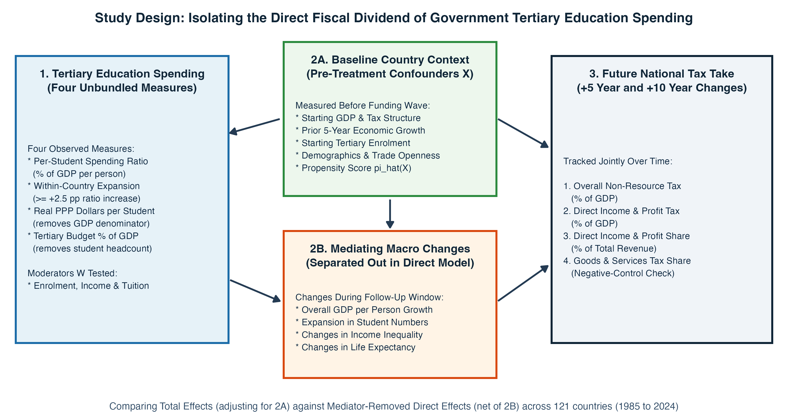
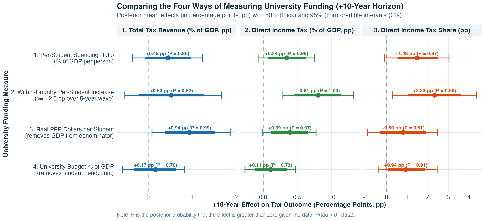
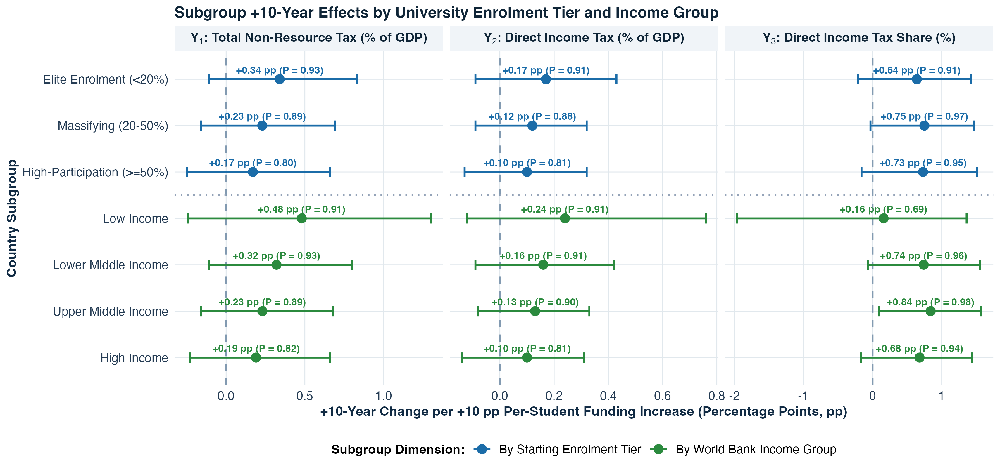
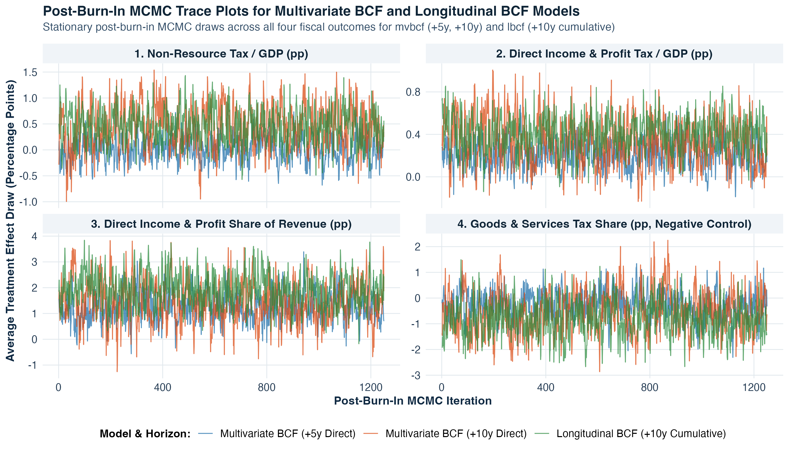

# Does Increasing Government Spending on Tertiary Education Improve the Future Tax Take? A Bayesian Causal Inference Analysis

**Andrew C. Parnell**  
School of Mathematics and Statistics, University College Dublin  
`andrew.parnell1@ucd.ie`  

*6 November 2026*

---

## Abstract

When a national government increases public spending on tertiary (university) education, does that investment strengthen the country's future tax take once general economic growth is separated out? Cross-country data make this question difficult to answer because faster-growing economies naturally collect more tax revenue, international indicators divide per-student spending by gross domestic product (GDP) per person and student headcount, and university cohorts take several years to graduate and enter higher tax brackets. We assemble a harmonised five-year panel covering 121 countries from 1985 to 2024 and fit Multivariate Bayesian Causal Forests that model four interrelated tax outcomes simultaneously whilst adjusting for starting country conditions and follow-up macroeconomic growth. We find that above-median per-student tertiary funding shifts the tax mix toward direct income, profit, and capital gains taxation by $+1.24$ percentage points (pp; $P = 0.99$, where $P$ is the posterior probability of an effect greater than zero given the data) after 5 years and $+1.48$ pp ($P = 0.97$) after 10 years. Overall tax revenue as a share of GDP takes a full decade to respond as university cohorts graduate and advance into higher-salaried careers, with 10-year direct income tax revenue rising by $+0.34$ pp of GDP ($P = 0.95$) under the baseline spending ratio and by $+0.81$ pp of GDP ($P = 1.00$) following substantial within-country increases in funding per student. By contrast, expanding the overall university budget without protecting spending per student yields weak fiscal returns.

**Keywords:** Multivariate Bayesian Causal Forests; tertiary education spending; tax capacity; direct income taxation; cross-country panel data.

---

## 1. Introduction

Public debates over higher education finance frequently centre on a simple, practical question: is government spending on tertiary (university) education a net drain on the public purse, or is it a productive investment that expands a country's future tax base? At the individual level, decades of labour economics research have shown that university graduates earn higher wages, experience lower unemployment, and work in larger, more formalised firms than non-graduates (Carneiro et al., 2011; Zimmerman, 2014; Psacharopoulos and Patrinos, 2018; Deming, 2022). Empirical welfare analyses in the United States also indicate that direct investments in college access and per-student instructional resources can recoup a substantial share of their upfront public cost over the lifecycle through higher future income tax payments (Trostel, 2010; Hendren and Sprung-Keyser, 2020; Chakrabarti et al., 2020). As university-educated cohorts enter the labour market and raise firm productivity (Moretti, 2004; Valero and Van Reenen, 2019), those private wage gains and corporate spillovers should in principle show up at the national level as stronger personal income, payroll, and corporate profit tax receipts.

Yet working out whether, and over what time horizon, national government spending on tertiary education actually improves a country's tax take is surprisingly tricky. First, if a country's tax revenue rises over the decade following an increase in university funding, we need to know whether universities specifically strengthened the formal tax base or whether the whole economy simply grew richer. Worse still, if an analyst constructs a national tax-per-person variable by multiplying the tax-to-GDP ratio by GDP per person, any positive effect of education on GDP automatically inflates the tax outcome by mathematical identity; isolating a genuine fiscal return requires modelling pure tax shares and tax-to-GDP ratios whilst controlling for both starting economic conditions and follow-up economic growth (Imai et al., 2010; Acharya et al., 2016; VanderWeele, 2016). Second, the standard international indicator of tertiary funding intensity compiled by the United Nations Educational, Scientific and Cultural Organisation (UNESCO) Institute for Statistics (https://data.uis.unesco.org/) and the World Bank World Development Indicators (WDI; https://datatopics.worldbank.org/world-development-indicators/) measures public expenditure per university student as a percentage of GDP per person. Because this ratio places both student headcount and GDP per person in the denominator, a low-income country with a tiny, elite university sector (such as Malawi or Ethiopia, enrolling fewer than 2% of young adults) can appear to spend over 150% of GDP per person per student, whereas a high-income country enrolling 60% of its young adults (such as Denmark or South Korea) appears to spend 27%, even though the high-income country spends nearly three times as many real purchasing power parity (PPP) dollars per student (where PPP adjusts US dollars for differences in local price levels across countries).

A third obstacle is that university investments take time to mature and affect different parts of the tax system unequally. A funding increase in a given five-year period immediately pays formal university salaries and supports student cohorts who take three to four years to graduate and another five years to enter peak tax-paying brackets. Furthermore, public finance theory shows that as economies accumulate skilled workers and formal employers, they shift away from indirect consumption and customs taxes toward direct personal income and corporate profit taxes (Gordon and Li, 2009; Besley and Persson, 2014; Kleven et al., 2016; Jensen, 2022). Looking only at a single headline tax-to-GDP number hides this shift in the underlying tax mix. Figure 1 summarises our study design for addressing all three obstacles across 121 countries from 1985 to 2024.

As illustrated in Figure 1, we jointly model four percentage-point (pp) tax outcomes over both $+5$ and $+10$ years: (1) total tax revenue as a share of GDP (excluding oil and mineral royalties), (2) direct income, profit, and capital gains tax revenue as a share of GDP, (3) direct income and profit taxes as a share of total tax revenue, and (4) indirect goods and services (sales and value-added) taxes as a share of total tax revenue. Rather than relying on a single composite spending ratio, we compare four observed measures of university funding side by side: the per-student spending ratio (% of GDP per person), within-country per-student funding expansions of at least $+2.5$ pp over a five-year wave, real 2021 PPP dollars per university student (which removes GDP from the denominator), and the public university budget as a percentage of GDP (which removes student headcount from the denominator). Throughout the paper, we use pp to denote percentage points, CI to denote a Bayesian posterior credible interval, and $P = P(\tau > 0 \mid \text{data})$ to denote the posterior probability that the causal treatment effect $\tau$ is greater than zero given the observed data.

We believe this is the first global study to use modern causal inference techniques to test whether public university funding increases future tax revenue. The remainder of the paper is organised as follows. Section 2 reviews the literature on tax capacity, university resources, and Bayesian regression tree models. Section 3 describes the 40-year panel dataset, illustrates the UNESCO denominator trap, and explains where countries such as Ireland sit on the funding scale. Section 4 explains the Multivariate Bayesian Causal Forest (MV-BCF) model in plain language, with full mathematical derivations in Appendix A. Section 5 presents the empirical results across time horizons, funding measures, enrolment levels, and 10-year country trajectories, whilst Section 6 discusses the policy implications, limitations, and directions for future research.

---

## 2. Literature Review

In this section we review three strands of research that have largely developed in parallel: the political economy of tax structure modernisation, the economics of per-student university resources, and Bayesian tree ensembles for causal inference. Bringing these three literatures together clarifies why university resources should affect direct income taxation more strongly than consumption taxation, and why flexible nonparametric models are needed to separate that fiscal return from general economic growth. Those interested in more comprehensive surveys of each field may refer to Besley and Persson (2014), Deming (2022), and Hill et al. (2020).

### 2.1 Tax Capacity, Formal Employment, and Tax Structure

A central question in public finance is why high-income countries collect 30% to 45% of GDP in tax revenue (primarily through direct personal income taxes, social security contributions, and corporate profit taxes), whereas low- and middle-income countries often collect less than 15% of GDP and rely heavily on indirect consumption taxes and customs duties (Gordon and Li, 2009; Besley and Persson, 2009, 2014). Early cross-country studies emphasised political institutions, property rights, and administrative state capacity (Besley and Persson, 2009; Kaufmann et al., 2011), alongside improved international accounting standards designed to separate domestic tax effort from volatile oil and mineral royalties (Prichard, 2016; UNU-WIDER, 2023; https://doi.org/10.35188/UNU-WIDER/GRD-2023). Whilst these institutional studies establish that fiscal capacity evolves alongside broader economic development, they leave open the specific microeconomic channels through which public investments in skilled human capital expand the collectible tax base.

More recent empirical work has focussed on the microeconomic mechanics of tax enforcement, paper trails, and formal employment (Kleven et al., 2016; Keen and Slemrod, 2017; Pomeranz and Vila-Belda, 2019). Kleven et al. (2016) show that modern governments can enforce high direct tax compliance at low audit cost because large, formal firms act as third-party tax collectors: complex businesses require internal accounting records shared across managers and skilled staff, making collusive tax evasion between employers and employees unsustainable. Building on this mechanism, Jensen (2022) analyses roughly 100 household surveys across development levels and shows that as the share of salaried employees rises relative to self-employed workers, governments lower personal income tax exemption thresholds and expand direct income tax collection. Field studies confirm that electronic tax filing and third-party information trails reduce evasion when paired with capable firms and literate taxpayers (Pomeranz and Vila-Belda, 2019; Okunogbe and Pouliquen, 2022), whilst broader direct taxation can also strengthen citizen engagement with the state (Weigel, 2020). By contrast, in developing economies with large informal sectors, indirect consumption taxes such as value-added tax (VAT) remain the primary revenue instrument because formal retail chains only gradually replace informal vendors as incomes rise (Bachas et al., 2024).

This public finance literature suggests a direct connection between university funding and the national tax base that goes beyond headline GDP growth. Universities are themselves large formal employers whose academic and administrative staff pay income tax through automatic payroll withholding, and they train the professional, managerial, scientific, and accounting graduates required by formal corporate employers (Kleven et al., 2016; Valero and Van Reenen, 2019), shifting workers into salaried jobs above national income tax exemption thresholds (Jensen, 2022). When this mechanism operates at the national level, higher public spending per university student should specifically expand direct income, profit, and capital gains taxation as a share of total tax revenue and as a share of GDP, whilst reducing relative reliance on indirect goods and services taxes.

### 2.2 Returns to University Resources and Fiscal Externalities

A large microeconometric literature documents strong private wage returns to university education across both advanced and developing economies (Carneiro et al., 2011; Zimmerman, 2014; Psacharopoulos and Patrinos, 2018; Chetty et al., 2020; Mountjoy, 2022). Reviewing this evidence, Deming (2022) notes that human capital accounts for at least one-third of within-country wage variation and at least half of cross-country income differences, with cognitive and problem-solving skills playing a key role in long-run growth (Hanushek and Woessmann, 2012; Angrist et al., 2021), even after accounting for skilled emigration from smaller developing countries (Beine et al., 2008). Beyond individual earnings, university graduates generate productivity spillovers for surrounding workers and firms: Moretti (2004) finds that a higher share of college graduates in a city raises the wages of both graduates and non-graduates, whilst Valero and Van Reenen (2019) examine roughly 15,000 universities across 1,500 sub-national regions in 78 countries and find that university expansions raise future regional GDP per person through skilled labour supply and local innovation.

Crucially for our study, higher education research demonstrates that graduation rates and subsequent earnings depend heavily on per-student instructional resources rather than enrolment headcounts alone. Bound et al. (2010) and Deming and Walters (2017) show that when public colleges expand student numbers whilst state funding per student stagnates or declines (a phenomenon known as institutional crowding), degree completion rates fall and time to graduation lengthens. Conversely, Chakrabarti et al. (2020) find that increases in state appropriations to public universities raise bachelor's degree completion and boost graduates' earnings into their thirties. When graduates complete their degrees and enter formal careers, the fiscal return to the public purse can be substantial: Trostel (2010) estimates that lifetime additional income and payroll taxes paid by college graduates exceed direct government subsidies, and Hendren and Sprung-Keyser (2020) show within their Marginal Value of Public Funds framework that direct investments in college access and per-student spending generate positive fiscal externalities through future tax receipts (though they also find that untargeted higher education tax credits for adults yield lower welfare returns than early childhood investments).

### 2.3 Bayesian Regression Tree Ensembles for Causal Inference

Separating the fiscal effect of university funding from general economic development involves two statistical challenges: controlling for intermediate economic growth without introducing bias, and accounting for non-linear confounding across diverse countries. In cross-country panels, standard linear two-way fixed effects regressions can suffer from negative weighting when treatment effects vary across countries and over time (Jordà, 2005; Acemoglu et al., 2019; de Chaisemartin and D'Haultfœuille, 2020; Callaway and Sant'Anna, 2021). Furthermore, as shown in the causal mediation literature (Imai et al., 2010; VanderWeele, 2016; Acharya et al., 2016; Ting and Linero, 2025), adjusting for follow-up macroeconomic changes (such as GDP per person growth, enrolment growth, inequality, and life expectancy) allows us to isolate the direct structural effect of university spending net of overall economic growth, especially when checked via two-stage sequential g-estimation (Acharya et al., 2016).

Bayesian Additive Regression Trees (BART; Chipman et al., 2010; Hill, 2011; Hill et al., 2020) and Bayesian Causal Forests (BCF; Hahn et al., 2020) provide a flexible nonparametric alternative to linear panel regressions, sitting alongside frequentist causal forests and double machine learning (Chernozhukov et al., 2018; Athey et al., 2019). Tree ensembles automatically capture non-linear relationships and multi-way interactions amongst covariates, with extensions supporting high-dimensional predictors (Linero, 2018), functional smoothing (Starling et al., 2020), count outcomes (Murray, 2021), fast stochastic tree search (Krantsevich et al., 2023), causal mediation (Ting and Linero, 2025), and low-dimensional posterior summaries (Woody et al., 2021). Hahn et al. (2020) show that standard single-forest BART models can suffer from regularisation-induced confounding when strong baseline predictors of the outcome also predict which countries receive higher funding; BCF resolves this by splitting the model into a prognostic forest $\mu$ (which includes the estimated propensity score) and a separately regularised treatment-effect forest $\tau$. Readers will note that the Multivariate Bayesian Causal Forest extension used in this paper (McJames et al., 2025; see also McJames et al., 2024) was co-developed by the author with Nathan McJames and Ann O'Shea. Given this, we want to make it clear from the outset that this paper is not written to promote one causal estimator over all others; in Appendix B, we compare the MV-BCF model directly against univariate BCFs, single-forest BART, linear local projections, two-way fixed effects, and double machine learning, and we discuss the limitations of the BCF approach alongside its strengths.

---

## 3. Data

### 3.1 Global Five-Year Panel Structure

Annual macroeconomic series for education spending and tax revenue contain frequent reporting gaps and short-term business-cycle fluctuations. Following standard practice in empirical macro-panel studies (Acemoglu et al., 2019), we average annual observations from the World Bank WDI, the UNESCO Institute for Statistics, the International Monetary Fund (IMF) Fiscal Monitor (https://www.imf.org/en/Publications/FM), the Worldwide Governance Indicators (WGI), the Standardised World Income Inequality Database (SWIID version 9.6; Solt, 2020; https://fsolt.org/swiid/), and the Organisation for Economic Co-operation and Development (OECD) *Education at a Glance* financing taxonomy (https://www.oecd.org/en/publications/education-at-a-glance.html) into eight non-overlapping five-year waves spanning 40 years: `1985-1989`, `1990-1994`, `1995-1999`, `2000-2004`, `2005-2009`, `2010-2014`, `2015-2019`, and `2020-2024`. Constructing five-year waves also matches the typical duration of an undergraduate degree programme and reduces serial correlation from annual budgetary carryover.

Although the full World Bank register lists 217 sovereign territories, many small island states and conflict-affected territories do not report tertiary education expenditure or disaggregated tax revenues to UNESCO and the World Bank. In addition, raw international fiscal archives occasionally contain reporting anomalies where currency-unit mismatches or offshore sovereign resource funds distort headline ratios. Screening out impossible tax-to-GDP values above 60% or below 0.5% of GDP removes two raw WDI reporting errors: Sudan in `1995-1999` (recorded at 629.2% of GDP due to a currency-unit mismatch) and Timor-Leste in `2010-2014` (recorded at 110.0% of non-oil GDP due to offshore petroleum fund accounting). Requiring strictly observed university funding and four-outcome tax series (with zero imputation on treatments or outcomes) yields our analysis dataset of 121 countries: 372 five-year country-waves across 121 countries at the $+5$-year horizon ($t \to t+1$) and 283 country-waves across 112 countries at the $+10$-year horizon ($t \to t+2$).

### 3.2 Tax Revenue Outcomes

To examine how university funding affects both overall tax collection and the mix of taxes without introducing mechanical GDP product identities, we track four percentage-point changes over $+5$ years ($t+1$) and $+10$ years ($t+2$). First, we measure total tax revenue as a percentage of GDP ($\Delta \text{Tax/GDP}$, in pp of GDP), based on the World Bank WDI tax-to-GDP series (`GC.TAX.TOTL.GD.ZS`). Following the fiscal-capacity literature (Prichard, 2016; UNU-WIDER, 2023), in major oil- and mineral-exporting countries where natural resource rents exceed 10% of GDP, we subtract half of the excess resource rents so that volatile commodity royalties do not masquerade as domestic tax effort (and we verify in Appendix B that using raw, unadjusted WDI tax-to-GDP gives virtually identical results).

Second, we measure direct income, profit, and capital gains tax revenue as a percentage of GDP ($\Delta \text{IncomeTax/GDP}$, in pp of GDP), which captures revenue collected directly from individual wages, salaries, and corporate profits. Third, we track direct income, profit, and capital gains taxes as a percentage of total revenue ($\Delta \text{IncomeTax/Rev}$, in pp of revenue), which measures structural modernisation toward progressive direct taxation (Besley and Persson, 2014; Jensen, 2022). Fourth, we track indirect goods and services taxes (such as VAT, sales taxes, and excise duties) as a percentage of total revenue ($\Delta \text{GoodsTax/Rev}$, in pp of revenue; Bachas et al., 2024). Readers should note that Outcome 2 (direct income tax as a share of GDP) is simply the product of Outcome 1 (total tax as a share of GDP) and Outcome 3 (direct income tax as a share of revenue) divided by 100. Thus, Outcomes 1, 3, and 4 capture the two underlying policy dimensions (whether overall tax collection rises and whether the tax mix shifts from consumption taxes toward income taxes), whilst Outcome 2 measures their combined impact on the national budget. Because these four measures are algebraically linked and move together within each country's budget, a major advantage of our Multivariate Bayesian Causal Forest approach is that it models all four outcomes simultaneously through a joint covariance structure, capturing their cross-outcome dependencies directly unlike standard single-equation regressions.

### 3.3 The UNESCO Denominator Trap and Country Funding Thresholds

The standard international indicator of per-student university spending compiled by UNESCO and the World Bank divides public spending per university student by GDP per person, which is algebraically identical to dividing the public university budget (% of GDP) by the number of university students per person:

$$\text{UNESCO Ratio}_{i,t} = \frac{\text{University Spend per Student}_{i,t}}{\text{GDP per Person}_{i,t}} \times 100 = \frac{\text{University Budget (\% GDP)}_{i,t}}{\text{Students per Person}_{i,t}}.$$

Because both GDP per person and student headcount appear in the denominator, countries with very different university systems can record similar headline ratios for completely different reasons. To see the raw data before any statistical modelling, Figure 2 plots the observed distributions of the UNESCO per-student ratio, real 2021 PPP dollars per student, gross tertiary enrolment, and the direct income tax share across the four World Bank income groups, and Table 1 reports the corresponding group summaries.

| Income Group (Countries, Waves) | UNESCO Ratio (%) | Real PPP $ / Student | Univ. Budget (% GDP) | Tertiary Enrol. (%) | Direct Income Tax Share (%) |
| :--- | :---: | :---: | :---: | :---: | :---: |
| **Low income** (21, 80) | **205%** | $3,957 | 0.47% | 2.3% | 29.2% |
| **Lower middle** (41, 172) | 76.5% | $3,258 | 0.65% | 7.4% | 30.8% |
| **Upper middle** (54, 219) | 26.8% | $3,521 | 0.64% | 25.5% | 33.1% |
| **High income** (69, 337) | 26.9% | **$11,148** | **0.94%** | **58.3%** | **38.4%** |

*Table 1: University spending indicators, enrolment, and baseline direct income tax share across World Bank income groups. Values in brackets in the first column show the number of countries and the number of observed five-year country-waves; group medians are reported for skewed spending and enrolment variables and group means for the direct income tax share.*

Figure 2 and Table 1 show clearly how the UNESCO denominator trap works in practice. In low-income countries (such as Uganda, Malawi, or Ethiopia), only 2.3% of young adults attend university; dividing a small university budget (0.47% of GDP) by a tiny student headcount and a low GDP per person produces a raw median UNESCO ratio of 205% (which we cap at 150% in Figure 2A and when fitting our regression trees so that extreme outliers do not distort the tree splits). That tiny elite student body also explains why median real PPP spending per student in low-income countries ($3,957, concentrated in one or two national universities) is slightly higher than in lower-middle-income countries ($3,258), where enrolment is over three times higher (7.4% median) and public budgets are stretched across many more students. Once we unbundle the denominators in Table 1, high-income countries (such as Denmark, Norway, or South Korea) spend nearly three times as much per student in real purchasing power ($11,148 vs $3,957) and twice as much of their national income (0.94% vs 0.47% of GDP), whilst collecting a larger share of their tax revenue from direct income and profit taxes (38.4% vs 29.2%).

Because comparing raw UNESCO ratios across income groups would classify almost every low-income country as high-spending and almost every high-income country as low-spending, we define our primary binary funding indicator ($Z_{i,t} = 1$) by comparing each country's per-student spending ratio against the median of its own World Bank income group (205% for low income, 76.5% for lower-middle income, 26.8% for upper-middle income, and 26.9% for high income). This within-group threshold places roughly half of all country-waves in the above-median funding group (47.3% at $+5$ years and 49.8% at $+10$ years). Among high-income countries, Nordic and continental European countries with strong public university investment (such as Norway at 38.6% to 45.8%, Sweden at 43.2% to 54.2%, Denmark at 41.5%, and Austria at 35.0% to 36.2%) sit consistently above the 26.9% threshold ($Z_{i,t} = 1$), whereas countries that rely more heavily on private tuition or have lower public per-student allocations (such as Chile at 19.6%, the United States at 20.9%, and Spain at 22.4%) sit below it ($Z_{i,t} = 0$). Ireland provides a particularly clear example of a country that moved across the threshold over time: Ireland sat just above the high-income median ($Z_{i,t} = 1$) in `1995-1999` (28.2%), `2005-2009` (28.4%), and `2010-2014` (27.6%), but fell below the median ($Z_{i,t} = 0$) in `2000-2004` (25.6%) and dropped sharply to 17.3% in `2015-2019` as student numbers expanded much faster than state university funding after the 2008 financial crisis.

---

## 4. Methodology

In an ideal experiment, we would randomly assign some countries to increase university funding and others to hold funding steady, and then track their tax receipts over the next decade. In observational data, however, governments set their university budgets in response to economic conditions, demographics, and existing tax capacity, and the relationships among these variables are strongly non-linear (Hill, 2011; Hill et al., 2020). To separate the causal effect of university funding from confounding macroeconomic trends, we use Bayesian Causal Forests (Hahn et al., 2020) and their multivariate extension (McJames et al., 2025), providing the intuitive setup here and full mathematical derivations in Appendix A.

### 4.1 Multivariate Bayesian Causal Forests (MV-BCF)

The Multivariate Bayesian Causal Forest (Hahn et al., 2020; McJames et al., 2025) splits the prediction of future tax changes into two distinct regression tree ensembles (Chipman et al., 2010): a baseline prognostic trajectory (what would have happened to a country's tax take naturally given its starting conditions and overall economic growth) and a causal treatment effect that can vary with country characteristics. For country $i$ at wave $t$ and follow-up horizon $h \in \{1, 2\}$ ($+5$ and $+10$ years), the four tax changes $\Delta Y_{i, t+h} \in \mathbb{R}^4$ are modelled jointly as:

$$\Delta Y_{i, t+h} = \mu\bigl(X_{i,t}, \hat{\pi}(X_{i,t})\bigr) + \tau\bigl(W_{i,t}\bigr) \cdot Z_{i,t} + \varepsilon_{i, t+h}, \quad \varepsilon_{i, t+h} \stackrel{\text{i.i.d.}}{\sim} \mathcal{N}_4(0, \Sigma).$$

To estimate the baseline trajectory $\mu(X_{i,t}, \hat{\pi}_{i,t})$, we use an ensemble of 75 shallow decision trees (many having only one or two splits), where each terminal leaf outputs a vector of four values corresponding to our four tax outcomes. The baseline forest is fed with 19 pre-treatment country characteristics measured at or before wave $t$ (starting log real GDP per person in PPP dollars, starting total tax-to-GDP ratio, starting direct income tax share, starting goods and services tax share, disposable income Gini inequality, life expectancy, gross tertiary and secondary enrolment ratios, total education spending as a share of GDP, working-age population share, log population, unemployment rate, natural resource rents, trade openness, lagged five-year GDP per person growth, World Bank income group, geographic region, OECD membership, and wave time index) together with four follow-up macroeconomic controls over $[t, t+h]$ (forward GDP per person growth, university enrolment expansion, income inequality changes, and life expectancy changes) so that general economic growth during the follow-up window is separated out (Imai et al., 2010; Acharya et al., 2016). We also include the pre-treatment propensity score $\hat{\pi}(X_{i,t}) = P(Z_{i,t} = 1 \mid X_{i,t})$ inside $\mu(\cdot)$ to guard against regularisation-induced confounding (Hahn et al., 2020), and verify in Appendix C that treated and control observations exhibit strong propensity overlap across $[0.041, 0.960]$.

To allow the fiscal return to vary across countries without chasing noise in a macro panel, we model the treatment effect $\tau(W_{i,t})$ using a second, smaller ensemble of 30 shallower trees fed with 8 country moderators $W_{i,t}$ (gross tertiary enrolment, log real GDP per person, gross secondary enrolment, starting direct income tax share, working-age population share, World Bank income group, OECD membership, and wave index). Using a larger, more flexible tree prior for the prognostic forest $\mu(\cdot)$ and a smaller, more conservative tree prior for the treatment-effect forest $\tau(\cdot)$ is standard practice in Bayesian causal forest modelling (following Hahn et al., 2020; see also Chipman et al., 2010 and Hill, 2011), as it allows the model to absorb complex baseline confounding whilst shrinking noisy subgroup treatment differences toward the overall mean. All four tax outcomes are linked through the $4 \times 4$ residual covariance matrix $\Sigma$, which receives a conjugate Inverse-Wishart prior (with all prior hyperparameters detailed in Appendix A).

The main advantage of the MV-BCF framework is that it captures non-linear confounding and shares information across correlated tax outcomes whilst providing full Bayesian posterior distributions for every country at both the $+5$-year and $+10$-year horizons. The main disadvantage is that tree ensembles rely on Markov chain Monte Carlo (MCMC) sampling and conditional ignorability assumptions rather than automatic linear fixed-effect differencing. All MV-BCF models are fitted in C++ for 2,000 MCMC iterations (750 burn-in, 1,250 retained posterior draws), with convergence diagnostics reported in Appendix C.

---

## 5. Results

### 5.1 Effects on Tax Revenue After 5 and 10 Years

We begin by examining our primary question: when a country spends above its income-group median per university student, what happens to its tax revenue 5 and 10 years later once starting country conditions and follow-up economic growth are controlled for? Recall that throughout all tables and figures, CI denotes a Bayesian posterior credible interval and $P = P(\tau > 0 \mid \text{data})$ denotes the posterior probability that the treatment effect is greater than zero given the data. Table 2 and Figure 3 report the posterior mean treatment effects, 80% and 95% credible intervals, and posterior probabilities $P$ across the four tax outcomes at $+5$ years ($N = 372$, 121 countries) and $+10$ years ($N = 283$, 112 countries).

| Tax Revenue Outcome | $+5$ Years Mean ($P$) | $+5$ Years 80% CI / 95% CI | $+10$ Years Mean ($P$) | $+10$ Years 80% CI / 95% CI |
| :--- | :---: | :---: | :---: | :---: |
| **1. Total Non-Resource Tax / GDP** (% of GDP, pp) | $+0.02$ ($P=0.55$) | $[-0.30, +0.32]$ / $[-0.46, +0.49]$ | $+0.45$ ($P=0.86$) | $[-0.07, +0.98]$ / $[-0.35, +1.24]$ |
| **2. Direct Income & Profit Tax / GDP** (% of GDP, pp) | **$+0.21$ ($P=0.95$)** | $[+0.04, +0.38]$ / $[-0.04, +0.47]$ | **$+0.34$ ($P=0.95$)** | $[+0.07, +0.63]$ / $[-0.06, +0.76]$ |
| **3. Direct Income & Profit Tax Share** (% of total tax revenue, pp) | **$+1.24$ ($P=0.99$)** | $[+0.57, +1.96]$ / $[+0.24, +2.40]$ | **$+1.48$ ($P=0.97$)** | $[+0.54, +2.50]$ / $[-0.11, +3.03]$ |
| **4. Goods & Services Tax Share** (% of total tax revenue, pp) | $-0.29$ ($P=0.31$) | $[-0.97, +0.39]$ / $[-1.41, +0.73]$ | $-0.56$ ($P=0.24$) | $[-1.58, +0.51]$ / $[-2.02, +1.05]$ |

*Table 2: Posterior mean treatment effects (in percentage points, pp), 80% and 95% credible intervals (CIs), and posterior probabilities $P = P(\tau > 0 \mid \text{data})$ from the four-outcome Multivariate Bayesian Causal Forest at $+5$ years ($N = 372$, 121 countries) and $+10$ years ($N = 283$, 112 countries).*

Table 2 and Figure 3 show a clear pattern across the two time horizons. First, higher per-student university funding produces an immediate and lasting shift in the tax mix toward direct income, profit, and capital gains taxation: the direct income tax share of revenue (Outcome 3) rises by $+1.24$ pp after 5 years (95% CI $[+0.24, +2.40]$, $P = 0.99$) and by $+1.48$ pp after 10 years (95% CI $[-0.11, +3.03]$, $P = 0.97$; in Appendix B we note that omitting the follow-up macroeconomic growth controls changes these estimates by less than $0.25$ pp, giving $+1.02$ pp at $+5$ years and $+1.36$ pp at $+10$ years). Second, overall tax collection as a share of GDP takes a full decade to respond: after 5 years, total non-resource tax revenue (Outcome 1) is essentially unchanged at $+0.02$ pp of GDP (95% CI $[-0.46, +0.49]$, $P = 0.55$), whereas after 10 years, as university cohorts complete their degrees and advance into higher-salaried careers, total non-resource tax revenue rises by $+0.45$ pp of GDP (95% CI $[-0.35, +1.24]$, $P = 0.86$) and direct income tax revenue as a share of GDP (Outcome 2) rises from $+0.21$ pp at $+5$ years ($P = 0.95$) to $+0.34$ pp of GDP at $+10$ years (80% CI $[+0.07, +0.63]$, 95% CI $[-0.06, +0.76]$, $P = 0.95$). Third, on the indirect goods and services tax share (Outcome 4), the estimated effect is slightly negative in share terms ($-0.29$ pp at $+5$ years, $P = 0.31$; $-0.56$ pp at $+10$ years, $P = 0.24$) with wide credible intervals spanning zero, confirming that the fiscal return is concentrated in direct income and profit taxation rather than consumption taxes. To put these percentage-point figures into concrete national currency terms (holding each country's latest population and 2021 PPP GDP per person constant so that demographic growth does not inflate the calculation), a 10-year gain of $+0.34$ pp of GDP in direct income tax revenue corresponds to roughly EUR $0.62$ billion (USD $0.68$ billion) per year in additional income tax receipts for the median-sized economy in our sample (total GDP of EUR $183$ billion), or around EUR $1.2$ billion per year in a medium-sized high-income economy such as Ireland and EUR $11.0$ billion per year in a large economy such as the United Kingdom (we report percentage points of GDP in cross-country charts because national GDP spans four orders of magnitude across our 121 countries).

### 5.2 Comparing the Four Ways of Measuring University Funding

Whilst Figure 3 compared the $+5$-year and $+10$-year time horizons for our baseline per-student spending ratio, a natural follow-up question is how the $+10$-year fiscal return changes when we unbundle the UNESCO ratio into its separate components. In Table 3 and Figure 4, we hold the time horizon fixed at $+10$ years and compare four distinct ways of measuring university funding: (1) our baseline per-student spending ratio (% of GDP per person), (2) observed within-country per-student funding expansions of at least $+2.5$ pp (and at least $+2.5\%$ relative growth) over a five-year wave, (3) real 2021 PPP dollars per student (which removes GDP per person from the denominator), and (4) the total public university budget as a percentage of GDP (which removes student headcount from the denominator). Comparing these four definitions on the same 10-year horizon allows us to test whether future tax gains are driven by real instructional resources per student or merely by aggregate budget size.

| University Funding Measure ($+10$-Year Horizon) | Waves (Countries) | Total Tax / GDP (pp) | Direct Income Tax / GDP (pp) | Direct Income Tax Share (pp) |
| :--- | :---: | :---: | :---: | :---: |
| **1. Per-Student Ratio (% GDP/person)** | 283 (112) | $+0.45$ ($P=0.86$) $[-0.35, +1.24]$ | **$+0.34$ ($P=0.95$)** $[-0.06, +0.76]$ | **$+1.48$ ($P=0.97$)** $[-0.11, +3.03]$ |
| **2. Within-Country Per-Student Increase** | 176 (86) | $+0.53$ ($P=0.82$) $[-0.53, +1.67]$ | **$+0.81$ ($P=1.00$)** $[+0.29, +1.33]$ | **$+2.33$ ($P=0.99$)** $[+0.29, +4.36]$ |
| **3. Real PPP Dollars per Student** | 283 (112) | **$+0.94$ ($P=0.99$)** $[+0.09, +1.88]$ | **$+0.39$ ($P=0.97$)** $[-0.01, +0.78]$ | $+0.80$ ($P=0.81$) $[-0.91, +2.47]$ |
| **4. University Budget % of GDP** | 403 (123) | $+0.17$ ($P=0.70$) $[-0.59, +0.83]$ | $+0.11$ ($P=0.73$) $[-0.27, +0.47]$ | **$+0.94$ ($P=0.91$)** $[-0.37, +2.45]$ |

*Table 3: Comparison of $+10$-year posterior mean effects (in percentage points, pp), 95% credible intervals (CIs), and posterior probabilities $P = P(\tau > 0 \mid \text{data})$ across the four ways of measuring university funding.*

The comparison in Table 3 and Figure 4 shows why unbundling the denominator is so informative. When we remove GDP per person from the denominator and measure funding in real 2021 PPP dollars per student (Row 3), the $+10$-year effect on total non-resource tax revenue more than doubles from $+0.45$ pp to $+0.94$ pp of GDP (95% CI $[+0.09, +1.88]$, $P = 0.99$), alongside a $+0.39$ pp gain in direct income tax as a share of GDP ($P = 0.97$). Even more strikingly, when we focus on country-waves that achieved an actual within-country expansion in per-student funding of at least $+2.5$ pp over a five-year wave (Row 2, $N = 176$ across 86 countries), the $+10$-year gain in direct income tax revenue reaches $+0.81$ pp of GDP (95% CI $[+0.29, +1.33]$, $P = 1.00$) and the direct income tax share rises by $+2.33$ pp (95% CI $[+0.29, +4.36]$, $P = 0.99$). We also check in Appendix B (`R13`) what happens when we raise the static per-student spending threshold from the income-group median (top 50%) to the top tercile (top 33% within each income group): the $+10$-year effect on total non-resource tax revenue strengthens slightly from $+0.45$ pp ($P = 0.86$) to $+0.54$ pp of GDP (95% CI $[-0.26, +1.35]$, $P = 0.91$), whilst the direct income tax effects remain positive ($+0.24$ pp of GDP, $P = 0.88$, and $+0.87$ pp of revenue share, $P = 0.85$) with slightly wider credible intervals because fewer country-waves cross the higher cutoff. By contrast, when we remove student headcount from the denominator and look only at the aggregate university budget as a share of GDP without accounting for how many students share that budget (Row 4), the $+10$-year effects on total tax revenue ($+0.17$ pp, $P = 0.70$) and direct income tax revenue ($+0.11$ pp, $P = 0.73$) are much weaker, consistent with microeconomic evidence that expanding student headcounts without protecting per-student resources leads to institutional crowding and lower completion rates (Bound et al., 2010; Deming and Walters, 2017; Chakrabarti et al., 2020).

### 5.3 Variation Across Countries, Negative Scenarios, and 10-Year Trajectories

How do the fiscal effects vary across countries at different stages of university enrolment and economic development, and are there situations where increasing university funding actually reduces the tax take? Figure 5 plots the unit-level $+10$-year posterior effects on the direct income tax share against starting gross tertiary enrolment across all four World Bank income groups, highlighting notable country-waves at the extremes of the data (with full numerical subgroup breakdowns reported in Appendix B). As shown in Figure 5, the shift in the tax mix toward direct income and profit taxation increases steadily with baseline university enrolment and tax administration capacity: it averages $+0.90$ pp ($P = 0.83$) in elite university systems with under 20% enrolment, rises to $+1.53$ pp ($P = 0.96$) in massifying systems with 20-50% enrolment (such as Brazil and Armenia), and reaches $+1.87$ pp (95% CI $[+0.16, +3.63]$, $P = 0.99$) in high-participation systems with at least 50% enrolment, where individual country-waves such as Ireland (`2005-2009`, $+3.01$ pp), Austria (`2010-2014`, $+2.72$ pp), and the United States (`2010-2014`, $+2.67$ pp) achieve the largest compositional shifts. By contrast, when we look at total tax revenue as a share of GDP (Appendix B), the largest gains occur in lower-middle-income ($+0.79$ pp of GDP, $P = 0.94$) and upper-middle-income ($+0.61$ pp of GDP, $P = 0.93$) economies whose formal tax bases are still expanding, tapering off to $+0.21$ pp of GDP ($P = 0.68$) in mature high-income economies.

Crucially, both the historical data and our model estimates also reveal three specific scenarios where increasing university funding can be associated with a *decrease* in the tax take. First, in the short run ($+5$ years), 126 out of 372 country-waves (34%) have negative point estimates on total tax-to-GDP (down to $-0.57$ pp of GDP), reflecting a temporary "student lock-in" effect: when a government expands university funding and student places, more young adults remain in lecture theatres rather than working full time and paying income and consumption taxes during those initial five years. Second, at the $+10$-year horizon in very low-income economies with tiny elite enrolment below 4% and extreme UNESCO per-student ratios above 150% (highlighted in the bottom-left corner of Figure 5, such as Ethiopia in `1995-1999` at $-0.83$ pp and Malawi in `2010-2014` at $-0.51$ pp), increasing spending on a tiny elite university sector without broad formal-sector job creation or protection against skilled emigration (Beine et al., 2008) fails to expand the domestic income tax base. Third, in mature high-income economies where total tax revenue already exceeds 35% of GDP (and in our separate OECD-only sub-model in Appendix B, where total tax-to-GDP estimates average $-0.63$ to $-0.72$ pp), expanding public university budgets can coincide with a lower overall tax-to-GDP ratio even as the income tax share of revenue rises; in Ireland's `2005-2009` wave, for example, high per-student university spending was followed over the next decade by a $+3.01$ pp shift toward direct income tax share, but headline non-resource tax-to-GDP fell by $-6.9$ pp (with a model CATE of $-0.41$ pp) due to the post-2008 banking crisis and multinational national-accounts shifts.

To illustrate how the estimated fiscal effect unfolds between the $+5$-year and $+10$-year horizons across individual countries, Figure 6 plots the MV-BCF country-level trajectories and 80% credible intervals on the direct income tax share for seven diverse countries (the United States, Norway, Austria, Ireland, Chile, the United Kingdom, and South Africa) alongside the global posterior mean fan ($+1.24$ pp at $+5$ years and $+1.48$ pp at $+10$ years). At the $+5$-year horizon, all seven countries cluster tightly around the global mean between $+1.26$ and $+1.32$ pp. Over the second five-year period ($+5$ to $+10$ years), as graduating university cohorts enter full-time careers and advance into higher tax brackets, the country trajectories fan out according to their university participation and direct tax capacity: high-enrolment systems such as the United States ($+2.67$ pp, 80% CI $[+0.79, +4.66]$), Norway ($+2.47$ pp, 80% CI $[+0.66, +4.40]$), Austria ($+2.27$ pp, 80% CI $[+0.69, +3.99]$), and Ireland ($+2.23$ pp, 80% CI $[+0.60, +3.94]$) experience substantial further maturation over years 5 to 10, whereas Chile ($+1.52$ pp, 80% CI $[+0.16, +2.96]$), the United Kingdom ($+1.48$ pp, 80% CI $[+0.10, +2.93]$), and South Africa ($+1.35$ pp, 80% CI $[-0.03, +2.81]$) track closer to the global average. In Appendix B, we also summarise our extensive sensitivity checks across alternative estimators, non-overlapping decadal waves, pre-trend controls, two-stage sequential g-estimation, pre-COVID samples, and a top-tercile spending cutoff; those checks confirm that while aggregate tax-to-GDP estimates are sensitive to country fixed effects and pandemic-era shocks, the shift toward direct income taxation holds across every specification.

---

## 6. Conclusions and Discussion

### 6.1 Cohort Maturation Timelines and Policy Implications

Our findings across 121 countries show that government spending on university education produces a measurable fiscal return, but that this return operates primarily by shifting the tax structure toward direct income, profit, and capital gains taxation and requires a full 10-year horizon to mature. Because our panel averages annual data into five-year waves, a university funding increase in wave $t$ (years 0 to 4) is evaluated in wave $t+1$ (years 5 to 9) and wave $t+2$ (years 10 to 14). During the first five-year window, higher per-student university funding immediately expands formal university payrolls (whose academic and administrative staff pay income tax via automatic employer withholding) whilst keeping a larger cohort of young adults in full-time study, which shifts the tax mix toward direct income tax ($+1.24$ pp) without raising overall tax-to-GDP ($+0.02$ pp). By the 10-year window (years 10 to 14), two university cohorts have completed their degrees and moved into salaried professional, managerial, and technical roles inside formal firms (Kleven et al., 2016; Jensen, 2022; Valero and Van Reenen, 2019), raising direct income tax revenue by $+0.34$ to $+0.81$ pp of GDP and total non-resource tax revenue by $+0.45$ to $+0.94$ pp of GDP.

For finance and education ministries, our comparison of the four funding definitions in Section 5.2 carries a clear practical lesson: expanding the overall university budget or student numbers without protecting funding *per student* yields weak fiscal returns ($+0.11$ pp on direct income tax/GDP when only budget share of GDP is considered). Countries that maintain or expand real resources per student avoid institutional crowding (Bound et al., 2010; Deming and Walters, 2017; Chakrabarti et al., 2020) and achieve much stronger 10-year gains in direct income tax receipts ($+0.39$ pp of GDP under real PPP dollars per student and $+0.81$ pp of GDP following observed within-country per-student expansions). To put these magnitudes in perspective using Table 1, median public university budgets stand at 0.47% to 0.94% of GDP across income groups, meaning that a 25% to 35% expansion in per-student funding represents roughly $0.15$ to $0.30$ pp of GDP in annual public spending. In national currency terms (holding population and baseline GDP constant), for a median-sized economy of EUR $183$ billion GDP, an upfront per-student funding boost of $0.15$ to $0.30$ pp of GDP costs roughly EUR $275$ million to EUR $550$ million per year and generates an estimated EUR $0.62$ billion to EUR $1.48$ billion per year in additional direct income tax revenue after 10 years, providing macroeconomic support for microeconomic lifecycle analyses (Trostel, 2010; Hendren and Sprung-Keyser, 2020), though formal net fiscal accounting requires discounting annual cost and revenue streams over complete graduate careers.

### 6.2 Limitations and Future Research

Several caveats apply when interpreting observational cross-country macro panels, and we highlight five main limitations of our study:

1. *Reverse causality and fiscal-capacity feedback:* A central concern in macro-fiscal studies is that growing tax capacity enables governments to spend more on higher education rather than the other way round (Baumol, 1967; World Bank, 2024; World Bank and UNESCO, 2024). Whilst we adjust for starting tax-to-GDP, starting income and goods tax shares, lagged GDP growth, and explicit pre-treatment fiscal trends (Appendix B), observational conditioning cannot completely rule out multi-decade fiscal feedback loops.
2. *Unobserved concurrent policy reforms:* Our causal estimates rely on conditional ignorability given the 19 baseline characteristics and four follow-up growth controls (Imai et al., 2010; Acharya et al., 2016). If a reformist government simultaneously modernises its electronic tax administration (Pomeranz and Vila-Belda, 2019; Okunogbe and Pouliquen, 2022) and increases university funding within the same five-year wave, part of the estimated effect could reflect that concurrent tax reform.
3. *Skilled emigration (brain drain):* In low- and lower-middle-income countries, a substantial share of university graduates emigrate to higher-income economies (Beine et al., 2008). Because emigrants pay direct income taxes in their destination country whilst sending untaxed remittances home (which are spent on domestic goods subject to VAT), high skilled emigration can dampen domestic direct income tax returns in smaller developing nations.
4. *Central government reporting and five-year wave coarseness:* World Bank fiscal series primarily record central government revenue, which can understate state or provincial income taxes in federal countries, and averaging annual data into five-year waves smooths out year-to-year timing.
5. *Binary treatment threshold and boundary effects:* Because our primary treatment indicator dichotomises per-student funding at each income group's median ($Z_{i,t} \in \{0, 1\}$), it estimates the average effect of shifting from a typical below-median funding level (22.2% in high-income $Z=0$ countries) to a typical above-median funding level (36.2% in high-income $Z=1$ countries). In the most recent data wave (`2015-2019`), several $Z=0$ countries sit almost exactly on their income-group boundary, such as Portugal (26.91% vs the 26.95% high-income cutoff, a gap of just 0.04 pp costing EUR 0.004 billion per year) and Poland (26.77%, a gap of 0.18 pp costing EUR 0.12 billion per year). Interpreting a binary threshold model literally as a step function would imply that a token spending nudge across the median line triggers the full 10-year tax return (EUR 0.98 billion per year in Portugal or EUR 2.84 billion per year in Poland), which would clearly be unrealistic. As we detail in Appendix B (`outputs/tables/tableA4_latest_z0_countries_costs_and_returns.csv`), policy makers in near-boundary countries should evaluate the cost of a substantive per-student funding expansion (such as the $+2.5$ pp within-country expansion in Row 2 of Table 3) rather than the minimal cost of stepping over the median cutoff.

These limitations point to several promising avenues for future research. First, whilst this paper has focussed exclusively on tertiary education because university cohorts enter the labour market within a 5-to-10-year window, extending multivariate Bayesian causal forests to 15-to-25-year horizons (or explicitly longitudinal multi-wave tree architectures; McJames et al., 2024) would allow researchers to compare government spending on early childhood, primary, and secondary schooling (Hanushek and Woessmann, 2012; Angrist et al., 2021; Hendren and Sprung-Keyser, 2020) directly against university funding as younger school cohorts reach adulthood. Second, incorporating bilateral skilled migration data (Beine et al., 2008) directly into the treatment-effect moderators would quantify how brain drain alters the fiscal return to public university subsidies in developing countries. Third, linking university funding cohorts to administrative employer-employee tax registers within individual countries would make it possible to trace graduate earnings and corporate tax payments year by year. To help policy makers and researchers explore our dataset and country-level estimates interactively, we provide a companion web application in the `app/` directory of the project repository.

---

## Declarations and Statements

- **Author Contributions (CRediT):** **Andrew C. Parnell:** Conceptualisation, Data curation, Formal analysis, Methodology, Software, Visualisation, Writing - original draft, Writing - review and editing.
- **Data Availability Statement:** All raw and processed datasets analysed in this study are derived from publicly available international databases (World Bank WDI, UNESCO UIS, IMF, WGI, SWIID, and OECD) licensed under CC-BY-4.0 and are included in the project repository at https://github.com/andrewcparnell/education-tax-bcf (with full SHA-256 checksums and provenance documented in `data/raw/PROVENANCE.md`).
- **Code Availability Statement:** All R and C++ (`RcppArmadillo`) source code, data-cleaning scripts, MCMC samplers, diagnostic scripts, interactive exploration app (`app/`), automated pipeline tests, and figure generation pipelines are openly available under the MIT License at https://github.com/andrewcparnell/education-tax-bcf and can be reproduced end-to-end via `bash run_all.sh`. <!-- style-check: ignore -->
- **Ethics, Funding, and Conflict of Interest:** This study analyses aggregate sovereign macroeconomic statistics and involves no human subjects or personally identifiable information; institutional ethical approval is not required. This research received no specific external grant funding. As disclosed in Section 2, the author co-developed the Multivariate Bayesian Causal Forest methodology (McJames et al., 2025; see also McJames et al., 2024) evaluated alongside competing estimators in this study; the author declares no financial or other competing interests.

---

## Appendix A: Mathematical Specification of the MV-BCF Sampler

In the four-outcome Multivariate Bayesian Causal Forest (MV-BCF; Hahn et al., 2020; McJames et al., 2025), the prognostic forest uses $M_\mu = 75$ trees with depth-penalty hyperparameters $(\alpha_\mu = 0.95, \beta_\mu = 2.0)$ and the treatment-effect forest uses $M_\tau = 30$ trees with more conservative depth-penalty hyperparameters $(\alpha_\tau = 0.25, \beta_\tau = 3.0)$, with conjugate Inverse-Wishart prior $\mathcal{IW}(\nu_0 = 6, \Psi_0)$ on the $4 \times 4$ residual covariance matrix $\Sigma$. Each prognostic leaf vector $\mu_{m,b} \in \mathbb{R}^4$ and treatment leaf vector $\tau_{l,b} \in \mathbb{R}^4$ receives an independent multivariate Gaussian prior scaled inversely by the number of trees. During reversible-jump Metropolis-Hastings tree updates (Chipman et al., 2010), proposed grow and prune moves combine the closed-form four-dimensional Gaussian marginal likelihood ratio with the exact tree prior and transition ratio, followed by a conjugate Inverse-Wishart draw for $\Sigma$.

---

## Appendix B: Subgroup Breakdowns, Method Benchmarks, and Robustness Checks

The subgroup breakdowns in `outputs/tables/table3_subgroup_cates.csv` show two contrasting gradients across development stages: the 10-year shift toward direct income taxation strengthens monotonically with university enrolment ($+0.90$ pp in elite systems, $+1.53$ pp in massifying systems, and $+1.87$ pp in high-participation systems, $P = 0.99$), whereas total tax-to-GDP gains are largest in lower-middle-income ($+0.79$ pp, $P = 0.94$) and upper-middle-income ($+0.61$ pp, $P = 0.93$) economies whose formal tax bases are still expanding. In the method benchmark comparisons (`B1` to `B6` in `outputs/tables/table_method_benchmarks.csv`), omitting follow-up macroeconomic growth controls (Total Effect) yields $+0.45$ pp ($P = 0.87$) on total non-resource tax/GDP, $+0.25$ pp ($P = 0.88$) on direct income tax/GDP, $+1.36$ pp ($P = 0.96$) on direct income tax share, and $-0.55$ pp ($P = 0.25$) on goods tax share, whilst single-forest BART (`B3`) shrinks effects toward zero and frequentist estimators (`B4` linear local projections, `B5` two-way fixed effects, and `B6` cross-fitted double machine learning) all confirm positive 10-year gains on direct income tax/GDP ($+0.29$ to $+0.40$ pp) and direct income tax share ($+1.19$ to $+1.55$ pp). Across all 14 sensitivity checks (`R1` to `R13` in `outputs/tables/table4_robustness_checks.csv`), the pre-treatment placebo check (`R5`) is small and indistinct from zero ($+0.07$ pp on direct income tax/GDP, $P = 0.66$), and raising the static per-student spending cutoff from the income-group median (top 50%) to the top tercile (top 33%, check `R13`) yields $+0.54$ pp ($P = 0.91$, 95% CI $[-0.26, +1.35]$) on total non-resource tax/GDP, $+0.24$ pp ($P = 0.88$, 95% CI $[-0.16, +0.63]$) on direct income tax/GDP, and $+0.87$ pp ($P = 0.85$, 95% CI $[-0.64, +2.36]$) on direct income tax share. Finally, `outputs/tables/tableA4_latest_z0_countries_costs_and_returns.csv` lists all 48 countries from our 10-year modelling sample that sit in the below-median group ($Z_{i,t} = 0$) in the most recent treatment wave (`2015-2019`), reporting their current per-student spending ratio, gap to the income-group median threshold, annual public cost to reach $Z=1$ (alongside the cost of a substantive $+2.5$ pp per-student increase for near-boundary countries such as Portugal and Poland), and $+10$-year posterior mean returns and 95% credible intervals in both percentage points of GDP and constant 2021 euros.

---

## Appendix C: Propensity Overlap, Residual Covariance, and MCMC Diagnostics

Inverse-propensity weighting reduces the mean absolute standardised mean difference across all 19 baseline covariates from $0.238$ (maximum $1.006$) to $0.105$ (maximum $0.260$), with $82.0\%$ of observations inside the strict common-support region $\hat{\pi} \in [0.041, 0.960]$ (`outputs/tables/tableA3_propensity_overlap_and_balance.csv`). Posterior cross-outcome residual correlations confirm strong positive co-movement between total non-resource tax/GDP and direct income tax/GDP ($r = +0.62$ at $+10$ years) and between direct income tax/GDP and the direct income tax share ($r = +0.75$), alongside a strong negative correlation between the direct income tax share and the goods and services tax share ($r = -0.58$), justifying joint multivariate modelling. Across all 31 fitted MV-BCF models (`outputs/tables/tableA1_convergence_and_fit_diagnostics.csv`), post-burn-in split-chain $\hat{R}$ values range from $1.000$ to $1.020$, and empirical 95% posterior predictive coverage lies between $95.4\%$ and $97.5\%$.

---

## Appendix D: Computational Environment and Energy Report

All local data processing, C++ (`RcppArmadillo`) Gibbs sampling, and figure generation were executed on a single Apple Silicon workstation (`outputs/tables/tableA2_compute_and_energy.csv`). Fitting all 31 main, benchmark, and sensitivity MV-BCF models completes in 611.4 seconds and consumes only $4.25\text{ Wh}$ of electricity ($1.06\text{ g CO}_2\text{e}$ at the Irish grid carbon intensity of $250\text{ g CO}_2\text{e/kWh}$). By contrast, auditing our complete interaction logs across all five project stages reveals 753 cloud LLM queries ($1.61\text{ million}$ input tokens and $0.94\text{ million}$ generated output, reasoning, and tool-call tokens across the primary session, eight specialist reviewer and user-persona subagents, and two external LLM referee rounds). Applying published frontier LLM inference energy benchmarks (Luccioni et al., 2024), the cloud LLM queries consumed an estimated $682.20\text{ Wh}$ ($170.55\text{ g CO}_2\text{e}$), roughly 160 times the electrical energy required to run all 31 Bayesian MCMC models locally, bringing the combined project footprint to $686.45\text{ Wh}$ ($171.61\text{ g CO}_2\text{e}$).
