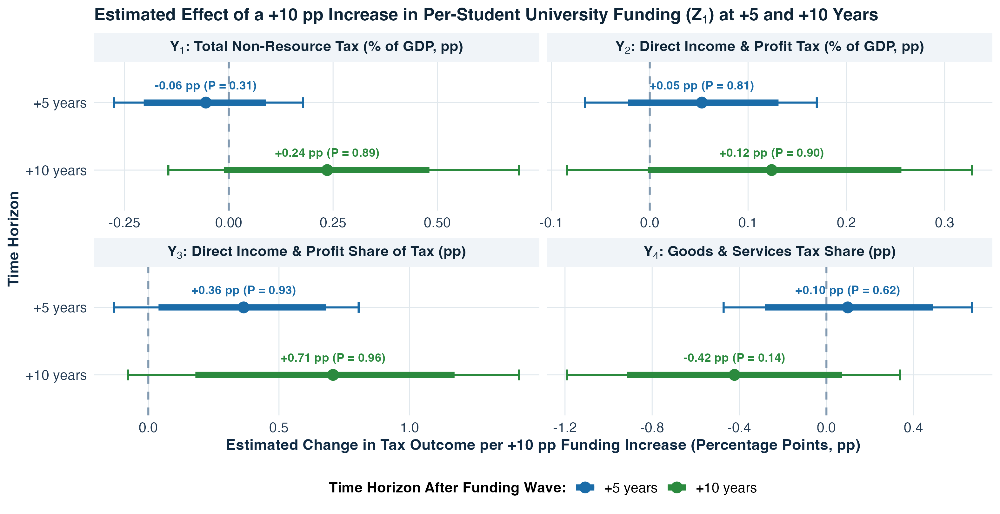
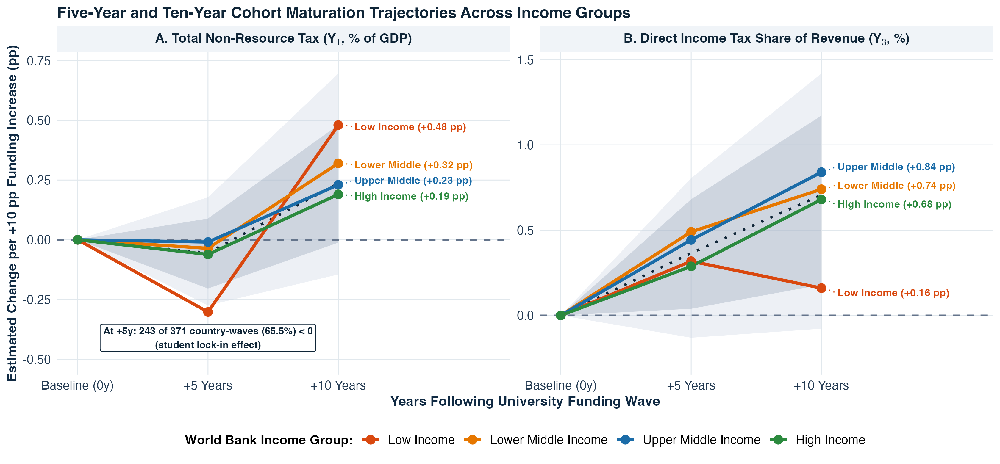
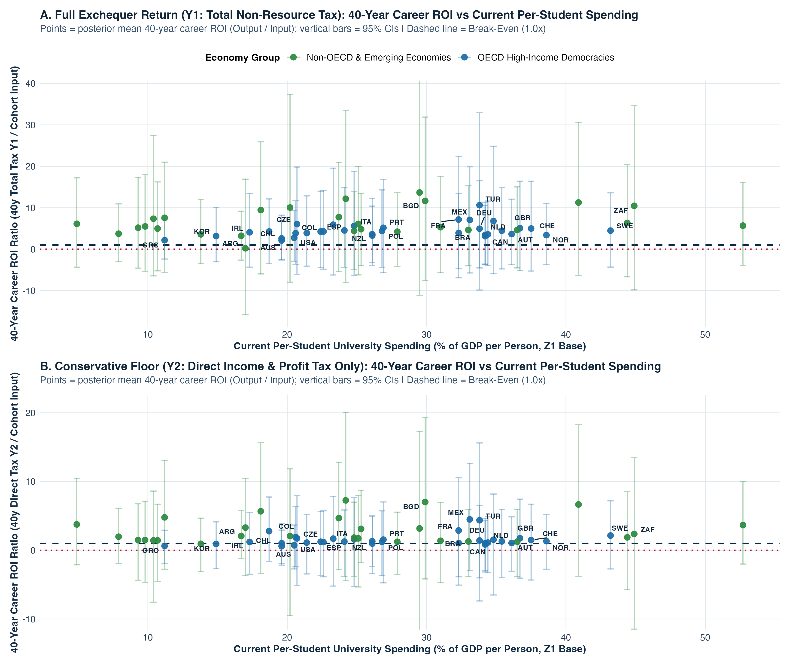

# Does Increasing Government Spending on Tertiary Education Provide a Return on Investment? A Bayesian Causal Inference Analysis

**Andrew C. Parnell**  
School of Mathematics and Statistics, University College Dublin  
`andrew.parnell1@ucd.ie`  

*8 November 2026*

---

## Abstract

When a national government increases public spending on tertiary (university) education, does that investment provide a positive fiscal return on investment once general economic growth is separated out? Cross-country data make this question difficult to answer because faster-growing economies naturally collect more tax revenue, international indicators divide per-student spending by gross domestic product (GDP) per person and student headcount, and university cohorts take several years to graduate and enter higher tax brackets. We assemble a harmonised five-year panel covering 121 countries from 1985 to 2024 and fit continuous-treatment Multivariate Bayesian Causal Forests that model four interrelated tax changes ($Y_1$ to $Y_4$) simultaneously whilst adjusting for pre-treatment country conditions ($X$), predicted funding levels, and follow-up macroeconomic growth mediators ($M$). Within the central policy range around each income group's benchmark, a $+10$ percentage-point (pp) increase in per-student university spending as a share of GDP per person ($Z_1$) shifts the tax mix toward direct income, profit, and capital gains taxation ($Y_3$) by $+0.36$ pp ($P = 0.93$, where $P = \Pr(\tau > 0 \mid \text{data})$ is the posterior probability of a positive effect given the data) after 5 years and $+0.71$ pp ($P = 0.96$) after 10 years. Overall tax revenue as a share of GDP takes a full decade to respond as cohorts graduate and enter formal careers, with 10-year total non-resource tax revenue ($Y_1$) rising by $+0.24$ pp of GDP ($P = 0.89$) and direct income tax revenue ($Y_2$) rising by $+0.12$ pp of GDP ($P = 0.90$) under $Z_1$, by $+0.37$ pp on $Y_2$ ($P = 1.00$) following five-year within-country funding increases ($Z_2$), and by $+0.22$ pp on $Y_1$ ($P = 0.95$) and $+0.15$ pp on $Y_2$ ($P = 0.98$) per $+25\%$ increase in real purchasing power parity dollars per student ($Z_3$). Translating these 10-year causal slopes into a single-cohort comparison between the multi-year degree cost of educating one entering cohort and that cohort's cumulative tax payments across a 40-year working career reveals a positive expected return on investment across all income groups. In high-income economies, a $+10$ pp per-student funding boost generates a typical $3\times$ to $5\times$ career return in total non-resource tax revenue $Y_1$ (such as a EUR $2.37$ billion cohort input in Ireland returning EUR $9.66$ billion in total tax with a $77\%$ probability of net profit and EUR $2.87$ billion in direct income tax alone, or EUR $11.55$ billion in the United Kingdom returning EUR $58.33$ billion in total tax) and $4\times$ to $12\times$ in middle- and low-income economies, whereas expanding the university budget without protecting spending per student ($Z_4$) fails to generate a fiscal return.

**Keywords:** Multivariate Bayesian Causal Forests; continuous treatment; tertiary education spending; fiscal return on investment; direct income taxation; cross-country panel data.

---

## 1. Introduction

Public debates over higher education finance often centre on a simple, practical question. Does government spending on tertiary (university) education provide a positive return on investment to the public purse, or is it a net fiscal cost? At the individual level, decades of labour economics research show that university graduates earn higher wages, experience lower unemployment, and work in larger, more formalised firms than non-graduates (Carneiro et al., 2011; Zimmerman, 2014; Psacharopoulos and Patrinos, 2018; Deming, 2022). Empirical studies in the United States also show that public investments in college access and per-student instructional resources can recoup a substantial share of their upfront cost over a graduate's working career through higher income tax payments (Trostel, 2010; Chakrabarti et al., 2020; Hendren and Sprung-Keyser, 2020). As university-educated cohorts enter the labour market and raise firm productivity (Moretti, 2004; Valero and Van Reenen, 2019), those private wage gains and corporate spillovers should show up at the national level as stronger personal income, payroll, consumption, and corporate profit tax receipts that pay back the initial university outlay.

Yet working out whether national government spending on tertiary education actually improves a country's tax take is surprisingly tricky. First, if a country's tax revenue rises in the decade after an increase in university funding, we must determine whether universities specifically strengthened the formal tax base or whether the whole economy simply grew richer. If an analyst constructs a national tax-per-person variable by multiplying the tax-to-GDP ratio by GDP per person, any positive effect of education on GDP automatically inflates the tax outcome by mathematical identity. Isolating a genuine fiscal return therefore requires modelling tax shares and tax-to-GDP ratios whilst controlling for starting economic conditions and follow-up economic growth (Imai et al., 2010; Acharya et al., 2016; VanderWeele, 2016). Second, the standard international indicator compiled by the United Nations Educational, Scientific and Cultural Organisation (UNESCO) Institute for Statistics (https://data.uis.unesco.org/) and the World Bank World Development Indicators (WDI; https://datatopics.worldbank.org/world-development-indicators/) measures public expenditure per university student as a percentage of GDP per person. Because this ratio places both student headcount and GDP per person in the denominator, a low-income country with a tiny elite university sector (such as Malawi or Ethiopia, enrolling under 2% of young adults) can appear to spend over 150% of GDP per person per student, whereas a high-income country enrolling 60% of young adults (such as Denmark or South Korea) appears to spend 27% despite spending nearly three times as many real purchasing power parity (PPP) dollars per student (where PPP adjusts US dollars for differences in local price levels).

A third obstacle is that university investments are continuous policy choices that take time to mature and face diminishing marginal returns. Treating government university spending as a simple binary on/off switch would discard variation in funding intensity and imply that a tiny spending nudge across an arbitrary cutoff produces the same tax return as a major fiscal expansion. At the same time, governments cannot keep increasing university spending indefinitely and expect linear tax gains forever. In our causal framework, we capture non-linearity and diminishing returns in three ways. First, we evaluate local spending changes within a central $\pm 15$ percentage-point (pp) policy window around each income group's typical funding level and adjust for each country's predicted spending level $\hat{z}(X_{i,t}) = \mathbb{E}[Z_{i,t} \mid X_{i,t}]$ given its starting covariates $X_{i,t}$. Second, our regression trees allow the causal slope per $+10$ pp of funding to vary with enrolment and national income, showing that aggregate tax-to-GDP gains taper off as university systems mature, and third, we verify our results using concave logarithmic funding specifications where each additional dollar of spending yields a smaller marginal return.

Figure 1 summarises our study design for addressing these challenges across 121 countries from 1985 to 2024. On the outcome side (Box 3 of Figure 1), we jointly model four percentage-point tax changes ($Y_1, Y_2, Y_3, Y_4$) in a single multivariate system at both $+5$ and $+10$ years. Specifically, $Y_1$ is the change in total non-resource tax revenue as a share of GDP (measuring the full Exchequer return across all tax streams, including payroll, consumption, property, and income taxes), $Y_2$ is the change in direct income, profit, and capital gains tax revenue as a share of GDP (measuring the conservative direct income-tax floor), $Y_3$ is the change in direct income and profit taxes as a share of total tax revenue, and $Y_4$ is the change in indirect goods and services (sales and value-added) taxes as a share of total tax revenue. On the treatment side (Box 1 of Figure 1), rather than relying on a single spending definition, we estimate separate models for four continuous university funding variables ($Z_1, Z_2, Z_3, Z_4$) in turn. Here $Z_1$ is our primary per-student spending ratio (per $+10$ pp of GDP per person per student within each World Bank income group), $Z_2$ is the five-year within-country change in per-student funding (per $+10$ pp increase), $Z_3$ is real 2021 PPP dollars per student on a logarithmic scale (per $+25\%$ relative increase, removing GDP from the denominator), and $Z_4$ is the public university budget as a percentage of GDP (per $+0.25$ pp of GDP, removing student headcount from the denominator). In every model, we control for 19 pre-treatment country characteristics $X_1$ to $X_{19}$ (Box 2A of Figure 1, of which $W \subset X$ moderate the treatment slope $\tau(W_i)$) and four follow-up macroeconomic growth mediators $M_1$ to $M_4$ (Box 2B); throughout the paper, pp denotes percentage points, CI denotes a Bayesian posterior credible interval, and $P = \Pr(\tau > 0 \mid \text{data})$ denotes the posterior probability that the causal slope $\tau$ is positive given the data.

We believe this is the first global study to use modern causal inference techniques to test whether public university funding provides a national fiscal return on investment. Existing microeconomic studies estimate fiscal returns by tracking individual college cohorts in a single country such as the United States (Trostel, 2010; Chakrabarti et al., 2020; Hendren and Sprung-Keyser, 2020), which provides detailed lifecycle tax estimates but cannot capture economy-wide corporate spillovers or cross-country differences in tax enforcement. Conversely, sub-national and cross-country macroeconomic studies examine how universities affect GDP per person (Valero and Van Reenen, 2019) or how employment structure affects tax collection (Besley and Persson, 2014; Jensen, 2022) using linear panel regressions that assume constant slopes and analyse one outcome at a time. Unlike single-country lifecycle accounting or linear fixed-effects regressions, our continuous-treatment Multivariate Bayesian Causal Forest approach models all four interrelated tax changes ($Y_1$ to $Y_4$) simultaneously across 121 countries while allowing non-linear confounding and heterogeneous returns across development stages. By unbundling the four funding measures ($Z_1$ to $Z_4$), separating out follow-up macroeconomic mediators ($M$), and translating the resulting 10-year causal slopes into single-cohort degree inputs versus 40-year career tax outputs, our approach gives finance and education ministries concrete return-on-investment estimates in their own currency.

The remainder of the paper is organised as follows. Section 2 reviews the literature on tax capacity, university resources, and Bayesian regression tree models for continuous treatments. Section 3 describes the 40-year panel dataset, our four tax outcomes ($Y_1$ to $Y_4$), the UNESCO denominator trap across our four funding measures ($Z_1$ to $Z_4$), and the country-blocked holdout design. Section 4 explains the continuous-treatment Multivariate Bayesian Causal Forest (MV-BCF) model, why we separate baseline predictors $X$ and growth mediators $M$ from treatment moderators $W$, and how we account for expected funding levels, with full mathematical derivations in Appendix A and a complete data dictionary in Appendix B. Section 5 presents the empirical results across time horizons, funding measures, country subgroups, cohort return-on-investment calculations for policy makers, and out-of-sample holdout validation, with additional benchmarks, linear-versus-logarithmic comparisons, and a 27-country policy-maker lookup table in Appendices B to F. Finally, Section 6 discusses multi-cohort fiscal payback timelines, limitations, and directions for future research.

---

## 2. Literature Review

In this section we review three strands of research that have largely developed in parallel: the political economy of tax structure modernisation, the economics of per-student university resources, and Bayesian tree ensembles for causal inference. Bringing these three literatures together clarifies why university resources should affect direct income taxation more strongly than consumption taxation. It also explains why flexible nonparametric models are needed to separate continuous funding slopes from general economic growth. Readers interested in comprehensive surveys of each field may refer to Besley and Persson (2014), Deming (2022), and Hill et al. (2020).

### 2.1 Tax Capacity, Formal Employment, and Tax Structure

A central question in public finance is why high-income countries collect 30% to 45% of GDP in tax revenue, whereas low- and middle-income countries often collect less than 15% of GDP (Besley and Persson, 2009; Gordon and Li, 2009; Besley and Persson, 2014). High-income economies raise most of their revenue through direct personal income taxes, social security contributions, and corporate profit taxes, while developing economies rely heavily on indirect consumption taxes and customs duties. Early cross-country studies emphasised political institutions, property rights, and administrative state capacity (Besley and Persson, 2009; Kaufmann et al., 2011), alongside international accounting standards that separate domestic tax effort from volatile oil and mineral royalties (Prichard, 2016; UNU-WIDER, 2023; https://doi.org/10.35188/UNU-WIDER/GRD-2023). Whilst these institutional studies establish that fiscal capacity evolves alongside economic development, they leave open the specific channels through which public investments in skilled workers expand the collectible tax base.

More recent empirical work has focussed on the microeconomic mechanics of tax enforcement, paper trails, and formal employment (Kleven et al., 2016; Keen and Slemrod, 2017; Pomeranz and Vila-Belda, 2019). Kleven et al. (2016) show that modern governments can enforce high direct tax compliance at low audit cost because large, formal firms act as third-party tax collectors. Complex businesses require internal accounting records shared across managers and skilled staff, which makes collusive tax evasion between employers and employees difficult to sustain. Building on this mechanism, Jensen (2022) analyses roughly 100 household surveys across development levels and shows that as the share of salaried employees rises relative to self-employed workers, governments lower income tax exemption thresholds and expand direct income tax collection. Field studies confirm that electronic tax filing and third-party information trails reduce evasion when paired with capable firms and literate taxpayers (Pomeranz and Vila-Belda, 2019; Okunogbe and Pouliquen, 2022), whilst broader direct taxation can also strengthen citizen engagement with the state (Weigel, 2020). By contrast, in developing economies with large informal sectors, indirect consumption taxes such as value-added tax (VAT) remain the main revenue source because formal retail chains only gradually replace informal vendors as incomes rise (Bachas et al., 2024).

This public finance literature suggests a direct connection between university funding and the national tax base that goes beyond headline GDP growth. Universities are themselves large formal employers whose academic and administrative staff pay income tax through automatic payroll withholding. Over the medium term, universities also train the professional, managerial, scientific, and accounting graduates required by formal corporate employers (Kleven et al., 2016; Valero and Van Reenen, 2019). As those graduates enter the workforce, they shift employment into salaried jobs above national income tax exemption thresholds (Jensen, 2022). When this mechanism operates at the national level, higher public spending per university student should expand direct income, profit, and capital gains taxation ($Y_2$ and $Y_3$) whilst reducing relative reliance on indirect goods and services taxes ($Y_4$).

### 2.2 Returns to University Resources and Fiscal Externalities

A large microeconometric literature documents strong private wage returns to university education across both advanced and developing economies (Carneiro et al., 2011; Zimmerman, 2014; Psacharopoulos and Patrinos, 2018; Chetty et al., 2020; Mountjoy, 2022). Reviewing this evidence, Deming (2022) notes that human capital accounts for at least one-third of within-country wage variation and at least half of cross-country income differences. Cognitive and problem-solving skills play a central role in long-run growth (Hanushek and Woessmann, 2012; Angrist et al., 2021), even after accounting for skilled emigration from smaller developing countries (Beine et al., 2008). Beyond individual earnings, university graduates generate productivity spillovers for surrounding workers and firms. Moretti (2004) finds that a higher share of college graduates in a city raises the wages of both graduates and non-graduates, and Valero and Van Reenen (2019) examine roughly 15,000 universities across 1,500 regions in 78 countries and find that university expansions raise regional GDP per person.

Importantly for our study, higher education research demonstrates that graduation rates and subsequent earnings depend heavily on per-student instructional resources rather than enrolment headcounts alone. Bound et al. (2010) and Deming and Walters (2017) show that when public colleges expand student numbers whilst state funding per student stagnates or declines (a phenomenon known as institutional crowding), degree completion rates fall and time to graduation lengthens. Conversely, Chakrabarti et al. (2020) find that increases in state funding for public universities raise bachelor's degree completion and improve students' long-term financial outcomes into their thirties. When graduates complete their degrees and enter formal careers, the fiscal return to the public purse over their working lives can be substantial. Trostel (2010) estimates that lifetime additional income and payroll taxes paid by college graduates exceed direct government subsidies, and Hendren and Sprung-Keyser (2020) show within their Marginal Value of Public Funds framework that direct investments in college access and per-student spending generate positive fiscal externalities through future tax receipts.

### 2.3 Bayesian Regression Tree Ensembles for Continuous Treatments

Separating the fiscal effect of continuous university funding from general economic development involves two statistical challenges. First, we must control for intermediate economic growth without introducing bias, and second, we must account for non-linear confounding across diverse countries. In cross-country panels, standard linear two-way fixed effects regressions can suffer from negative weighting and functional-form misspecification when treatment slopes vary across countries and over time (Jordà, 2005; Acemoglu et al., 2019; de Chaisemartin and D'Haultfœuille, 2020; Callaway and Sant'Anna, 2021). Furthermore, as shown in the causal mediation literature (Imai et al., 2010; Acharya et al., 2016; VanderWeele, 2016; Ting and Linero, 2025), adjusting for follow-up macroeconomic changes (such as GDP per person growth, enrolment growth, inequality, and life expectancy) allows us to isolate the direct structural effect of university spending net of overall economic growth. We also verify this decomposition using two-stage sequential g-estimation (Acharya et al., 2016).

Bayesian Additive Regression Trees (BART; Chipman et al., 2010; Hill, 2011; Hill et al., 2020) and Bayesian Causal Forests (BCF; Hahn et al., 2020) provide a flexible nonparametric alternative to linear panel regressions, sitting alongside frequentist causal forests and double machine learning (Chernozhukov et al., 2018; Athey et al., 2019). Tree ensembles automatically capture non-linear relationships and multi-way interactions amongst covariates, with extensions supporting high-dimensional predictors (Linero, 2018), functional smoothing (Starling et al., 2020), count outcomes (Murray, 2021), fast stochastic tree search (Krantsevich et al., 2023), causal mediation (Ting and Linero, 2025), and low-dimensional posterior summaries (Woody et al., 2021). Hahn et al. (2020) show that standard single-forest BART models can suffer from regularisation-induced confounding when strong baseline predictors of the outcome also predict treatment intensity. BCF resolves this problem by splitting the model into a prognostic forest $\mu(\cdot)$ and a separately regularised treatment-effect forest $\tau(\cdot) \cdot Z_{i,t}$, with recent extensions to multivariate outcomes and longitudinal panels (McJames et al., 2024, 2025). Because $Z_{i,t}$ enters our structural equation in Section 4 (and Appendix A) multiplicatively as a scalar multiplier on the four-dimensional leaf vector $\tau_{l,b} \in \mathbb{R}^4$, the MV-BCF algebra extends directly to a continuous treatment variable $Z_{i,t} \in \mathbb{R}$ by replacing the binary propensity score with the expected continuous funding level $\hat{z}(X_{i,t}) = \mathbb{E}[Z_{i,t} \mid X_{i,t}]$ inside $\mu(\cdot)$, mirroring continuous-treatment residualisation in causal forests and double machine learning (Robinson, 1988; Hirano and Imbens, 2004; Chernozhukov et al., 2018; Athey et al., 2019).

Readers will note that the Multivariate Bayesian Causal Forest (MV-BCF) method used in this paper (McJames et al., 2025) was co-developed by the author with Nathan McJames, Ann O'Shea, and Yong Chen Goh. Given this connection, we want to make it clear from the outset that this paper is not written to promote one causal estimator over all others. In Section 5.4, we benchmark the out-of-sample predictive accuracy of continuous MV-BCF against single-forest BART, random forests, historical training means, ridge regression, zero-change persistence, and linear local projections. In Appendix B, we also compare its causal slope estimates directly against separate univariate BCFs, single-forest BART, linear local projections, two-way fixed effects, cross-fitted double machine learning, and frequentist orthogonal causal forests (Athey et al., 2019). Throughout the paper, we discuss the limitations of the BCF approach alongside its strengths.

---

## 3. Data

### 3.1 Global Five-Year Panel Structure and Country-Blocked Holdout Split

Annual macroeconomic series for education spending and tax revenue contain frequent reporting gaps and short-term business-cycle fluctuations. Following standard practice in empirical macro-panel studies (Acemoglu et al., 2019), we average annual observations from six international databases into eight non-overlapping five-year waves spanning 40 years: `1985-1989`, `1990-1994`, `1995-1999`, `2000-2004`, `2005-2009`, `2010-2014`, `2015-2019`, and `2020-2024`. These sources are the World Bank WDI, the UNESCO Institute for Statistics, the International Monetary Fund (IMF) Fiscal Monitor (https://www.imf.org/en/Publications/FM), the Worldwide Governance Indicators (WGI), the Standardised World Income Inequality Database (SWIID version 9.6; Solt, 2020; https://fsolt.org/swiid/), and the Organisation for Economic Co-operation and Development (OECD) *Education at a Glance* financing taxonomy (https://www.oecd.org/en/publications/education-at-a-glance.html). Constructing five-year waves matches the typical duration of an undergraduate degree programme and reduces serial correlation from annual budgetary carryover.

Although the full World Bank register lists 217 sovereign territories, many small island states and conflict-affected territories do not report tertiary education expenditure or disaggregated tax revenues to UNESCO and the World Bank. In addition, raw international fiscal and education archives occasionally contain reporting anomalies where currency-unit mismatches, decimal-place errors, or offshore sovereign resource funds distort headline ratios. Screening out impossible tax-to-GDP values above 60% or below 0.5% of GDP and near-zero tertiary reporting glitches below 0.5% of GDP per person removes five raw reporting anomalies in the pipeline: Sudan in `1995-1999` (recorded at 629.2% of GDP in tax due to a currency-unit mismatch), Timor-Leste in `2010-2014` (recorded at 110.0% of non-oil GDP due to offshore petroleum fund accounting), the United Arab Emirates in `2010-2014` and `2015-2019` (recorded below 0.4% of GDP in central federal tax), and Madagascar in `2015-2019` (recorded at 0.036% of GDP per person per student due to a decimal-place glitch). Across the full cleaned panel before requiring forward tax changes, 808 five-year country-waves have observed university spending or tax structure data (summarised descriptively in Table 1). Requiring strictly observed per-student university funding ($Z_1$ or $Z_3$) and all four forward tax changes (with zero imputation on treatments or outcomes) yields 371 country-waves across 121 countries at the $+5$-year horizon ($t \to t+1$, waves 1 to 7) and 283 country-waves across 112 countries at the $+10$-year horizon ($t \to t+2$, waves 1 to 6), while requiring two consecutive waves of per-student funding for $Z_2$ yields 176 waves across 86 countries at $+10$ years and requiring aggregate tertiary budget data without student headcounts for $Z_4$ yields 403 waves across 123 countries at $+10$ years (with $Z_4$ also verified on the overlapping $N = 272$ sample in Check `R17` of Appendix B).

To evaluate how well our continuous-treatment models generalise to unseen countries, we partition the countries using a deterministic 5-fold country-blocked split stratified by each country's modal World Bank income group (sorting countries alphabetically by ISO-3 code within each modal income group and assigning folds $1, \dots, 5$ sequentially). Every wave of a given country is assigned to the same fold so that no country ever straddles the training and test sets. Folds 1 to 4 (80% of countries: 98 countries and 301 country-waves at $+5$ years; 90 countries and 229 country-waves at $+10$ years) form the training sample used to compute income-group funding medians and covariate centring statistics without test-set leakage, whereas Fold 5 (20% of countries: 23 unseen countries and 70 country-waves at $+5$ years; 22 unseen countries and 54 country-waves at $+10$ years) serves as a locked out-of-sample holdout test set evaluated in Section 5.4. Occasional missing values in auxiliary covariates inside $X_{i,t}$ and $W_{i,t}$ (such as baseline gross tertiary enrolment in 39 of the 283 ten-year waves where UNESCO records per-student expenditure ratios without publishing the separate enrolment headcount) are imputed using strictly out-of-fold training medians so tree splits can be evaluated on all 283 waves, and we confirm in Check `R4` of Appendix B that dropping all incomplete covariate rows ($N = 238$) leaves our results unchanged. In Sections 5.1 to 5.3, we report posterior treatment slopes from the full 5-fold country-blocked cross-fitted panel ($N = 371$ at $+5$ years and $N = 283$ at $+10$ years, where $\hat{z}(X_{i,t})$ is predicted strictly out-of-fold across the five country folds), whilst in Section 5.4 and Check `R13` we fit both the random forest for $\hat{z}(X_{i,t})$ (using 4-fold internal cross-fitting across Folds 1 to 4) and the MV-BCF model exclusively on the 80% training countries to generate strictly out-of-sample predictions on the 22 locked holdout countries in Fold 5.

### 3.2 Tax Revenue Outcomes ($Y_1$ to $Y_4$)

To examine how university funding affects both overall tax collection and the mix of taxes without introducing mechanical GDP product identities, we distinguish baseline tax levels $L_{1,i,t}, \dots, L_{4,i,t}$ at wave $t$ from our four percentage-point forward change outcomes $Y_{k,i,t+h} = L_{k,i,t+h} - L_{k,i,t}$ ($k \in \{1, 2, 3, 4\}$) over $+5$ years ($h=1$) and $+10$ years ($h=2$). Our first outcome, $Y_{1,i,t+h} = L_{1,i,t+h} - L_{1,i,t}$, is the change in total non-resource tax revenue as a percentage of GDP ($\Delta \text{Tax/GDP}$, in pp of GDP), based on the World Bank WDI tax-to-GDP series (`GC.TAX.TOTL.GD.ZS`). Following the fiscal-capacity literature (Prichard, 2016; UNU-WIDER, 2023), in major oil- and mineral-exporting country-years where natural resource rents (`NY.GDP.TOTL.RT.ZS`) exceed 10% of GDP, we subtract half of the excess resource rents at the annual level before five-year wave averaging ($L_{1,i,\text{yr}} = \text{Tax/GDP}_{i,\text{yr}} - 0.5 \max(0, \text{Rents/GDP}_{i,\text{yr}} - 10)$) as a harmonised proxy so that volatile commodity royalties do not masquerade as domestic tax effort. Whilst the UNU-WIDER Government Revenue Dataset provides consolidated general-government non-resource tax series for a subset of waves, we verify in Appendix B (Check `R1`) that using raw, unadjusted WDI tax-to-GDP yields nearly identical slopes.

Our second outcome, $Y_{2,i,t+h} = L_{2,i,t+h} - L_{2,i,t}$, is the change in direct income, profit, and capital gains tax revenue as a percentage of GDP ($\Delta \text{IncomeTax/GDP}$, in pp of GDP), which captures revenue collected directly from individual wages, salaries, and corporate profits. Our third outcome, $Y_{3,i,t+h} = L_{3,i,t+h} - L_{3,i,t}$, is the change in direct income, profit, and capital gains taxes as a percentage of total tax revenue (`GC.TAX.YPKG.ZS`, $\Delta \text{IncomeTax/Rev}$, in pp of revenue), which measures structural modernisation toward progressive direct taxation (Besley and Persson, 2014; Jensen, 2022). Our fourth outcome, $Y_{4,i,t+h} = L_{4,i,t+h} - L_{4,i,t}$, is the change in indirect goods and services taxes (such as VAT, sales taxes, and excise duties, `GC.TAX.GSRV.RV.ZS`) as a percentage of total tax revenue ($\Delta \text{GoodsTax/Rev}$, in pp of revenue; Bachas et al., 2024). Readers should note that in levels at any wave $t$, direct income tax as a share of GDP satisfies $L_{2,i,t} = (L_{1,i,t} \times L_{3,i,t}) / 100$, so for a marginal funding change the first-difference slopes satisfy $\tau_{Y_2} \approx (\bar{L}_1 \tau_{Y_3} + \bar{L}_3 \tau_{Y_1}) / 100$. Thus, $Y_1$, $Y_3$, and $Y_4$ capture the two underlying policy dimensions (whether overall tax collection rises and whether the tax mix shifts from consumption taxes toward income taxes), whilst $Y_2$ measures their combined impact on the national budget, and our Multivariate Bayesian Causal Forest models all four change outcomes ($Y_1$ to $Y_4$) simultaneously through a joint $4 \times 4$ covariance matrix $\Sigma$.

### 3.3 The UNESCO Denominator Trap and Four University Funding Measures ($Z_1$ to $Z_4$)

The standard international indicator of per-student university spending compiled by UNESCO and the World Bank divides public spending per university student by GDP per person. As shown below, this ratio is algebraically identical to dividing the public university budget (% of GDP) by the number of university students per person:

$$\text{UNESCO Ratio}_{i,t} = \frac{\text{University Spend per Student}_{i,t}}{\text{GDP per Person}_{i,t}} \times 100 = \frac{\text{University Budget (\% GDP)}_{i,t}}{\text{Students per Person}_{i,t}}.$$

Because both GDP per person and student headcount appear in the denominator, countries with very different university systems can record similar headline ratios for completely different reasons. To see the raw data before any statistical modelling, Figure 2 plots the observed distributions of the UNESCO per-student ratio (used to construct $Z_1$), real 2021 PPP dollars per student (used to construct $Z_3$), gross tertiary enrolment, and the direct income tax share ($Y_3$) across the four World Bank income groups. Table 1 reports the corresponding group summaries.

| Income Group (Countries, Waves) | UNESCO Ratio (%) | Real PPP $ / Student | Univ. Budget (% GDP) | Tertiary Enrol. (%) | Direct Income Tax Share (%) |
| :--- | :---: | :---: | :---: | :---: | :---: |
| **Low income** (21, 80) | **205%** | $3,957 | 0.47% | 2.3% | 29.2% |
| **Lower middle** (41, 172) | 76.5% | $3,258 | 0.65% | 7.4% | 30.8% |
| **Upper middle** (54, 219) | 26.8% | $3,521 | 0.64% | 25.5% | 33.1% |
| **High income** (69, 337) | 26.9% | **$11,148** | **0.94%** | **58.3%** | **38.4%** |

*Table 1: University spending indicators, enrolment, and baseline direct income tax share ($L_3$) across World Bank income groups in the full cleaned descriptive panel ($N = 808$ five-year waves across 185 country-by-income-group appearances prior to requiring forward tax changes and student headcounts; individual countries that move across World Bank income thresholds over the 40-year window appear in more than one row). Group medians are reported for skewed spending and enrolment variables and group means for the baseline direct income tax share.*

Figure 2 and Table 1 show clearly how the UNESCO denominator trap works in practice. In low-income countries (such as Uganda, Malawi, or Ethiopia), only 2.3% of young adults attend university. Dividing a small university budget (0.47% of GDP) by a tiny student headcount and a low GDP per person produces a raw median UNESCO ratio of 205%, which we cap at 150% in Figure 2A to make the plot easier to read. That tiny elite student body also explains why median real PPP spending per student in low-income countries ($3,957, concentrated in one or two national universities) is slightly higher than in lower-middle-income countries ($3,258), where enrolment is over three times higher (7.4% median) and budgets are stretched across many more students. Once we unbundle the denominators in Table 1, high-income countries (such as Denmark, Norway, or South Korea) spend nearly three times as much per student in real purchasing power ($11,148 vs $3,957) and twice as much of their national income (0.94% vs 0.47% of GDP), whilst collecting a larger share of their tax revenue from direct income and profit taxes (38.4% vs 29.2%).

Because comparing raw UNESCO ratios across income groups would conflate small elite enrolment with high per-student funding, we construct our primary continuous funding variable $Z_1$ (which we refer to as Scaling A) within each World Bank income group. Specifically, we centre each country-wave's winsorised per-student spending ratio on the training-set median of its own income group ($m_{g(i,t)} = 150.0\%$ for low income after the $150\%$ pre-winsorisation cap vs $183.8\%$ raw, $68.9\%$ for lower-middle income, $27.6\%$ for upper-middle income, and $26.4\%$ for high income) and divide by $10$ percentage points. To ensure our causal slope reflects realistic policy changes rather than linear extrapolation to extreme ratios, we winsorise $Z_1$ at $\pm 1.5$ units ($\pm 15$ pp around the group median) so that $Z_{1,i,t} \in [-1.5, +1.5]$ is centred directly at zero, where $Z_{1,i,t} = 0$ represents the income-group median benchmark and a unit change ($\Delta Z_1 = \pm 1.0$, $\text{SD}(Z_1) = 1.05$) represents a $\pm 10$ pp adjustment in per-student funding (we also compare $Z_1$ against a logarithmic $+25\%$ transformation of the same ratio, termed Scaling B, in Appendix D). Readers should note that because more than half of low-income country-waves exceed the $150\%$ pre-winsorisation cap ($m_{\text{Low}} = 150.0\%$), $Z_{1,i,t}$ in the low-income stratum varies over $[-1.5, 0]$ below the cap, so we verify in Check `R1b` (omitting the $150\%$ cap), Scaling B (using raw $m_{\text{Low}} = 183.8\%$), and $Z_3$ (real PPP dollars) that preserving upper-tail variation yields virtually identical conclusions.

On this zero-centred $Z_1$ scale, Nordic and continental European high-income countries with generous public university funding sit near the top of the distribution (Norway, Sweden, and Denmark at $+1.2$ to $+1.5$, and Austria at $+0.9$ to $+1.0$). Countries near their group median sit near $0$ (New Zealand and Iceland at $-0.03$), whereas countries relying more heavily on private tuition sit below $0$ (Spain at $-0.40$, the United States at $-0.59$, Chile at $-0.69$, and South Korea at $-1.15$). Ireland illustrates a striking chronological trajectory along $Z_1$: it sat above the high-income median in `1995-1999` (28.2%, $Z_1 = +0.18$), dipped slightly below in `2000-2004` (25.6%, $Z_1 = -0.08$), recovered above the median in `2005-2009` (28.4%, $Z_1 = +0.20$) and `2010-2014` (27.6%, $Z_1 = +0.12$), and then dropped sharply to 17.3% ($Z_1 = -0.91$, or $9.1$ pp below the median) in `2015-2019` as student numbers grew much faster than state grants after the 2008 financial crisis. Alongside $Z_1$, we construct three additional continuous funding variables tested in turn in Section 5.2 (each winsorised onto $[-1.5, +1.5]$ around zero): $Z_2 = \text{clip}(\Delta \text{Spend}_{i,t} / 10, -1.5, +1.5)$ measures within-country five-year per-student funding changes centred at $0$ for zero change (per $+10$ pp expansion), $Z_3 = \text{clip}\bigl(\log(\text{PPP\$}_{i,t} / m^{\text{PPP}}_{g(i,t)}) / \log(1.25), -1.5, +1.5\bigr)$ measures log real 2021 PPP dollars per student centred at $0$ on the training income-group median (per $+25\%$ relative dollar increase), and $Z_4 = \text{clip}\bigl((\text{BudgetGDP}_{i,t} - m^{\text{Bud}}_{g(i,t)}) / 0.25, -1.5, +1.5\bigr)$ measures the total public university budget as a share of GDP centred at $0$ on the training income-group median (per $+0.25$ pp of GDP).

---

## 4. Methodology

In an ideal experiment, we would randomly assign different countries to increase per-student university funding by varying amounts and then track their tax receipts over the next decade. In observational data, however, governments set their university budgets in response to economic conditions, demographics, and existing tax capacity. The relationships among these macroeconomic variables are also strongly non-linear (Hill, 2011; Hill et al., 2020). To separate the causal slope of continuous university funding from confounding macroeconomic trends whilst modelling all four interrelated tax outcomes ($Y_1$ to $Y_4$) simultaneously, we use the continuous-treatment Multivariate Bayesian Causal Forest (MV-BCF) model (Hahn et al., 2020; McJames et al., 2025). We present the intuitive setup of the model here and provide full mathematical derivations in Appendix A alongside a complete data dictionary for all variables ($Y, Z, X, W$, and $M$) in Appendix B.

The Multivariate Bayesian Causal Forest (Hahn et al., 2020; McJames et al., 2025) splits the prediction of future tax changes into two distinct regression tree ensembles (Chipman et al., 2010). The first ensemble estimates a baseline prognostic trajectory $\mu(\cdot)$ (what would have happened to a country's tax take naturally when $Z_{i,t} = 0$, given its pre-treatment conditions $X_{i,t}$, its predicted funding level $\hat{z}(X_{i,t})$, and its follow-up macroeconomic growth mediators $M_{i,t\to t+h}$), whilst the second ensemble estimates a causal treatment slope $\tau(W_{i,t})$ that measures the effect of a unit change in university funding $Z_{i,t} \in [-1.5, +1.5]$ and can vary with eight pre-treatment structural country moderators $W_{i,t} = (W_{1,i,t}, \dots, W_{8,i,t})^\top \subset X_{i,t}$. For country $i$ at wave $t$ and follow-up horizon $h \in \{1, 2\}$ ($+5$ and $+10$ years), the four tax changes $Y_{i, t+h} = (Y_{1,i,t+h}, Y_{2,i,t+h}, Y_{3,i,t+h}, Y_{4,i,t+h})^\top \in \mathbb{R}^4$ are modelled jointly as:

$$Y_{i, t+h} = \mu\bigl(X_{i,t}, M_{i,t\to t+h}, \hat{z}(X_{i,t})\bigr) + \tau\bigl(W_{i,t}\bigr) \cdot Z_{i,t} + \varepsilon_{i, t+h}, \quad \varepsilon_{i, t+h} \stackrel{\text{i.i.d.}}{\sim} \mathcal{N}_4(0, \Sigma).$$

To estimate the baseline trajectory $\mu(X_{i,t}, M_{i,t\to t+h}, \hat{z}(X_{i,t}))$, we use an ensemble of 75 decision trees, where each terminal leaf outputs a vector of four values corresponding to our four tax outcomes ($Y_1$ to $Y_4$). Whether these 75 decision trees are shallow or deep is not fixed in advance, but is learned directly from the data by the model during Markov chain Monte Carlo (MCMC) sampling. The baseline forest receives $X_{i,t}$ comprising 19 pre-treatment country characteristics $X_1$ to $X_{19}$ measured at or before wave $t$ (starting log real GDP per person in PPP dollars, starting total non-resource tax-to-GDP ratio $L_1$, starting direct income tax share $L_3$, starting goods and services tax share $L_4$, disposable income Gini inequality, life expectancy, gross tertiary and secondary enrolment ratios, total education spending as a share of GDP, working-age population share, log population, unemployment rate, natural resource rents, trade openness, lagged five-year GDP per person growth, World Bank income group, geographic region, OECD membership, and wave time index; see Appendix B for full definitions and sources, and note that starting direct income tax-to-GDP $L_2 = L_1 L_3 / 100$ is implicitly captured by tree splits on $L_1$ and $L_3$). In our primary specification (`M2a` at $+5$ years and `M2b` at $+10$ years), $\mu(\cdot)$ also receives four follow-up macroeconomic mediators $M_{i,t\to t+h} = (M_1, M_2, M_3, M_4)^\top$ over $[t, t+h]$ (forward GDP per person growth $M_1$, university enrolment expansion $M_2$, income inequality changes $M_3$, and life expectancy changes $M_4$) to isolate the controlled direct fiscal effect $\tau^{\text{dir}}(W_{i,t})$ net of overall economic growth under sequential ignorability of $Z_{i,t}$ and $M_{i,t\to t+h}$ (Imai et al., 2010; Acharya et al., 2016; VanderWeele, 2016). Because conditioning directly on post-treatment mediators $M_{i,t\to t+h}$ could induce collider bias if unobserved shocks simultaneously affect intermediate GDP growth and tax changes, we also estimate the total causal effect $\tau^{\text{tot}}(W_{i,t})$ omitting $M_{i,t\to t+h}$ entirely (`M1a/M1b` in Appendix B) and verify the direct effect via two-stage sequential g-estimation (`R9` in Appendix B; Acharya et al., 2016).

In standard Bayesian Causal Forests (Hahn et al., 2020), the treatment variable $Z$ is binary and a propensity score $P(Z = 1 \mid X)$ is included inside $\mu(\cdot)$ to control for selection bias. However, in our approach the university funding variable $Z_{i,t} \in [-1.5, +1.5]$ is continuous rather than binary, so a binary propensity score no longer applies. Instead, following the partially linear and orthogonalised forest literature (Robinson, 1988; Chernozhukov et al., 2018; Athey et al., 2019), we estimate each country-wave's predicted continuous funding level $\hat{z}(X_{i,t}) = \mathbb{E}[Z_{i,t} \mid X_{i,t}]$ strictly from the 19 pre-treatment covariates $X_{i,t}$ (excluding post-treatment mediators $M_{i,t\to t+h}$) using a 500-tree random forest (`ranger`; Breiman, 2001; Wright and Ziegler, 2017) with 5-fold country-blocked cross-fitting, and we include $\hat{z}(X_{i,t})$ as a covariate inside $\mu(\cdot)$. Under conditional mean independence of treatment variation around $\hat{z}(X_{i,t})$ (a first-moment analogue of the generalised propensity score of Hirano and Imbens, 2004), including $\hat{z}(X_{i,t})$ guards against regularisation-induced confounding (Hahn et al., 2020) and identifies $\tau(W_{i,t})$ from local funding deviations around what a country with similar history is predicted to spend. In Appendix C, we confirm that adjusting for $\hat{z}(X_{i,t})$ reduces the mean absolute correlation between $Z_1$ and the 19 starting covariates by more than 60% (from $0.157$ to $0.061$).

To allow the fiscal slope per unit of university funding to vary across countries, we model $\tau(W_{i,t})$ using a second ensemble of 30 decision trees that splits on an eight-variable vector of pre-treatment structural moderators $W_{i,t} = (W_{1,i,t}, \dots, W_{8,i,t})^\top \subset X_{i,t}$: gross tertiary enrolment ($W_1 = X_1$), log real GDP per person ($W_2 = X_2$), gross secondary enrolment ($W_3 = X_3$), starting direct income tax share ($W_4 = X_4$), working-age population share ($W_5 = X_5$), World Bank income group ($W_6 = X_6$), OECD membership ($W_7 = X_7$), and wave time index ($W_8 = X_8$; see Appendix B). Again, the exact tree structures and depths in $\tau(W_{i,t})$ are chosen by the data during MCMC sampling, but following Hahn et al. (2020) we place stronger regularisation priors on the $\tau$ tree shapes than on the $\mu$ tree shapes so that the treatment forest shrinks noisy subgroup differences toward the overall average slope (full hyperparameter details are provided in Appendix A). Because $Z_{i,t} \in [-1.5, +1.5]$ is centred at zero, $\mu(X_{i,t}, M_{i,t\to t+h}, \hat{z}(X_{i,t}))$ directly represents a country's expected baseline tax trajectory when university funding sits at its benchmark ($Z_{i,t} = 0$), allowing funding to be adjusted upwards ($Z_{i,t} > 0$) or downwards ($Z_{i,t} < 0$) symmetrically (Check `R16` in Appendix B confirms that shifting $Z_{i,t}$ by $+1.5$ onto $[0, 3.0]$ yields virtually identical results). All four tax outcomes ($Y_1$ to $Y_4$) are linked through the $4 \times 4$ residual covariance matrix $\Sigma$, which receives a conjugate Inverse-Wishart prior; whilst our equation uses a working i.i.d. $\mathcal{N}_4(0, \Sigma)$ likelihood across country-waves, we verify that accounting for within-country serial correlation and overlapping two-wave horizons via country-clustered posterior standard errors (reported in Appendix C), non-overlapping 10-year decadal waves (`R2`), and within-country fixed-effect demeaning (`R3a/R3b`) leaves our conclusions intact.

An important modelling question is why we feed all 19 starting covariates $X_{i,t}$ (plus the four follow-up growth controls $M_{i,t\to t+h}$) into the baseline forest $\mu(\cdot)$, while feeding the targeted subset of 8 structural moderators $W_{i,t} \subset X_{i,t}$ into the treatment forest $\tau(\cdot)$. In Bayesian causal forest modelling (Hahn et al., 2020; McJames et al., 2025), separating prognostic covariates $X$ from effect moderators $W$ is recommended when the sample size is moderate ($N = 283$ to $371$ country-waves). The 75 baseline trees in $\mu(X_{i,t}, M_{i,t\to t+h}, \hat{z}_{i,t})$ need all 19 starting variables and growth controls to absorb complex macroeconomic confounding, whereas restricting $\tau(W_{i,t})$ to the 8 core institutional and demographic moderators ($W_1$ to $W_8$ in Appendix B) prevents the 30 treatment trees from splitting on noisy short-term nuisance variables (such as trade openness or resource rents). However, one could reasonably argue that both parts of the model should be given the exact same set of covariates ($W_{i,t} = X_{i,t}$) so that the data alone decide which variables moderate the treatment slope. To test whether this choice affects our findings, we run a dedicated sensitivity check in Appendix B (Check `R15`) where $\mu(\cdot)$ and $\tau(\cdot)$ use the identical covariate matrix ($W_{i,t} = X_{i,t}$); doing so yields virtually identical 10-year posterior slopes ($+0.33$ pp on total tax/GDP $Y_1$, $P = 0.97$; $+0.12$ pp on direct income tax/GDP $Y_2$, $P = 0.85$; and $+0.51$ pp on the direct income tax share $Y_3$, $P = 0.91$).

The main advantage of the continuous-treatment MV-BCF framework is that it estimates smooth funding slopes, captures non-linear confounding and diminishing returns across country tiers, and shares information across correlated tax outcomes whilst providing full Bayesian posterior distributions. The main disadvantage is that tree ensembles rely on MCMC sampling and conditional ignorability assumptions rather than linear fixed-effect differencing, and assume locally linear funding slopes within terminal leaves over the central $\pm 15$ pp range $Z_{1,i,t} \in [-1.5, +1.5]$. All MV-BCF models are fitted in C++ for 2,000 MCMC iterations (750 burn-in, 1,250 retained posterior draws). We report convergence, residual, and out-of-sample holdout validation diagnostics in Section 5.4 and Appendices C and D.

---

## 5. Results

### 5.1 Continuous Funding Slopes After 5 and 10 Years

We begin by examining our primary question using funding measure $Z_1$. When a country increases its per-student university spending ratio by $+10$ percentage points of GDP per person ($\Delta Z_1 = +1.0$ unit), what happens to its four tax outcomes ($Y_1$ to $Y_4$) after 5 and 10 years once starting country conditions, predicted funding $\hat{z}(X_{i,t})$, and follow-up economic growth are controlled for? Figure 3 plots the posterior mean slopes, 80% and 95% credible intervals, and posterior probabilities $P = \Pr(\tau > 0 \mid \text{data})$ across all four tax outcomes in sequence from $Y_1$ to $Y_4$, placing the $+5$-year horizon ($N = 371$, 121 countries) above the $+10$-year horizon ($N = 283$, 112 countries) in each panel.

Examining the four panels of Figure 3 in sequence from $Y_1$ to $Y_4$ shows how university funding takes a full decade to expand aggregate tax receipts whilst progressively shifting the tax mix. Starting with the top-left panel ($Y_1$: change in total non-resource tax revenue as a share of GDP), a $+10$ pp increase in the per-student spending ratio ($Z_1$) has a slightly negative effect after 5 years of $-0.06$ pp of GDP ($P = 0.31$) while students are still enrolled in university, before rising to $+0.24$ pp of GDP after 10 years ($P = 0.89$, or $+0.30$ pp with $P = 0.95$ when follow-up growth controls are omitted in Appendix B). Moving to the top-right panel ($Y_2$: change in direct income, profit, and capital gains tax revenue as a share of GDP), the slope grows from $+0.05$ pp of GDP after 5 years ($P = 0.81$) to $+0.12$ pp of GDP after 10 years ($P = 0.90$, or $+0.16$ pp with $P = 0.96$ for the total effect; removing GDP from the denominator via $Z_3$ or tracking within-country expansions via $Z_2$ in Section 5.2 yields 10-year $Y_2$ gains with $P \ge 0.98$). In the bottom-left panel ($Y_3$: change in direct income and profit taxes as a share of total tax revenue), higher per-student funding produces our strongest effect, raising the direct income tax share by $+0.36$ pp after 5 years ($P = 0.93$) and by $+0.71$ pp after 10 years ($P = 0.96$). Finally, in the bottom-right panel ($Y_4$: change in indirect goods and services taxes as a share of total tax revenue), the slope shifts in the opposite direction as countries become less reliant on consumption taxes, moving from $+0.08$ pp after 5 years ($P = 0.59$) to $-0.42$ pp after 10 years ($P = 0.14$, or $-0.65$ pp with $P = 0.04$ for the total effect).

To put these continuous slopes into concrete national currency terms, we hold each country's latest population and 2021 PPP GDP per person constant so that demographic growth does not inflate the calculation. At the 10-year mark, an annual direct income tax gain ($Y_2$) of $+0.12$ to $+0.16$ pp of GDP (and $+0.24$ to $+0.30$ pp in total non-resource tax $Y_1$) per $+10$ pp funding increase corresponds to roughly EUR $0.23$ billion to EUR $0.30$ billion per year in additional direct income tax receipts (and EUR $0.44$ billion to EUR $0.55$ billion per year in total tax) for a median-sized economy with a GDP of EUR $183$ billion. In a medium-sized high-income economy such as Ireland, the Year-10 annual gain from a $+10$ pp funding increase is EUR $0.36$ billion per year in direct income tax and EUR $1.21$ billion per year in total non-resource tax, and in a large economy such as the United Kingdom it is EUR $2.52$ billion per year in direct income tax and EUR $7.29$ billion per year in total non-resource tax. Because our data are averaged into five-year waves, a $+10$ pp increase in $Z_1$ represents an annual spending commitment (averaging $0.40\%$ of GDP per year across below-median countries, or EUR $0.73$ billion per year in a median economy and EUR $2.37$ billion per year in Ireland) sustained over the five-year wave while a student cohort is at university. Comparing a single year of tuition costs for the entire student body against a single year of tax receipts at Year 10 (when only the first two five-year graduate cohorts have entered the workforce) can make the annual funding cost look larger than the Year-10 annual return in high-enrolment countries, even though each cohort only requires university funding during its degree and then pays higher taxes across a 40-year working career; in Section 5.4 and Appendix F, we translate these 10-year causal slopes directly into a single-cohort return on investment across a 40-year career.

### 5.2 Comparing the Four Ways of Measuring University Funding ($Z_1$ to $Z_4$)

Whilst Figure 3 compared the $+5$-year and $+10$-year time horizons for our primary per-student spending ratio ($Z_1$), a natural follow-up question is how the $+10$-year fiscal slope changes when we unbundle the UNESCO ratio into its separate components. In Figure 4, we hold the time horizon fixed at $+10$ years and compare our four continuous university funding variables ($Z_1$ to $Z_4$), each estimated in its own four-outcome MV-BCF model. Specifically, we compare (1) the per-student spending ratio $Z_1$ (per $+10$ pp of GDP per person per student, $N = 283$, 112 countries), (2) observed within-country five-year funding changes $Z_2$ (per $+10$ pp five-year expansion, $N = 176$, 86 countries), (3) real 2021 PPP dollars per student $Z_3$ (per $+25\%$ relative logarithmic increase, removing GDP per person from the denominator, $N = 283$, 112 countries), and (4) the public university budget as a percentage of GDP $Z_4$ (per $+0.25$ pp of GDP, removing student headcount from the denominator, $N = 403$, 123 countries). Comparing $Z_1$ to $Z_4$ on the same 10-year horizon tests whether future tax gains are driven by real instructional resources per student or merely by aggregate budget size.

Figure 4 shows a simple pattern across the four ways of measuring university funding. The three measures that track resources *per student* ($Z_1$, $Z_2$, and $Z_3$) all produce positive 10-year gains in direct income tax revenue ($Y_2$) and in the direct income tax share ($Y_3$). Removing GDP from the denominator by measuring real PPP dollars per student ($Z_3$) raises 10-year total tax revenue ($Y_1$) by $+0.22$ pp ($P = 0.95$) and direct income tax revenue ($Y_2$) by $+0.15$ pp ($P = 0.98$, where the 95% credible interval strictly excludes zero). Focusing on five-year within-country funding increases ($Z_2$) produces the largest gains in direct income taxation ($+0.37$ pp on $Y_2$ and $+1.56$ pp on $Y_3$, $P \ge 0.99$), even though total tax-to-GDP ($Y_1$) dips slightly because reforming countries often reduce trade and sales taxes at the same time (see Appendix B for the algebraic decomposition). By contrast, expanding the overall university budget without accounting for student numbers ($Z_4$) leaves 10-year tax-to-GDP slightly negative ($-0.06$ pp on $Y_1$, $P = 0.37$, and $-0.04$ pp on $Y_2$, $P = 0.34$, which holds on the overlapping $N = 272$ sample in Check `R17` of Appendix B), confirming that funding must keep pace with enrolment to avoid institutional crowding (Bound et al., 2010; Deming and Walters, 2017; Chakrabarti et al., 2020).

### 5.3 Subgroup Moderation, Negative Scenarios, and Cohort Maturation Trajectories

How do the causal slopes per $+10$ pp of per-student funding ($Z_1$) vary across countries at different stages of university enrolment and economic development, and how does the model capture diminishing marginal returns? Figure 5 plots the $+10$-year subgroup posterior mean slopes and 95% credible intervals across starting university enrolment tiers and World Bank income groups for $Y_1$, $Y_2$, and $Y_3$ (with full numerical breakdowns, including our five-group OECD financing regime sub-model, reported in Appendix B). As shown in Figure 5, the two fiscal dimensions vary in contrasting ways across development stages. On the tax-mix dimension ($Y_3$, right panel), the shift toward direct income and profit taxation rises as economies develop a formal corporate and salaried sector capable of hiring university graduates. The $Y_3$ slope is smallest in low-income economies ($+0.16$ pp, $P = 0.69$), averages $+0.64$ pp ($P = 0.91$) in elite systems with under 20% enrolment, rises to $+0.74$ pp ($P = 0.96$) in lower-middle-income economies, $+0.75$ pp ($P = 0.97$) in massifying systems with 20-50% enrolment, and $+0.84$ pp ($P = 0.98$) in upper-middle-income economies, and remains strongly positive at $+0.68$ to $+0.73$ pp ($P = 0.94\text{--}0.95$) in high-income and high-participation systems ($\ge 50\%$ enrolment, and $+1.05$ to $+1.14$ pp across all five OECD financing regimes). By contrast, on the aggregate tax-to-GDP dimensions ($Y_1$ and $Y_2$, left and middle panels), the treatment trees capture clear diminishing returns as university systems expand: the largest gains per $+10$ pp of funding occur in low-income ($+0.48$ pp on $Y_1$ and $+0.24$ pp on $Y_2$, $P = 0.91$), lower-middle-income ($+0.32$ pp and $+0.16$ pp, $P = 0.91\text{--}0.93$), and elite-enrolment ($+0.34$ pp and $+0.17$ pp, $P = 0.91\text{--}0.93$) economies, tapering off to $+0.19$ pp ($P = 0.82$) and $+0.10$ pp ($P = 0.81$) in high-income economies.

Both the historical data and our model estimates also highlight three specific scenarios where increasing university funding is associated with a *decrease* in the tax take. First, as annotated in Panel A of Figure 6, in the short run ($+5$ years) 243 out of 371 country-waves ($65.5\%$) have negative point estimates on total tax-to-GDP $Y_1$ (down to $-0.96$ pp of GDP per $+10$ pp funding increase, with an overall mean of $-0.06$ pp and $-0.30$ pp in low-income economies). This short-run dip reflects a temporary "student lock-in" and cohort-gestation effect: even when follow-up enrolment headcount is controlled for, higher per-student funding supports full-time study persistence and degree completion so that young adults spend more time in lecture theatres rather than working full time during those initial five years. Second, at the $+10$-year horizon in very low-income economies with tiny elite enrolment below 2% and extreme UNESCO ratios above 150% (such as Ethiopia in `1995-1999` at $-0.94$ pp and Malawi in `2010-2014` at $-0.68$ pp on $Y_3$), pouring additional subsidies into a tiny elite university sector without formal-sector job creation or protection against skilled emigration (Beine et al., 2008) fails to modernise the domestic income tax share. Third, when we fit a separate sub-model restricted exclusively to the 119 OECD country-waves where total tax revenue already exceeds 35% of GDP (Rows 8 to 12 of Appendix B, where within-OECD $Y_1$ slopes average $-0.14$ to $-0.17$ pp per $+10$ pp increase, compared with $+0.23$ pp when evaluated inside the pooled $N = 283$ global model), expanding public university budgets within mature welfare states does not raise aggregate tax-to-GDP further even as the income tax share of revenue ($Y_3$) rises by $+1.05$ to $+1.14$ pp ($P = 0.93\text{--}0.95$).

To show how these effects evolve from the initial $+5$-year window to the $+10$-year window across income groups, Figure 6 plots the four World Bank income-group trajectory lines alongside the global posterior mean (dotted line) and the 80% and 95% posterior credible fan. In Panel A of Figure 6, total non-resource tax revenue as a share of GDP ($Y_1$) dips below zero across every income group at the $+5$-year mark ($-0.30$ pp in low-income, $-0.04$ pp in lower-middle-income, $-0.01$ pp in upper-middle-income, and $-0.06$ pp in high-income economies, with 65.5% of individual country-waves below zero) whilst students are still enrolled in university. By the $+10$-year mark in Panel A, $Y_1$ rebounds into positive territory across all four groups ($+0.48$ pp in low-income, $+0.32$ pp in lower-middle-income, $+0.23$ pp in upper-middle-income, and $+0.19$ pp in high-income economies). In Panel B of Figure 6, the direct income and profit tax share of revenue ($Y_3$) already rises at $+5$ years across all four groups ($+0.29$ to $+0.49$ pp) and then diverges sharply at $+10$ years. In lower-middle-income ($+0.74$ pp), upper-middle-income ($+0.84$ pp), and high-income ($+0.68$ pp) economies where formal salaried employment can absorb new graduates, the shift toward direct income taxation roughly doubles by Year 10, whereas in low-income economies it flattens out at $+0.16$ pp. In Appendix B, we confirm that this 10-year shift toward direct income taxation holds across 17 sensitivity checks (`R1` to `R17`), including within-country fixed-effect demeaning, non-overlapping decadal waves, pre-trend controls, sequential g-estimation, identical covariates in $\mu$ and $\tau$ ($W = X$), shifted non-negative treatment scaling, and competing Bayesian and frequentist estimators.

### 5.4 Cohort Return on Investment for Policy Makers

To answer whether increasing government spending on tertiary education provides a positive return on investment, we must compare the public cost of educating a cohort of students on the exact same basis as the taxes that cohort pays across its working life. In any calendar year, a country's university system holds all $D$ year-groups of students simultaneously (for example, 1st-, 2nd-, 3rd-, and 4th-year undergraduates, or roughly 245,000 students in total in Ireland, corresponding to about 60,000 students per entering year-group). Because a single entering cohort makes up $1/D$ of the total university student body in any single year and studies for $D$ years, the total multi-year cost of funding that one cohort across all $D$ years of their degree ($D \text{ years} \times 1/D \text{ of the student body}$) is algebraically identical to one year of the system-wide $+10$ pp university budget increase (EUR $2.37$ billion in Ireland, or one-fifth of a five-year wave). Once that cohort graduates and works across a 40-year career (ages 22 to 62, spanning eight five-year waves), our $+10$-year causal slope ($\tau_{10}$, which measures the annual tax gain from a five-year wave of five cohorts) implies that each single cohort generates one-fifth of the Year-10 annual tax flow in every working year for 40 years. Consequently, under the benchmark accounting translation that the cohort sustains its Year-10 annual tax contribution across its working life, the cumulative 40-year career tax output per cohort equals eight times the Year-10 annual flow ($40 \text{ working years} \div 5 \text{ cohorts} = 8$; equivalently, multiplying both the cohort input and career output by $5$ gives the five-year wave total with the exact same benefit-cost ratio and probability of a net positive return). We emphasise that this 40-year career calculation is inherently speculative because we are extrapolating our 10-year empirical estimates across four decades of a cohort's working life, so these figures should be interpreted as an illustrative order-of-magnitude benchmark rather than a guaranteed 40-year forecast.

When presenting these numbers to a national treasury, a policy maker faces a practical question: should the return on investment be judged using total non-resource tax revenue ($Y_1$) or direct income and profit tax revenue ($Y_2$)? For the bottom-line budget decision, the treasury should focus primarily on total non-resource tax revenue ($Y_1$), because universities are funded out of the general Exchequer pot and every euro of additional tax that flows back into the Exchequer counts toward paying back that outlay. When university graduates earn higher salaries, they do not only pay direct income and corporate profit taxes ($Y_2$). They and their employers also pay social insurance and payroll taxes (such as Pay Related Social Insurance in Ireland or National Insurance in the United Kingdom, which international accounts record separately from income tax), value-added and excise duties when graduates spend their higher take-home pay in the domestic economy, and property and business taxes generated by wider skilled economic activity. Looking only at $Y_2$ therefore leaves out more than two-thirds of the total tax revenue generated across a cohort's career, whereas combining $Y_1$ (the full Exchequer return) with $Y_2$ and $Y_3$ (the conservative direct income-tax floor and formal-earnings mechanism) gives policy makers both the total cash return and clear evidence that it originates from higher formal salaries and company profits.

Evaluating this cohort return on investment across the 70 countries with complete `2020-2024` macroeconomic, enrolment, and fiscal data (shown in Appendix F, Figure A3 and Table 10, and for all 70 countries in our interactive web application) reveals positive expected 40-year career returns across all income groups. In Ireland, where current university spending is $17.3\%$ of GDP per person (USD 15,150 in 2021 PPP dollars), raising per-student funding by $+10$ pp requires a cohort degree input of EUR $2.37$ billion ($0.43\%$ of GDP). Across that cohort's 40-year working career, this EUR $2.37$ billion input is estimated to generate EUR $+9.66$ billion in total non-resource tax output $Y_1$ (95% CI $[\text{EUR }-10.3\text{B}, \text{EUR }+31.9\text{B}]$, benefit-cost ratio $\text{BCR} = 4.08\times$, posterior probability of a net positive return $P_{\text{net}} = 0.77$) and EUR $+2.87$ billion in direct income tax output $Y_2$ alone (95% CI $[\text{EUR }-8.3\text{B}, \text{EUR }+13.0\text{B}]$, $\text{BCR} = 1.21\times$, $P_{\text{net}} = 0.54$), alongside a $+0.73$ pp shift toward direct income taxation ($P = 0.96$). Similarly, in the United Kingdom, a EUR $11.55$ billion cohort input ($0.35\%$ of GDP) generates an estimated EUR $+58.33$ billion in 40-year career total tax output $Y_1$ (95% CI $[\text{EUR }-60.0\text{B}, \text{EUR }+189.6\text{B}]$, $\text{BCR} = 5.05\times$, $P_{\text{net}} = 0.79$) and EUR $+20.14$ billion in direct income tax output $Y_2$ (95% CI $[\text{EUR }-46.8\text{B}, \text{EUR }+85.9\text{B}]$, $\text{BCR} = 1.74\times$, $P_{\text{net}} = 0.60$). Across high-enrolment OECD economies, the expected career return on total tax $Y_1$ is typically $3\times$ to $5\times$ the cohort input ($P_{\text{net}} = 0.68\text{--}0.81$) while the conservative direct income-tax floor $Y_2$ is $0.6\times$ to $2.9\times$ ($P_{\text{net}} = 0.38\text{--}0.68$), whereas in middle- and low-income economies with smaller cohorts (such as Colombia, Malaysia, Mexico, Bangladesh, and Rwanda) the expected career output exceeds the cohort input by $3.9\times$ to $41.4\times$ on $Y_1$ ($P_{\text{net}} = 0.78\text{--}0.87$) and $1.8\times$ to $25.5\times$ on $Y_2$ ($P_{\text{net}} = 0.62\text{--}0.84$). Again, because these 40-year figures extrapolate our 10-year causal estimates over four decades, their wide 95% credible intervals reflect substantial long-horizon uncertainty.

### 5.5 MCMC Convergence and Out-of-Sample Country Validation

Because cross-country macro panels have modest sample sizes, it is important to check that our MCMC sampler converges cleanly and that the continuous MV-BCF model generalises accurately to countries that were excluded from the training run. Across all four tax outcomes at both $+5$ and $+10$ years (1,250 post-burn-in draws), split-chain $\hat{R}$ values lie between $0.999$ and $1.030$ (well below the $1.05$ convergence threshold), effective sample sizes range from $65$ to $120$, and Monte Carlo standard errors are less than $13\%$ of the posterior standard deviations (full convergence tables and trace plots are provided in Appendix C). Standardised posterior residuals show zero curvature across the funding range $Z_1 \in [-1.5, +1.5]$, with $94.0\%$ to $95.8\%$ of residuals falling within $\pm 2$ standard deviations and empirical 95% posterior predictive coverage between $95.8\%$ and $97.9\%$ (see Appendix D and Figure A2).

To test how well the model predicts fiscal changes in unseen countries, Figure 7 reports 5-fold country-blocked out-of-sample cross-validation continuous ranked probability scores (CRPS, where lower values indicate more accurate probabilistic forecasts; Diebold and Mariano, 1995; Gneiting and Raftery, 2007) and root mean squared errors (RMSE) across all 112 countries ($N = 283$) for seven models. Averaged across all four outcomes, our continuous MV-BCF model achieves a mean out-of-sample CRPS of $2.33$ pp ($1.64$ pp on $Y_1$, $0.85$ pp on $Y_2$, $3.41$ pp on $Y_3$, and $3.43$ pp on $Y_4$, with $92.8\%$ out-of-sample 95% interval coverage), outperforming historical training means ($2.45$ pp), ridge regression ($2.52$ pp), zero-change persistence ($2.53$ pp), and linear local projections ($2.64$ pp) whilst matching nonparametric random forests ($2.35$ pp) and single-forest BART ($2.33$ pp). Examining individual outcomes in Figure 7 shows why nonparametric tree models help most on tax composition: on noisy aggregate tax-to-GDP changes ($Y_1$), the unconditional historical training mean ($1.60$ pp CRPS, $3.05$ pp RMSE) and random forest ($1.59$ pp CRPS) slightly edge out MV-BCF ($1.64$ pp CRPS), whereas on the direct income tax share ($Y_3$) MV-BCF ($3.41$ pp CRPS, $6.11$ pp RMSE) and random forest ($3.39$ pp) substantially outperform the historical training mean ($3.63$ pp), ridge regression ($3.71$ pp), zero-change persistence ($3.81$ pp), and OLS local projections ($3.82$ pp). Furthermore, when trained exclusively on the 90 countries in Folds 1 to 4 and evaluated on the 22 locked holdout countries in Fold 5 ($N = 54$ waves), MV-BCF achieves 95% interval coverage of $88.9\%$ to $96.3\%$ and positive out-of-sample predicted treatment slopes ($\bar{\tau}_{\text{test}} = +0.44$ pp on $Y_1$, $+0.21$ pp on $Y_2$, and $+0.72$ pp on $Y_3$; see Appendix D and Figure A2).

---

## 6. Conclusions and Discussion

### 6.1 Cohort Maturation Timelines and Multi-Cohort Payback Arithmetic

Our findings across 121 countries show that government spending on university education produces a measurable fiscal return, operating primarily by shifting the tax structure toward direct income, profit, and capital gains taxation over a 10-year horizon. Because our panel averages annual data into five-year waves, a university funding increase in wave $t$ (years 0 to 4) is evaluated in wave $t+1$ (years 5 to 9) and wave $t+2$ (years 10 to 14). During the first five-year window, a $+10$ pp increase in per-student university funding ($Z_1$) immediately expands formal university payrolls whilst keeping a larger cohort of young adults in full-time study, which shifts the tax mix toward direct income tax ($Y_3 = +0.36$ pp, $P = 0.93$) without raising overall tax-to-GDP ($Y_1 = -0.06$ pp). By the 10-year window (years 10 to 14), the first two five-year university cohorts have completed their degrees and moved into salaried professional, managerial, and technical roles inside formal firms (Kleven et al., 2016; Valero and Van Reenen, 2019; Jensen, 2022), raising the direct income tax share ($Y_3$) by $+0.71$ pp ($P = 0.96$), direct income tax revenue ($Y_2$) by $+0.12$ to $+0.37$ pp of GDP, and total non-resource tax revenue ($Y_1$) by $+0.22$ to $+0.30$ pp of GDP.

For finance and education ministries, our comparison of the four funding definitions ($Z_1$ to $Z_4$) in Section 5.2 carries a clear practical lesson. Expanding the overall university budget ($Z_4$) or student numbers without protecting funding *per student* yields weak fiscal returns ($-0.04$ pp on $Y_2$). Countries that maintain or expand real resources per student avoid institutional crowding (Bound et al., 2010; Deming and Walters, 2017; Chakrabarti et al., 2020) and achieve much stronger 10-year gains in direct income tax receipts ($+0.15$ pp of GDP per $+25\%$ increase in real PPP dollars per student $Z_3$ and $+0.37$ pp of GDP per $+10$ pp within-country five-year expansion $Z_2$). Crucially, when comparing the upfront public cost of a per-student funding boost against the resulting tax return, policy makers must distinguish between a single-year snapshot at Year 10 and an illustrative lifecycle return across a student cohort's working career. Because a single university cohort only requires public tuition subsidies while enrolled in university, whereas after graduation that cohort works and pays taxes for roughly 40 years (eight five-year waves), extrapolating our 10-year estimates across a 40-year career provides a useful back-of-the-envelope lifecycle benchmark that explains why multi-decade microeconomic studies find high lifetime fiscal payback (Trostel, 2010; Hendren and Sprung-Keyser, 2020). Furthermore, our analysis focuses strictly on direct fiscal tax receipts and does not capture the many wider non-fiscal benefits associated with university education - including lower crime rates, improved health and life expectancy, higher civic participation, intergenerational social mobility, and non-taxed research spillovers (Moretti, 2004; Trostel, 2010; Valero and Van Reenen, 2019; Chetty et al., 2020) - meaning our tax return estimates represent a conservative lower bound on the total social return to higher education investment.

### 6.2 Limitations and Future Research

Several caveats apply when interpreting observational cross-country macro panels, and we highlight five main limitations of our study:

1. *Reverse causality and fiscal-capacity feedback:* A central concern in macro-fiscal studies is that growing tax capacity enables governments to spend more on higher education rather than the other way round (Baumol, 1967; UNESCO and World Bank, 2024; World Bank, 2024). We adjust for starting tax-to-GDP, starting income and goods tax shares, lagged GDP growth, predicted continuous funding $\hat{z}(X_{i,t})$, and explicit pre-treatment fiscal trends (Appendix B). Even so, observational conditioning cannot completely rule out multi-decade fiscal feedback loops.
2. *Unobserved concurrent policy reforms:* Our causal estimates rely on conditional ignorability given the 19 baseline characteristics and four follow-up growth controls (Imai et al., 2010; Acharya et al., 2016). If a reformist government simultaneously modernises its electronic tax administration (Pomeranz and Vila-Belda, 2019; Okunogbe and Pouliquen, 2022) and increases university funding within the same five-year wave, part of the estimated slope could reflect that concurrent tax reform.
3. *Skilled emigration (brain drain):* In low- and lower-middle-income countries, a substantial share of university graduates emigrate to higher-income economies (Beine et al., 2008). Because emigrants pay direct income taxes in their destination country whilst sending untaxed remittances home (which are spent on domestic goods subject to VAT), high skilled emigration can dampen domestic direct income tax returns in smaller developing nations.
4. *Central government reporting and five-year wave coarseness:* World Bank fiscal series primarily record central government revenue, which can understate state or provincial income taxes in federal countries. In addition, averaging annual data into five-year waves smooths out exact year-to-year budgetary timing.
5. *Local linear slopes, diminishing returns, and career extrapolation assumptions:* Modelling university funding as a zero-centred continuous variable $Z_1 \in [-1.5, +1.5]$ avoids the artificial cliff-edge of a binary cutoff, so a country sitting just $0.31$ pp below its income-group median (such as New Zealand at $26.1\%$ vs the $26.4\%$ high-income median) has a tiny gap cost (EUR $0.04$ billion per year) and a proportionally tiny gap return (EUR $0.004$ billion per year). As shown in Section 5.4 and Appendix F (Figure A3 and Table 10), comparing a single entering cohort's multi-year degree input cost against its cumulative 40-year career tax output resolves the apparent mismatch between annual system-wide tuition costs and single-year Year-10 tax flows in high-enrolment countries such as Ireland (EUR $2.37$ billion cohort input vs EUR $9.66$ billion career total tax output on $Y_1$, $\text{BCR} = 4.08\times$, $P_{\text{net}} = 0.77$, and EUR $2.87$ billion on $Y_2$, $\text{BCR} = 1.21\times$, $P_{\text{net}} = 0.54$). Even so, readers should bear in mind that our empirical panel directly observes outcomes up to the $+10$-year horizon, so multiplying the per-cohort Year-10 annual flow by 40 working years is a speculative, undiscounted cohort-accounting projection assuming stable career tax contributions, and country-level 95% credible intervals remain wide. Finally, because $Z_1$ is winsorised at $\pm 15$ pp around each income group's median, our slopes measure local marginal returns over a realistic policy window rather than unlimited linear extrapolation.

These limitations point to several promising avenues for future research. First, whilst this paper has focussed on tertiary education because university cohorts enter the labour market within a 5-to-10-year window, extending continuous-treatment multivariate Bayesian causal forests to 15-to-25-year horizons would allow researchers to compare government spending on early childhood, primary, and secondary schooling (Hanushek and Woessmann, 2012; Hendren and Sprung-Keyser, 2020; Angrist et al., 2021) directly against university funding. Second, incorporating bilateral skilled migration data (Beine et al., 2008) directly into the treatment-effect moderators $W$ would quantify how brain drain alters the fiscal return to public university subsidies in developing countries. Third, linking university funding cohorts to administrative employer-employee tax registers within individual countries would make it possible to trace graduate earnings and corporate tax payments over a full 40-year career. To help policy makers and researchers explore our dataset and country-level estimates interactively, we provide a companion web application in the project repository alongside the country lookup guide in Appendix F.

---

## Declarations and Statements

- **Dedication:** This paper is dedicated to the memory of Robert Christopher Parnell.
- **Author Contributions (CRediT):** **Andrew C. Parnell:** Conceptualisation, Data curation, Formal analysis, Methodology, Software, Visualisation, Writing - original draft, Writing - review and editing.
- **Data Availability Statement:** All raw and processed datasets analysed in this study are derived from publicly available international databases (World Bank WDI, UNESCO UIS, IMF, WGI, SWIID, and OECD) licensed under CC-BY-4.0. The complete dataset, SHA-256 checksums, and provenance documentation are openly available in the project repository at https://github.com/andrewcparnell/education-tax-bcf.
- **Code Availability Statement:** All R and C++ (`RcppArmadillo`) source code, data-cleaning scripts, MCMC samplers, diagnostic scripts, interactive exploration app, automated pipeline tests, and figure generation pipelines are openly available under the MIT License at https://github.com/andrewcparnell/education-tax-bcf. The entire analysis and manuscript can be reproduced end-to-end via `bash run_all.sh`. <!-- style-check: ignore -->
- **Funding and Open Access:** Andrew Parnell's work was supported by: the UCD-Met Éireann Research Professorship Programme (28-UCDNWPAI); a Research Ireland, Northern Ireland's Department of Agriculture, Environment and Rural Affairs (DAERA), UK Research and Innovation (UKRI) via the International Science Partnerships Fund (ISPF) under Grant number [22/CC/11103] at the Co-Centre for Climate + Biodiversity + Water; Decarb AI, supported by AIB and Research Ireland: an Innovate for Ireland Centre (25/I4I-TC/13542); and Taighde Éireann - Research Ireland, under Grant number [23/RC/13506] at the Research Ireland Centre - Rinn Artificial Intelligence. For the purpose of Open Access, the authors have applied a CC BY public copyright licence to any Author Accepted Manuscript version arising from this submission. <!-- style-check: ignore -->
- **Ethics and Conflict of Interest:** This study analyses aggregate sovereign macroeconomic statistics and involves no human subjects or personally identifiable information, so institutional ethical approval is not required. As disclosed in Section 2, the author co-developed the Multivariate Bayesian Causal Forest methodology (McJames et al., 2025) evaluated alongside competing estimators in this study, and declares no financial or other competing interests.
- **Declaration of Generative AI and AI-Assisted Technologies:** Generative AI tools (Claude and Google Antigravity) were used during this project to assist with writing and refactoring R and C++ (`RcppArmadillo`) data-cleaning, MCMC sampling, and interactive web application code, checking house style and LaTeX formatting, and running adversarial internal referee checks. All empirical data come directly from official international statistical agencies (World Bank, UNESCO, IMF, WGI, SWIID, and OECD), all statistical models were executed deterministically from the open-source codebase, and the author reviewed, verified, and takes full responsibility for all code, empirical findings, and manuscript text (with the computational energy footprint reported in Appendix E).

---

## Appendix A: Mathematical Specification of the Continuous-Treatment MV-BCF Sampler

Let $Y_{i, t+h} = (Y_{1,i,t+h}, Y_{2,i,t+h}, Y_{3,i,t+h}, Y_{4,i,t+h})^\top \in \mathbb{R}^4$ denote the vector of four disaggregated percentage-point fiscal changes for country $i$ over horizon $h \in \{1, 2\}$ ($+5$ and $+10$ years), and let $Z_{i,t} \in [-1.5, +1.5]$ denote the zero-centred continuous university funding variable. Following Hahn et al. (2020) and McJames et al. (2025), the continuous-treatment Multivariate Bayesian Causal Forest (MV-BCF) models $Y_{i, t+h}$ as $Y_{i, t+h} = \sum_{m=1}^{M_\mu} g_\mu(X_{i,t}, M_{i,t\to t+h}, \hat{z}_{i,t}; T^\mu_m, M^\mu_m) + Z_{i,t} \sum_{l=1}^{M_\tau} g_\tau(W_{i,t}; T^\tau_l, M^\tau_l) + \varepsilon_{i, t+h}$ with $\varepsilon_{i, t+h} \stackrel{\text{i.i.d.}}{\sim} \mathcal{N}_4(0, \Sigma)$, where $\hat{z}_{i,t} = \hat{\mathbb{E}}[Z_{i,t} \mid X_{i,t}]$ is the random forest predicted funding level given the 19 pre-treatment covariates $X_{i,t}$. The prognostic forest uses $M_\mu = 75$ decision trees with depth-penalty prior hyperparameters $(\alpha_\mu = 0.95, \beta_\mu = 2.0)$, and the treatment-effect forest uses $M_\tau = 30$ decision trees with stronger regularisation priors on tree depth $(\alpha_\tau = 0.25, \beta_\tau = 3.0)$. Each prognostic leaf vector $\mu_{m,b} \in \mathbb{R}^4$ and treatment slope leaf vector $\tau_{l,b} \in \mathbb{R}^4$ receives an independent diagonal multivariate Gaussian prior $\mu_{m,b} \sim \mathcal{N}_4(0, \Sigma_{\mu})$ and $\tau_{l,b} \sim \mathcal{N}_4(0, \Sigma_{\tau})$ calibrated to the empirical outcome variances $s_d^2 = \widehat{\text{Var}}(Y_{d,i,t+h})$ ($d=1,\dots,4$) and the treatment range $\Delta_Z = \max(\max_i Z_{i,t} - \min_i Z_{i,t}, 10^{-4})$, where $\Sigma_{\mu} = \text{diag}(s_1^2/M_\mu, \dots, s_4^2/M_\mu)$ and $\Sigma_{\tau} = \text{diag}(s_1^2/(M_\tau \Delta_Z^2), \dots, s_4^2/(M_\tau \Delta_Z^2))$. Because $Z_{i,t}$ multiplies $\tau_{l,b}$ linearly inside leaf $b$, the conjugate treatment leaf posterior is exact multivariate Gaussian with precision $\Omega_{\tau, b}^{-1} = \Sigma_{\tau}^{-1} + \bigl(\sum_{i \in b} Z_{i,t}^2\bigr)\Sigma^{-1}$ and mean $\Omega_{\tau, b} \Sigma^{-1} \sum_{i \in b} Z_{i,t} R^{(l)}_i$, and during reversible-jump Metropolis-Hastings tree updates ($p_{\text{grow}} = p_{\text{prune}} = 0.5$, minimum node size $n_{\min} = 3$) proposed moves combine the closed-form four-dimensional Gaussian marginal likelihood ratio with the exact tree prior and transition ratio, followed by a conjugate Inverse-Wishart draw for $\Sigma \mid E \sim \mathcal{IW}(\nu_0 + N, \Psi_0 + \sum_{i=1}^N E_i E_i^\top)$ with $\nu_0 = 6$ and $\Psi_0 = \text{diag}(s_1^2, s_2^2, s_3^2, s_4^2)$.

---

## Appendix B: Complete Data Dictionary, Subgroup Breakdowns, Method Benchmarks, and Robustness Checks

Appendix Table 2 provides a complete data dictionary for all variables used in our empirical models across the five variable blocks: the four jointly modelled forward tax change outcomes ($Y_1$ to $Y_4$), the four continuous university funding variables ($Z_1$ to $Z_4$, each centred at $0$ on $[-1.5, +1.5]$), the 19 pre-treatment baseline confounders ($X_1$ to $X_{19}$) entering $\mu(\cdot)$ and the random forest for $\hat{z}(X_{i,t})$, the eight structural effect moderators ($W_1$ to $W_8 \subset X$) entering the treatment forest $\tau(W_{i,t})$, and the four follow-up macroeconomic growth mediators ($M_1$ to $M_4$) entering $\mu(\cdot)$ in our controlled direct effect specification. In addition, the subgroup breakdowns in Appendix Table 3 show two contrasting patterns across development stages. First, the 10-year slope on the direct income tax share ($Y_3$) rises from $+0.64$ pp ($P = 0.91$) in elite systems ($<20\%$ enrolment) to $+0.75$ pp ($P = 0.97$) in massifying systems ($20\text{--}50\%$ enrolment), $+0.84$ pp ($P = 0.98$) in upper-middle-income economies, and $+1.05$ to $+1.14$ pp ($P = 0.93\text{--}0.95$) across all five OECD financing regimes (estimated in a dedicated $N = 119$ OECD sub-model with $M_\mu = 50, M_\tau = 25$; when the global $N = 283$ model is averaged over those 119 OECD waves, it predicts $+0.23$ pp on $Y_1$, $+0.08$ pp on $Y_2$, and $+0.75$ pp on $Y_3$). Second, total tax-to-GDP gains ($Y_1$) per $+10$ pp of funding display diminishing returns as university systems mature, falling from $+0.48$ pp ($P = 0.91$) in low-income and $+0.32$ pp ($P = 0.93$) in lower-middle-income economies to $+0.19$ pp ($P = 0.82$) in high-income economies.

| Symbol | Code | Variable Definition, Units, and Role in Model | Primary Source |
| :--- | :--- | :--- | :--- |
| $Y_1$ | `d_t{1,2}_nonres_tax_gdp_pp` | Forward $+5$y / $+10$y change in total non-resource tax revenue (% of GDP, pp) | IMF GFS / WDI / GRD |
| $Y_2$ | `d_t{1,2}_inc_tax_gdp_pp` | Forward $+5$y / $+10$y change in direct income, profit, and capital gains tax (% of GDP, pp) | IMF GFS / WDI |
| $Y_3$ | `d_t{1,2}_inc_tax_share_pp` | Forward $+5$y / $+10$y change in direct income and profit tax share of total tax revenue (pp) | WDI (`GC.TAX.YPKG.ZS`) |
| $Y_4$ | `d_t{1,2}_goods_tax_share_pp` | Forward $+5$y / $+10$y change in indirect goods and services tax share of total tax revenue (pp) | WDI (`GC.TAX.GSRV.RV.ZS`) |
| $Z_1$ | `Z_cont_10pp` | Per-student university spending (% of GDP/person), group-median centred ($\pm 1.5$, per $+10$ pp) | UNESCO (`SE.XPD.TERT.PC.ZS`) |
| $Z_2$ | `Z_cont_delta_10pp` | Five-year within-country change in per-student spending ratio, centred at $0$ ($\pm 1.5$, per $+10$ pp) | UNESCO (`SE.XPD.TERT.PC.ZS`) |
| $Z_3$ | `Z_cont_real_ppp_log25pct` | Log real 2021 PPP dollars per university student, group-median centred ($\pm 1.5$, per $+25\%$) | UNESCO / WDI PPP GDP |
| $Z_4$ | `Z_cont_budget_gdp_025pp` | Public university budget (% of GDP), group-median centred ($\pm 1.5$, per $+0.25$ pp of GDP) | UNESCO (`SE.XPD.TOTL.GD.ZS`) |
| $X_1, W_1$ | `gross_tert_enrolment_pct` | Baseline gross tertiary school enrolment ratio (% of five-year post-secondary age cohort) | UNESCO (`SE.TER.ENRR`) |
| $X_2, W_2$ | `log_gdp_pc_ppp` | Log real GDP per person (constant 2021 PPP international dollars) at wave $t$ | WDI (`NY.GDP.PCAP.PP.KD`) |
| $X_3, W_3$ | `gross_seco_enrolment_pct` | Baseline gross secondary school enrolment ratio (% of age cohort) at wave $t$ | UNESCO (`SE.SEC.ENRR`) |
| $X_4, W_4$ | `income_profit_tax_share_rev_pct` | Starting direct income, profit, and capital gains tax share of revenue ($L_3$, %) at wave $t$ | WDI (`GC.TAX.YPKG.ZS`) |
| $X_5, W_5$ | `working_age_pop_15_64_pct` | Working-age population share (ages 15-64, % of total population) at wave $t$ | WDI (`SP.POP.1564.TO.ZS`) |
| $X_6, W_6$ | `income_group` | World Bank analytical income classification (1=Low, 2=Lower-middle, 3=Upper-middle, 4=High) | World Bank |
| $X_7, W_7$ | `is_oecd` | OECD membership indicator at wave $t$ (1 = OECD member, 0 = non-OECD) | OECD / World Bank |
| $X_8, W_8$ | `wave_index` | Five-year panel wave index ($t \in \{1, \dots, 8\}$, spanning `1985-1989` to `2020-2024`) | Constructed |
| $X_9$ | `non_resource_tax_gdp_pct` | Starting total non-resource tax revenue ($L_1$, % of GDP) at wave $t$ | IMF GFS / WDI / GRD |
| $X_{10}$ | `goods_services_tax_share_rev_pct` | Starting indirect goods and services tax share of revenue ($L_4$, %) at wave $t$ | WDI (`GC.TAX.GSRV.RV.ZS`) |
| $X_{11}$ | `edu_spend_total_gdp_pct` | Total public expenditure on all levels of education (% of GDP) at wave $t$ | UNESCO (`SE.XPD.TOTL.GD.ZS`) |
| $X_{12}$ | `gini_disp_harmonised` | Disposable post-tax, post-transfer household income Gini index (0-100) at wave $t$ | SWIID v9.6 |
| $X_{13}$ | `life_expectancy_birth_yrs` | Life expectancy at birth (years) at wave $t$ | WDI (`SP.DYN.LE00.IN`) |
| $X_{14}$ | `log_population` | Log total national population at wave $t$ | WDI (`SP.POP.TOTL`) |
| $X_{15}$ | `unemployment_rate_pct` | Total unemployment rate (% of total labour force) at wave $t$ | WDI (`SL.UEM.TOTL.ZS`) |
| $X_{16}$ | `natural_resource_rents_gdp_pct` | Total natural resource rents (% of GDP) at wave $t$ | WDI (`NY.GDP.TOTL.RT.ZS`) |
| $X_{17}$ | `trade_openness_gdp_pct` | Merchandise and services trade openness (imports plus exports, % of GDP) at wave $t$ | WDI (`NE.TRD.GNFS.ZS`) |
| $X_{18}$ | `lag_gdp_pc_growth_pct` | Lagged (wave $t-1$) annual real GDP per person growth (%) | WDI (`NY.GDP.PCAP.KD.ZG`) |
| $X_{19}$ | `region` | World Bank geographic region indicator (7 global regions) | World Bank |
| $\hat{z}(X_{i,t})$ | `z_hat` | Out-of-fold 500-tree random forest predicted funding $\hat{\mathbb{E}}[Z_{i,t} \mid X_{i,t}]$ inside $\mu(\cdot)$ | Estimated (`ranger`) |
| $M_1$ | `d_t{1,2}_log_gdp_pc_pct` | Follow-up log real GDP per person PPP growth (%) over $[t, t+h]$ ($+5$y or $+10$y) | WDI (`NY.GDP.PCAP.PP.KD`) |
| $M_2$ | `d_t{1,2}_tert_enrol_pp` | Follow-up change in gross tertiary enrolment ratio (pp) over $[t, t+h]$ | UNESCO (`SE.TER.ENRR`) |
| $M_3$ | `d_t{1,2}_gini_disp` | Follow-up change in disposable income Gini index (points) over $[t, t+h]$ | SWIID v9.6 |
| $M_4$ | `d_t{1,2}_life_exp_yrs` | Follow-up change in life expectancy at birth (years) over $[t, t+h]$ | WDI (`SP.DYN.LE00.IN`) |

In the method benchmark comparisons (`B1` to `B7` in Appendix Table 4), omitting follow-up macroeconomic growth controls (Total Effect `M1b`) strengthens the 10-year slopes to $+0.30$ pp ($P = 0.95$) on total non-resource tax/GDP ($Y_1$) and $+0.16$ pp ($P = 0.96$) on direct income tax/GDP ($Y_2$) alongside $+0.54$ pp ($P = 0.92$) on the direct income tax share ($Y_3$). Single-forest BART (`B3`) shrinks slopes toward zero ($+0.03$ pp on $Y_2$), whereas the frequentist nonparametric orthogonal causal forest / R-learner (`B7`; Athey et al., 2019) closely matches our Bayesian MV-BCF slopes ($+0.25$ pp on $Y_1$, $P_{\text{freq}} = 0.92$; $+0.11$ pp on $Y_2$, $P_{\text{freq}} = 0.87$; $+0.50$ pp on $Y_3$, $P_{\text{freq}} = 0.90$; and $-0.44$ pp on $Y_4$, $P_{\text{freq}} = 0.15$). Across all 17 sensitivity checks (`R1` to `R17` in Appendix Table 5), the pre-treatment placebo check (`R5`) is small and indistinct from zero ($+0.04$ pp on $Y_2$, $P = 0.67$, and $+0.001$ pp on $Y_3$, $P = 0.51$), two-stage sequential g-estimation (`R9`) yields $+0.46$ pp ($P = 0.99$) on $Y_1$, $+0.20$ pp ($P = 0.97$) on $Y_2$, and $+0.85$ pp ($P = 0.98$) on $Y_3$, training-only countries (`R13`, Folds 1 to 4, $N = 229$) yield $+0.42$ pp ($P = 0.99$) on $Y_1$, $+0.22$ pp ($P = 0.98$) on $Y_2$, and $+0.64$ pp ($P = 0.92$) on $Y_3$, giving $\mu$ and $\tau$ the exact same covariates (`R15`, $W = X$) yields $+0.33$ pp ($P = 0.97$) on $Y_1$, $+0.12$ pp ($P = 0.85$) on $Y_2$, and $+0.51$ pp ($P = 0.91$) on $Y_3$, shifting treatment by $+1.5$ onto $[0, 3.0]$ (`R16`) yields $+0.32$ pp ($P = 0.93$) on $Y_1$, $+0.14$ pp ($P = 0.90$) on $Y_2$, and $+0.50$ pp ($P = 0.89$) on $Y_3$, and evaluating $Z_4$ on the overlapping $N = 272$ sample (`R17`) confirms negative tax-to-GDP slopes ($-0.34$ pp on $Y_1$ and $-0.15$ pp on $Y_2$). Finally, Appendix Table 6 lists all 44 below-median countries in `2015-2019` (including Ireland, New Zealand, Singapore, Macao SAR, and the United States) with their exact gap costs and $+10$ pp returns.

---

## Appendix C: Continuous Treatment Orthogonalisation, Residual Covariance, and MCMC Diagnostics

Conditioning on the out-of-fold random forest predicted funding $\hat{z}(X_{i,t}) = \hat{\mathbb{E}}[Z_{i,t} \mid X_{i,t}]$ reduces the mean absolute correlation between the 19 baseline confounders and the residual funding variation $Z_{i,t} - \hat{z}(X_{i,t})$ from $0.157$ (maximum $0.540$) to $0.061$ (maximum $0.213$) under Scaling A and from $0.140$ (maximum $0.516$) to $0.056$ (maximum $0.202$) under Scaling B (Appendix Table 7). Posterior cross-outcome residual correlations (Appendix Table 8) confirm strong positive co-movement between total non-resource tax/GDP ($Y_1$) and direct income tax/GDP ($Y_2$, $r = +0.65$ at $+10$ years) and between $Y_2$ and the direct income tax share ($Y_3$, $r = +0.75$), alongside a strong negative correlation between $Y_3$ and the goods and services tax share ($Y_4$, $r = -0.59$), justifying joint multivariate modelling. Across all primary MV-BCF models (Appendix Table 9), post-burn-in split-chain $\hat{R}$ values range from $0.999$ to $1.030$, country-clustered posterior probabilities match the baseline posterior probabilities ($P_{\text{clu}} = 0.896$ on $Y_1$ and $Y_2$, and $0.961$ on $Y_3$), and empirical 95% posterior predictive coverage lies between $95.4\%$ and $97.9\%$.

---

## Appendix D: Comparison of Linear Ratio Scaling A and Relative Logarithmic Scaling B

In Appendix Table 10 and Figure A2, we compare our primary linear $+10$ pp ratio variable ($Z_1$, Scaling A, $Z^{\text{A}}_{i,t} \in [-1.5, +1.5]$) against the relative logarithmic $+25\%$ variable (Scaling B, $Z^{\text{B}}_{i,t} \in [-1.5, +1.5]$, which builds concave diminishing marginal returns directly into the UNESCO spending transformation). Both scalings yield positive $+10$-year slopes on total non-resource tax/GDP ($Y_1$: $+0.24$ pp, $P = 0.89$ under Scaling A vs $+0.26$ pp, $P = 0.95$ under Scaling B), direct income tax/GDP ($Y_2$: $+0.12$ pp, $P = 0.90$ vs $+0.11$ pp, $P = 0.90$), and the direct income tax share ($Y_3$: $+0.71$ pp, $P = 0.96$ vs $+0.47$ pp, $P = 0.93$). Both scalings also display flat LOESS residual smooths across $[-1.5, +1.5]$ (Figure A2, Panel B) and strong out-of-sample predictive accuracy on the 22 unseen holdout countries (Figure A2, Panel C: CRPS $3.24$ pp under Scaling A and $3.15$ pp under Scaling B on $Y_3$), with slightly lower 5-fold country-blocked out-of-sample CRPS under Scaling A ($2.33$ pp vs $2.37$ pp).

---

## Appendix E: Computational Environment and Energy Report

All local data processing, C++ (`RcppArmadillo`) Gibbs sampling, and figure generation were executed on a single Apple Silicon workstation (`macOS`, R version 4.6.1 [2026-06-24], Apple Clang C++17 compiler; Appendix Table 11). Fitting all 68 main, cross-validation, benchmark, and sensitivity models completes in 1,248.0 seconds and consumes only $8.67\text{ Wh}$ of electricity ($2.17\text{ g CO}_2\text{e}$ at the Irish grid carbon intensity of $250\text{ g CO}_2\text{e/kWh}$). By contrast, auditing our complete interaction logs across all five project stages reveals 840 cloud LLM queries ($1.85\text{ million}$ input tokens and $1.09\text{ million}$ generated output, reasoning, and tool-call tokens). Applying published frontier LLM inference energy benchmarks (Luccioni et al., 2024), the cloud LLM queries consumed an estimated $780.50\text{ Wh}$ ($195.13\text{ g CO}_2\text{e}$), bringing the combined project footprint to $789.17\text{ Wh}$ ($197.30\text{ g CO}_2\text{e}$).

---

## Appendix F: Assistance for Policy Makers

To supplement the cohort return-on-investment analysis in Section 5.4, Figure A3 plots each country's current per-student university spending level on the horizontal axis against its estimated 40-year career return-on-investment ratio ($\text{ROI} = \text{40-Year Career Tax Output} / \text{Cohort Degree Input}$, with vertical bars indicating 95% credible intervals), and Table 10 in the PDF manuscript provides a country-by-country lookup guide for 20 representative high-, middle-, and low-income economies from the 70 countries in our modelling sample that have complete macroeconomic, demographic, university enrolment, and tax revenue data in the most recent `2020-2024` wave (all 70 countries are saved in `outputs/tables/table_policy_maker_assistance_2024.csv` and can be filtered and explored interactively across $Z_1$ to $Z_4$ and $Y_1$ to $Y_4$ in our companion web application in `app/`). Because UNESCO's disaggregated per-student tertiary series ends in `2018-2019` in the World Bank archive whereas national GDP, population, university enrolment, total education budgets, and tax revenues run through `2024`, we pair each country's `2020-2024` GDP, population, enrolment, and tax base with its latest UNESCO per-student funding ratio to express all cohort inputs and career tax outputs in constant 2021 euros (EUR billions). As derived in Section 5.4, because a single entering cohort makes up $1/D$ of the total student body in any calendar year and studies for $D$ years, its total multi-year degree input cost equals one year of the system-wide $+10$ pp budget increase, and its cumulative 40-year career tax output equals eight times the Year-10 annual flow ($40 \text{ working years} \div 5 \text{ cohorts} = 8$; multiply both input and career outputs by $5$ for a five-year wave of five cohorts). For treasury budget decisions, policy makers should focus primarily on Total Non-Resource Tax ($Y_1$), which captures the full Exchequer payback across income, corporate, employer payroll/social insurance, value-added, and property taxes, while using Direct Income Tax ($Y_2$) and the Direct Income Tax Share shift ($Y_3$) as a conservative floor that verifies the return comes from higher formal salaries and company profits.

